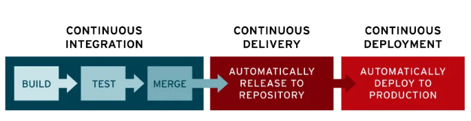
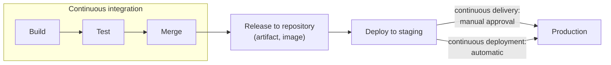
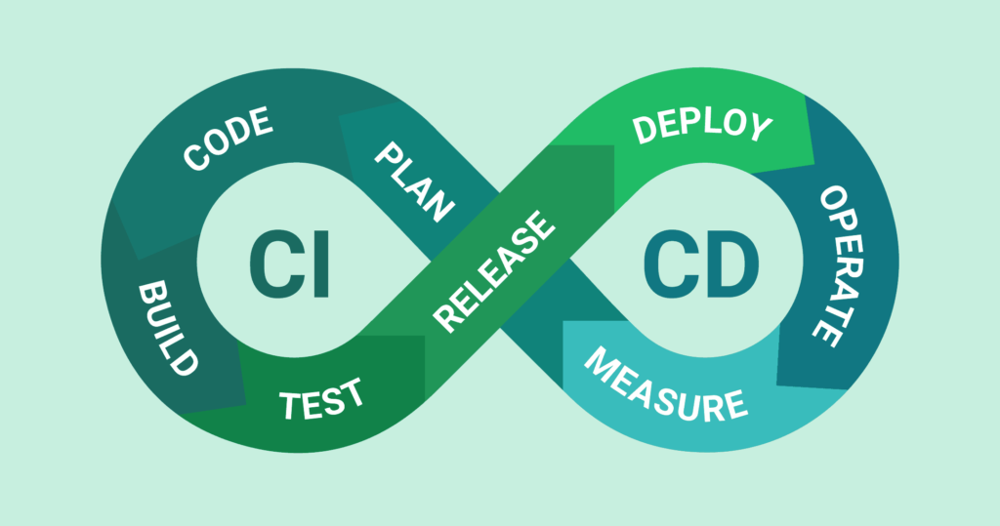
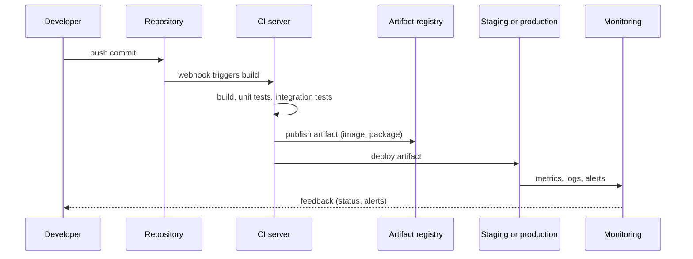

# CI/CD overview

## Summary

CI/CD is the automated path from a code change to running software. *Continuous integration* (CI) merges every developer's work into a shared branch many times a day and verifies each merge with an automated build and tests. *Continuous delivery* keeps the result always releasable and pushes it to a repository or staging environment, with a manual decision for production. *Continuous deployment* removes that last manual step, so every change that passes the pipeline goes to production automatically. Together they replace big, risky releases with a stream of small, verified changes.

## Prerequisites

- [DevOps overview](../foundations/devops-overview.md) for the lifecycle and the DORA metrics.
- Basic familiarity with Git (commits, branches, merges).

## Core concepts

### The problem CI/CD solves

Without CI, developers work on long-lived branches and integrate at the end of a project. The merge then surfaces weeks of conflicting changes at once ("integration hell"), and nobody knows whether the combined code builds, let alone works. Without CD, releasing is a manual, error-prone procedure performed rarely, so each release carries many changes and much risk. CI/CD makes integration and release so frequent and so automated that each one is small, boring and easy to undo.

*Analogy.* CI is like washing dishes after every meal instead of once a week: each wash is quick and nothing sticks. CD is having the clean dishes always on the shelf, ready to serve. Continuous deployment is a restaurant where every cooked plate goes straight to the guest without the chef's final look, which only works if the kitchen checks are excellent. The analogy breaks because dishes do not depend on each other, while code changes do; that dependency is exactly why integrating often matters.

### Definitions

- **Continuous integration (CI).** A development practice in which developers integrate code into a shared repository frequently, often several times a day. Each integration triggers an automated build and test process to detect issues early.
- **Continuous delivery.** Every change that passes CI is automatically built into a release candidate and delivered to a repository or staging environment. The codebase is always deployable; deployment to production requires a manual approval.
- **Continuous deployment.** The automated deployment of every change that passes the pipeline to production. It emphasizes automation and minimizes human intervention.

The figure below shows the three stages as one chain: CI builds, tests and merges, continuous delivery releases to a repository, continuous deployment deploys to production.



The same chain as a diagram, with the one difference between delivery and deployment marked:



CI and CD are often drawn on the DevOps infinity loop: plan, code, build and test on the CI side, then release, deploy, operate and measure on the CD side.



### Benefits

- **Reduced time to market.** Speeds up development and deployment and enables rapid iteration.
- **Higher quality.** Automated tests catch bugs earlier in the development cycle, close to the change that caused them.
- **Improved collaboration.** Teamwork and communication between developers and operations improve because everyone sees the same pipeline.
- **Lower risk.** Small, frequent changes are easier to test and to revert when something goes wrong.

### Continuous delivery in detail

Continuous delivery automates the release of validated code to a repository after successful builds, unit tests and integration tests in CI.

- **Automation.** Automates every stage from code merge to a production-ready build, including test automation (unit, integration and system tests) and release automation.
- **Role of operations.** Operations teams can deploy the application to production quickly and with minimal effort, because the artifact and the procedure are ready.
- **Visibility and communication.** Addresses poor visibility between development and business teams by keeping one codebase that is always ready to deploy; the business decides when to release.
- **Purpose.** The codebase is always deployable and deployment complexity is reduced.

How it works:

1. **Code testing.** Automated tests validate code changes.
2. **Repository upload.** Validated builds are uploaded to a repository (for example a package repository, GitHub releases or a container registry).
3. **Production readiness.** Code is kept in a state in which it can be deployed to production with minimal manual intervention.

### Continuous deployment in detail

Continuous deployment is the next step after continuous delivery: it automates the release of changes from the repository directly to production.

- **Extension of continuous delivery.** Automates the final stage of the pipeline, moving changes into production.
- **Automation benefits.** Reduces the manual workload of operations teams and speeds up the delivery of updates to users.
- **Feedback integration.** User feedback is incorporated faster because small, incremental changes are deployed.
- **Risk reduction.** Deployments are smaller and more frequent, so issues are easier to identify and fix.

How it works:

1. **Test automation.** Validates that code changes meet quality standards.
2. **Live deployment.** Changes go live within minutes once they pass the automated tests.
3. **User availability.** Updates are immediately available to users (or to a fraction of them, see release strategies below).

Challenges:

- **No manual gates.** Requires well-designed automated tests, because nothing else stops a bad change.
- **High initial investment.** Extensive test automation increases upfront cost and development effort.

### Continuous delivery compared with continuous deployment

| Aspect | Continuous delivery | Continuous deployment |
| --- | --- | --- |
| Automation scope | Up to a build that is ready for deployment | The entire process, including deployment to production |
| Deployment control | Manual approval before production | Fully automated, no manual intervention |
| Testing requirements | Automated tests plus an optional final manual review | Comprehensive automated tests, no manual checks |
| Speed of deployment | Fast, but can be delayed by manual gates | Changes often go live within minutes |
| Risk level | Lower per release because of the manual check | Higher if the automated tests are weak |

The risk row needs care: the manual gate in continuous delivery lowers risk only if the reviewer can actually judge the change. In practice, DORA research associates deployment automation with better stability, not worse, as long as test automation and monitoring are strong.

### Core principles

1. **Automation.** Automate building, testing and deploying to eliminate repetitive tasks and reduce human error.
2. **Small, frequent changes.** Small, incremental changes give faster feedback and smaller blast radius.
3. **Fast feedback.** Developers get immediate feedback on code quality from test results and build status. A CI build should finish in about ten minutes; slower builds are run less often and ignored more.
4. **Version control.** A version control system (for example Git) tracks changes and manages integrations. Pipeline definitions are versioned too ("pipeline as code").
5. **Collaboration.** Shared repositories, clear workflows and transparent processes.
6. **Build once, deploy many.** The same artifact moves through every environment; only configuration changes. Rebuilding per environment means production runs something that was never tested.

### Key components

1. **Source code repository.** Stores the codebase and tracks changes (for example Git hosted on GitHub, GitLab or Bitbucket).
2. **Build automation tool or CI server.** Turns code into executable artifacts (for example Jenkins, GitHub Actions, Azure DevOps).
3. **Testing frameworks.** Automated tests that validate changes (for example Selenium, JUnit, pytest).
4. **Artifact repository.** Stores versioned build outputs (container registry, package repository).
5. **Deployment automation tools.** Deploy builds to staging and production (for example Ansible, Kubernetes, Docker, Argo CD).
6. **Monitoring and feedback.** Tools that monitor deployments and report back (for example Prometheus, Grafana).

### Typical workflow

The sequence below follows one commit through a pipeline.



1. **Code commit.** Developers push changes to the repository.
2. **Build trigger.** The CI server detects the change (webhook or polling) and starts the build.
3. **Automated testing.** Unit, integration and system tests verify functionality.
4. **Artifact creation.** The pipeline produces deployment-ready artifacts (for example Docker images or WAR files).
5. **Deployment.** The artifact is deployed to staging or production automatically.
6. **Feedback.** Deployment status, logs, metrics and alerts flow back to the team.

### Release strategies

Continuous deployment is safe only when a bad change reaches few users and is quickly undone. Common strategies:

| Strategy | How it works | Rollback |
| --- | --- | --- |
| Rolling | Replace instances in batches | Roll forward or redeploy the previous version |
| Blue-green | Run the new version beside the old one, switch traffic at once | Switch traffic back |
| Canary | Send a small share of traffic (for example 5 percent) to the new version and widen it while metrics stay healthy | Send all traffic back to the old version |
| Feature flags | Deploy code switched off, enable it per user group at runtime | Turn the flag off |

### Tools

- **Jenkins.** A highly customizable open source automation server. See [Jenkins](jenkins.md).
- **GitHub Actions.** CI/CD integrated in GitHub repositories.
- **GitLab CI/CD.** CI/CD built into GitLab.
- **CircleCI.** A cloud-based CI/CD service with container support.
- **Azure DevOps (Pipelines).** CI/CD pipelines for the Azure ecosystem and beyond.
- **Argo CD.** A GitOps-based tool for Kubernetes deployments. See [GitOps](gitops.md).

## Worked example

A minimal pipeline for a Python service in GitHub Actions syntax. It runs tests on every push and pull request, builds a container image once, and deploys only from the `main` branch. Untested; the deploy step is a placeholder.

```yaml
# .github/workflows/ci.yml
name: ci
on:
  push:
    branches: [main]
  pull_request:

jobs:
  test:
    runs-on: ubuntu-24.04
    steps:
      - uses: actions/checkout@v4
      - uses: actions/setup-python@v5
        with:
          python-version: "3.12"
      - run: pip install -r requirements.txt
      - run: pytest -q            # fail fast: no artifact is built when tests fail

  build:
    needs: test
    runs-on: ubuntu-24.04
    steps:
      - uses: actions/checkout@v4
      # tag with the commit SHA so the same image is promoted through all environments
      - run: docker build -t registry.example.com/shop/api:${{ github.sha }} .
      - run: docker push registry.example.com/shop/api:${{ github.sha }}

  deploy:
    needs: build
    if: github.ref == 'refs/heads/main'
    runs-on: ubuntu-24.04
    environment: production      # an environment with required reviewers turns this into continuous delivery
    steps:
      - run: ./deploy.sh registry.example.com/shop/api:${{ github.sha }}
```

Expected behavior:

- A pull request runs `test` and `build`, but not `deploy`.
- A merge to `main` runs all three jobs. Without required reviewers on the `production` environment, this is continuous deployment; with them, the pipeline pauses for approval, which is continuous delivery.
- A failing test stops the pipeline before an image is built, so a broken change never reaches the registry.

## Trade offs and when to use it

- **CI is almost always worth it.** The cost is a build server and a test suite; the benefit is that integration problems appear within minutes.
- **Continuous delivery fits most teams.** It keeps a human decision for production, useful when releases are tied to business events, contracts or regulations.
- **Continuous deployment needs maturity.** It requires strong automated tests, monitoring and fast rollback (canary releases, feature flags). Without them it ships failures faster.
- **Pipeline cost.** Pipelines are software: they need maintenance, security patches and ownership. A slow or flaky pipeline erodes trust and people start bypassing it.
- **Alternatives.** Pull-based delivery ([GitOps](gitops.md)) replaces the deploy step of a push pipeline with an agent in the target environment.

## Common mistakes

- **Long-lived feature branches with a CI server.** Running CI on a branch that merges once a month is not continuous integration. Fix: merge to the main branch at least daily (trunk-based development), hide unfinished work behind feature flags.
- **Rebuilding the artifact per environment.** Production then runs an untested build. Fix: build once, tag with the commit SHA, promote the same artifact.
- **Ignoring flaky tests.** Teams learn to rerun until green, and real failures slip through. Fix: quarantine and fix flaky tests, track the flake rate.
- **Secrets in pipeline definitions.** Credentials end up in the repository or in logs. Fix: use the secret store of the CI system or an external vault (see [Secrets management](../devsecops/secrets-management.md)).
- **No rollback plan.** Fix: practice rollbacks and prefer strategies with instant rollback (blue-green, flags).

## Practice

1. What is the single difference between continuous delivery and continuous deployment?
2. Why should the artifact deployed to production be the same one that was tested in staging?
3. A team has a CI server but merges feature branches once every two weeks. Are they practicing CI? Why?
4. Which release strategy gives the fastest rollback for a change that touches the user interface only for some customers?

Answers:

1. Whether deployment to production needs a manual approval (delivery) or happens automatically (deployment).
2. A rebuilt artifact can differ (dependency versions, build flags), so the tests no longer prove anything about what runs in production.
3. No. CI means integrating into the shared branch frequently, at least daily; a build server alone does not prevent integration problems.
4. Feature flags: turning the flag off removes the change without a deployment.

## Further reading

- *Continuous Delivery* (Jez Humble, David Farley, Addison-Wesley, 2010): the book that defined the deployment pipeline.
- [Continuous Integration](https://martinfowler.com/articles/continuousIntegration.html) (Martin Fowler, revised 2024): the canonical description of CI practices.
- [DORA capability: continuous delivery](https://dora.dev/capabilities/continuous-delivery/) (DORA): what the research says about continuous delivery and its effect on performance.
- [GitHub Actions documentation](https://docs.github.com/en/actions) (GitHub): reference for the syntax used in the worked example.
