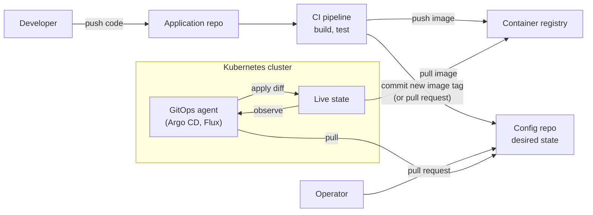
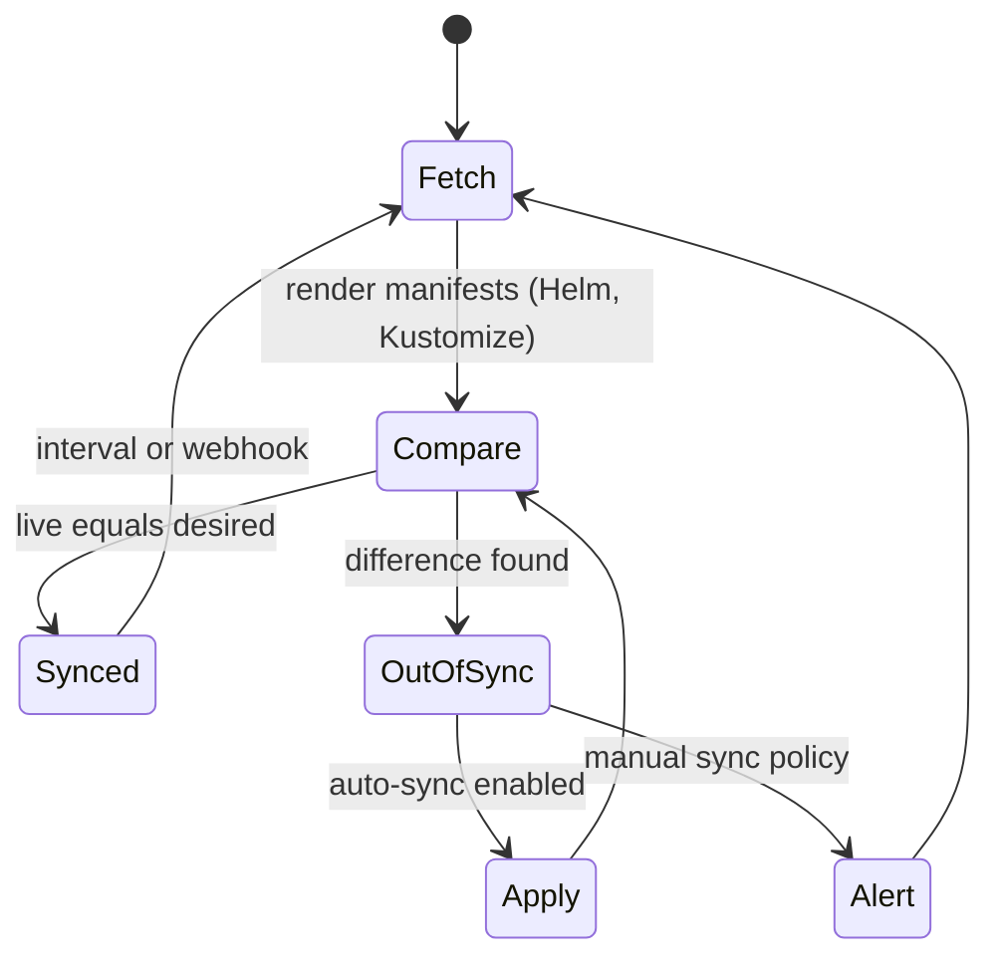

# GitOps

## Summary

GitOps is an approach to continuous deployment in which a Git repository is the single source of truth for the desired state of applications and infrastructure. The desired state is written declaratively (for example Kubernetes YAML), and an agent running next to the target system continuously pulls it from Git and reconciles the live system to match. A deployment is therefore a Git commit, a rollback is a `git revert`, and the Git history is the audit log. GitOps combines the principles of infrastructure as code with Git's review and versioning workflow.

## Prerequisites

- [CI/CD overview](ci-cd-overview.md) for push-based pipelines, which GitOps changes.
- [Infrastructure as code](../infrastructure-as-code/infrastructure-as-code-overview.md) for declarative definitions and drift.
- Basic Kubernetes objects (Deployment, Service, namespace), because most GitOps tools target Kubernetes.

## Core concepts

### The problem GitOps solves

In a push-based pipeline, the CI server holds credentials to production and runs `kubectl apply` or a deploy script. Three problems follow. The CI server becomes a high-value target with access to every environment. Nobody notices when someone changes production by hand, because the pipeline only acts when it runs. And the real state of production is wherever the last script left it, not something you can read in one place. GitOps moves the deploy step into the target environment and makes it continuous: an agent compares Git with reality all the time and corrects differences.

*Analogy.* A thermostat. You set the desired temperature (the commit), and the thermostat keeps measuring and heating or cooling until the room matches, also when someone opens a window (drift). You never tell the heater "run for ten minutes". The analogy breaks for irreversible actions: a thermostat can always correct, but a database migration or deleted data cannot simply be reconciled back.

### Definition and principles

The OpenGitOps project of the CNCF defines four principles (version 1.0.0). The original four principles below match them:

1. **Declarative infrastructure and application definitions.** The desired state is expressed declaratively (for example YAML or JSON), not as a sequence of commands.
2. **Version control as the single source of truth.** All configuration is stored in Git, which gives tracking, auditing and collaboration; the stored state is versioned and immutable.
3. **Pull-based deployments.** Agents pull updates from the repository and apply them, instead of a pipeline pushing them; this reduces manual intervention and the credentials stored outside the cluster.
4. **Automated, continuous synchronization.** Continuous reconciliation keeps the deployed state equal to the desired state in Git.

### How it works

1. **Write the desired state.** Define application and infrastructure configuration in a Git repository.
2. **Commit and push changes.** A commit (usually through a reviewed pull request) changes the desired state; CI pipelines may validate it.
3. **Reconcile the state.** A GitOps agent (for example Flux or Argo CD) monitors the repository. When the deployed state drifts from the desired state, the agent reconciles it automatically.
4. **Monitor and observe.** Observability tools confirm that the deployed system works as expected.

The diagram shows the two loops: CI builds images and updates the configuration repository, and the agent in the cluster pulls and reconciles. Note that no arrow goes from CI into the cluster.



### Workflow

1. A developer changes the configuration (for example adds a new service or bumps an image tag).
2. The change is committed to the Git repository, usually through a pull request.
3. CI pipelines or GitOps agents detect the change.
4. The GitOps tool deploys the change to the target environment (for example a Kubernetes cluster).
5. Monitoring verifies that the system matches the desired state and works.

### Reconciliation loop

The reconciliation loop is the mechanism that makes GitOps different from "deploy from Git". It is the same control loop that Kubernetes controllers use:



Argo CD calls the two states `Synced` and `OutOfSync`; with *self-heal* enabled it also reverts manual changes made directly in the cluster.

### Benefits

1. **Simplified CI/CD.** Deployments and rollbacks are driven by Git commits.
2. **Enhanced security.** Git provides an auditable history of all changes. Pull-based deployment means the CI system does not need cluster credentials, so fewer secrets are exposed.
3. **Consistency and reliability.** Declarative configuration removes differences between environments.
4. **Collaboration.** Git branching and pull request workflows apply to operations changes.
5. **Faster rollbacks.** Reverting to a previous commit rolls back the change.

### GitOps compared with traditional CI/CD

| Aspect | Traditional CI/CD | GitOps |
| --- | --- | --- |
| Trigger | Push-based pipelines | Pull-based reconciliation |
| Source of truth | Pipelines and their configuration | Git repository |
| Security | The pipeline holds credentials to the target | The agent inside the target pulls; changes go through pull requests |
| Deployment | Manual approvals and scripts | Automated from Git commits |
| Drift | Undetected until the next run | Detected and optionally corrected continuously |

### Challenges

1. **Learning curve.** Teams must adapt to new tools and to doing operations through pull requests.
2. **Complexity in large systems.** Configuration for many services, environments and clusters becomes hard to organize (repository layout, templating, promotion between environments).
3. **Drift management.** Keeping synchronization in dynamic environments is hard, for example when autoscalers change replica counts that are also in Git.
4. **Tool compatibility.** Integrating GitOps with existing CI/CD pipelines needs planning (who updates image tags, how promotion works).
5. **Secrets.** Plain secrets cannot be stored in Git; you need sealed or external secrets.

### Key tools

- **Argo CD.** A Kubernetes-native GitOps continuous delivery tool (CNCF graduated). Declarative configuration, a web UI for managing applications, automated drift detection and reconciliation.
- **Flux (FluxCD).** An open source GitOps toolkit for Kubernetes (CNCF graduated). Continuous delivery and automated synchronization, Helm and Kustomize support, multi-tenancy support, image update automation.
- **Jenkins X.** A CI/CD platform for Kubernetes with GitOps at its core, focused on Kubernetes deployments.
- **Terraform with GitOps.** Terraform provisions infrastructure while GitOps workflows manage configuration. Terraform itself is push-based; tools such as Atlantis, HCP Terraform VCS-driven runs or the Flux Terraform controller give it a Git-driven workflow.

### GitOps in Kubernetes

GitOps is most popular on Kubernetes because the Kubernetes API is already declarative and reconciling. Kubernetes manifests fit GitOps principles directly and allow:

1. **Deployment of applications.** Git repositories store the Kubernetes manifests (raw YAML, Helm charts, Kustomize overlays).
2. **Cluster management.** Cluster configuration and resources (namespaces, RBAC policies, network policies, CRDs) are managed the same way.
3. **Disaster recovery.** A cluster can be recreated from scratch with the Git repository as the source of truth (data in persistent volumes needs separate backups).

### Use cases

1. **Continuous deployment** of applications and infrastructure across environments.
2. **Multi-cluster management** of many Kubernetes clusters from one repository.
3. **Disaster recovery** by recreating infrastructure from the commits in Git.
4. **Compliance and auditing** with the Git log as the change record.

## Worked example

An Argo CD `Application` that keeps the `shop` namespace in sync with a Kustomize overlay in Git. Untested; checked against the Argo CD documentation, 2026-11.

```yaml
apiVersion: argoproj.io/v1alpha1
kind: Application
metadata:
  name: shop-production
  namespace: argocd
spec:
  project: default
  source:
    repoURL: https://git.example.com/platform/shop-config.git
    targetRevision: main
    path: overlays/production          # Kustomize overlay for this environment
  destination:
    server: https://kubernetes.default.svc
    namespace: shop
  syncPolicy:
    automated:
      prune: true      # delete objects that were removed from Git
      selfHeal: true   # revert manual changes made with kubectl
    syncOptions:
      - CreateNamespace=true
```

What happens:

1. CI builds `shop/api:3f2a9c1` and opens a pull request that changes the image tag in `overlays/production/kustomization.yaml`.
2. After review and merge, Argo CD detects the new commit (polling, by default every three minutes, or a webhook), renders the overlay and finds the Deployment `OutOfSync`.
3. Argo CD applies the diff; Kubernetes performs a rolling update.
4. If someone runs `kubectl scale deployment api --replicas=10` by hand, self-heal sets the replicas back to the value in Git within the next reconciliation.
5. Rollback: `git revert` of the merge commit; Argo CD applies the previous tag.

## Trade offs and when to use it

- **Use GitOps** when the target exposes a declarative, reconcilable API (Kubernetes, and through controllers also cloud resources) and you want audited, reviewable changes.
- **It is a poor fit** for imperative, one-off operations (database migrations, data fixes) and for systems without a declarative API. Keep those in pipelines or jobs.
- **Repository layout is a design decision.** Separate application code from configuration repositories, so CI commits to configuration do not trigger application builds in a loop.
- **Promotion between environments** (dev to staging to production) is not defined by GitOps itself. Common choices are one directory per environment, one branch per environment (discouraged by most tool authors because branches drift) or a promotion tool.

## Common mistakes

- **Storing secrets in plain text in Git.** Fix: Sealed Secrets, SOPS or the External Secrets Operator with a vault (see [Secrets management](../devsecops/secrets-management.md)).
- **Fighting the autoscaler.** Git sets `replicas: 3`, the Horizontal Pod Autoscaler sets 8, and self-heal resets it. Fix: omit `replicas` from Git for autoscaled workloads or tell the tool to ignore that field.
- **Treating GitOps as "a pipeline that runs `kubectl apply`".** Without continuous reconciliation, drift goes unnoticed. Fix: run an agent with drift detection.
- **One branch per environment.** Branches diverge and merges between them become manual. Fix: directories or overlays per environment on one branch.

## Practice

1. Which component holds credentials to the cluster in a push pipeline, and which in GitOps?
2. What does self-heal do, and when can it cause trouble?
3. Why is `git revert` a rollback in GitOps but not necessarily in a push pipeline?
4. Name two kinds of change that GitOps handles poorly.

Answers:

1. The CI server in a push pipeline; the agent inside the cluster in GitOps.
2. It reverts live changes that differ from Git. It causes trouble when another controller (for example an autoscaler) legitimately changes a field that is also defined in Git.
3. In GitOps the agent continuously applies whatever Git says, so the reverted state is applied automatically. In a push pipeline, a revert only takes effect if the pipeline runs and deploys it.
4. Imperative one-off operations such as database migrations, and secrets, which cannot be stored in plain text.

## Further reading

- [OpenGitOps principles](https://opengitops.dev/) (OpenGitOps, CNCF, version 1.0.0): the vendor neutral definition of GitOps.
- [Argo CD documentation](https://argo-cd.readthedocs.io/) (Argo Project): the Application resource, sync policies and self-heal.
- [Flux documentation](https://fluxcd.io/flux/) (Flux project): the GitOps toolkit controllers, image automation and multi-tenancy.
- [Guide to GitOps](https://www.weave.works/technologies/gitops/) (Weaveworks, 2017 onward): the original description by the company that coined the term; the company closed in 2024, so the page may move.
