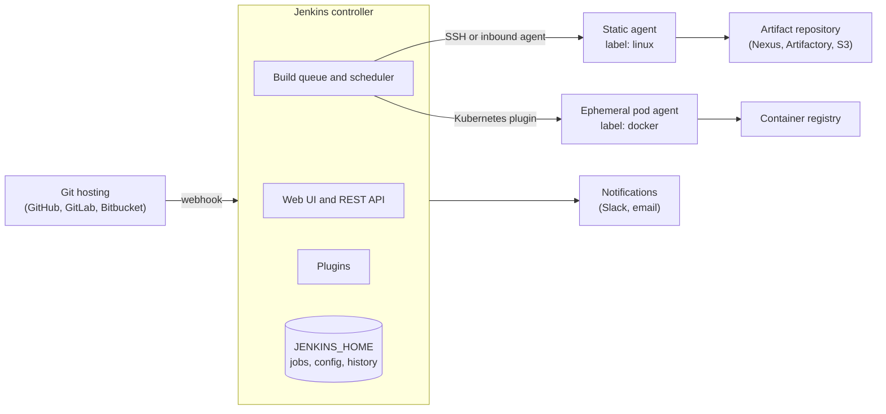

# Jenkins

## Summary

Jenkins is an open source automation server written in Java and one of the most widely used tools for continuous integration (CI) and continuous delivery (CD). It runs *jobs* (automated tasks such as builds, tests and deployments), usually defined as *pipelines* in a `Jenkinsfile` stored next to the code. A central *controller* schedules the work and *agents* on other machines or containers execute it. Its strength is flexibility through a very large plugin ecosystem; its weakness is the effort needed to operate, secure and upgrade it.

## Prerequisites

- [CI/CD overview](ci-cd-overview.md) for the concepts Jenkins implements.
- Basic Git and shell scripting ([Bash](../operating-systems/shell-and-terminal/bash.md)).

## Core concepts

### Purpose

Jenkins is used for:

- **Automating repetitive tasks** such as builds, tests and deployments.
- **Continuous integration** by testing each code change automatically and integrating it into the main codebase.
- **Continuous deployment** by deploying applications automatically after successful tests.
- **Infrastructure as code execution** by running automation tools such as Ansible or Terraform.
- **Monitoring and alerting** through integrations with tools such as Prometheus and Grafana (Jenkins exposes its own metrics with the Prometheus plugin).

*Analogy.* Jenkins is a factory foreman. The foreman (controller) reads the work orders (Jenkinsfiles), assigns each one to a free workstation (agent) that has the right tools (labels), and keeps the records (build history, artifacts, logs). The analogy breaks on state: a real foreman forgets nothing when restarted, while a Jenkins controller keeps its configuration and history on its disk (`JENKINS_HOME`), which must be backed up.

### Architecture

The diagram shows the controller, its agents and the systems around it.



- **Controller** (called *master* before 2020). Handles job scheduling, plugin management, the UI and the API. Builds should not run on the controller itself: its executors are set to zero in hardened setups, because a build on the controller can read `JENKINS_HOME`, including credentials.
- **Agent** (worker node). Executes jobs, builds and tests on separate machines. Agents connect over SSH (controller to agent) or as inbound agents (agent to controller over TCP or WebSocket). With the Kubernetes or Docker plugins, agents are ephemeral containers created per build.
- **Executor.** A slot on an agent that runs one build at a time.
- **Label.** A tag on agents (`linux`, `docker`, `gpu`) that pipelines request with `agent { label 'linux' }`.

This distributed build system scales across many machines and reduces the load on a single Jenkins instance.

### Jobs

A *job* (or project) is the fundamental unit in Jenkins: an automated task such as compiling code, running tests or deploying an application. Each execution of a job is a *build* with a number, a log and a result.

Types of jobs:

- **Freestyle project.** A basic job whose steps are defined in the UI. Easy to start, but not versioned.
- **Pipeline project.** A workflow defined as code in a `Jenkinsfile`.
- **Multibranch pipeline.** Discovers branches (and pull requests) in a repository and creates a pipeline job for each branch that has a `Jenkinsfile`.
- **Folder.** Organizes jobs hierarchically; folders can also scope credentials and permissions.
- **Organization folder.** Scans a whole GitHub organization or Bitbucket project and creates multibranch pipelines for every repository.

### Pipelines and the Jenkinsfile

A *Jenkins pipeline* defines the CI/CD workflow as code. A `Jenkinsfile` is the text file that contains it, versioned with the source code.

Benefits of a Jenkinsfile:

- **Pipeline as code.** The CI/CD workflow is version controlled and reviewed like code.
- **Portability.** The same file works in different Jenkins instances and environments.
- **Consistency.** Builds are standardized across branches and teams.

There are two syntaxes:

**Declarative pipeline** (recommended). A structured, easier-to-read syntax with a fixed shape (`pipeline`, `agent`, `stages`, `steps`, `post`). Jenkins validates it before running.

```groovy
pipeline {
    agent any
    stages {
        stage('Build') {
            steps {
                echo 'Building...'
            }
        }
        stage('Test') {
            steps {
                echo 'Testing...'
            }
        }
        stage('Deploy') {
            steps {
                echo 'Deploying...'
            }
        }
    }
}
```

**Scripted pipeline.** Plain Groovy code in a `node` block, offering more flexibility (loops, conditionals, arbitrary logic) at the cost of complexity.

```groovy
node {
    stage('Build') {
        echo 'Building...'
    }
    stage('Test') {
        echo 'Testing...'
    }
    stage('Deploy') {
        echo 'Deploying...'
    }
}
```

Both run on the same engine. Declarative pipelines can embed scripted code in a `script { }` block when needed. Common logic shared across many repositories goes into a *shared library* (a separate Git repository with Groovy code loaded with `@Library`).

### Plugins

Jenkins is plugin-based: almost every feature, including pipelines and Git support, is a plugin. The plugin index lists more than 1,800 plugins (checked 2026-11; the exact number changes).

| Plugin | Purpose |
| --- | --- |
| Git | Integrates with Git repositories |
| Docker Pipeline | Builds and runs containers from pipelines |
| Kubernetes | Runs agents as pods in Kubernetes |
| Blue Ocean | A pipeline UI; no longer receives new features, the classic UI and the Pipeline Graph View plugin replace it |
| SonarQube Scanner | Code quality analysis |
| Configuration as Code (JCasC) | Defines the whole Jenkins configuration in YAML |
| Credentials Binding | Exposes stored credentials to builds as variables or files |

### Triggers

Jenkins can start builds:

- **Webhooks** from GitHub, GitLab or Bitbucket (preferred: immediate and cheap).
- **Cron schedules** (`triggers { cron('H 2 * * *') }`; `H` spreads jobs over time to avoid load spikes).
- **Polling SCM** (checking the repository for changes at intervals; wasteful at scale).
- **Manual execution** (on demand, optionally with parameters).
- **Upstream jobs** (one job triggers another).

### Credentials and security

Jenkins stores credentials (encrypted on the controller disk) for authentication and API access.

Credential types:

- Username and password
- SSH private keys
- API tokens and secret text
- Secret files and certificates

Practices:

- Store credentials in the Jenkins credentials store or, better, an external secrets manager through a plugin (for example HashiCorp Vault).
- Never hardcode secrets in Jenkinsfiles; bind them only for the steps that need them with `withCredentials`, which also masks them in logs.
- Restrict access with role-based authorization and folder-level credentials.

### Artifacts and storage

Builds produce artifacts: compiled binaries, logs, test reports and container images. They can be stored in:

- **The Jenkins workspace or build archive** (local storage on the controller; fine for small reports, bad for large binaries).
- **Artifact repositories** (for example Nexus or Artifactory).
- **Cloud storage** (for example Amazon S3 or Azure Blob Storage).
- **Container registries** for images (Jenkins builds and pushes them; it does not store them itself).

### Advantages

- **Open source and free.** CI/CD without license costs.
- **Extensive plugin ecosystem.** Integrations with Docker, Kubernetes, Terraform, Prometheus, Slack, Jira and many others.
- **Platform independent.** Runs on Windows, Linux and macOS, and in containers (Docker, Kubernetes).
- **Scalability.** Distributed builds across many agents through the controller-agent architecture.
- **Flexibility and customization.** Groovy scripting enables advanced pipeline logic.
- **Active community.** Wide adoption means plenty of documentation, answers and plugins.

### Disadvantages

- **Steep learning curve.** Groovy-based pipeline syntax, plugin choice and best practices take time to learn.
- **Complex setup and maintenance.** Installing, configuring, upgrading and backing up Jenkins, especially at scale, takes significant effort.
- **Performance with large workloads.** A single controller hits limits with thousands of jobs; the usual answer is several controllers and ephemeral agents.
- **Plugin dependencies and compatibility.** Plugin updates can break each other or the core.
- **Security risks.** A powerful automation server with credentials to many systems; misconfiguration or outdated plugins expose it. Jenkins publishes security advisories for core and plugins regularly.

## Worked example

A declarative pipeline for a containerized service. It runs in a Kubernetes pod agent, tests, builds and pushes an image tagged with the commit, and asks for approval before production. Untested; written against Jenkins LTS 2.4xx with the Kubernetes, Docker Pipeline and Credentials Binding plugins, checked 2026-11.

```groovy
pipeline {
    agent {
        kubernetes {
            // one pod per build: a clean environment every time
            yaml '''
              spec:
                containers:
                - name: python
                  image: python:3.12-slim
                  command: ["sleep", "infinity"]
                - name: kaniko
                  image: gcr.io/kaniko-project/executor:debug
                  command: ["sleep", "infinity"]
            '''
        }
    }
    options {
        timeout(time: 30, unit: 'MINUTES')   // a hung build must not hold an agent forever
        buildDiscarder(logRotator(numToKeepStr: '50'))
    }
    environment {
        IMAGE = "registry.example.com/shop/api:${env.GIT_COMMIT.take(7)}"
    }
    stages {
        stage('Test') {
            steps {
                container('python') {
                    sh 'pip install -r requirements.txt && pytest --junitxml=report.xml'
                }
            }
            post { always { junit 'report.xml' } }
        }
        stage('Build image') {
            steps {
                container('kaniko') {
                    // kaniko builds without a Docker daemon, so the pod needs no privileged mode
                    sh '/kaniko/executor --context . --destination ${IMAGE}'
                }
            }
        }
        stage('Deploy to production') {
            when { branch 'main' }
            steps {
                input message: "Deploy ${IMAGE} to production?"   // continuous delivery gate
                withCredentials([string(credentialsId: 'deploy-token', variable: 'TOKEN')]) {
                    sh './deploy.sh "$IMAGE"'   // single quotes: the shell, not Groovy, expands the secret
                }
            }
        }
    }
    post {
        failure { echo "Build failed: ${env.BUILD_URL}" }
    }
}
```

Expected behavior: feature branches stop after `Build image`; `main` waits at the `input` step until someone approves. The secret is masked as `****` in the log. Using double quotes around `$TOKEN` in Groovy would interpolate the secret into the command string, which Jenkins warns about because it can leak into process listings.

## Trade offs and when to use it

- **Choose Jenkins** when you need self-hosting, unusual integrations, complex pipelines across many repositories, or builds on special hardware.
- **Choose a hosted or integrated CI** (GitHub Actions, GitLab CI/CD, CircleCI, Azure Pipelines) when your code already lives on that platform and you want little operational work.
- **Operational cost.** Plan for upgrades of core and plugins, backups of `JENKINS_HOME`, security advisories and capacity. Configuration as Code and ephemeral agents reduce this cost.
- **Jenkins X** is a separate project for Kubernetes GitOps, not a newer Jenkins version.

## Common mistakes

- **Running builds on the controller.** A build can read every stored credential. Fix: set controller executors to 0 and use agents.
- **Configuring jobs only in the UI.** The configuration is lost or drifts. Fix: Jenkinsfiles in Git plus Jenkins Configuration as Code for the server.
- **Installing many plugins and never updating them.** Fix: keep a minimal plugin list, pin it (for example in a custom image with `jenkins-plugin-cli`), update regularly after reading the security advisories.
- **Interpolating secrets in Groovy strings.** Fix: pass secrets as environment variables and reference them in single-quoted shell strings.
- **Polling SCM for hundreds of jobs.** Fix: webhooks.

## Practice

1. Why should the controller have zero executors?
2. What is the difference between a multibranch pipeline and a pipeline job?
3. Declarative or scripted: which one is validated before execution, and which allows arbitrary Groovy?
4. Where should a 2 GB build artifact be stored, and why not in Jenkins itself?

Answers:

1. A build that runs on the controller has access to `JENKINS_HOME`, which contains configuration and encrypted credentials, so a malicious or buggy build could compromise all of Jenkins.
2. A pipeline job runs one Jenkinsfile from one branch; a multibranch pipeline discovers branches and pull requests and creates a job for each automatically.
3. Declarative is validated first; scripted allows arbitrary Groovy.
4. In an artifact repository or object storage. Archiving large artifacts on the controller fills its disk and slows backups.

## Further reading

- [Jenkins User Documentation](https://www.jenkins.io/doc/) (Jenkins project): the official guide to pipelines, agents and administration.
- [Pipeline syntax](https://www.jenkins.io/doc/book/pipeline/syntax/) (Jenkins project): the reference for declarative and scripted pipelines.
- [Securing Jenkins](https://www.jenkins.io/doc/book/security/) (Jenkins project): controller isolation, access control and credentials.
- [Jenkins security advisories](https://www.jenkins.io/security/advisories/) (Jenkins project): the list to follow for core and plugin vulnerabilities.
- [Jenkins plugin index](https://plugins.jenkins.io/) (Jenkins project): search and health scores for plugins.
