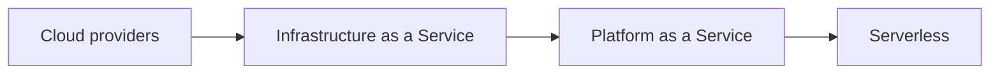

# Cloud computing

Cloud providers and service models: what the cloud is, IaaS, PaaS and serverless, and how responsibility is shared.

Provider-specific depth lives in the separate cloud knowledge repositories (for example `google-cloud-knowledge`).

## Map of the area

The diagram shows the notes in reading order; subareas are marked with (subarea).

## Notes in reading order

1. [Cloud providers](cloud-providers.md): NIST definition, service models, shared responsibility and the major providers.
2. [Infrastructure as a Service](iaas.md): characteristics, components, use cases and challenges.
3. [Platform as a Service](paas.md): characteristics, components, providers and challenges.
4. [Serverless](serverless.md): FaaS, serverless architecture, cold starts and cost.

## Planned topics

- SaaS
- Cloud cost management (FinOps)
- Multi-cloud and hybrid cloud
- Cloud design patterns
- Cloud landing zones and account structure
