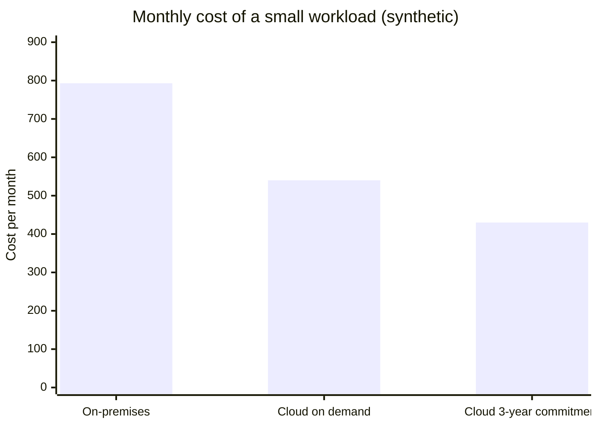

# Cloud providers

## Summary

A cloud provider is a company that offers computing resources and services (servers, storage, databases, networking, software) over the internet, on demand and paid by use. Customers rent capacity instead of buying and running data centers, which lets them scale quickly and pay operating rather than capital costs. Services come in layers of abstraction: infrastructure (IaaS), platforms (PaaS), software (SaaS) and serverless functions. Three hyperscalers (Amazon Web Services, Microsoft Azure, Google Cloud) dominate the market, followed by Oracle, IBM, Alibaba and many regional providers. Choosing among them is a trade off between service breadth, ecosystem fit, price, regions and the risk of lock-in.

## Prerequisites

- [Virtualization](../containers-and-virtualization/virtualization.md), the technology under almost every cloud service.

## Core concepts

### Definition of cloud computing

The most cited definition is NIST SP 800-145 (2011). Cloud computing is a model for convenient, on-demand network access to a shared pool of configurable computing resources that can be rapidly provisioned and released with minimal management effort or provider interaction. It names five essential characteristics:

1. **On-demand self-service.** Customers provision resources themselves, through a console or API, without human interaction with the provider.
2. **Broad network access.** Services are available over the network with standard mechanisms.
3. **Resource pooling.** The provider serves many customers (tenants) from shared resources, assigned dynamically.
4. **Rapid elasticity.** Capacity scales out and in quickly, often automatically, and appears unlimited.
5. **Measured service.** Usage is metered, which enables pay-per-use billing.

NIST also defines three service models (IaaS, PaaS, SaaS) and four deployment models: public, private, community and hybrid cloud.

*Analogy.* Electricity from the grid instead of a generator in the basement. You plug in, use as much as you need and pay per kilowatt-hour; the utility worries about power plants. The analogy breaks on portability: any appliance works with any power company, while software built on one cloud's proprietary services does not move easily to another.

### Types of cloud services

1. **Infrastructure as a Service (IaaS).** Virtualized computing resources over the internet: virtual machines, storage, networks. See [IaaS](iaas.md).
2. **Platform as a Service (PaaS).** A platform to build, deploy and manage applications: application hosting platforms, managed database systems. See [PaaS](paas.md).
3. **Software as a Service (SaaS).** Complete applications delivered over the internet, for example CRM tools such as Salesforce, or Microsoft 365.
4. **Function as a Service and serverless.** Code or containers run on demand without servers to manage. See [Serverless](serverless.md).

### The shared responsibility model

The higher the service model, the more the provider manages. Security and operations are split accordingly: the provider is responsible for the security *of* the cloud, the customer for security *in* the cloud. The diagram shows who manages which layer.

```mermaid
flowchart TB
  subgraph legend["Who manages each layer"]
    direction LR
    cust["Customer"]:::c
    prov["Provider"]:::p
  end
  subgraph onprem["On-premises"]
    o1["Data and access"]:::c --- o2["Application"]:::c --- o3["Runtime and middleware"]:::c --- o4["Operating system"]:::c --- o5["Virtualization"]:::c --- o6["Servers, storage, network"]:::c --- o7["Facility"]:::c
  end
  subgraph iaas["IaaS"]
    i1["Data and access"]:::c --- i2["Application"]:::c --- i3["Runtime and middleware"]:::c --- i4["Operating system"]:::c --- i5["Virtualization"]:::p --- i6["Servers, storage, network"]:::p --- i7["Facility"]:::p
  end
  subgraph paas["PaaS"]
    p1["Data and access"]:::c --- p2["Application"]:::c --- p3["Runtime and middleware"]:::p --- p4["Operating system"]:::p --- p5["Virtualization"]:::p --- p6["Servers, storage, network"]:::p --- p7["Facility"]:::p
  end
  subgraph saas["SaaS"]
    s1["Data and access"]:::c --- s2["Application"]:::p --- s3["Runtime and middleware"]:::p --- s4["Operating system"]:::p --- s5["Virtualization"]:::p --- s6["Servers, storage, network"]:::p --- s7["Facility"]:::p
  end
  classDef c fill:#fde2b8,stroke:#b8860b,color:#222
  classDef p fill:#cfe8ff,stroke:#2b6cb0,color:#222
```

Data and access management (who can read what) remain the customer's responsibility in every model.

### Advantages

1. **Cost efficiency.** Pay only for what you use and reduce capital expenditure.
2. **Scalability.** Scale resources up or down quickly with demand.
3. **Global reach.** Deploy close to users in data centers around the world.
4. **Reliability.** Built-in redundancy (multiple zones and regions) supports high availability.
5. **Security.** Providers offer strong security features and physical security that often exceed what one company can afford on-premises; using them correctly is still the customer's job.

### Disadvantages

1. **Vendor lock-in.** Proprietary services and APIs make switching providers hard.
2. **Downtime.** Provider outages are rare but can disrupt many services at once.
3. **Data privacy and sovereignty.** Data stored abroad or by a foreign company raises compliance questions (GDPR, sector regulations).
4. **Complex pricing.** Many pricing dimensions (compute, storage, requests, data transfer, especially egress) make costs hard to predict.
5. **Limited customization.** Some workloads need hardware or control that only on-premises gives.

### Major providers

**Amazon Web Services (AWS).** The largest and most widely adopted provider, launched in 2006, with the broadest portfolio across IaaS, PaaS and SaaS.

- Popular services: EC2 (virtual machines), S3 (object storage), RDS (relational databases), Lambda (serverless functions), CloudFormation (infrastructure as code).
- Advantages: an extensive portfolio for diverse industries; high scalability and flexibility for workloads of any size; a strong global presence with many regions and availability zones; good documentation and a large community; strong security and compliance offerings.
- Disadvantages: complex pricing with potential for unexpected costs; a steeper learning curve for beginners; the number of services can overwhelm users with simple needs.

**Microsoft Azure.** A fast-growing provider with strong enterprise integration, especially for organizations using Microsoft technologies.

- Popular services: Virtual Machines, Azure App Service, Azure Functions (serverless), Azure DevOps, Azure Cosmos DB.
- Advantages: integration with Microsoft products such as Microsoft 365 and Windows Server; hybrid cloud support (Azure Stack, Azure Arc); enterprise identity through Microsoft Entra ID (formerly Azure Active Directory); licensing discounts for existing Microsoft customers (Azure Hybrid Benefit).
- Disadvantages: several widely reported outages and security incidents in recent years; a portal that new users often find less intuitive; some services are less mature than their AWS counterparts.

**Google Cloud (Google Cloud Platform, GCP).** Known for data analytics, AI and machine learning, Kubernetes and its global network.

- Popular services: Compute Engine, BigQuery (data analytics), Google Kubernetes Engine (container orchestration), Cloud Run functions (formerly Cloud Functions), Cloud Storage.
- Advantages: strong data analytics and machine learning tools; strong support for containers (Google created Kubernetes); comparatively transparent pricing with automatic sustained-use discounts; a fast private global network with low latency.
- Disadvantages: a smaller global footprint and market share than AWS and Azure; a narrower portfolio for some general enterprise needs; fewer third-party integrations.

**IBM Cloud.** Focused on enterprise and regulated industries, hybrid cloud (Red Hat OpenShift) and AI.

- Popular services: watsonx (AI, successor of the Watson brand), Red Hat OpenShift on IBM Cloud, IBM Cloud for Financial Services. IBM Cloud Foundry (PaaS) and the IBM Blockchain Platform were part of the portfolio but have been deprecated (TODO: verify the end-of-support dates).
- Advantages: expertise in hybrid cloud and enterprise integration; AI capabilities; industry-tailored services for finance and healthcare.
- Disadvantages: a smaller market share; a smaller developer community; pricing that can be high for small businesses.

**Oracle Cloud Infrastructure (OCI).** Designed mainly for enterprise workloads, especially Oracle Database.

- Popular services: Oracle Autonomous Database, OCI Compute, Exadata Database Service.
- Advantages: optimized for Oracle Database applications; strong performance for enterprise workloads; competitive pricing, including low data egress fees, for database-heavy applications; multicloud database offerings inside AWS, Azure and Google Cloud data centers.
- Disadvantages: a smaller ecosystem and adoption; a strong focus on the Oracle ecosystem; a learning curve for non-Oracle users.

**Alibaba Cloud.** The leading provider in China and strong in Asia.

- Popular services: Elastic Compute Service (ECS), Object Storage Service (OSS), AnalyticDB.
- Advantages: strong presence and reliability in Asian markets; competitive compute and storage prices; a rich ecosystem for e-commerce and retail.
- Disadvantages: limited presence outside Asia; documentation and support that can be less comprehensive in English.

### Comparison of providers

| Provider | Strength | Weakness |
| --- | --- | --- |
| AWS | Broadest service range, global reach | Complex pricing, steep learning curve |
| Azure | Microsoft integration, hybrid cloud | Reported outages and incidents, less intuitive portal |
| Google Cloud | Data analytics, AI, Kubernetes, network | Smaller global presence and market share |
| IBM Cloud | Hybrid cloud and regulated industries | Small market share |
| Oracle Cloud | Oracle Database performance | Narrow ecosystem focus |
| Alibaba Cloud | Leader in China and Asia | Limited support outside Asia |

TODO: Add current market share figures with a dated source (for example Synergy Research Group or Gartner).

## Worked example

Comparing the monthly cost of one small web workload on-premises and in an IaaS cloud (synthetic, rounded numbers for illustration; real prices vary by provider, region and discounts and must be checked on the pricing pages).

| Cost item | On-premises (3-year amortization) | Cloud on demand | Cloud with 3-year commitment |
| --- | --- | --- | --- |
| Two servers | 2 x 6,000 / 36 = 333 | - | - |
| Two VMs, 4 vCPU and 16 GB each | - | 2 x 140 = 280 | 2 x 85 = 170 |
| Storage 1 TB | 40 | 80 | 80 |
| Data transfer out 2 TB | included in the internet line (100) | 2,000 GB x 0.09 = 180 | 180 |
| Power, space, cooling | 120 | - | - |
| Admin time for hardware | 200 | - | - |
| Total per month | 793 | 540 | 430 |

The lesson is not that the cloud is always cheaper: steady, large workloads can be cheaper on owned hardware, and egress fees can dominate for data-heavy applications. The cloud's main financial benefit is elasticity: paying for peaks only while they last and not buying hardware for growth that may never come.

## Trade offs and when to use it

- **Single provider** keeps operations simple and lets you use managed services fully; **multi-cloud** reduces dependence but multiplies skills, tooling and integration work.
- **Managed, proprietary services** (DynamoDB, BigQuery, Cosmos DB) save operating effort and increase lock-in; **open interfaces** (Kubernetes, PostgreSQL, S3-compatible APIs) keep options open.
- **Region choice** decides latency, available services, price and data residency.
- **Cost control** (FinOps) is an ongoing practice: tagging, budgets, rightsizing, commitments and turning off idle resources.

## Common mistakes

- **Lift and shift without optimization.** VMs sized like the old servers run 24/7 at low utilization and cost more than before. Fix: rightsize, autoscale, use commitments for the steady baseline.
- **Ignoring egress.** Moving data out of the cloud or between regions is charged per GB. Fix: design data flows with transfer costs in mind.
- **Misunderstanding shared responsibility.** Public storage buckets and open security groups are the customer's fault, not the provider's. Fix: guardrails and policy as code.
- **No exit plan.** Fix: document dependencies on proprietary services and keep data in exportable formats.

## Practice

1. Name the five essential characteristics of cloud computing according to NIST.
2. In IaaS, who patches the guest operating system?
3. Why can a workload be more expensive in the cloud than on-premises?
4. Which provider would you look at first for a company standardized on Microsoft 365 and Active Directory, and why?

Answers:

1. On-demand self-service, broad network access, resource pooling, rapid elasticity, measured service.
2. The customer.
3. Steady, fully utilized workloads do not benefit from elasticity, on-demand prices include a premium, and data egress fees can be high.
4. Azure, because of its integration with Microsoft Entra ID, Windows Server licensing benefits and Microsoft 365, though the decision should still compare services and prices.

## Further reading

- [NIST SP 800-145: The NIST Definition of Cloud Computing](https://csrc.nist.gov/pubs/sp/800/145/final) (NIST, 2011): the standard definition used above.
- [AWS shared responsibility model](https://aws.amazon.com/compliance/shared-responsibility-model/) (Amazon Web Services): the provider and customer split.
- [AWS Well-Architected Framework](https://docs.aws.amazon.com/wellarchitected/latest/framework/welcome.html) (Amazon Web Services), [Azure Well-Architected Framework](https://learn.microsoft.com/azure/well-architected/) (Microsoft) and [Google Cloud Architecture Framework](https://cloud.google.com/architecture/framework) (Google): the providers' design guidance.
- [FinOps Framework](https://www.finops.org/framework/) (FinOps Foundation): cloud cost management practices.
