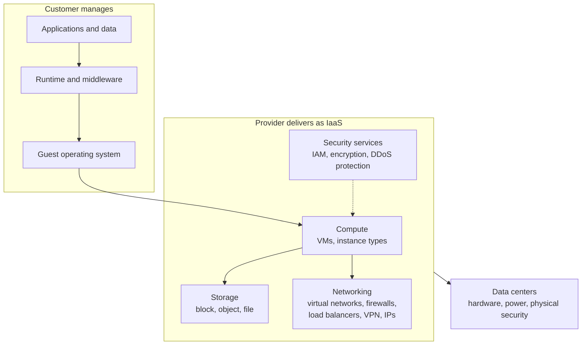

# Infrastructure as a Service

## Summary

Infrastructure as a Service (IaaS) is the cloud service model that rents virtualized computing resources over the internet: virtual machines, block and object storage, virtual networks, load balancers and related security services, paid by use and provisioned through a console or API in minutes. The provider runs the data centers, hardware and hypervisors; the customer manages everything from the operating system up (patches, middleware, runtime, applications, data). IaaS is the foundation layer of cloud computing, with Platform as a Service (PaaS) and Software as a Service (SaaS) built on top. It gives the most control of the cloud models and also the most operational responsibility.

## Prerequisites

- [Cloud providers](cloud-providers.md) for the service models and the shared responsibility model.
- [Virtualization](../containers-and-virtualization/virtualization.md).

## Core concepts

### Definition

IaaS lets organizations rent IT infrastructure (servers, storage, networking and other computing resources) on a pay-as-you-go basis, without physically managing or maintaining it. NIST SP 800-145 describes it as the capability to provision processing, storage, networks and other fundamental computing resources on which the consumer can run arbitrary software, including operating systems; the consumer does not control the underlying cloud infrastructure.

*Analogy.* Renting an empty, furnished-to-the-walls warehouse unit: power, walls, security guards and the loading dock are provided, but you bring the shelves, the stock and the staff, and you decide how to arrange them. The analogy breaks on speed: no landlord gives you a hundred new units in five minutes and takes them back an hour later.

### Key characteristics

- **Scalability and elasticity.** Resources scale on demand; organizations add or remove capacity for fluctuating needs without overprovisioning or underusing hardware.
- **Pay-as-you-go pricing.** Utility-style billing for compute time (per second or hour), storage capacity and data transfer; cost-efficient for startups and variable demand.
- **Self-service.** Customers control the resources they provision through a console or API (VMs, storage, network settings) without involving the provider.
- **Multi-tenancy.** Many customers share the physical hardware, while each tenant's resources are isolated for security and privacy.
- **Automation.** Orchestration tools and infrastructure as code (for example Terraform or AWS CloudFormation) automate deployment, scaling and management.

### Components



- **Compute (virtual machines).** Virtual servers that run operating systems (Linux, Windows) and applications, in many sizes (instance types) with different CPU, memory, GPU and storage ratios. The number of VMs scales up or down with need.
- **Storage.** Block storage (virtual disks for databases and file systems), object storage (unstructured data such as images, videos and backups) and file storage. Storage is *persistent* (survives when the VM stops) or *ephemeral* (local instance storage tied to the VM's lifecycle).
- **Networking.** Virtual networks that connect VMs and other resources, with firewalls (security groups), load balancers, VPNs and IP address management.
- **Security.** Identity and access management (IAM), encryption in transit and at rest, and protection against distributed denial-of-service (DDoS) attacks are usually part of the offer.
- **Data centers.** The physical facilities owned and run by the provider, which maintains hardware and physical security and builds in redundancy for high availability.

### Use cases

- **Development and testing.** Isolated, customizable environments that are created quickly and scaled up for production after testing.
- **Big data processing.** Compute power and storage for large data sets, important in finance, healthcare and e-commerce where real-time analysis matters.
- **Backup and disaster recovery.** Backup storage and standby recovery environments that replicate on-premises infrastructure.
- **Hosting complex applications** such as ERP, CRM and e-commerce platforms that must perform under heavy load.
- **Website hosting** that scales with traffic.
- **Lift and shift migration** of existing VMs to the cloud without rewriting applications.

### Advantages

- **Cost savings.** No investment in physical hardware, data centers or staff to run them; especially useful for startups and small businesses.
- **Flexibility and agility.** Resources are chosen and configured per requirement and deployed quickly, which shortens time to market.
- **Disaster recovery and business continuity.** Providers offer high availability, backup and replication across regions, so a regional failure need not stop the business.
- **Global reach.** Data centers worldwide let applications run close to users, which reduces latency.
- **Focus on the core business.** Infrastructure maintenance moves to the provider.

### Challenges

- **Management complexity.** Virtualized resources still need managing; the customer maintains the software stack (operating systems, middleware, applications) and makes it work together.
- **Security.** The provider secures the infrastructure, but securing applications and data remains largely the customer's responsibility: network segmentation, encryption, identity management and patching.
- **Vendor lock-in.** Different APIs, services and tools make moving between providers hard, which matters for multi-cloud strategies.
- **Downtime and reliability.** High uptime guarantees (SLAs) do not prevent outages; applications need contingency plans such as multiple zones.
- **Cost management.** Pay-as-you-go becomes expensive without monitoring and optimization (idle VMs, oversized instances, forgotten disks).

### Providers

- **Amazon Web Services (AWS).** The leading IaaS provider, with EC2 (Elastic Compute Cloud), S3 (Simple Storage Service) and VPC (Virtual Private Cloud), a global network of data centers and an ecosystem for machine learning, AI and IoT.
- **Microsoft Azure.** Azure Virtual Machines, Azure Blob Storage and Azure Virtual Network, integrated with Microsoft enterprise tools and popular with Windows-based organizations.
- **Google Cloud.** Compute Engine, Cloud Storage and Virtual Private Cloud, with strong support for containers and Kubernetes (Google created Kubernetes).
- **IBM Cloud and Oracle Cloud Infrastructure.** Other major IaaS providers, often chosen for enterprise-specific services and hybrid cloud deployments.
- Smaller and regional providers (DigitalOcean, Hetzner, OVHcloud, Scaleway) offer simpler IaaS at lower prices.

## Worked example

Create a small VM with a firewall rule in AWS using the CLI. Untested; AWS CLI v2, checked 2026-11. IDs are placeholders.

```bash
# 1. A security group that allows HTTPS from anywhere and SSH only from the office range
aws ec2 create-security-group --group-name web-sg --description "web" --vpc-id vpc-0abc1234
aws ec2 authorize-security-group-ingress --group-id sg-0def5678 --protocol tcp --port 443 --cidr 0.0.0.0/0
aws ec2 authorize-security-group-ingress --group-id sg-0def5678 --protocol tcp --port 22  --cidr 203.0.113.0/24

# 2. A VM with a persistent 20 GB encrypted root disk
aws ec2 run-instances \
  --image-id ami-0123456789abcdef0 \
  --instance-type t3.small \
  --key-name ops-key \
  --security-group-ids sg-0def5678 \
  --subnet-id subnet-0aaa1111 \
  --block-device-mappings 'DeviceName=/dev/xvda,Ebs={VolumeSize=20,VolumeType=gp3,Encrypted=true}' \
  --tag-specifications 'ResourceType=instance,Tags=[{Key=Name,Value=web1},{Key=owner,Value=team-shop}]'
```

What the customer still has to do after this point: patch the operating system, install and configure the web server, set up backups and monitoring, and rotate the SSH key. In practice the same resources would be written in an IaC tool rather than typed in a shell, so they can be reviewed and recreated ([Infrastructure as code](../infrastructure-as-code/infrastructure-as-code-overview.md)).

## Trade offs and when to use it

- **Choose IaaS** when you need control over the operating system, special software, licensing constraints or a lift-and-shift migration.
- **Choose PaaS or serverless** when the application fits a managed runtime and the team prefers not to manage operating systems.
- **Choose containers on managed Kubernetes** for a middle ground: control over the runtime image, provider-managed nodes and control plane.
- **Reserved or committed capacity** lowers cost for steady workloads; **spot or preemptible instances** cost much less for interruptible work.

## Common mistakes

- **Treating VMs as pets.** Hand-configured VMs cannot be recreated. Fix: images and IaC, so any VM can be replaced.
- **Single-zone deployments for critical services.** Fix: spread across at least two availability zones behind a load balancer.
- **SSH open to the world.** Fix: restrict source ranges, use a bastion or session manager, prefer keys and short-lived credentials.
- **Forgotten resources.** Unattached disks, old snapshots and idle VMs keep billing. Fix: tags with owners and regular cleanup.

## Practice

1. In IaaS, which layers does the customer manage?
2. What is the difference between persistent and ephemeral instance storage?
3. Why is multi-tenancy acceptable for security in IaaS?
4. Which pricing option fits a nightly batch job that may be interrupted and restarted?

Answers:

1. The guest operating system, runtime and middleware, applications and data (plus network and security configuration of their resources).
2. Persistent storage survives stopping or replacing the VM; ephemeral storage is tied to the VM's lifecycle and is lost when it stops or moves.
3. Tenants are isolated by the hypervisor, virtual networks and access controls, so they share hardware but cannot access each other's resources.
4. Spot or preemptible instances.

## Further reading

- [NIST SP 800-145: The NIST Definition of Cloud Computing](https://csrc.nist.gov/pubs/sp/800/145/final) (NIST, 2011): the IaaS definition.
- [Amazon EC2 documentation](https://docs.aws.amazon.com/ec2/) (Amazon Web Services): instances, storage and security groups.
- [Azure Virtual Machines documentation](https://learn.microsoft.com/azure/virtual-machines/) (Microsoft) and [Compute Engine documentation](https://cloud.google.com/compute/docs) (Google Cloud): the equivalents on the other hyperscalers.
