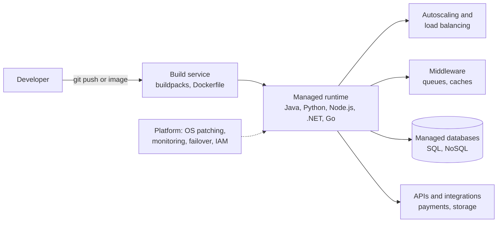

# Platform as a Service

## Summary

Platform as a Service (PaaS) is the cloud service model in which the provider runs the whole platform an application needs (servers, operating systems, runtimes, middleware, scaling, often databases and deployment pipelines), and the customer only brings the application code and its data. Developers push code (or a container image), and the platform builds, deploys, scales and patches it. PaaS speeds up development and removes most operations work; in exchange the customer accepts the platform's supported languages, limits and conventions, and some lock-in to its services. Heroku, Google App Engine, Azure App Service and AWS Elastic Beanstalk are classic examples.

## Prerequisites

- [Cloud providers](cloud-providers.md) for the service models and shared responsibility.
- [IaaS](iaas.md), the layer PaaS is built on.

## Core concepts

### Definition

PaaS provides a framework for developers to build, deploy and manage applications without the complexity of managing underlying infrastructure such as servers, storage and networks. The platform includes operating systems, middleware, development tools, databases and runtime environments. In NIST terms, the consumer deploys applications created with programming languages, libraries, services and tools supported by the provider, and controls the deployed applications and possibly configuration settings of the hosting environment, but not the network, servers, operating systems or storage.

*Analogy.* A commercial kitchen you rent by the hour. Ovens, refrigerators, cleaning and health inspections are taken care of; you bring recipes and ingredients and cook. You cannot replace the oven with your own model or rebuild the kitchen layout. The analogy breaks on scaling: no rented kitchen clones itself ten times during the lunch rush, which is exactly what a PaaS does with application instances.

### Key characteristics

- **Abstracted infrastructure.** A ready-to-use platform hides servers, networks and storage; developers do not set up or maintain infrastructure.
- **Scalability.** Applications scale up and down with demand on elastic, provider-managed infrastructure, including compute, storage and databases.
- **Managed operating systems.** The platform applies OS updates, patches and configuration, so developers focus on the application layer.
- **Multi-tenancy.** Many customers share the infrastructure, with applications isolated from each other.
- **CI/CD integration.** Many PaaS offerings include or integrate pipelines that test and deploy code changes automatically.

### Components



- **Application hosting and runtime.** Environments for languages such as Java, Python, Ruby and .NET, including interpreters or compilers, so developers write code without managing servers.
- **Middleware.** Application servers, message queues and other components that connect the operating system and the application.
- **Development tools.** Integrated or supported IDEs, version control, repositories and debugging tools.
- **Database management.** Managed SQL and NoSQL databases, with backups, replication and scaling handled by the provider.
- **APIs and integrations.** Connections to third-party services (payment gateways, storage, external data).
- **Security.** IAM, encryption and compliance features at the platform level; developers remain responsible for the security of their own code and data.

Many PaaS platforms build applications with *buildpacks*: they detect the language from the repository (for example `requirements.txt` for Python), install the runtime and dependencies, and produce a runnable image without a Dockerfile. Cloud Native Buildpacks (a CNCF project) standardize this and output OCI images.

### Use cases

- **Application development and deployment** of web and mobile applications.
- **APIs and microservices**, with runtimes and orchestration for small, independent services.
- **DevOps and continuous integration** with built-in pipelines that shorten time to production and increase deployment frequency.
- **Big data and analytics** on platforms with integrated processing (some PaaS offerings integrate Apache Hadoop or Apache Spark).
- **IoT applications** that ingest large volumes of device data and integrate with external systems.

### Advantages

- **Faster development and deployment.** No infrastructure to manage, plus integrated development, test and deployment tools.
- **Cost efficiency.** No investment in hardware or specialized operations staff; pay-as-you-go pricing.
- **Collaboration.** Shared environments, version control and cloud repositories let distributed teams work on the same project.
- **Integration with services.** Easy access to databases, storage, machine learning, analytics and IoT services.
- **Automated management.** Load balancing, monitoring and failover are automated, which improves reliability.
- **Multi-device support** for web, mobile and desktop applications.

### Challenges

- **Vendor lock-in.** Proprietary services, tools and APIs make moving to another provider hard without rework; choose providers with that risk in mind.
- **Customization limitations.** Less control over the environment; specific hardware or software configurations may not be possible.
- **Security and compliance.** Developers remain responsible for application and data security, and regulatory compliance (GDPR, HIPAA) depends on the provider's capabilities.
- **Performance issues.** Resource contention in multi-tenant environments can degrade performance without proper isolation.
- **Dependency on internet connectivity.** Development, deployment and management depend on reliable connectivity.

### Providers

- **Heroku.** One of the earliest PaaS platforms (2007, owned by Salesforce), supporting Ruby, Python, Node.js and more; popular for rapid development by startups. Its free tier was removed in 2022.
- **Google App Engine.** A fully managed platform with automatic scaling, built-in security and monitoring, integrated with Google Cloud. For new container-based workloads Google now generally points to Cloud Run.
- **Azure App Service.** Hosts web apps, mobile back ends and APIs in many languages, integrated with Visual Studio and Azure DevOps.
- **AWS Elastic Beanstalk.** Deploys and scales applications in Java, PHP, Python, Ruby, Docker and others; it creates ordinary AWS resources (EC2, load balancers, autoscaling groups) that remain visible and adjustable, giving more control than a classic PaaS.
- **Cloud Foundry.** An open source PaaS (Cloud Foundry Foundation); IBM's hosted IBM Cloud Foundry offered enterprise integration with IBM services but has been deprecated (TODO: verify the end-of-support date). Commercial distributions such as VMware Tanzu Application Service continue.
- Newer developer platforms (Render, Fly.io, Railway, Vercel for front ends) follow the same model.

## Worked example

Deploy a Python web application to Google App Engine standard environment. Untested; Google Cloud CLI, checked 2026-11.

```yaml
# app.yaml
runtime: python312
entrypoint: gunicorn -b :$PORT main:app   # the platform injects PORT
instance_class: F2
automatic_scaling:
  min_instances: 0          # scale to zero when idle: no traffic, no instance cost
  max_instances: 10
  target_cpu_utilization: 0.65
env_variables:
  APP_ENV: "production"
```

```bash
gcloud app deploy app.yaml --project=my-project
gcloud app browse
```

What the developer did not do: choose or patch an operating system, install Python, configure a load balancer, TLS certificates or autoscaling. The platform builds the app from `requirements.txt`, deploys a new version, shifts traffic to it and scales between zero and ten instances. Constraints come with it: the supported runtime versions, request time limits and the platform's way of handling background work.

## Trade offs and when to use it

- **Choose PaaS** for web applications and APIs in mainstream languages where developer speed matters more than control over the stack.
- **Choose IaaS or Kubernetes** for special runtimes, long-running or stateful processes, or fine-grained network control.
- **Choose FaaS or serverless containers** for event-driven or very spiky workloads that should scale to zero and bill per request ([Serverless](serverless.md)).
- **Reduce lock-in** by deploying standard containers and using open interfaces (PostgreSQL, Redis) instead of proprietary platform services where portability matters.

## Common mistakes

- **Storing state on the instance file system.** Instances are replaced and scaled at any time. Fix: databases, object storage, external caches.
- **Ignoring platform limits** (request timeouts, memory per instance, cold starts). Fix: read the quotas before choosing the platform and design background work for them.
- **Assuming the provider secures the application.** Fix: dependency scanning, secrets management and access control remain the team's job.

## Practice

1. Which layers does the customer manage in PaaS?
2. What does a buildpack do?
3. Why is local disk state a problem on a PaaS?
4. When would you choose Elastic Beanstalk over a fully opaque PaaS?

Answers:

1. The application code, its configuration and its data.
2. It detects the application's language, installs the runtime and dependencies and produces a runnable image without a Dockerfile.
3. Instances are ephemeral and can be replaced or multiplied at any time, so local data is lost or inconsistent across instances.
4. When the team wants PaaS convenience but needs to see and adjust the underlying resources (instances, load balancers, scaling groups).

## Further reading

- [NIST SP 800-145: The NIST Definition of Cloud Computing](https://csrc.nist.gov/pubs/sp/800/145/final) (NIST, 2011): the PaaS definition.
- [The Twelve-Factor App](https://12factor.net/) (Adam Wiggins, Heroku, 2011): the design rules for applications that run well on a PaaS.
- [Cloud Native Buildpacks](https://buildpacks.io/docs/) (CNCF): how source code becomes an image without a Dockerfile.
- [Google App Engine documentation](https://cloud.google.com/appengine/docs) (Google Cloud), [Azure App Service documentation](https://learn.microsoft.com/azure/app-service/) (Microsoft) and [AWS Elastic Beanstalk documentation](https://docs.aws.amazon.com/elasticbeanstalk/) (Amazon Web Services).
