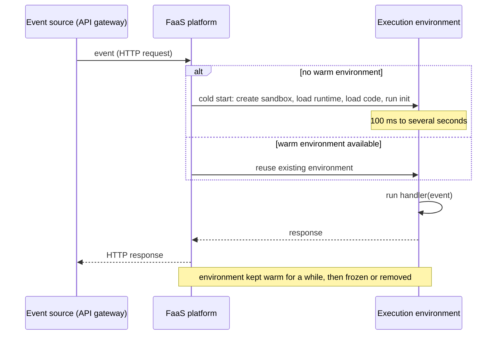
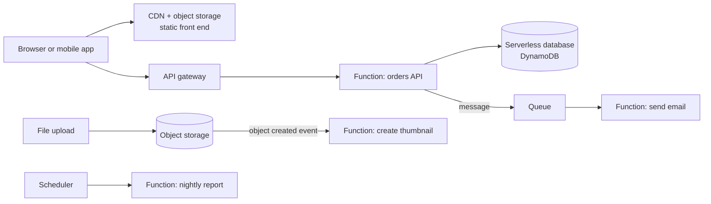
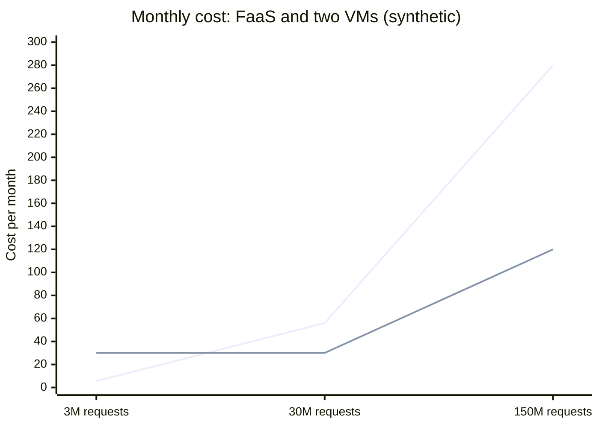

# Serverless

## Summary

Serverless is a cloud computing model in which developers build and run applications without managing the servers underneath: no provisioning, patching or capacity planning. "Serverless" does not mean there are no servers; it means the provider runs them, scales them automatically (including down to zero) and bills only for actual use, often per request and per millisecond of execution. The best-known form is Function as a Service (FaaS), where small functions run in response to events, but the term also covers fully managed services such as serverless databases, queues and container platforms. The model removes operations work and idle cost in exchange for cold starts, execution limits and tight coupling to a provider's ecosystem.

## Prerequisites

- [Cloud providers](cloud-providers.md) for the service models.
- [PaaS](paas.md), the model serverless evolved from.

## Core concepts

### Definition and key characteristics

1. **Auto-scaling.** Resources adjust automatically to demand, from zero to thousands of concurrent executions.
2. **Pay-as-you-go.** Charges follow actual usage (requests, execution time, memory) rather than provisioned capacity; idle time costs nothing.
3. **Managed infrastructure.** The provider handles infrastructure setup, maintenance and updates.
4. **Event-driven architecture.** Functions or services are triggered by events such as HTTP requests, file uploads, database changes, queue messages or schedules.

*Analogy.* A taxi instead of owning a car. You call it when you need a ride, pay per trip, and never think about parking, insurance or repairs. When many people need rides at once, more taxis appear. The analogy breaks in two places: you sometimes wait for a taxi to arrive (a cold start), and you cannot modify the taxi or keep your belongings in it between rides (functions are stateless and constrained).

### Comparison with the traditional server model

| Aspect | Traditional server model | Serverless |
| --- | --- | --- |
| Infrastructure | Managed by the team | Managed by the cloud provider |
| Scaling | Manual or configured autoscaling | Built-in, automatic, to zero |
| Costs | Pay for provisioned servers, also when idle | Pay for actual usage |
| Development speed | Slower because of setup | Faster, focus on application logic |
| Control | Full control of OS and runtime | Limited to code and configuration |

### Key components

**Platform as a Service (PaaS).** A platform that abstracts infrastructure and offers tools and environments for development and deployment. Examples: AWS Elastic Beanstalk, Google App Engine, Heroku. Use it when you need a managed environment to host applications with minimal configuration. Classic PaaS is not fully serverless when it bills for always-on instances, but platforms that scale to zero (App Engine standard, Cloud Run) blur the line.

**Function as a Service (FaaS).** A compute model that runs code in response to events without managing servers. Examples: AWS Lambda, Azure Functions, Google Cloud Run functions (formerly Cloud Functions). Use it for event-driven applications such as file processing, real-time data processing and back-end APIs.

**Serverless containers.** Platforms that run a whole container image with request-based scaling and per-use billing: Google Cloud Run, AWS Fargate (serverless compute for ECS and EKS, billed per task rather than per request), Azure Container Apps.

**Backend as a Service (BaaS) and managed services.** Databases, storage, authentication and messaging consumed as APIs: Amazon DynamoDB, Amazon S3, Firebase, Amazon SQS, Google Pub/Sub.

### How FaaS executes a function



A *cold start* happens when no initialized environment is available: the platform creates a sandbox (AWS Lambda uses Firecracker microVMs), starts the language runtime and runs the initialization code. Subsequent invocations reuse the warm environment. Code outside the handler (database connections, SDK clients) runs once per environment, which is why it is placed there.

### Serverless architecture

A typical serverless architecture has:

1. **Event sources.** Triggers such as HTTP requests (through an API gateway), file uploads, database updates, queue messages and schedules.
2. **Serverless functions (FaaS).** Small units of code executed per event.
3. **Managed services.** Databases, storage and messaging systems run by the provider.



### Serverless compared with PaaS and FaaS

| Aspect | PaaS | FaaS | Serverless (as a whole) |
| --- | --- | --- | --- |
| Scope | Full application management | Function-based compute | Broader concept that includes FaaS and managed services |
| Control | Application logic and some infrastructure settings | Function logic only | Composition of several managed services |
| Scaling | Autoscaling of instances, often with a minimum | Automatic per function, to zero | Highly dynamic, per service |
| Use cases | Web applications, APIs | Event-driven tasks, microservices | Event-driven and dynamic workloads |

### Advantages

1. **Reduced operational complexity.** Developers focus on code instead of infrastructure.
2. **Cost efficiency.** Pay only for the compute time used; no cost for idle capacity.
3. **Built-in high availability.** Providers run functions across multiple zones with fault tolerance.
4. **Rapid scaling.** Handles large spikes of requests without manual intervention, within account concurrency limits.

### Disadvantages

1. **Cold starts.** The first invocation after idle time has extra latency.
2. **Vendor lock-in.** Triggers, permissions and managed services tie the application to one provider's ecosystem.
3. **Debugging and observability challenges.** Limited control over infrastructure, distributed flows and short-lived environments make debugging harder; tracing is essential.
4. **Resource limits.** Functions have maximum execution time (for example 15 minutes on AWS Lambda), memory, payload size and concurrency limits (checked 2026-11).
5. **Cost at sustained high load.** Per-request pricing can exceed the cost of always-on instances for steady, heavy traffic.

### Use cases

1. **Web applications.** Static front ends on object storage and a CDN with serverless back ends (for example AWS Lambda with Amazon S3).
2. **Data processing.** Real-time stream processing, ETL steps and file conversions (images, video, documents).
3. **IoT applications.** Processing streams of data from devices.
4. **Chatbots and APIs.** Scalable APIs with serverless back ends.
5. **Scheduled and glue tasks.** Cron jobs, webhooks and automation between services.

## Worked example

Cost comparison for an API with spiky traffic (synthetic prices for illustration; check current pricing pages). The API receives 3 million requests per month, each running 200 ms with 512 MB memory.

FaaS cost:

| Item | Calculation | Result |
| --- | --- | --- |
| Compute in GB-seconds | 3,000,000 x 0.2 s x 0.5 GB | 300,000 GB-s |
| Compute price at 0.0000167 per GB-s | 300,000 x 0.0000167 | about 5.00 |
| Request price at 0.20 per million | 3 x 0.20 | 0.60 |
| Total per month (before free tier) | | about 5.60 |

Always-on alternative: two small VMs for redundancy at about 15 each, total about 30 per month, regardless of traffic.

Now assume traffic grows 50 times to 150 million requests per month with the same profile:



The FaaS line grows linearly with requests; the VM line (which needs more instances at 150 million requests, assumed eight) grows in steps. At low and spiky traffic serverless is far cheaper; at sustained high load, provisioned capacity becomes cheaper. A handler for the API, in Python (untested; AWS Lambda Python 3.12 runtime):

```python
import json, os
import boto3

# created once per execution environment and reused while warm
table = boto3.resource("dynamodb").Table(os.environ["TABLE_NAME"])

def handler(event, context):
    order_id = event["pathParameters"]["id"]
    item = table.get_item(Key={"id": order_id}).get("Item")
    if item is None:
        return {"statusCode": 404, "body": json.dumps({"error": "not found"})}
    return {"statusCode": 200, "body": json.dumps(item, default=str)}
```

## Trade offs and when to use it

- **Choose serverless** for event-driven work, spiky or unpredictable traffic, prototypes and glue code, where idle cost and operations effort dominate.
- **Choose containers or VMs** for steady high throughput, long-running processes, special runtimes, or strict latency requirements that cold starts violate.
- **Mitigate cold starts** with provisioned concurrency or minimum instances (which reintroduces some idle cost), smaller deployment packages and lighter runtimes.
- **Mitigate lock-in** with frameworks that abstract providers (Serverless Framework, SST, Knative) and by keeping business logic independent of the handler signature.

## Common mistakes

- **Synchronous chains of functions.** Function A waits for B, which waits for C, paying for all three and multiplying failure points. Fix: queues, events or a workflow service.
- **Opening a new database connection per invocation.** Thousands of concurrent functions exhaust the database's connection limit. Fix: reuse connections, use a connection proxy, or a serverless-friendly database.
- **Unbounded concurrency.** A traffic spike or retry storm scales functions until a downstream system fails. Fix: reserved concurrency limits and dead-letter queues.
- **Treating the local disk or memory as state.** Environments disappear. Fix: external state stores.

## Practice

1. What does "serverless" mean, given that servers still exist?
2. What is a cold start, and what causes it?
3. Why should SDK clients be created outside the handler function?
4. Using the worked example, explain why serverless becomes more expensive than VMs at very high sustained load.

Answers:

1. The provider manages, scales and bills the servers per use, so the customer never provisions or operates them.
2. The extra latency of the first invocation in a new execution environment, caused by creating the sandbox, starting the runtime and running initialization code.
3. Code outside the handler runs once per environment and is reused across warm invocations, which saves time and connections.
4. FaaS cost grows linearly with every request, while VM cost grows in steps and amortizes over many requests per instance when utilization is high.

## Further reading

- [NIST SP 800-145: The NIST Definition of Cloud Computing](https://csrc.nist.gov/pubs/sp/800/145/final) (NIST, 2011): the service models serverless builds on.
- [AWS Lambda Developer Guide](https://docs.aws.amazon.com/lambda/latest/dg/welcome.html) (Amazon Web Services): execution environment, cold starts and quotas.
- [Cloud Programming Simplified: A Berkeley View on Serverless Computing](https://arxiv.org/abs/1902.03383) (Jonas et al., UC Berkeley, 2019): the research view of serverless and its limits.
- [CNCF Serverless Whitepaper](https://github.com/cncf/wg-serverless/tree/master/whitepapers/serverless-overview) (CNCF Serverless Working Group, 2018): definitions of FaaS and BaaS.
- [Firecracker](https://firecracker-microvm.github.io/) (Amazon Web Services, open source): the microVM technology behind Lambda and Fargate.
