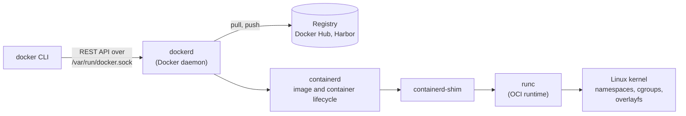

# Docker

## Summary

Docker is the tool that made Linux containers practical for everyday development and operations. It packages an application with everything it needs (code, runtime, libraries, configuration) into an *image*, built from a text recipe called a *Dockerfile*, and runs that image as an isolated *container* on any host with a container runtime. Images are stored and shared through *registries*, data that must outlive a container goes into *volumes*, containers talk over Docker *networks*, and *Docker Compose* describes multi-container applications in one file. Under the hood, a container is an ordinary Linux process isolated with kernel namespaces and limited with control groups, which is why it starts in milliseconds and shares the host kernel.

## Prerequisites

- [Virtualization](virtualization.md) for the difference between virtual machines and containers.
- [Processes](../operating-systems/process-management/processes.md) and [File systems](../operating-systems/storage-and-io/file-systems.md) for the Linux mechanisms containers use.

## Core concepts

### The problem Docker solves

"It works on my machine" is the classic symptom: the application depends on a specific runtime version, system libraries and configuration that differ between a developer laptop, the test server and production. Virtual machines solve this but are heavy (a full operating system per application, minutes to boot, gigabytes per image). Docker ships the application's user space only, in a standard, versioned format, so the same artifact runs the same way everywhere a compatible kernel exists. The joke in the source graphic puts it well: "But it works on my machine." "OK, we'll ship your machine."

*Analogy.* Shipping containers. Before them, every cargo (barrels, sacks, crates) was loaded differently on every ship, truck and train. A standard container fits every crane and vehicle without anyone caring what is inside. A Docker image is the standard box, the runtime is the crane. The analogy breaks at the foundation: shipping containers are completely independent of the ship, while software containers share the host's kernel, so a Linux container needs a Linux kernel (on macOS and Windows, Docker Desktop runs a small Linux VM for this).

### The eight core concepts

The figure summarizes the eight concepts that the rest of this note explains.


1. **Dockerfile.** Instructions to build an image: the base image, the dependencies, the files and the start command.
2. **Docker image.** A lightweight, standalone, read-only package that contains everything needed to run the application (code, libraries, dependencies). Images are built from a Dockerfile, are made of stacked *layers* and are versioned with *tags* and immutable *digests* (`sha256:...`).
3. **Docker container.** A running instance of an image: the image layers plus a thin writable layer, isolated from other containers and from the host. Many containers can run from one image.
4. **Docker registry.** A central repository for storing and distributing images. Docker Hub is the default public registry; private registries include Harbor, GitLab, GitHub Container Registry, Amazon ECR, Google Artifact Registry and Azure Container Registry.
5. **Docker volumes.** Persistent storage for data generated by containers. Volumes live outside the container's file system, survive container deletion and can be shared between containers.
6. **Docker Compose.** A tool for defining and running multi-container applications in a YAML file (`compose.yaml`), so a whole stack starts with one command.
7. **Docker networks.** Enable communication between containers and with the host. User-defined networks isolate groups of containers and provide DNS-based discovery by container name.
8. **Docker CLI.** The main interface (`docker build`, `docker pull`, `docker run`). The CLI is a client that talks to the Docker daemon (`dockerd`) over a Unix socket or TCP.

### Architecture



The Docker daemon delegates container lifecycle to *containerd*, which uses an *OCI runtime* (by default `runc`) to create the container. Images and runtimes follow the Open Container Initiative (OCI) specifications, which is why images built by Docker run on Kubernetes with containerd or CRI-O, and on Podman.

### What a container is in Linux terms

- **Namespaces** give the process its own view of the system: PID (own process tree, the app is PID 1), mount (own file system tree), network (own interfaces and ports), UTS (own host name), IPC, user (own UID mapping) and cgroup namespaces.
- **Control groups (cgroups)** limit and account resources: CPU shares and quotas, memory limits (exceeding them triggers the out-of-memory killer), I/O and number of processes.
- **Union file system (overlayfs).** Read-only image layers are stacked, with a writable layer on top; files changed by the container are copied up into the writable layer (copy-on-write).
- **Security features**: dropped Linux capabilities, seccomp syscall filters, AppArmor or SELinux profiles, optional rootless mode.

### Image layers and build cache

Each Dockerfile instruction that changes the file system (`RUN`, `COPY`, `ADD`) creates a layer. Layers are cached and shared between images. When an instruction or its input changes, that layer and every layer after it are rebuilt. Ordering instructions from least to most frequently changed (dependencies before source code) keeps builds fast.

### Networking modes

| Mode | Behavior | Typical use |
| --- | --- | --- |
| `bridge` (default) | Private network on the host with NAT to the outside; ports published with `-p host:container` | Single-host applications |
| User-defined bridge | Like bridge, plus DNS resolution of container names and isolation per network | Compose stacks |
| `host` | The container uses the host's network stack directly | Maximum network performance, no port mapping |
| `none` | No network | Batch jobs that must stay offline |
| `overlay` | Network spanning several hosts | Docker Swarm services |

### Storage types

| Type | Managed by | Typical use |
| --- | --- | --- |
| Named volume | Docker (`/var/lib/docker/volumes`) | Database data, persistent application data |
| Bind mount | You (any host path) | Source code during development, host configuration files |
| tmpfs | Memory | Secrets or scratch data that must not touch disk |

## Worked example

A small Python web API with a PostgreSQL database. Untested; Docker Engine 27 and Compose v2 syntax, checked 2026-11.

`Dockerfile` with a multi-stage build and a non-root user:

```dockerfile
# Stage 1: install dependencies in a full image with build tools
FROM python:3.12-slim AS build
WORKDIR /app
COPY requirements.txt .
# dependencies first: this layer stays cached until requirements.txt changes
RUN pip install --no-cache-dir --prefix=/install -r requirements.txt

# Stage 2: small runtime image without build tools
FROM python:3.12-slim
WORKDIR /app
COPY --from=build /install /usr/local
COPY . .
# never run as root inside the container
RUN useradd --uid 10001 --no-create-home appuser
USER appuser
EXPOSE 8000
CMD ["gunicorn", "--bind", "0.0.0.0:8000", "app:app"]
```

`compose.yaml`:

```yaml
services:
  api:
    build: .
    ports:
      - "8000:8000"
    environment:
      DATABASE_URL: postgresql://shop:${DB_PASSWORD}@db:5432/shop   # "db" resolves via Compose DNS
    depends_on:
      db:
        condition: service_healthy
  db:
    image: postgres:16
    environment:
      POSTGRES_USER: shop
      POSTGRES_PASSWORD: ${DB_PASSWORD}
      POSTGRES_DB: shop
    volumes:
      - db-data:/var/lib/postgresql/data    # data survives "docker compose down"
    healthcheck:
      test: ["CMD-SHELL", "pg_isready -U shop"]
      interval: 5s
      retries: 10
volumes:
  db-data:
```

Commands and what they do:

```bash
export DB_PASSWORD='<choose-a-password>'
docker compose up -d --build     # build the api image, start db, wait for its health check, start api
docker compose ps                # both services "running", db "healthy"
docker compose logs -f api       # follow the api logs
docker image ls                  # the api image is about 150 MB instead of 1 GB for a full python image
docker compose down              # remove containers and the network; the db-data volume stays
docker compose down -v           # also remove volumes: the database data is deleted
```

## Trade offs and when to use it

- **Containers** give fast startup, high density and portable, immutable artifacts. They share the host kernel, so isolation is weaker than with VMs; untrusted multi-tenant workloads need extra isolation (gVisor, Kata Containers, microVMs).
- **Docker Engine compared with alternatives.** Podman is daemonless and rootless by default with a compatible CLI; containerd with nerdctl is the lower-level choice; Kubernetes no longer uses Docker Engine as its runtime (dockershim was removed in Kubernetes 1.24 in 2022) but runs the same OCI images.
- **Docker Compose** is ideal for development and small single-host deployments; multi-host production needs an orchestrator such as Kubernetes (covered in the separate Kubernetes knowledge repository).
- **Docker Desktop licensing.** Docker Desktop requires a paid subscription for larger companies (above 250 employees or 10 million USD revenue, checked 2026-11); Docker Engine on Linux remains free.

## Common mistakes

- **Running as root in the container.** A container escape then gives root on the host. Fix: `USER` with a non-root UID, rootless mode, no `--privileged`.
- **Using `latest` tags in production.** The meaning of `latest` changes silently. Fix: pin versions or digests.
- **Storing data in the container's writable layer.** It disappears with the container. Fix: volumes.
- **Secrets in images** (`ENV PASSWORD=...`, copied `.env` files). Anyone who pulls the image can read them, also from old layers. Fix: build secrets (`RUN --mount=type=secret`), runtime injection and a `.dockerignore`.
- **Mounting `/var/run/docker.sock` into containers.** It grants full control of the host. Fix: avoid it, or use a restricted proxy.
- **Huge images.** Fix: slim or distroless base images, multi-stage builds, cleaning package caches in the same `RUN` layer.

## Practice

1. What is the difference between an image and a container?
2. Which two Linux kernel features provide container isolation and resource limits?
3. Why does the Dockerfile copy `requirements.txt` before the rest of the code?
4. What happens to the database data in the worked example after `docker compose down`, and after `docker compose down -v`?
5. Why can a Linux container not run natively on a Windows kernel?

Answers:

1. An image is a read-only template made of layers; a container is a running instance of it with its own writable layer and isolated process.
2. Namespaces (isolation) and control groups (resource limits).
3. So that the dependency installation layer stays cached when only source code changes.
4. After `down` the data stays in the named volume; after `down -v` the volume and the data are deleted.
5. Containers share the host kernel and make Linux system calls; a Windows kernel does not provide them, so a Linux VM (or WSL 2) is needed.

## Further reading

- [Docker documentation](https://docs.docker.com/) (Docker Inc.): engine, build, Compose and networking.
- [Dockerfile reference](https://docs.docker.com/reference/dockerfile/) (Docker Inc.): every instruction and build best practice.
- [Open Container Initiative specifications](https://opencontainers.org/) (OCI, Linux Foundation): the image, runtime and distribution specifications.
- [NIST SP 800-190: Application Container Security Guide](https://csrc.nist.gov/pubs/sp/800/190/final) (NIST, 2017): container risks and countermeasures.
- [namespaces(7)](https://man7.org/linux/man-pages/man7/namespaces.7.html) and [cgroups(7)](https://man7.org/linux/man-pages/man7/cgroups.7.html) (Linux man-pages project): the kernel mechanisms under containers.
