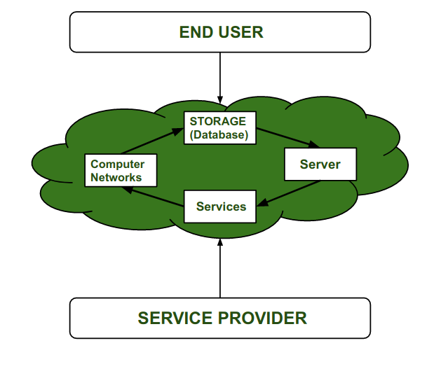
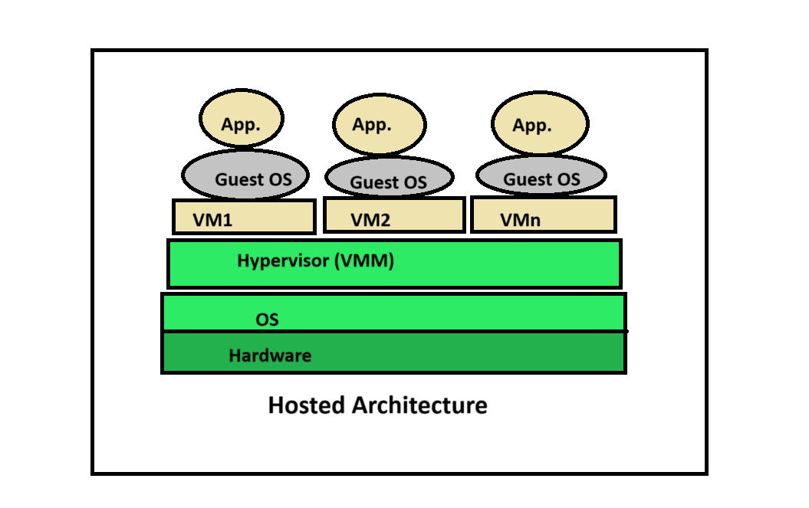
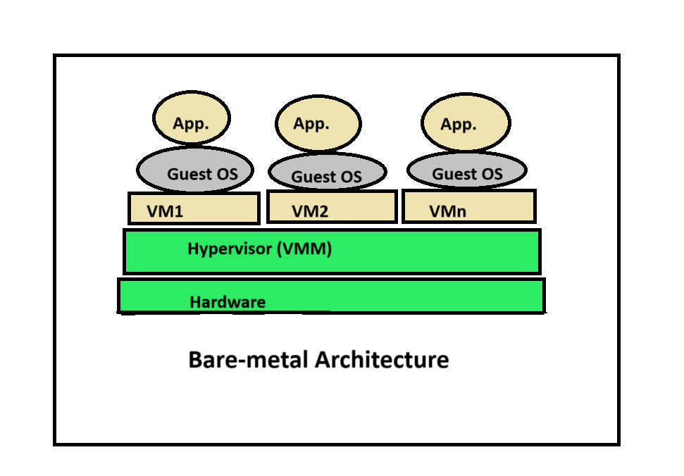
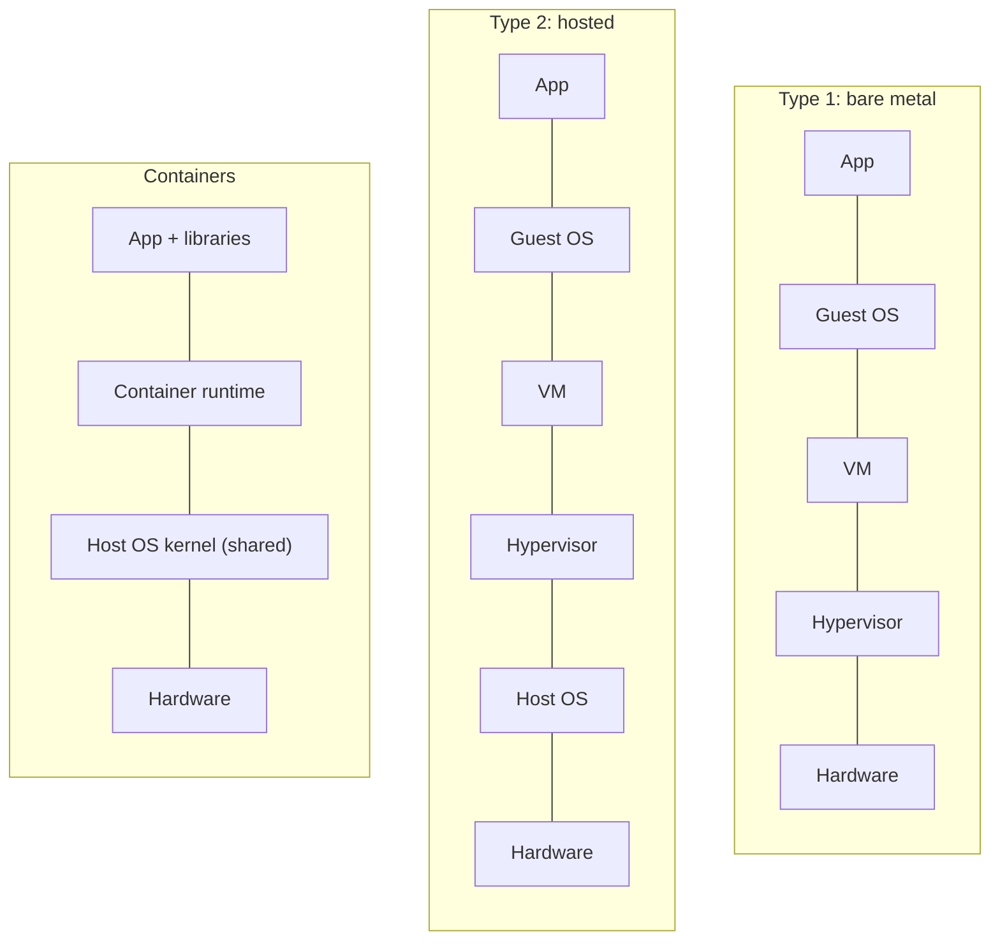
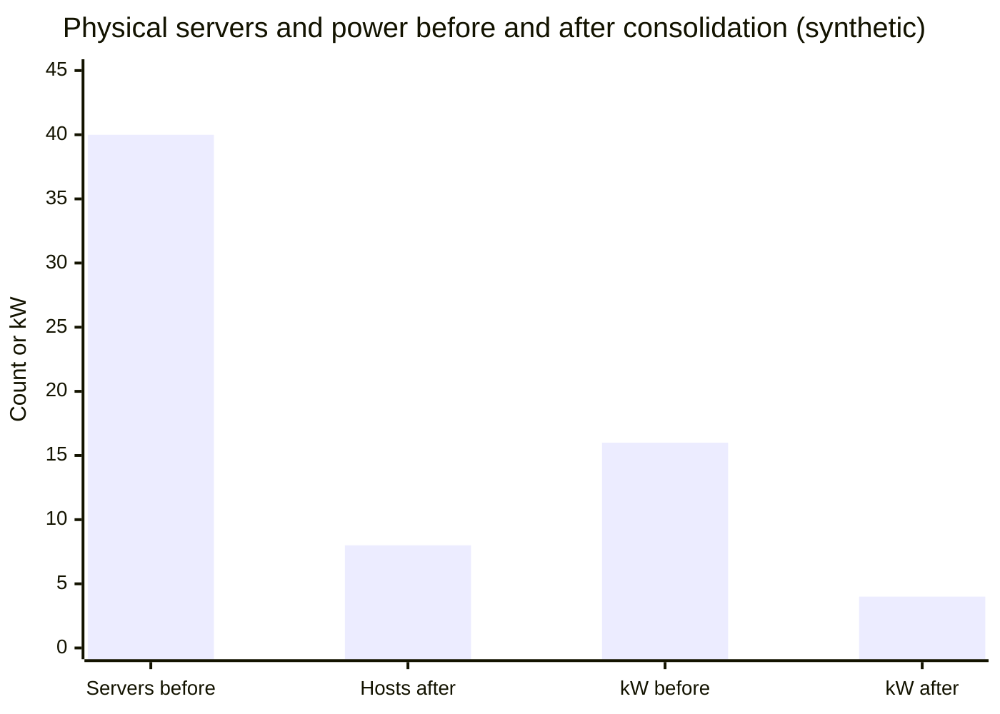

# Virtualization

## Summary

Virtualization creates virtual versions of computing resources (machines, storage, networks) so that one physical system can be shared safely and efficiently. In its most common form, a *hypervisor* runs several *virtual machines* (VMs) on one physical *host*; each VM has virtual CPUs, memory, disks and network cards and runs its own *guest* operating system as if it owned the hardware. Virtualization is the foundation of cloud computing: providers split large servers into many isolated VMs rented to many customers. Containers are a lighter alternative that virtualizes the operating system instead of the hardware, trading some isolation for speed and density.

## Prerequisites

- [Operating system overview](../operating-systems/operating-system-overview.md) for kernel mode, user mode and what an operating system manages.

## Core concepts

### The problem virtualization solves

Before virtualization, each application ran on its own physical server to avoid conflicts, and typical servers sat at 5 to 15 percent utilization. Every new application meant buying, racking and cabling hardware, which took weeks. Virtualization consolidates many workloads on fewer machines, creates new servers in minutes and decouples software from specific hardware.

For cloud vendors the same logic applies at scale. A provider owns the physical resources (servers, storage devices, network devices) and rents them to users, who no longer worry about the hardware. Renting whole physical servers would be expensive and leave them underused by customers; virtualization lets the provider divide a large server into smaller virtual ones for many customers, which uses resources efficiently and lowers cost.

The figure shows this relationship: the service provider supplies a cloud of networks, storage, servers and services that the end user consumes without seeing the hardware.



*Analogy.* An apartment building. One plot of land and one foundation (the physical server) hold many independent apartments (VMs). Each has its own door, kitchen and lock (guest OS), while the building manager (hypervisor) allocates water, power and space. Tenants cannot enter each other's apartments. The analogy breaks on flexibility: real apartments cannot be resized, moved to another building while occupied or cloned in seconds, and VMs can (resizing, live migration, snapshots).

### Terminology

- **Host machine.** The physical machine on which virtual machines are created.
- **Guest machine.** A virtual machine created on the host.
- **Virtual machine (VM).** A software emulation of a complete computer (virtual CPU, memory, disk, network interface) that runs under the control of a hypervisor and runs its own operating system.
- **Hypervisor (virtual machine monitor, VMM).** Software, firmware or hardware that creates and runs virtual machines, isolating them from each other and allocating physical resources to them.
- **Container.** An isolated group of processes that shares the host's operating system kernel. It is not a lightweight VM: it has no own kernel and no virtual hardware (see [Docker](docker.md)).
- **Virtualization software.** Software that virtualizes a computer, such as a hypervisor and its management tools.
- **Virtual network.** A software-defined network inside a host (virtual switches and interfaces) that can be extended across many servers (VLANs, VXLAN overlays).

### Characteristics

- **Isolation.** A crash or compromise inside one VM does not affect the others.
- **Encapsulation.** A whole VM is a set of files (configuration and virtual disks) that can be copied, moved and backed up.
- **Hardware independence.** A VM sees standard virtual hardware, so it runs on any host with the same hypervisor.
- **Resource sharing.** CPU, memory, storage and network are shared among VMs.
- **Snapshots and cloning.** The state of a VM can be saved and restored, or copied to create new VMs.
- **Dynamic resource allocation.** CPU and memory can be adjusted, and VMs can be moved between hosts (live migration).
- **High availability and fault tolerance.** VMs restart on another host when a host fails.
- **Scalability.** New VMs are created in minutes.

### How a hypervisor works

A hypervisor isolates the operating system and applications from the hardware, so several VMs share CPU, memory and network bandwidth. It manages and assigns those resources according to each VM's configuration.

Three techniques make this possible:

- **Hardware-assisted virtualization.** Modern CPUs provide virtualization extensions (Intel VT-x, AMD-V). The guest kernel runs directly on the CPU in a special non-root mode; sensitive instructions trap to the hypervisor. Second-level address translation (Intel EPT, AMD NPT) lets the hardware translate guest memory addresses efficiently.
- **Paravirtualization.** The guest uses drivers that know they are virtualized (for example virtio for disks and network in KVM), which is faster than emulating real hardware devices.
- **Emulation.** The hypervisor imitates hardware in software (for example QEMU emulating a different CPU architecture). It is flexible but slow, and used when no hardware support exists.

### Architecture

Virtualization architecture describes how the layers fit together. The figure shows application virtual services and infrastructure virtual services (compute, storage, network, cloud) integrated in a virtual operating system and data center, used by many platforms (.NET, SaaS, Windows, Linux, Java EE, desktop, apps) and delivered from on-premises or off-premises clouds.


- Virtual application services help with application management; virtual infrastructure services help with infrastructure management.
- Both are integrated into the virtual data center or operating system. Virtual services can be used from any platform and programming environment, from a local (on-premises) or external (off-premises) cloud. Cloud users pay a monthly or annual fee to the provider, who in turn delivers applications in the forms users need.
- A hypervisor separates the operating system from the underlying hardware and lets the host run many VMs at the same time on shared resources.

### Hosted and bare metal architectures

There are two main architectures. In the *hosted* architecture, a host operating system is installed on the hardware first, and the hypervisor runs as software on top of it; guest VMs run on the hypervisor, and applications inside them run as if on physical machines. In the *bare metal* architecture, the hypervisor is installed directly on the hardware with no host OS in between, which gives better performance and is used for production servers and workloads that need near-native or real-time access to hardware.





The same stacks side by side, with containers added for comparison:



### Hypervisor types

- **Type 1 (bare metal) hypervisors** run directly on the host hardware. Direct hardware access gives better performance, scalability and stability, and a smaller attack surface. Examples: VMware ESXi, Microsoft Hyper-V, Citrix Hypervisor (formerly XenServer), Xen, Oracle VM Server for x86 (Xen based), and KVM, which turns the Linux kernel itself into a type 1 hypervisor (some sources classify it as hosted because Linux is a full OS).
- **Type 2 (hosted) hypervisors** are installed as applications on a host operating system. They are simple to install and manage, which suits desktops and labs, but the extra layer costs performance and adds attack surface. Examples: VMware Workstation Pro, VMware Fusion, Oracle VirtualBox, Parallels Desktop.

Oracle Solaris Zones are sometimes listed with type 2 hypervisors, but they are operating system level virtualization (the Solaris equivalent of containers), not a hypervisor.

### Kinds of virtualization

| Kind | What is virtualized | Examples |
| --- | --- | --- |
| Server (hardware) virtualization | Whole machines | ESXi, KVM, Hyper-V |
| Operating system level virtualization | The OS user space (containers) | Docker, LXC, Solaris Zones, FreeBSD jails |
| Storage virtualization | Pools of disks presented as virtual volumes | SAN, Ceph, vSAN |
| Network virtualization | Switches, routers and networks in software | Open vSwitch, VXLAN, VMware NSX, cloud VPCs |
| Desktop virtualization (VDI) | User desktops running in a data center | Citrix, VMware Horizon |
| Application virtualization | Applications isolated from the OS they run on | App-V, Flatpak sandboxes |

### Advantages

- **Efficient hardware use.** Fewer physical machines are needed, which lowers cost for users and for providers.
- **High availability.** Features such as live migration and automatic restart keep VMs available.
- **Simpler disaster recovery.** VMs are files: they can be backed up, replicated and restored more reliably than physical servers.
- **Energy savings.** Consolidating servers reduces power and cooling costs.
- **Rapid setup.** New servers in minutes instead of purchase, delivery and installation cycles.
- **Easier cloud migration.** VMs can be moved to cloud providers, avoiding the cost of maintenance, power, cooling and staff for own hardware.
- **Resource optimization.** Consolidation saves hardware, energy and space.

### Disadvantages

- **High initial costs** for virtualization licenses and capable servers and storage.
- **Complexity** grows with the number of VMs (VM sprawl).
- **Security risks** from the additional layer: a hypervisor vulnerability can break isolation between VMs (VM escape).
- **Skilled staff needed**, which means hiring or training.
- **Data exposure** on shared infrastructure without proper isolation and access control.
- **Performance overhead and noisy neighbors**: VMs on the same host compete for CPU caches, memory bandwidth and I/O.

### Virtualization compared with containerization

Containerization, an alternative to hypervisor-based virtualization, uses operating system level virtualization: applications run in isolated user spaces on one shared kernel instead of in full VMs. Containers are lightweight packages inside one OS instance; VMs provide full operating systems for workloads that need strong isolation or a different OS.

| Aspect | Virtualization | Containerization |
| --- | --- | --- |
| Isolation level | Full OS isolation with own kernel | Process-level isolation on a shared kernel |
| Resource overhead | High (full OS per instance) | Low (shared kernel) |
| Performance | Some overhead from virtual hardware | Near native |
| Boot time | Slow (boot a full OS, tens of seconds or more) | Fast (start a process, often under a second) |
| Portability | Limited by image formats and hypervisors | High (OCI images across environments) |
| Management | Hypervisors (VMware, Hyper-V, KVM) | Container runtimes (Docker, containerd) |
| Deployment | Multi-OS and legacy applications | Microservices and cloud-native applications |
| Security | Strong isolation through separate kernels | Requires careful configuration (shared kernel) |

Use cases for virtualization:

- **Legacy application support** for applications that need specific OS versions.
- **Multi-OS environments** for testing or running applications on different operating systems on the same hardware.
- **Isolation and security** for workloads that need strong boundaries.
- **Data centers** that run many VMs on powerful servers to maximize utilization.
- **Testing environments** with VMs for different OS versions without extra machines.
- **Legacy systems** that need specific hardware and OS configurations.

Use cases for containerization:

- **Microservices**, because containers are lightweight and scale per service.
- **DevOps and CI/CD**, with consistent development, test and production environments that end "it works on my machine" problems.
- **Scalability**, scaling up and down quickly with load.
- **Portability** from a laptop to production servers.
- **Serverless computing**, where functions run in containers started and stopped on demand.

The two are usually combined: in the cloud, containers run inside VMs, and microVMs (Firecracker, used by AWS Lambda and Fargate) give container-like speed with VM isolation.

## Worked example

Consolidation calculation (synthetic numbers). A company runs 40 physical servers at an average CPU utilization of 10 percent. It wants to move them to virtualization hosts and keep each host below 60 percent utilization.

| Quantity | Calculation | Result |
| --- | --- | --- |
| Total load in "server units" | 40 x 0.10 | 4.0 |
| Hosts needed at 60 percent (same capacity per host) | 4.0 / 0.60 | 6.7, so 7 |
| Hosts with N+1 for failover | 7 + 1 | 8 |
| Power at 400 W per server, before | 40 x 400 W | 16 kW |
| Power at 500 W per busier host, after | 8 x 500 W | 4 kW |



A KVM example of creating one of those VMs on a Linux host (untested; libvirt 10.x tools, Ubuntu 24.04 host, checked 2026-11):

```bash
egrep -c '(vmx|svm)' /proc/cpuinfo     # > 0 means the CPU has VT-x or AMD-V
sudo apt install -y qemu-kvm libvirt-daemon-system virtinst
sudo virt-install --name web1 --memory 4096 --vcpus 2 \
  --disk size=20 --os-variant ubuntu24.04 \
  --cdrom ubuntu-24.04-live-server-amd64.iso \
  --network network=default --graphics none --console pty,target_type=serial
virsh list --all                          # web1 should be "running"
```

## Trade offs and when to use it

- **Use VMs** for strong isolation between tenants, different operating systems or kernels, legacy software and regulated workloads.
- **Use containers** for many small services from the same OS family that must start fast and pack densely.
- **Type 1 hypervisors** belong in production; **type 2** in labs and on desktops.
- **Licensing** matters: the VMware licensing changes after the Broadcom acquisition (2023 onward) pushed many organizations to evaluate KVM-based platforms (Proxmox VE, OpenStack, Nutanix AHV) and Hyper-V.

## Common mistakes

- **Overcommitting memory without monitoring.** Hosts start swapping or ballooning and every VM slows down. Fix: conservative memory overcommit and host-level monitoring.
- **Treating snapshots as backups.** Snapshots live on the same storage and slow down the VM as they grow. Fix: real backups to separate storage, short-lived snapshots.
- **VM sprawl.** Forgotten VMs consume resources and miss patches. Fix: ownership tags, expiry dates and inventory.
- **Calling containers lightweight VMs.** It hides the shared kernel and leads to weak isolation decisions. Fix: treat containers as processes and add VM-level isolation for untrusted code.

## Practice

1. What is the difference between a type 1 and a type 2 hypervisor? Give one example of each.
2. Which CPU features make hardware-assisted virtualization possible?
3. Why do containers start faster than VMs?
4. In the worked example, why is one extra host added?
5. Name two kinds of virtualization other than server virtualization.

Answers:

1. Type 1 runs directly on the hardware (VMware ESXi); type 2 runs as an application on a host OS (VirtualBox).
2. Intel VT-x or AMD-V, plus second-level address translation (EPT or NPT).
3. A container is a process on an already running kernel; a VM has to boot a full operating system.
4. For N+1 redundancy: if one host fails, its VMs can restart on the remaining hosts.
5. Any two of: storage, network, desktop, application, operating system level virtualization.

## Further reading

- "Formal requirements for virtualizable third generation architectures" (Gerald J. Popek, Robert P. Goldberg, Communications of the ACM, 1974): the classic definition of a virtual machine monitor.
- [KVM documentation](https://www.linux-kvm.org/page/Documents) (KVM project): the Linux kernel hypervisor.
- [libvirt documentation](https://libvirt.org/docs.html) (libvirt project): the management API and tools used in the example.
- [NIST SP 800-125: Guide to Security for Full Virtualization Technologies](https://csrc.nist.gov/pubs/sp/800/125/final) (NIST, 2011): hypervisor security recommendations.
- *Operating System Concepts*, 10th edition (Silberschatz, Galvin, Gagne, Wiley, 2018): chapter on virtual machines.
