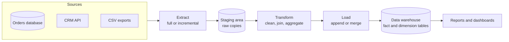

# ETL

## Summary

ETL (extract, transform, load) is the process that moves data from many source systems into a target system for analysis, typically a data warehouse. *Extract* gathers data from the sources, *transform* cleans, reshapes and combines it, and *load* writes the curated result into the target. ETL creates one consistent, historical view of data that is otherwise scattered across applications, which is the basis for reporting, audits and data-driven decisions. Because pipelines run repeatedly and automatically, they are operated like any other production software: versioned, tested, scheduled and monitored. Modern cloud warehouses often reverse the last two steps (ELT): raw data is loaded first and transformed inside the warehouse.

## Prerequisites

- Basic SQL and the idea of a relational database.
- [CI/CD overview](../ci-cd/ci-cd-overview.md) and [Monitoring](../observability/monitoring.md) for operating pipelines.

## Core concepts

### The three steps

- **Extract.** Gathers data from multiple sources: operational databases, SaaS APIs, files, event streams. Extraction can be *full* (everything each time) or *incremental* (only rows changed since the last run, using timestamps or change data capture).
- **Transform.** Processes and reshapes data for analysis: cleaning (invalid values, duplicates), standardizing (units, time zones, codes), joining sources, aggregating, and applying business rules.
- **Load.** Curates and loads the data into the new target, as a full replacement, an append or an upsert (merge) of changed rows.

*Analogy.* A restaurant kitchen. Ingredients arrive from many suppliers (extract), are washed, cut and cooked to recipes (transform), and plated for guests (load). Guests never see raw potatoes. The analogy breaks on repetition: a kitchen cooks each dish once, while an ETL pipeline must produce the same correct result every time it reruns, including after a failure halfway, which is why idempotent loads matter.



### Benefits: the CCPA mnemonic

The benefits of ETL are summarized as *CCPA* (not to be confused with the California Consumer Privacy Act):

- **Context.** Provides historical data for specific applications and use cases.
- **Consolidation.** Brings data together for analysis.
- **Productivity.** Automates data handling and saves time.
- **Accuracy.** Ensures reliable data for reporting and audits.

### Key insights

- **Comprehensive understanding.** ETL offers a systematic approach to data management that makes it easier to derive insights from many sources, which supports informed decisions.
- **Data consolidation.** Extracting from diverse sources creates a unified view, which improves the accuracy of analysis and reporting.
- **Time efficiency.** Automating the processing workflow reduces manual effort, so analysts work on analysis rather than data preparation.
- **Enhanced context.** ETL provides historical context for data-driven decisions tailored to specific use cases.
- **Improved reporting.** Accurate, consolidated data makes reports and visualizations that satisfy audit and compliance requirements easier to produce.
- **Repeatability.** ETL processes are repeatable, so new data is integrated consistently and accuracy and context are kept for ongoing analysis.
- **Foundation for growth.** ETL is central both to new data warehouse projects and to improving existing ones.

### ETL compared with ELT

| Aspect | ETL | ELT |
| --- | --- | --- |
| Where transformation runs | In a separate engine before loading | Inside the target warehouse after loading |
| Raw data in the target | No, only curated data | Yes, raw and curated layers |
| Typical era and targets | On-premises warehouses with limited compute | Cloud warehouses with elastic compute (BigQuery, Snowflake, Redshift) |
| Reprocessing | Requires re-extracting from sources | Rerun transformations on stored raw data |
| Typical tools | Informatica, Talend, SSIS, Spark jobs | Fivetran or Airbyte for loading, dbt for SQL transformations |

### Operating pipelines as a DevOps practice

- **Orchestration** schedules steps and handles dependencies and retries (Apache Airflow, Dagster, Prefect, cloud workflow services).
- **Idempotency.** Rerunning a load for the same period must not create duplicates: use merge on keys or replace a whole partition.
- **Testing.** Data quality checks (not null, uniqueness, referential integrity, freshness) run in CI and after each load (dbt tests, Great Expectations).
- **Monitoring.** Track run success, duration, row counts and data freshness, and alert when a dashboard would otherwise show stale data.
- **Version control and CI/CD** for pipeline code and SQL, like application code.

## Worked example

A daily incremental load of orders into a warehouse table with an idempotent merge. Untested; standard SQL `MERGE` as supported by PostgreSQL 15 and most cloud warehouses, checked 2026-11.

```sql
-- 1. Extract: copy yesterday's changed rows from the source into staging (done by the loader tool)
-- 2. Transform and load in one idempotent statement
MERGE INTO dwh.fact_orders AS t
USING (
    SELECT
        o.id                                   AS order_id,
        o.customer_id,
        DATE(o.created_at AT TIME ZONE 'UTC')  AS order_date,   -- standardize time zone
        ROUND(o.amount_cents / 100.0, 2)       AS amount_eur,   -- standardize units
        UPPER(TRIM(o.country))                 AS country_code  -- clean codes
    FROM staging.orders AS o
    WHERE o.updated_at >= DATE '2026-11-08'
      AND o.updated_at <  DATE '2026-11-09'
      AND o.amount_cents IS NOT NULL                             -- drop invalid rows
) AS s
ON t.order_id = s.order_id
WHEN MATCHED THEN UPDATE SET
    customer_id = s.customer_id, order_date = s.order_date,
    amount_eur = s.amount_eur, country_code = s.country_code
WHEN NOT MATCHED THEN INSERT (order_id, customer_id, order_date, amount_eur, country_code)
    VALUES (s.order_id, s.customer_id, s.order_date, s.amount_eur, s.country_code);
```

Running the statement twice for the same day leaves the table unchanged after the first run, because rows are matched by `order_id`. A plain `INSERT` would double yesterday's revenue on a retry. A follow-up check compares counts:

```sql
SELECT COUNT(*) FROM staging.orders WHERE updated_at >= DATE '2026-11-08' AND updated_at < DATE '2026-11-09';
SELECT COUNT(*) FROM dwh.fact_orders WHERE order_id IN (SELECT id FROM staging.orders);
```

## Trade offs and when to use it

- **ETL** fits when the target has limited compute, when sensitive fields must be removed before data lands, or when sources need heavy processing (for example Spark on large files).
- **ELT** fits cloud warehouses: load fast, keep raw history and change transformations without re-extracting.
- **Batch compared with streaming.** Daily or hourly batches are simple and cheap; streaming (Kafka, Flink) gives fresh data at much higher operational cost. Choose by how fresh the data must be.
- Deep data engineering and analytics topics belong to the separate data analytics knowledge repository; this area covers pipelines as operated systems.

## Common mistakes

- **Non-idempotent loads.** Retries duplicate data. Fix: merge on keys or overwrite partitions.
- **No data quality checks.** Broken source data flows into reports unnoticed. Fix: tests after each load and alerts on failures and freshness.
- **Mixing time zones.** Daily totals shift between days. Fix: convert to UTC early and define the reporting time zone explicitly.
- **Extracting everything every night.** Runs grow until they no longer fit the window. Fix: incremental extraction or change data capture.

## Practice

1. What happens in each of the three ETL steps?
2. What does the CCPA mnemonic stand for in the context of ETL?
3. Why is the `MERGE` in the worked example safe to rerun?
4. When would you prefer ELT over ETL?

Answers:

1. Extract gathers data from sources, transform cleans and reshapes it, load writes the curated data to the target.
2. Context, consolidation, productivity and accuracy.
3. Rows are matched on `order_id`, so existing rows are updated instead of inserted again.
4. With a cloud warehouse that has elastic compute, when you want to keep raw data and change transformations without re-extracting from sources.

## Further reading

- *The Data Warehouse Toolkit*, 3rd edition (Ralph Kimball, Margy Ross, Wiley, 2013): dimensional modeling, the target design for most ETL.
- *Fundamentals of Data Engineering* (Joe Reis, Matt Housley, O'Reilly, 2022): the data engineering lifecycle including ingestion and transformation.
- [Apache Airflow documentation](https://airflow.apache.org/docs/) (Apache Software Foundation): orchestration of pipelines.
- [dbt documentation](https://docs.getdbt.com/) (dbt Labs): SQL transformations and tests in an ELT workflow.
