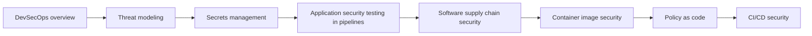

# DevSecOps

Security built into delivery: principles and frameworks, threat modeling, secrets, application security testing, supply chain security, container images, policy as code and the security of CI/CD itself.

## Map of the area

The diagram shows the notes in reading order; subareas are marked with (subarea).

## Notes in reading order

1. [DevSecOps overview](devsecops-overview.md): principles, lifecycle activities, NIST SSDF and other frameworks, prioritization and metrics.
2. [Threat modeling](threat-modeling.md): the four questions, data flow diagrams, STRIDE, attack trees and pipeline threats.
3. [Secrets management](secrets-management.md): secret zero, lifecycle, delivery patterns, rotation, scanning and tools.
4. [Application security testing in pipelines](application-security-testing.md): SAST, SCA, secret and IaC scanning, DAST, IAST and fuzzing.
5. [Software supply chain security](software-supply-chain-security.md): incidents, SBOM and VEX, SLSA provenance, Sigstore signing, dependency hygiene.
6. [Container image security](container-image-security.md): base images, secure builds, scanning, registries and admission.
7. [Policy as code](policy-as-code.md): OPA, Conftest, Kyverno, ValidatingAdmissionPolicy and Sentinel, with safe rollout.
8. [CI/CD security](cicd-security.md): OWASP Top 10 CI/CD risks, poisoned pipeline execution, OIDC and runner hardening.

## Planned topics

- Runtime security and detection (Falco, eBPF)
- Kubernetes security hardening
- Cloud security posture management
- Security incident response for DevOps teams
- Compliance as code and audit evidence
- Vulnerability management program
