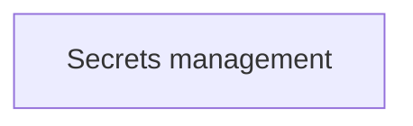

# DevSecOps

Security built into delivery: secrets, supply chain, scanning and policy as code.

## Map of the area

The diagram shows the notes in reading order; subareas are marked with (subarea).

## Notes in reading order

1. [Secrets management](secrets-management.md): features, secret zero, CI/CD integration and tools.

## Planned topics

- Software supply chain security (SLSA, SBOM, signing)
- SAST, DAST and SCA in pipelines
- Container image scanning
- Policy as code
- Threat modeling for pipelines
- Security of CI/CD systems
