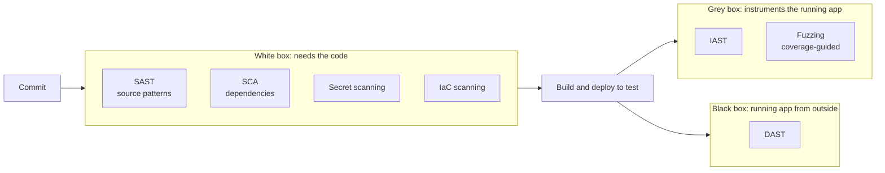
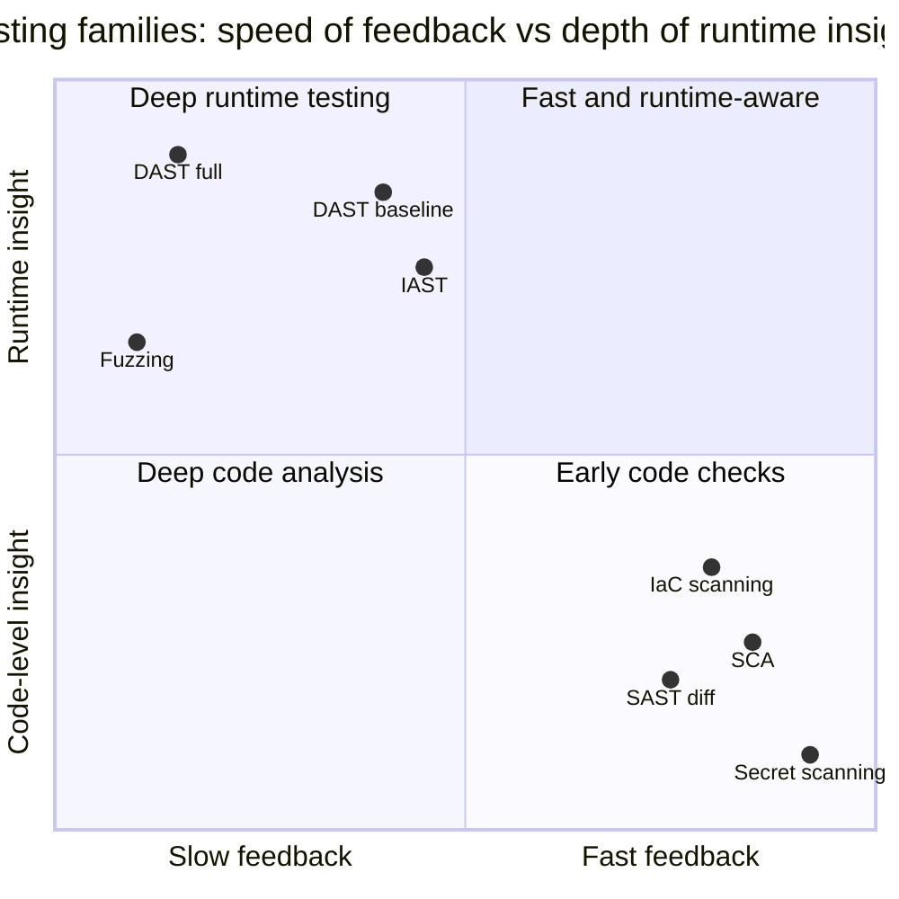

# Application security testing in pipelines

## Summary

Application security testing (AST) finds vulnerabilities in software automatically, and DevSecOps runs it inside the CI/CD pipeline so every change is checked. The main families are **SAST** (static analysis of source code for insecure patterns), **SCA** (software composition analysis of open source dependencies for known vulnerabilities and license issues), **secret scanning** (credentials in code and history), **IaC scanning** (misconfigurations in Terraform, Kubernetes manifests, Dockerfiles), **DAST** (dynamic testing of a running application from the outside) and **IAST** (instrumentation inside a running application during tests), with fuzzing as a complement. Each sees different flaws, produces different false positives and fits a different pipeline stage. Effective programs combine several, block only on new, high-confidence findings, deliver results in the pull request, and prioritize by exploitability rather than raw counts.

## Prerequisites

- [DevSecOps overview](devsecops-overview.md).
- [CI/CD overview](../ci-cd/ci-cd-overview.md).

## Core concepts

### The families of testing



The diagram groups the families by what they need: white-box tools read code and manifests and run early; grey-box and black-box tools need a running application and run later in the pipeline.

*Analogy.* Inspecting a car. Reading the blueprints for known design errors is SAST; checking the parts list against recall notices is SCA; test-driving the car on a track and trying to make it fail is DAST; putting sensors inside the engine during the test drive is IAST. No single inspection catches everything: the parts list does not reveal a badly designed brake line, and the test drive does not show which supplier part is recalled. The analogy breaks on scale: software inspections run thousands of times a day, so false alarms cost far more than in a car factory.

### SAST: static application security testing

SAST analyzes source code (or bytecode) without running it. Techniques range from pattern matching to data flow and taint analysis: tracking untrusted input (a *source*, such as an HTTP parameter) to a dangerous operation (a *sink*, such as a SQL query) without passing through a *sanitizer*.

- **Finds**: injection (SQL, command, XSS: CWE-89, CWE-78, CWE-79), path traversal (CWE-22), insecure deserialization, weak cryptography, hardcoded credentials, dangerous APIs.
- **Misses**: business logic flaws, authorization logic, configuration and runtime issues, vulnerabilities in dependencies.
- **Strengths**: early (in the IDE or pull request), points to file and line, no running environment needed.
- **Weaknesses**: false positives (it cannot always know that input is already validated), language-specific, slow deep analysis on large code bases.
- **Tools**: Semgrep (pattern rules, fast), CodeQL (query-based data flow, used in GitHub code scanning), SonarQube, Snyk Code, Checkmarx, language linters with security rules (Bandit for Python, gosec for Go, ESLint security plugins).

Example of a taint finding:

```python
# Python 3.12, Flask; vulnerable to SQL injection (CWE-89)
@app.get("/orders")
def orders():
    customer = request.args["customer"]                    # source: untrusted input
    sql = f"SELECT * FROM orders WHERE customer = '{customer}'"
    return db.execute(sql).fetchall()                      # sink: query built from input

# fixed: parameterized query keeps data and code separate
@app.get("/orders")
def orders_fixed():
    customer = request.args["customer"]
    return db.execute("SELECT * FROM orders WHERE customer = ?", (customer,)).fetchall()
```

### SCA: software composition analysis

SCA inventories the third-party components of an application (from lock files, manifests or built artifacts) and matches them against vulnerability databases (the National Vulnerability Database, GitHub Advisory Database, OSV) and license data.

- **Why it matters**: open source dependencies make up most of the code in a typical modern application; Log4Shell (CVE-2021-44228, December 2021) showed how one vulnerable transitive dependency can affect a whole industry overnight.
- **Finds**: known vulnerabilities (CVEs) in direct and transitive dependencies, outdated components, license conflicts, sometimes malicious packages.
- **Misses**: unknown vulnerabilities and flaws in your own code.
- **Key features**: transitive dependency resolution, reachability analysis (is the vulnerable function called?), automatic fix pull requests, SBOM output ([Software supply chain security](software-supply-chain-security.md)).
- **Tools**: Dependabot and Renovate (update pull requests), OSV-Scanner, Trivy, Grype, OWASP Dependency-Check, Snyk Open Source, GitHub dependency review.

### Secret scanning

Detects credentials committed to code or present in history, images and logs, using provider patterns, entropy and live verification. Run it as a pre-commit hook, as push protection on the Git server and in CI. Details and response steps are in [Secrets management](secrets-management.md#secret-scanning).

### IaC and configuration scanning

Checks Terraform, CloudFormation, Kubernetes manifests, Helm charts and Dockerfiles against rules such as "storage buckets must not be public", "containers must not run as root", "security groups must not allow 0.0.0.0/0 on SSH".

- **Tools**: Checkov, Trivy (misconfiguration scanning), KICS, tflint (with rulesets), kube-score, Hadolint for Dockerfiles; organization-specific rules are often written as policy as code ([Policy as code](policy-as-code.md)).
- **Plan-time checks** on `terraform show -json` output see final values after variables and modules are resolved, which static file scanning cannot.

### DAST: dynamic application security testing

DAST tests a running application from the outside, like an attacker without access to the code: it crawls or reads an API definition (OpenAPI, GraphQL schema), sends crafted requests and analyzes responses.

- **Finds**: injection that is actually exploitable, cross-site scripting, missing security headers, TLS misconfigurations, authentication and session problems, exposed debug endpoints, server misconfiguration.
- **Misses**: code paths it cannot reach (pages behind complex logins, features not linked), vulnerabilities in code that is not exposed, and it cannot point to the line of code.
- **Strengths**: language-independent, few false positives for confirmed findings, tests the deployed configuration.
- **Weaknesses**: slow (minutes to hours), needs a running environment with test data, can damage data (only run against test environments, or production with explicit authorization and safe settings).
- **Tools**: ZAP (formerly OWASP ZAP, now maintained with support from Checkmarx), Burp Suite (commercial, mainly manual testing), Nuclei (template-based checks), StackHawk.

In pipelines, a *baseline* passive scan (a few minutes) runs on each deployment to a test environment, and full active scans run nightly or weekly.

### IAST and fuzzing

- **IAST** (interactive application security testing) places an agent inside the running application (for example a Java or .NET agent) while functional or end-to-end tests run. It sees both the request and the code path, so it reports real data flows from source to sink with low false positives. It depends on test coverage and is available for fewer languages. Examples: Contrast Security, Seeker.
- **Fuzzing** feeds large amounts of generated, mutated input to code and watches for crashes and hangs; coverage-guided fuzzers (libFuzzer, AFL++, Go's native fuzzing since Go 1.18, Jazzer for Java) find memory safety bugs and parser errors that other methods miss. OSS-Fuzz runs continuous fuzzing for critical open source projects.

### Comparison

| Family | Stage | Needs | Typical time | False positives | Points to code |
| --- | --- | --- | --- | --- | --- |
| Secret scanning | Pre-commit, push, CI | Repository | Seconds | Low with verification | Yes |
| SAST | IDE, pull request | Source code | Seconds to minutes (diff), longer (full) | Medium to high | Yes |
| SCA | Pull request, build, continuously | Manifests and lock files | Seconds | Low for matching; relevance varies | Package and version |
| IaC scanning | Pull request, plan | IaC files or plans | Seconds | Low to medium | Yes |
| DAST | After deployment to test | Running app | Minutes to hours | Low for confirmed issues | No |
| IAST | During automated tests | Agent in running app | Adds to test time | Low | Yes |
| Fuzzing | Nightly, continuous | Harness per target | Hours | Very low (crashes are real) | Yes, with stack trace |



The quadrant chart is a qualitative placement (positions are judgments, not measurements) that shows why the families complement each other: fast, code-level checks run on every pull request; slower, runtime-aware tests run after deployment or on a schedule.

### Making findings actionable

1. **Diff-aware gating**: block a merge only on findings introduced by the change; track existing findings in a backlog with deadlines.
2. **Severity and confidence thresholds**: block on high-severity, high-confidence rules; report the rest.
3. **One place for results**: upload results in SARIF (the OASIS Static Analysis Results Interchange Format) to the code host or a vulnerability management tool, deduplicated across tools.
4. **Suppressions with reasons** in code (`# nosemgrep: rule-id -- input validated by schema`), reviewed like code.
5. **Prioritize by exploitability**: reachability, CISA KEV, EPSS and exposure ([DevSecOps overview](devsecops-overview.md#prioritizing-vulnerabilities)).
6. **Fix automation**: dependency update bots with auto-merge for patch updates that pass tests.

## Worked example

A pull request pipeline for a Python service runs secret scanning, SAST and SCA in parallel, each producing SARIF, and blocks on new high-severity findings. Untested; GitHub Actions syntax, Gitleaks 8.x, Semgrep 1.x, OSV-Scanner 2.x, checked 2026-11. Actions are pinned to commit SHAs (placeholders shown).

```yaml
name: security
on: [pull_request]
permissions:
  contents: read
  security-events: write          # upload SARIF results only
jobs:
  secrets:
    runs-on: ubuntu-24.04
    steps:
      - uses: actions/checkout@<SHA>
        with: { fetch-depth: 0 }  # full history so the scan sees every commit of the branch
      - run: gitleaks git --redact --exit-code 1 --log-opts="origin/main..HEAD"
  sast:
    runs-on: ubuntu-24.04
    steps:
      - uses: actions/checkout@<SHA>
      - run: pipx run semgrep scan --config p/python --baseline-commit origin/main --sarif -o semgrep.sarif --error --severity ERROR
      - uses: github/codeql-action/upload-sarif@<SHA>
        if: always()
        with: { sarif_file: semgrep.sarif }
  sca:
    runs-on: ubuntu-24.04
    steps:
      - uses: actions/checkout@<SHA>
      - run: osv-scanner scan source --lockfile requirements.txt --format sarif --output osv.sarif
      - uses: github/codeql-action/upload-sarif@<SHA>
        if: always()
        with: { sarif_file: osv.sarif }
```

Results over one month for this service (synthetic):

| Tool | Findings reported | Blocked merges | Confirmed true positives among blocks |
| --- | --- | --- | --- |
| Gitleaks | 3 | 3 | 3 |
| Semgrep (blocking rules) | 41 | 6 | 5 |
| OSV-Scanner | 27 | 2 | 2 |

```mermaid
xychart-beta
  title "Findings reported vs merges blocked in one month (synthetic)"
  x-axis [Gitleaks, Semgrep, OSV-Scanner]
  y-axis "Count" 0 --> 45
  bar [3, 41, 27]
  bar [3, 6, 2]
```



The chart compares reported findings (first bar) with blocked merges (second bar) from the table. Only 11 of 71 findings blocked a merge, and 10 of those were real, which keeps developers' trust in the gate; the other 60 findings went to the backlog for triage by severity and reachability.

## Trade offs and when to use it

- **SAST** is the earliest code-level check but noisy; invest in rule tuning and diff-aware gating.
- **SCA** is the highest return per effort for most teams, because dependencies dominate the code base; it requires a process for updates.
- **DAST** confirms exploitability in the deployed configuration but is slow and needs environments; run baselines per deployment and full scans on a schedule.
- **IAST** gives precise results if test coverage is good and the language is supported; otherwise its value is limited.
- **Commercial vs open source**: commercial suites add correlation, dashboards and support; open source tools with SARIF and a vulnerability management workflow cover most needs.

## Common mistakes

- **Blocking on all findings from day one.** Fix: report mode, tuning, then diff-aware blocking on high-confidence rules.
- **Running DAST against production without authorization or safe settings.** Fix: test environments, or explicit approval and passive scans only.
- **Ignoring transitive dependencies.** Fix: scan lock files or built artifacts, not only top-level manifests.
- **Counting findings as the success metric.** Fix: measure time to remediate, escaped vulnerabilities and false positive rates.
- **Suppressing without explanation.** Fix: suppressions in code with a reason, reviewed.
- **Results scattered across tools.** Fix: SARIF into one place, deduplicated.

## Practice

1. What is the difference between SAST and DAST in what they need and what they find?
2. Explain source, sink and sanitizer in taint analysis.
3. Why can SCA find Log4Shell in your application while SAST usually cannot?
4. What is diff-aware gating, and why does it matter?
5. Which family would you run nightly rather than on every pull request, and why?
6. What is SARIF used for?

Answers:

1. SAST needs source code and finds insecure code patterns early, with file and line; DAST needs a running application and finds exploitable behavior from the outside, without pointing to code.
2. A source is where untrusted data enters (an HTTP parameter), a sink is a dangerous operation (a SQL query, a shell command), and a sanitizer is validation or encoding that makes the data safe; a finding is a path from source to sink without a sanitizer.
3. Log4Shell is a known vulnerability in a third-party library version; SCA matches the library version against advisories, while SAST analyzes your own code and usually not the internals of dependencies.
4. Blocking a merge only on findings introduced by the change; it avoids blocking every pull request because of historical findings, which keeps the gate trusted.
5. Full DAST scans and fuzzing, because they take a long time and need running environments.
6. As a standard format for static analysis results, so that results from different tools can be uploaded, displayed and deduplicated in one place.

## Further reading

- [OWASP DevSecOps Guideline](https://owasp.org/www-project-devsecops-guideline/) (OWASP): placement of the testing families in pipelines.
- [OWASP Web Security Testing Guide](https://owasp.org/www-project-web-security-testing-guide/) (OWASP).
- [CWE Top 25 Most Dangerous Software Weaknesses](https://cwe.mitre.org/top25/) (MITRE).
- [Static Analysis Results Interchange Format (SARIF) Version 2.1.0](https://docs.oasis-open.org/sarif/sarif/v2.1.0/sarif-v2.1.0.html) (OASIS, 2020).
- [OSV: Open Source Vulnerabilities](https://osv.dev/) (OpenSSF and Google).
- [ZAP documentation](https://www.zaproxy.org/docs/) (ZAP project).
- [Semgrep documentation](https://semgrep.dev/docs/) and [CodeQL documentation](https://codeql.github.com/docs/).
