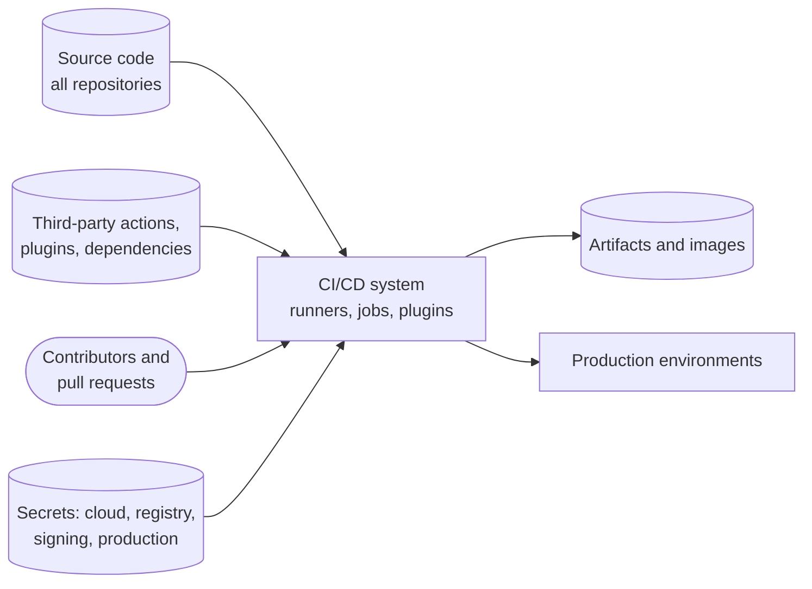
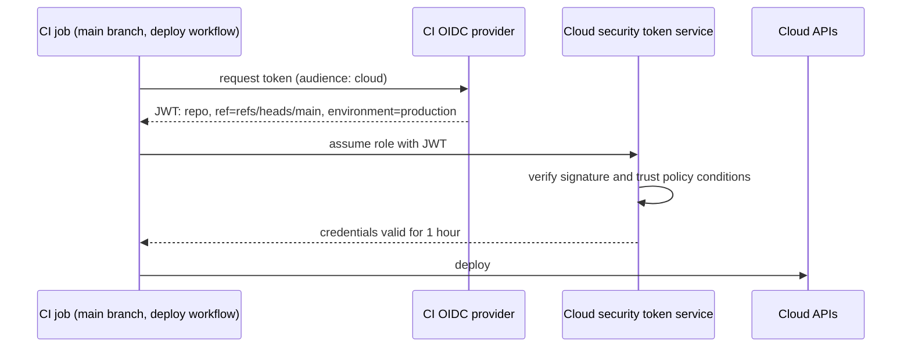

# CI/CD security

## Summary

A CI/CD system is one of the most privileged systems in an organization: it reads all source code, holds credentials for registries, clouds and production, executes code from every contributor and every dependency, and produces the artifacts that run in production. Compromising it gives an attacker a direct, trusted path to production, which is why pipelines are now a prime target. CI/CD security protects this delivery system: flow controls so no single person or job can push unreviewed code to production, least-privilege and short-lived identities (OIDC instead of stored keys), isolation of untrusted code such as pull requests from forks, pinned and verified third-party actions and plugins, hardened and ephemeral runners, artifact integrity, and logging. The OWASP Top 10 CI/CD Security Risks (2022) is the reference catalog of what goes wrong.

## Prerequisites

- [CI/CD overview](../ci-cd/ci-cd-overview.md) and [Jenkins](../ci-cd/jenkins.md) or another CI system.
- [Secrets management](secrets-management.md), [Threat modeling](threat-modeling.md) and [Software supply chain security](software-supply-chain-security.md).

## Core concepts

### Why pipelines are a target

The pipeline sits at the intersection of everything valuable:



The diagram shows why the CI/CD system is so attractive: it combines inputs that may be untrusted (pull requests, third-party code) with the most powerful credentials and direct write access to artifacts and production. Security work aims to separate these, so untrusted inputs never meet powerful credentials.

*Analogy.* The loading dock of a bank's cash center. Trucks from many suppliers arrive (dependencies, pull requests), staff with master keys work there (pipeline credentials), and the dock has a direct route to the vault (production). Security means checking every delivery, giving each worker only the keys for their task, and never letting a visiting driver walk into the vault room. The analogy breaks on automation: the dock's "workers" are scripts that run code supplied by the visitors themselves, which is why isolation of untrusted code is the central problem.

### OWASP Top 10 CI/CD Security Risks

The OWASP Top 10 CI/CD Security Risks (2022, contributed by Cider Security, later acquired by Palo Alto Networks):

| ID | Risk | Meaning | Key controls |
| --- | --- | --- | --- |
| CICD-SEC-1 | Insufficient flow control mechanisms | One identity can push code or artifacts to production without independent review or approval | Branch protection, required reviews, no direct pushes, protected environments |
| CICD-SEC-2 | Inadequate identity and access management | Too many identities, excessive permissions, stale accounts, shared accounts | SSO, least privilege, regular access reviews |
| CICD-SEC-3 | Dependency chain abuse | Malicious packages through dependency confusion, typosquatting, compromised packages | Proxies, scoped registries, pinned versions with hashes ([Software supply chain security](software-supply-chain-security.md)) |
| CICD-SEC-4 | Poisoned pipeline execution (PPE) | An attacker who can change pipeline files or scripts (for example in a pull request) runs commands in the pipeline | Do not run untrusted code with secrets; protect pipeline definitions; require approval for outside contributors |
| CICD-SEC-5 | Insufficient pipeline-based access controls (PBAC) | Pipeline jobs can access more secrets, networks and systems than they need | Per-job credentials, scoped tokens, network segmentation of runners |
| CICD-SEC-6 | Insufficient credential hygiene | Long-lived secrets, secrets in code or logs, shared credentials | OIDC federation, masking, rotation, secret scanning |
| CICD-SEC-7 | Insecure system configuration | Unpatched CI servers, default settings, overly permissive runners | Hardening, patching, configuration as code |
| CICD-SEC-8 | Ungoverned usage of third-party services | Third-party apps and integrations with broad access to repositories and pipelines | Inventory, approval, least-privilege scopes |
| CICD-SEC-9 | Improper artifact integrity validation | Artifacts can be tampered with between build and deployment | Signing, provenance, verification at deployment |
| CICD-SEC-10 | Insufficient logging and visibility | Attacks on the pipeline go unnoticed | Audit logs of the SCM and CI systems forwarded to a SIEM, alerts |

### Poisoned pipeline execution and untrusted code

Context: the following describes an attack class for defensive design. Test such scenarios only in your own lab or with written authorization.

Poisoned pipeline execution happens when attacker-controlled content is executed by the pipeline:

- **Direct PPE**: the attacker modifies the pipeline definition itself (for example `.github/workflows/ci.yml` or `Jenkinsfile`) in a branch or pull request, and the CI system runs it.
- **Indirect PPE**: the definition is protected, but it executes files the attacker can modify: a `Makefile`, a test script, a build configuration.
- **Public PPE**: in public repositories, anyone can open a pull request from a fork.

Specific traps in GitHub Actions (checked 2026-11):

| Trap | Why it is dangerous | Safer alternative |
| --- | --- | --- |
| `pull_request_target` combined with checking out the PR's head code | The workflow runs in the context of the base repository with secrets and a write token, but executes fork code | Use `pull_request` (no secrets for forks); if `pull_request_target` is needed, never check out or run PR code in it |
| Script injection: `run: echo "${{ github.event.issue.title }}"` | Untrusted text is interpolated into a shell script before execution | Pass untrusted values through environment variables and quote them |
| Actions referenced by tag (`uses: some/action@v4`) | Tags can be moved to malicious commits (tj-actions, March 2025, CVE-2025-30066) | Pin to a full commit SHA and update with a bot |
| Default `GITHUB_TOKEN` with write permissions | Any compromised step can push code or releases | `permissions:` at workflow level, read-only by default |
| Self-hosted runners on public repositories | Fork PRs can run arbitrary code on your infrastructure and persist on it | GitHub-hosted or ephemeral, isolated runners; never persistent self-hosted runners for public repositories |
| Caches and artifacts shared between untrusted and trusted workflows | Cache poisoning: a PR writes a cache that the release workflow later restores | Separate cache keys and scopes; do not restore caches written by untrusted runs into release builds |

The same principles apply to GitLab CI (protected branches and variables, merge request pipelines from forks), Jenkins (do not build untrusted pull requests on controllers or with credentials) and other systems.

### Identity: OIDC instead of stored credentials

Static cloud keys stored as CI secrets are the most common pipeline credential and the most commonly leaked. Modern CI systems issue a signed OIDC token per job, describing the repository, branch, workflow and environment. Cloud providers (AWS IAM, Google Cloud Workload Identity Federation, Azure federated credentials), HashiCorp Vault and registries can trust these tokens and exchange them for short-lived credentials, with conditions on the token's claims.



The sequence shows the exchange; the important part is the trust policy, which must restrict the subject claim to the exact repository and branch or environment. A trust policy that accepts any repository of the CI provider would let anyone's pipeline assume the role.

Example AWS IAM trust policy condition (excerpt, untested; checked 2026-11):

```json
"Condition": {
  "StringEquals": {
    "token.actions.githubusercontent.com:aud": "sts.amazonaws.com",
    "token.actions.githubusercontent.com:sub": "repo:example-org/shop:environment:production"
  }
}
```

### Runners

| Practice | Reason |
| --- | --- |
| Ephemeral runners (one job, then destroyed) | No persistence of malware or leftovers between jobs |
| Separate runner pools by trust level (fork PRs, internal branches, release and deploy) | Untrusted jobs never share hosts with jobs that hold production credentials |
| Network egress restrictions | Limits exfiltration and access to internal systems |
| No Docker socket mounted into jobs, no privileged containers | Mounting the socket gives root on the host |
| Patched images, minimal tools | Reduce attack surface |
| Runtime monitoring (for example egress auditing on runners) | Detect unexpected network calls during builds |

### Flow control and the path to production

- Branch protection on main and release branches: required reviews (at least one person who is not the author), required status checks, no force pushes, signed commits where useful.
- Protected environments with required reviewers or deployment policies for production, and deployment credentials available only to those environments.
- `CODEOWNERS` review for pipeline definitions, infrastructure code and security-relevant files.
- Separation of duties enforced by the platform, not by convention: the pipeline is the only way to production, and nobody holds production write credentials for daily work.

### Detection and visibility

Forward audit logs of the source control system (permission changes, branch protection changes, new deploy keys, new OAuth apps), the CI system (workflow changes, runner registrations, secret access) and the cloud (role assumptions by CI identities) to a SIEM, and alert on unusual events: a workflow file change on the default branch outside a pull request, new self-hosted runners, secrets accessed by unusual jobs, deployments outside the pipeline.

## Worked example

Harden a GitHub Actions deployment workflow. Untested; GitHub Actions as of 2026-11; action SHAs are placeholders that a bot such as Dependabot keeps updated.

Before (several of the risks above):

```yaml
on: [pull_request_target, push]
jobs:
  deploy:
    runs-on: self-hosted
    steps:
      - uses: actions/checkout@v4
        with: { ref: "${{ github.event.pull_request.head.sha }}" }   # runs fork code with secrets
      - run: echo "Deploying ${{ github.event.pull_request.title }}"  # script injection
      - run: ./deploy.sh
        env:
          AWS_ACCESS_KEY_ID: ${{ secrets.AWS_KEY }}                    # long-lived key
          AWS_SECRET_ACCESS_KEY: ${{ secrets.AWS_SECRET }}
```

After:

```yaml
on:
  push:
    branches: [main]
permissions:
  contents: read                     # read-only token by default
jobs:
  deploy:
    runs-on: ubuntu-24.04            # ephemeral hosted runner
    environment: production          # required reviewers, environment-scoped trust
    permissions:
      contents: read
      id-token: write                # OIDC token for the cloud role
    steps:
      - uses: actions/checkout@<SHA>
      - uses: aws-actions/configure-aws-credentials@<SHA>
        with:
          role-to-assume: arn:aws:iam::111122223333:role/shop-deploy
          aws-region: eu-central-1
      - name: Deploy
        env:
          COMMIT_MSG: ${{ github.event.head_commit.message }}   # untrusted text via env, not interpolated
        run: |
          echo "Deploying commit: ${COMMIT_MSG}"
          ./deploy.sh
```

| Risk | Before | After |
| --- | --- | --- |
| CICD-SEC-4 Poisoned pipeline execution | Fork code runs with secrets via `pull_request_target` | Deploy runs only on `main` after review |
| Script injection | PR title interpolated into shell | Passed through an environment variable |
| CICD-SEC-6 Credential hygiene | Long-lived AWS keys | OIDC, one-hour credentials, trust policy bound to the production environment |
| CICD-SEC-5 Pipeline access control | Default token permissions | Read-only token, `id-token` only for the deploy job |
| CICD-SEC-3 and SEC-8 Third-party actions | Tag references | Pinned commit SHAs |
| CICD-SEC-7 Runner configuration | Persistent self-hosted runner | Ephemeral hosted runner |
| CICD-SEC-1 Flow control | Any push or PR deploys | Protected `production` environment with required reviewers |

Tools that automate such checks: zizmor and actionlint (static analysis of workflow files), OpenSSF Scorecard (checks token permissions, pinning and branch protection), StepSecurity Harden-Runner (egress monitoring on runners). (Tool names checked 2026-11.)

## Trade offs and when to use it

- **Strict isolation of untrusted code** slows open source contributions (maintainers must approve runs); it is still essential for public repositories.
- **OIDC federation** removes stored keys but requires correct trust policies; a loose subject condition is worse than a scoped key.
- **Pinning by SHA** prevents tag hijacking but creates update work; automate it with bots and review the diffs of action updates.
- **Ephemeral runners** cost more startup time and caching effort than persistent ones; for jobs with production credentials they are worth it.
- **Required reviewers for production** add a human step; combine them with small, frequent changes so approvals stay quick.

## Common mistakes

- **`pull_request_target` with checkout of PR code.** Fix: never run untrusted code in privileged contexts.
- **Secrets available to all branches and jobs.** Fix: environment-scoped secrets and identities.
- **Wildcard OIDC trust policies** (`repo:example-org/*`). Fix: exact repository and environment or branch.
- **Persistent self-hosted runners shared across trust levels.** Fix: separate pools, ephemeral runners.
- **Treating the CI server as a developer tool rather than production infrastructure.** Fix: patching, hardening, access reviews and monitoring like any production system.
- **No audit logging.** Fix: export SCM and CI audit logs and alert on sensitive changes.

## Practice

1. Why is a CI/CD system considered production infrastructure?
2. What is poisoned pipeline execution, and what distinguishes direct from indirect PPE?
3. Why is `pull_request_target` dangerous when combined with checking out the pull request's code?
4. How does OIDC federation improve credential hygiene, and what must the trust policy restrict?
5. Name three controls for CICD-SEC-1, insufficient flow control.
6. How should untrusted text such as an issue title be used in a workflow step?

Answers:

1. It holds credentials to production and registries, reads all source code and produces the artifacts that run in production; compromising it gives a trusted path to production.
2. Execution of attacker-controlled content in the pipeline; direct PPE modifies the pipeline definition itself, indirect PPE modifies files the pipeline executes, such as scripts or build files.
3. The workflow runs with the base repository's secrets and write token, so executing fork code in it gives the fork author access to those secrets.
4. Jobs receive short-lived credentials based on a signed identity token instead of stored long-lived keys; the trust policy must restrict the audience and the subject to the exact repository and branch or environment.
5. Branch protection with required reviews, no direct pushes or force pushes to protected branches, protected deployment environments with required reviewers, CODEOWNERS for pipeline files.
6. Pass it through an environment variable and quote it in the script, instead of interpolating it into the script text.

## Further reading

- [OWASP Top 10 CI/CD Security Risks](https://owasp.org/www-project-top-10-ci-cd-security-risks/) (OWASP, 2022).
- [Security hardening for GitHub Actions](https://docs.github.com/en/actions/security-for-github-actions/security-guides/security-hardening-for-github-actions) (GitHub).
- [Keeping your GitHub Actions and workflows secure: Preventing pwn requests](https://securitylab.github.com/resources/github-actions-preventing-pwn-requests/) (GitHub Security Lab, 2021).
- [About security hardening with OpenID Connect](https://docs.github.com/en/actions/security-for-github-actions/security-hardening-your-deployments/about-security-hardening-with-openid-connect) (GitHub).
- [NIST SP 800-204D](https://csrc.nist.gov/pubs/sp/800/204/d/final) (NIST, 2024): securing CI/CD pipelines in the software supply chain.
- [CVE-2025-30066](https://nvd.nist.gov/vuln/detail/CVE-2025-30066) (NVD): the tj-actions/changed-files compromise.
- [OpenSSF Scorecard checks](https://github.com/ossf/scorecard/blob/main/docs/checks.md) (OpenSSF).
