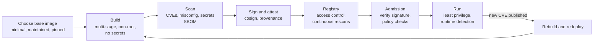
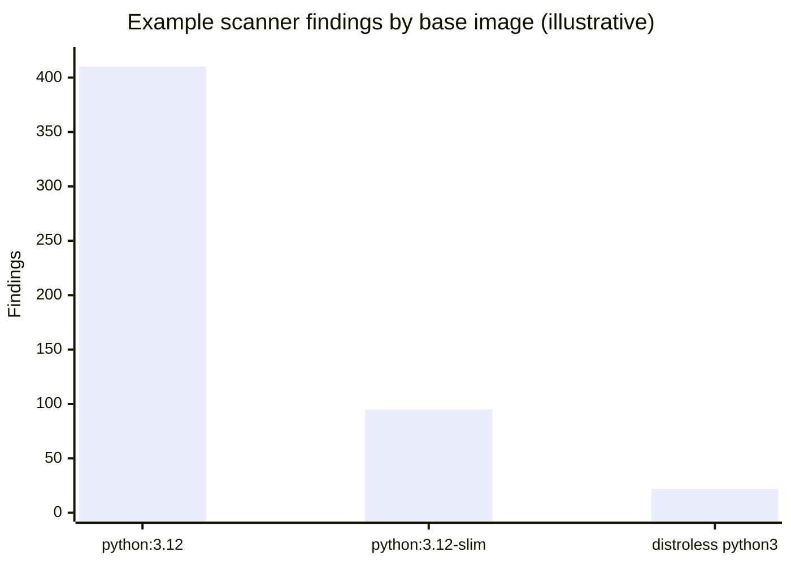

# Container image security

## Summary

A container image packages an application with its operating system libraries and runtime, so every vulnerability, secret and misconfiguration inside it ships to production with the application. Container image security covers the whole image lifecycle: choosing a small, maintained base image; building with multi-stage builds, a non-root user and no secrets in layers; scanning images for known vulnerabilities and misconfigurations in CI and continuously in registries; signing images and recording their SBOM; admitting only trusted, verified images into clusters; and running them with least privilege and runtime detection. The reference guidance is NIST SP 800-190 (Application Container Security Guide) and the CIS benchmarks for Docker and Kubernetes. The most effective single measure is usually to ship less: minimal and distroless base images remove most of the vulnerabilities scanners would otherwise report.

## Prerequisites

- [Docker](../containers-and-virtualization/docker.md) for images, layers and Dockerfiles.
- [Application security testing in pipelines](application-security-testing.md) and [Software supply chain security](software-supply-chain-security.md).

## Core concepts

### What is in an image and why it matters

An image is a stack of read-only layers plus configuration (entry point, user, environment, exposed ports). A typical image based on a general-purpose distribution contains a package manager, a shell, hundreds of libraries and tools the application never uses. Each is potential attack surface (tools an attacker can use after a compromise) and a source of scanner findings that must be triaged.

*Analogy.* Packing for a trip by plane. Every item you pack must pass security and you are responsible for it; bringing the whole contents of your house means more to inspect, more to lose and more that can be used against you. A carefully packed carry-on with only what you need is faster to check and safer. The analogy breaks on freshness: luggage does not develop new problems after packing, while an image that was clean at build time accumulates known vulnerabilities as new CVEs are published, which is why images must be rescanned and rebuilt regularly.

NIST SP 800-190 groups container risks into five areas:

| Risk area | Examples |
| --- | --- |
| Image risks | Vulnerabilities, configuration defects, embedded malware, embedded clear-text secrets, use of untrusted images |
| Registry risks | Insecure connections, stale images, insufficient authentication and authorization |
| Orchestrator risks | Unbounded administrative access, unauthorized access, poorly separated workloads, orchestrator node trust |
| Container risks | Runtime software vulnerabilities, unbounded network access, insecure runtime configurations, app vulnerabilities, rogue containers |
| Host OS risks | Large attack surface, shared kernel, host OS component vulnerabilities, improper user access rights, host file system tampering |

This note focuses on the image and registry areas; orchestrator and runtime hardening belong to the Kubernetes knowledge repository and to host hardening notes.

### The image security lifecycle



The flowchart shows the stages; the loop at the end matters as much as the first build, because images age.

### Choosing a base image

| Base image type | Example | Size (order of magnitude) | Shell and package manager | Notes |
| --- | --- | --- | --- | --- |
| Full distribution | `debian:12`, `ubuntu:24.04` | 75 to 120 MB | Yes | Familiar, many packages, many scanner findings |
| Slim distribution | `debian:12-slim`, `python:3.12-slim` | 25 to 50 MB plus runtime | Yes | Good compromise |
| Alpine | `alpine:3.20` | about 8 MB | Yes (`apk`) | musl libc can cause compatibility and performance differences |
| Distroless | `gcr.io/distroless/static-debian12`, `gcr.io/distroless/python3-debian12` | 2 MB (static) to tens of MB | No | No shell; debugging through ephemeral containers |
| Hardened minimal images | Chainguard images (Wolfi), Docker Hardened Images, other vendors | Small | Usually no | Rebuilt frequently, near-zero known CVEs, SBOM and signatures included |
| `scratch` | `FROM scratch` | Only your binary | No | For static binaries (Go, Rust) |

Image sizes are approximate and change with releases (checked 2026-11). Rules: use official or verified publishers, pin by digest (`FROM python:3.12-slim@sha256:...`) and let a bot update the digest, and prefer images with a defined update cadence.

### Building securely

A multi-stage Dockerfile keeps compilers and build tools out of the final image:

```dockerfile
# syntax=docker/dockerfile:1
# Build stage: has the toolchain
FROM golang:1.23@sha256:<DIGEST> AS build
WORKDIR /src
COPY go.mod go.sum ./
RUN go mod download
COPY . .
RUN CGO_ENABLED=0 go build -trimpath -ldflags="-s -w" -o /out/app ./cmd/app

# Runtime stage: only the binary, no shell, non-root user
FROM gcr.io/distroless/static-debian12:nonroot@sha256:<DIGEST>
COPY --from=build /out/app /app
USER nonroot:nonroot
EXPOSE 8080
ENTRYPOINT ["/app"]
```

Checklist:

- **Non-root user** (`USER` with a numeric UID or a named non-root user); combined with a read-only root file system at runtime.
- **No secrets in layers.** Every `COPY` and `RUN` creates a layer that stays in the image even if a later step deletes the file. Use BuildKit secret mounts (`RUN --mount=type=secret,id=npmrc ...`) for build-time credentials.
- **Minimal packages**, installed with `--no-install-recommends` and caches removed in the same layer.
- **`.dockerignore`** to keep `.git`, `.env`, test data and credentials out of the build context.
- **Explicit `HEALTHCHECK` or orchestrator probes**, and labels with source and version (OCI annotations such as `org.opencontainers.image.source`).
- **Lint the Dockerfile** with Hadolint; scan it for misconfigurations with Trivy or Checkov.

### Scanning images

Image scanners unpack the layers, identify OS packages (from the package database) and language packages (from lock files and binaries), and match them against vulnerability data from distribution security trackers and advisory databases.

| Tool | Notes |
| --- | --- |
| Trivy (Aqua Security) | Vulnerabilities, misconfigurations, secrets, licenses, SBOM generation; images, file systems, repositories, Kubernetes |
| Grype (Anchore), with Syft for SBOMs | Fast vulnerability scanning, can scan an existing SBOM |
| Docker Scout | Integrated with Docker Desktop and Docker Hub |
| Clair (Quay) | Registry-integrated scanning |
| Cloud registry scanning | Amazon ECR, Google Artifact Registry, Azure Container Registry scan on push and continuously |

Interpreting results:

- **Fixable vs unfixable.** Many findings have no fixed package version in the distribution yet; block only on fixable findings above a severity threshold, and track the rest.
- **Distribution severity vs NVD severity.** Distributions rate how a CVE affects *their* build of a package (Debian may mark a CVE as minor or "not affecting" its configuration); scanners can use either.
- **Reachability and VEX.** A vulnerable library that is never loaded is less urgent; VEX documents record such decisions ([Software supply chain security](software-supply-chain-security.md)).
- **Continuous rescanning.** A clean image becomes vulnerable when a new CVE is published; registries and admission controllers should rescan running images, and pipelines should rebuild on base image updates.

### Registry security

- Private registries with authentication, least-privilege push rights (only CI identities push), and audit logs.
- Immutable tags for releases, so a tag cannot be overwritten.
- Retention policies that remove stale images, so old vulnerable images cannot be deployed by accident.
- Signatures and attestations (SBOM, provenance, scan results) stored next to images as OCI artifacts.
- Pull-through caches or mirrors for public images, so builds do not depend directly on public registries.

### Admission and runtime

At deployment, an admission controller enforces image policies: allowed registries, signatures from specific identities, no `latest` tag, no critical fixable vulnerabilities, non-root user ([Policy as code](policy-as-code.md)). At runtime, the Kubernetes Pod Security Standards (`restricted` profile) and security contexts drop capabilities, block privilege escalation and require a read-only root file system; runtime detection tools such as Falco (CNCF) alert on unexpected behavior, for example a shell spawned inside a container that has no shell in its image.

## Worked example

Compare scanner findings for the same Python web service built on three base images. Untested; Trivy 0.5x, checked 2026-11. The finding counts are illustrative examples of the typical pattern, not measurements; reproduce them with the commands below, as actual numbers change daily.

```bash
for img in shop:full shop:slim shop:distroless; do
  echo "== $img"
  trivy image --quiet --severity HIGH,CRITICAL --ignore-unfixed "$img" | grep -E "^Total"
done
trivy image --format cyclonedx --output sbom.cdx.json shop:distroless    # SBOM for the chosen image
```

| Image | Base | Size (MB) | Total findings (all severities) | High and critical, fixable |
| --- | --- | --- | --- | --- |
| `shop:full` | `python:3.12` (Debian full) | 1,020 | 410 | 18 |
| `shop:slim` | `python:3.12-slim` | 160 | 95 | 4 |
| `shop:distroless` | `gcr.io/distroless/python3-debian12` | 75 | 22 | 1 |



The chart plots the total findings column of the table. The pattern is consistent in practice: most findings come from packages the application never uses, so switching the base image removes far more risk (and triage work) than patching individual packages. The remaining high finding should be checked for a fix in the application's own dependencies, which a base image change cannot remove.

## Trade offs and when to use it

- **Minimal images** reduce attack surface and noise but make debugging harder (no shell); use ephemeral debug containers (`kubectl debug`) or debug variants of the image outside production.
- **Alpine** is small but uses musl libc, which occasionally breaks binary wheels and DNS behavior; slim Debian-based or distroless images avoid this.
- **Strict admission policies** stop unsafe images but can block emergency fixes; define a documented break-glass process.
- **Commercial hardened images** save rebuild work and come with SLAs for fixes, at a license cost and some vendor dependency.

## Common mistakes

- **Secrets added and deleted in later layers.** They remain in the image history. Fix: BuildKit secret mounts, scan images for secrets.
- **Running as root by default.** Fix: `USER` in the Dockerfile and `runAsNonRoot` in the pod security context.
- **Using `latest` or unpinned tags.** Builds become irreproducible and can pull a compromised image. Fix: pin by digest with automated updates.
- **Scanning only at build time.** Fix: continuous registry scanning and scheduled rebuilds.
- **Blocking on unfixable findings.** Teams cannot act, so they ignore the gate. Fix: block on fixable findings above a threshold, track the rest.
- **Full OS images for compiled binaries.** Fix: `scratch` or distroless static images.

## Practice

1. Name the five risk areas of NIST SP 800-190.
2. Why does deleting a secret file in a later Dockerfile step not remove it from the image?
3. What are the benefits and the main drawback of distroless images?
4. Why should images be rescanned after they are built and deployed?
5. What should an admission policy check about images?
6. Why is "fixable" a useful filter for blocking builds?

Answers:

1. Image risks, registry risks, orchestrator risks, container risks and host OS risks.
2. Each instruction creates a layer; the file exists in the earlier layer, which remains part of the image and can be extracted.
3. Fewer packages mean less attack surface and fewer findings, and no shell hampers attackers; the drawback is harder debugging.
4. New vulnerabilities are published daily, so an image that was clean at build time can become vulnerable without any change.
5. Allowed registries, a valid signature from the expected identity, pinned digests or no mutable tags, vulnerability thresholds, and security context requirements such as non-root.
6. Teams can act on fixable findings by updating packages or base images; blocking on unfixable ones only teaches teams to bypass the gate.

## Further reading

- [Application Container Security Guide, SP 800-190](https://csrc.nist.gov/pubs/sp/800/190/final) (NIST, 2017).
- [CIS Docker Benchmark](https://www.cisecurity.org/benchmark/docker) (Center for Internet Security).
- [Dockerfile best practices](https://docs.docker.com/build/building/best-practices/) and [build secrets](https://docs.docker.com/build/building/secrets/) (Docker).
- [Trivy documentation](https://trivy.dev/latest/docs/) (Aqua Security).
- [Distroless container images](https://github.com/GoogleContainerTools/distroless) (Google).
- [Pod Security Standards](https://kubernetes.io/docs/concepts/security/pod-security-standards/) (Kubernetes).
- [Falco](https://falco.org/docs/) (Falco project, CNCF).
