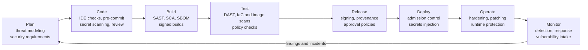
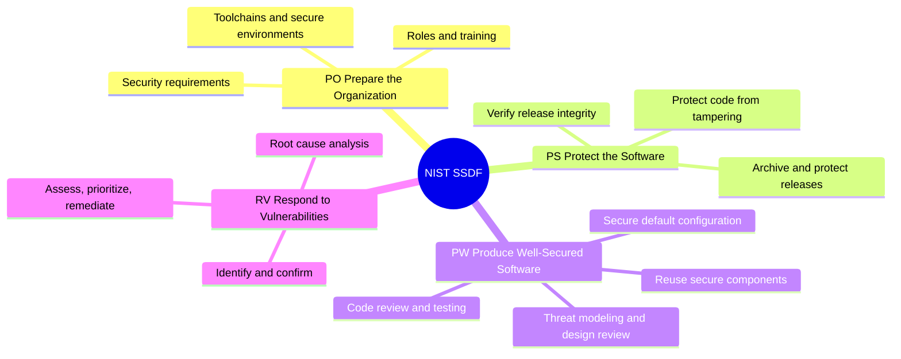
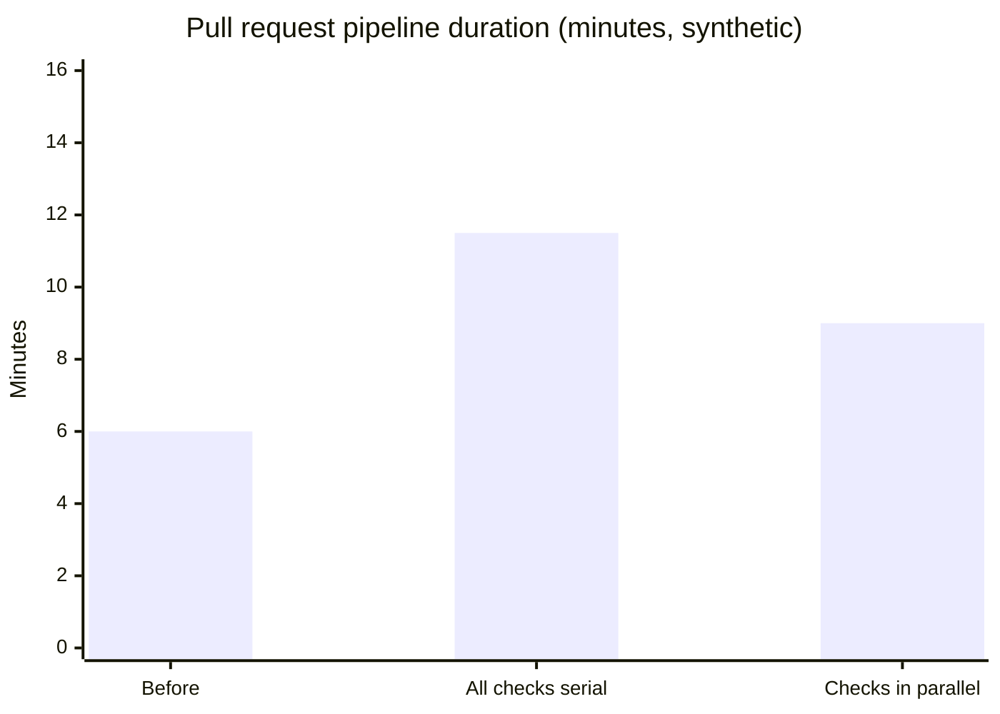

# DevSecOps overview

## Summary

DevSecOps integrates security into every stage of the DevOps lifecycle, so that security is a shared responsibility of the teams that build and run software, enforced continuously by automation, instead of a separate team's gate at the end. In practice it means threat modeling during design, secure defaults in templates and platforms, automated checks in the pipeline (static analysis, dependency and container scanning, secret scanning, infrastructure as code scanning, policy as code), protection of the delivery system itself (CI/CD security and software supply chain integrity), and detection and response in production. Frameworks such as the NIST Secure Software Development Framework (SSDF, SP 800-218), NIST SP 800-204D, OWASP SAMM and DSOMM, and SLSA describe what good looks like. The goal is not to find more vulnerabilities but to ship fewer, fix them faster and keep the pipeline fast enough that teams do not route around it.

## Prerequisites

- [DevOps overview](../foundations/devops-overview.md) and [The Three Ways](../foundations/three-ways.md).
- [CI/CD overview](../ci-cd/ci-cd-overview.md).

## Core concepts

### The problem DevSecOps solves

In a traditional release process, a security team reviewed or penetration-tested the application shortly before release. With quarterly releases this was slow but possible. With dozens of deployments per day it is impossible: either the security review becomes the bottleneck of the value stream, or it is skipped. Late findings are also expensive: a design flaw found in a pre-release test may require rework across many components, and teams under deadline pressure accept the risk instead. Meanwhile the attack surface has moved: modern applications consist mostly of open source dependencies, container images, cloud configuration and pipeline definitions, none of which a final penetration test examines well.

DevSecOps addresses this by moving security work to where decisions are made (design, code, configuration), automating the repeatable checks, and giving teams the knowledge and tools to own the security of what they build, with security specialists acting as an enabling and platform function.

*Analogy.* Food safety in a restaurant kitchen. A health inspector visiting twice a year (the old security gate) cannot keep food safe; safety comes from routines built into daily work: temperature logs, separate cutting boards, labeled containers, staff training and suppliers that are checked. The inspector still matters, but as a check on a system that is safe by design. The analogy breaks on adversaries: food poisoning is accidental, while software faces attackers who actively look for the one gap the routines missed, which is why monitoring and response in production remain part of the job.

### Principles

1. **Shift left, and shield right.** Do security work as early as possible (design, code), and keep detection and response in production, because not everything can be found early. Some practitioners call the combination *shift everywhere*.
2. **Automate the repeatable.** Every check that can run in the pipeline runs on every change; humans focus on design review, threat modeling and triage.
3. **Make the secure way the easy way.** Secure defaults, templates and golden paths on the platform beat policies in documents ([Team Topologies and platform engineering](../foundations/team-topologies.md)).
4. **Shared responsibility.** Product teams own the security of their services; security specialists provide expertise, tooling, standards and coaching (security champions programs).
5. **Risk-based prioritization.** Not every finding matters equally; fix what is exploitable and exposed first.
6. **Fast feedback.** Findings reach the developer in the pull request, in minutes, with a fix suggestion, not in a PDF report weeks later.
7. **Secure the delivery system too.** The pipeline, its credentials and its dependencies are part of the attack surface ([CI/CD security](cicd-security.md)).

### Security activities across the lifecycle

The flowchart places the main security activities on the stages of the DevOps lifecycle. Each activity has a home note:

| Activity | Home note |
| --- | --- |
| Threat modeling | [Threat modeling](threat-modeling.md) |
| SAST, DAST, SCA, IAST, secret and IaC scanning | [Application security testing in pipelines](application-security-testing.md) |
| SBOM, provenance, signing, SLSA | [Software supply chain security](software-supply-chain-security.md) |
| Image hardening and scanning, admission | [Container image security](container-image-security.md) |
| Guardrails as code | [Policy as code](policy-as-code.md) |
| Protecting pipelines and runners | [CI/CD security](cicd-security.md) |
| Credentials | [Secrets management](secrets-management.md) |
| TLS certificates and keys | [Certificates for domains](../networking/network-security/domain-certificates.md) |

### Frameworks and standards

| Framework | Publisher | What it gives you |
| --- | --- | --- |
| Secure Software Development Framework (SSDF), SP 800-218, version 1.1 (2022) | NIST | High-level practices in four groups: Prepare the Organization (PO), Protect the Software (PS), Produce Well-Secured Software (PW), Respond to Vulnerabilities (RV); referenced by US federal software procurement rules |
| SP 800-204D (2024) | NIST | Strategies for integrating software supply chain security into DevSecOps CI/CD pipelines |
| SP 800-190 (2017) | NIST | Application container security guide ([Container image security](container-image-security.md)) |
| OWASP SAMM | OWASP | Maturity model for a software security program: governance, design, implementation, verification, operations |
| OWASP DSOMM | OWASP | Maturity model specific to DevSecOps activities ([DevOps maturity models](../foundations/devops-maturity-models.md)) |
| OWASP Top 10 and ASVS | OWASP | The most critical web application risks, and a verification standard of security requirements |
| OWASP Top 10 CI/CD Security Risks | OWASP | Risks of the delivery system itself |
| SLSA | OpenSSF | Levels for build integrity and provenance ([Software supply chain security](software-supply-chain-security.md)) |
| CIS Benchmarks and CIS Controls | Center for Internet Security | Hardening baselines for operating systems, containers, Kubernetes and clouds |

The SSDF groups map naturally to the lifecycle: PO is the organizational foundation (roles, training, toolchains), PS protects code and artifacts from tampering, PW is secure design, coding, review and testing, and RV is vulnerability intake, triage and remediation.

The mind map summarizes the four SSDF practice groups and examples of their practices (paraphrased from SP 800-218).

### Prioritizing vulnerabilities

Automated scanning produces many findings; triage decides what to fix first. Signals to combine:

| Signal | Source | Meaning |
| --- | --- | --- |
| CVSS base score (v3.1, v4.0 since 2023) | FIRST, published in NVD and advisories | Severity of the vulnerability in general, 0 to 10 |
| EPSS | FIRST | Probability that the vulnerability is exploited in the wild in the next 30 days |
| CISA Known Exploited Vulnerabilities (KEV) catalog | CISA | Evidence of active exploitation |
| Reachability | SCA tools with call-graph analysis | Whether your code actually calls the vulnerable function |
| Exposure and asset value | Your inventory | Internet-facing, handles sensitive data, privileges |
| VEX statements | Vendors and your own analysis | Whether a product is affected by a CVE in its components |

A practical rule: fix known exploited and reachable vulnerabilities in exposed services first, regardless of CVSS; treat CVSS alone as a poor prioritization signal, because most high-CVSS vulnerabilities are never exploited.

### Metrics

| Metric | What it tells you |
| --- | --- |
| Mean or median time to remediate, by severity | How fast the organization fixes what it finds |
| Vulnerability backlog age | Whether findings are being ignored |
| Escaped vulnerabilities (found in production or by external reports) | Effectiveness of earlier checks |
| Coverage: share of repositories with SAST, SCA, secret scanning, signed builds | Whether controls are actually deployed |
| False positive rate and developer override rate | Whether tools are trusted or bypassed |
| Pipeline time added by security checks | Cost to flow |
| DORA metrics | Whether security is slowing delivery ([DORA metrics](../foundations/dora-metrics.md)) |

### Roles

- **Product teams** own fixing findings in their code and dependencies and run the checks in their pipelines.
- **Security champions**: developers in each team with extra training, a link to the security team and time to spread practices.
- **Security engineering (enabling and platform)**: builds the shared tooling, policies and golden paths, provides threat modeling facilitation and expertise.
- **Security operations**: detection, incident response, vulnerability intake from external researchers (a disclosure policy and `security.txt`, RFC 9116).

## Worked example

A team adds security checks to a pipeline that currently runs build and unit tests in 6 minutes. The goal is to keep feedback under 15 minutes for pull requests (synthetic timings, tools as examples; checked 2026-11, untested).

| Stage | Tool examples | Runs on | Added time (minutes) | Blocks merge on |
| --- | --- | --- | --- | --- |
| Secret scanning | Gitleaks | Every push | 0.5 | Any verified secret |
| SAST | Semgrep, CodeQL | Pull request | 3 | New high-severity findings |
| SCA | OSV-Scanner, Trivy | Pull request | 1 | New known-exploited or critical reachable vulnerabilities |
| IaC scanning | Checkov, Trivy | Pull request touching IaC | 1 | Policy violations of severity high |
| Container scan and SBOM | Trivy, Syft | Main branch build | 2 | Critical fixable vulnerabilities in the base image |
| Signing and provenance | cosign, SLSA generator | Release | 1 | Never (always runs) |
| DAST baseline | ZAP baseline scan | Nightly against staging | (not in PR) | Report only |

The chart compares the pipeline before, with all pull request checks run one after another (6 + 0.5 + 3 + 1 + 1 = 11.5 minutes), and with the checks run in parallel after the build (about 9 minutes). Design choices that keep the pipeline trusted:

1. **Block only on new, high-confidence findings** (diff-aware scanning); existing findings go to a backlog with a deadline, so teams are not blocked by history.
2. **Make findings actionable in the pull request** with file, line and fix suggestion.
3. **Run slow scans out of band** (DAST nightly), with results routed to the owning team.
4. **Measure** override rates and time to remediate, and tune rules that produce noise.

## Trade offs and when to use it

- **Benefits.** Fewer vulnerabilities reach production, faster fixes, security that scales with the number of teams and deployments, evidence for compliance as a by-product of the pipeline.
- **Costs.** Tool licenses and operation, triage effort, training, and pipeline time. Poorly tuned tools create alert fatigue and teach developers to ignore or bypass them.
- **Limits.** Automated checks find known patterns; design flaws, business logic abuse and novel attacks need threat modeling, review and testing by people. Shifting left does not remove the need for detection and response in production.
- **When to use it.** Any team that deploys frequently; the depth (which checks block, how strict policies are) should follow the risk of the system.

## Common mistakes

- **Adding every scanner at once in blocking mode.** Teams drown in findings and bypass the pipeline. Fix: start in report mode, tune, then block on a small set of high-confidence rules.
- **Treating DevSecOps as buying tools.** Fix: combine tools with threat modeling, training, ownership and metrics.
- **Ignoring the pipeline itself.** Attackers target CI/CD and dependencies. Fix: CI/CD security and supply chain controls.
- **Prioritizing by CVSS alone.** Fix: combine exploitation evidence (KEV, EPSS), reachability and exposure.
- **Security team as the sole fixer.** Fix: findings go to the owning team; security enables.

## Practice

1. What problem does DevSecOps solve that a pre-release penetration test cannot?
2. Name the four practice groups of the NIST SSDF.
3. Why is "shift left" alone insufficient?
4. Which signals besides CVSS help prioritize a vulnerability?
5. How do you avoid blocking every pull request because of existing findings?
6. Give two metrics that show whether security tools are trusted by developers.

Answers:

1. Continuous, automated checks on every change at the speed of frequent deployments, and coverage of dependencies, configuration and the pipeline, which a late, periodic test does not provide.
2. Prepare the Organization (PO), Protect the Software (PS), Produce Well-Secured Software (PW), Respond to Vulnerabilities (RV).
3. Not every issue can be found before release (new vulnerabilities in dependencies, runtime attacks, misconfigurations), so detection and response in production remain necessary.
4. Exploitation evidence (CISA KEV), exploitation probability (EPSS), reachability in your code, exposure of the service and value of the asset, and VEX statements.
5. Diff-aware scanning that blocks only on findings introduced by the change, with a backlog and deadlines for existing ones.
6. False positive rate and override or suppression rate (also whether teams disable checks).

## Further reading

- [Secure Software Development Framework (SSDF) Version 1.1, SP 800-218](https://csrc.nist.gov/pubs/sp/800/218/final) (NIST, 2022).
- [Strategies for the Integration of Software Supply Chain Security in DevSecOps CI/CD Pipelines, SP 800-204D](https://csrc.nist.gov/pubs/sp/800/204/d/final) (NIST, 2024).
- [OWASP SAMM](https://owaspsamm.org/) and [OWASP DevSecOps Maturity Model](https://dsomm.owasp.org/) (OWASP).
- [OWASP DevSecOps Guideline](https://owasp.org/www-project-devsecops-guideline/) (OWASP).
- [Shift left on security](https://dora.dev/capabilities/shifting-left-on-security/) (DORA capability guide).
- [Exploit Prediction Scoring System (EPSS)](https://www.first.org/epss/) (FIRST) and [Known Exploited Vulnerabilities Catalog](https://www.cisa.gov/known-exploited-vulnerabilities-catalog) (CISA).
- *Agile Application Security* (Laura Bell, Michael Brunton-Spall, Rich Smith, Jim Bird, O'Reilly, 2017).
