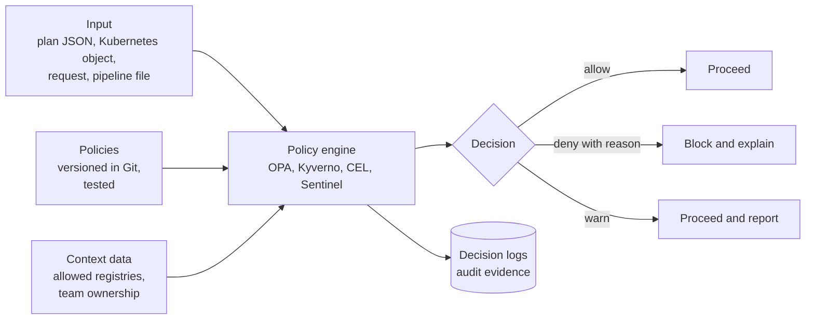
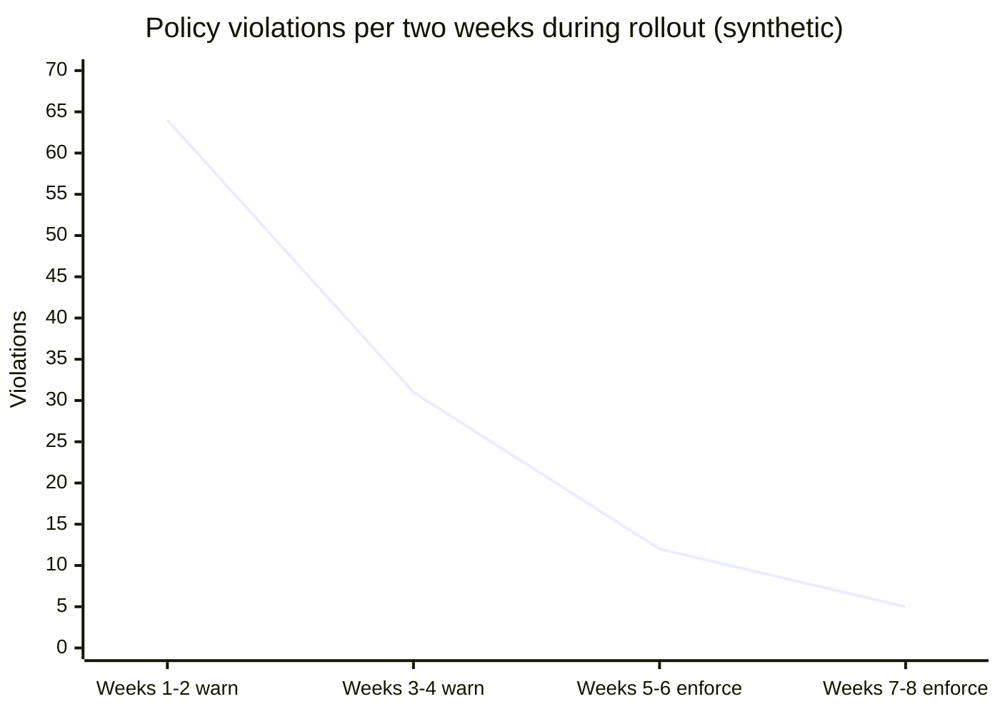

# Policy as code

## Summary

Policy as code expresses organizational rules (security, compliance, cost, operational standards) as machine-readable code that is versioned, reviewed, tested and evaluated automatically, instead of as documents that people must remember to follow. A policy engine takes structured input (a Terraform plan, a Kubernetes object, an API request, a CI pipeline definition), evaluates it against the policies and returns a decision: allow, deny, or warn, with a reason. The most widely used engines are Open Policy Agent (OPA) with its Rego language, Kyverno and the built-in ValidatingAdmissionPolicy with CEL for Kubernetes, Conftest for configuration files in CI, HashiCorp Sentinel for HCP Terraform, and the native policy services of the clouds. Enforced at several points (pull request, plan, admission, runtime audit), policies become guardrails that make the secure and compliant path the default, with evidence for auditors as a by-product.

## Prerequisites

- [DevSecOps overview](devsecops-overview.md).
- [Infrastructure as code](../infrastructure-as-code/infrastructure-as-code-overview.md) and basic Kubernetes objects.

## Core concepts

### The problem policy as code solves

Rules such as "storage must be encrypted", "no public load balancers without a WAF", "every resource has an owner tag" or "containers must not run privileged" traditionally live in wiki pages and are checked by manual review or periodic audits. At the speed of DevOps this fails: reviewers miss violations, audits find them months later, and teams experience security as arbitrary blocking. Policy as code makes the rules explicit, testable and automatic, gives immediate feedback with an explanation, and lets the rules evolve through the same review process as the code they govern.

*Analogy.* Building codes enforced by the design software. Instead of an inspector checking a finished house against a thick rulebook, the architect's software refuses to place a staircase that is too steep and explains why. The rules are the same for every architect, updated centrally, and the inspector's job becomes reviewing exceptions. The analogy breaks on intent: building software rarely deals with people trying to circumvent it, while policy engines must be placed where they cannot be bypassed, such as admission control, not only as an optional linter.

### How a policy engine works



The diagram shows the separation that defines policy as code: the decision logic (policies) is separate from the systems that enforce it, takes structured input plus context data, and records every decision for audit.

Key properties:

- **Decoupled**: the application or platform asks "is this allowed?" and enforces the answer; the logic lives in policies.
- **Declarative**: policies describe what must be true, not how to check it step by step.
- **Testable**: policies have unit tests with example inputs.
- **Versioned and reviewed**: changes go through pull requests like code.
- **Auditable**: decision logs show what was evaluated and why it was allowed or denied.

### Enforcement points

| Point | Input | Example tools | Effect |
| --- | --- | --- | --- |
| Developer machine and pull request | IaC files, manifests, Dockerfiles | Conftest, Checkov, Kyverno CLI, `opa eval` | Fast feedback before merge |
| CI pipeline, plan stage | `terraform show -json` plan, rendered Helm output | Conftest, OPA, Sentinel and OPA in HCP Terraform | Block applies that violate policy, with final values |
| Kubernetes admission | Objects sent to the API server | ValidatingAdmissionPolicy (CEL), OPA Gatekeeper, Kyverno | Reject or mutate objects at creation; cannot be bypassed by skipping CI |
| Cloud control plane | API calls to the cloud | AWS Service Control Policies and Config rules, Azure Policy, Google Cloud Organization Policy | Prevent or detect non-compliant resources, even created manually |
| Runtime and audit | Existing resources | Gatekeeper audit, Kyverno background scans, Cloud Custodian, AWS Config | Find drift and resources created before the policy |
| Application authorization | User requests | OPA as a sidecar or library, Cedar (AWS), OpenFGA | Fine-grained access decisions |

A robust setup enforces the most important rules in two places: early (pull request, for fast feedback) and at a point that cannot be skipped (admission or cloud control plane).

### The main engines

**Open Policy Agent (OPA)**, a graduated CNCF project, is a general-purpose engine. Policies are written in Rego, a declarative query language: rules produce values (such as a set of deny messages) when their conditions are true for the input.

```rego
# policy/terraform/buckets.rego, OPA 1.x (Rego v1 syntax)
package terraform.buckets

import rego.v1

# deny public S3 bucket ACLs in a Terraform plan
deny contains msg if {
  some rc in input.resource_changes
  rc.type == "aws_s3_bucket_acl"
  rc.change.after.acl in {"public-read", "public-read-write"}
  msg := sprintf("%s: public ACL '%s' is not allowed", [rc.address, rc.change.after.acl])
}

# require an owner tag on every created resource that supports tags
deny contains msg if {
  some rc in input.resource_changes
  "create" in rc.change.actions
  tags := object.get(rc.change.after, "tags", null)
  tags != null
  not tags.owner
  msg := sprintf("%s: missing required tag 'owner'", [rc.address])
}
```

**Conftest** runs Rego policies against structured files (JSON, YAML, HCL, Dockerfiles) and is the usual way to use OPA in CI.

**OPA Gatekeeper** runs OPA as a Kubernetes admission webhook with `ConstraintTemplate` and `Constraint` custom resources, plus audit of existing objects.

**Kyverno**, a CNCF project, is Kubernetes-native: policies are written as YAML resources, can validate, mutate (add defaults), generate resources and verify image signatures, without learning Rego.

**ValidatingAdmissionPolicy** is built into Kubernetes (generally available since Kubernetes 1.30, April 2024) and uses the Common Expression Language (CEL), evaluated in the API server without a webhook:

```yaml
apiVersion: admissionregistration.k8s.io/v1
kind: ValidatingAdmissionPolicy
metadata:
  name: no-privileged-containers
spec:
  failurePolicy: Fail
  matchConstraints:
    resourceRules:
      - apiGroups: [""]
        apiVersions: ["v1"]
        operations: ["CREATE", "UPDATE"]
        resources: ["pods"]
  validations:
    - expression: >-
        object.spec.containers.all(c,
          !has(c.securityContext) || !has(c.securityContext.privileged) || c.securityContext.privileged == false)
      message: "Privileged containers are not allowed."
---
apiVersion: admissionregistration.k8s.io/v1
kind: ValidatingAdmissionPolicyBinding
metadata:
  name: no-privileged-containers
spec:
  policyName: no-privileged-containers
  validationActions: ["Deny"]
```

**Sentinel** is HashiCorp's policy language for HCP Terraform, Terraform Enterprise and other HashiCorp products, with enforcement levels advisory, soft mandatory and hard mandatory (see the Terraform knowledge repository). HCP Terraform also runs OPA policies.

| Engine | Language | Scope | Strengths | Limits |
| --- | --- | --- | --- | --- |
| OPA and Conftest | Rego | Anything with JSON input | General purpose, one language everywhere, strong testing | Rego has a learning curve |
| OPA Gatekeeper | Rego | Kubernetes admission and audit | Mature, audit of existing objects | Webhook operations, Rego |
| Kyverno | YAML (plus CEL and JMESPath) | Kubernetes | Easy to read, mutation, generation, image verification | Kubernetes only |
| ValidatingAdmissionPolicy | CEL | Kubernetes admission | Built in, no webhook, fast | Validation only, simpler logic, no external data calls |
| Sentinel | Sentinel | HashiCorp products | Integrated in HCP Terraform runs | Commercial, HashiCorp only |
| Cloud policy services | JSON, Rego (Azure Policy uses JSON rules) | One cloud | Enforced in the control plane, cannot be bypassed | Cloud-specific |

### Writing good policies

- **Explain the denial.** Every deny message names the resource, the rule and how to fix it, ideally with a link to the standard.
- **Start in audit or warn mode**, measure violations, fix existing resources, then enforce.
- **Test policies** with passing and failing inputs (`opa test`, `kyverno test`, `conftest verify`) in CI.
- **Use exceptions as code**: a documented, reviewed exemption list with expiry dates, not ad hoc disabling.
- **Keep policies small and composable**, one rule per concern, organized by domain.
- **Version and distribute** policies as bundles (OPA bundles, OCI artifacts) so all enforcement points use the same version.
- **Map policies to controls** (CIS benchmarks, internal standards, regulatory requirements), so decision logs become compliance evidence.

## Worked example

Enforce two rules on Terraform plans in CI with Conftest and test the policy. Untested; Terraform 1.9, Conftest 0.5x, OPA 1.x, checked 2026-11.

```bash
terraform plan -out=tfplan
terraform show -json tfplan > plan.json
conftest test plan.json --policy policy/terraform --namespace terraform.buckets
```

Output for a plan that adds a public bucket without an owner tag:

```text
FAIL - plan.json - terraform.buckets - aws_s3_bucket_acl.assets: public ACL 'public-read' is not allowed
FAIL - plan.json - terraform.buckets - aws_s3_bucket.assets: missing required tag 'owner'

2 tests, 0 passed, 0 warnings, 2 failures, 0 exceptions
```

A unit test for the policy, run with `opa test policy/ -v`:

```rego
package terraform.buckets_test

import rego.v1
import data.terraform.buckets

test_public_acl_denied if {
  some msg in buckets.deny with input as {"resource_changes": [{
    "address": "aws_s3_bucket_acl.a", "type": "aws_s3_bucket_acl",
    "change": {"actions": ["create"], "after": {"acl": "public-read"}}}]}
  contains(msg, "public ACL")
}

test_private_bucket_with_owner_allowed if {
  count(buckets.deny) == 0 with input as {"resource_changes": [{
    "address": "aws_s3_bucket.b", "type": "aws_s3_bucket",
    "change": {"actions": ["create"], "after": {"tags": {"owner": "team-shop"}}}}]}
}
```

Rollout plan with measured results (synthetic, eight weeks across 40 Terraform repositories):

| Week | Mode | Plans evaluated | Violations | Violating plans merged |
| --- | --- | --- | --- | --- |
| 1 to 2 | Warn | 310 | 64 | 64 |
| 3 to 4 | Warn, owners notified | 295 | 31 | 31 |
| 5 to 6 | Enforce | 320 | 12 | 0 |
| 7 to 8 | Enforce | 305 | 5 | 0 |



The chart plots the violations column: the warn phase let teams fix existing code without being blocked, and by the time enforcement started, violations were rare enough that blocking caused little friction.

## Trade offs and when to use it

- **Benefits.** Consistent, automatic, explainable enforcement; fast feedback; audit evidence; rules evolve through review.
- **Costs.** Learning a policy language, writing and testing policies, operating admission webhooks (availability and latency of the API server path).
- **Risks.** Over-restrictive policies block legitimate work and push teams to workarounds; a failing admission webhook with `failurePolicy: Fail` can block all deployments.
- **Choosing an engine.** For Kubernetes-only rules, start with ValidatingAdmissionPolicy or Kyverno; for one language across Terraform, Kubernetes, CI and applications, use OPA; in HCP Terraform, use its integrated Sentinel or OPA policies.

## Common mistakes

- **Enforcing on day one.** Fix: audit and warn first, then enforce.
- **Deny messages without guidance.** Fix: say what is wrong and how to fix it.
- **Policies only in CI.** They can be bypassed by applying changes directly. Fix: also enforce at admission or in the cloud control plane.
- **Untested policies.** A typo can allow everything or block everything. Fix: policy unit tests in CI.
- **Exceptions by disabling policies.** Fix: exception lists as code with owners and expiry.
- **Webhook as a single point of failure.** Fix: highly available deployment, timeouts, and exclusions for system namespaces.

## Practice

1. What are the inputs and the output of a policy engine?
2. Why should important rules be enforced both in the pull request and at admission or in the cloud control plane?
3. When would you choose ValidatingAdmissionPolicy over OPA Gatekeeper?
4. Why evaluate Terraform plans rather than `.tf` files?
5. Describe a safe rollout of a new policy.
6. What makes a deny message useful?

Answers:

1. Structured input (a plan, an object, a request), policies and optional context data; the output is a decision (allow, deny, warn) with reasons, plus a decision log.
2. The pull request gives fast feedback; admission or control-plane enforcement cannot be bypassed by skipping the pipeline.
3. For straightforward validation rules in Kubernetes when you want a built-in mechanism without operating a webhook, and when you do not need audit of existing objects or Rego's expressiveness.
4. The plan contains the final values after variables, modules, functions and defaults are resolved, which file scanning cannot always determine.
5. Write and test the policy, run it in audit or warn mode, measure and fix violations, notify owners, then enforce, with an exception process.
6. It names the resource and the rule, explains why, and says how to fix it (with a link to the standard).

## Further reading

- [Open Policy Agent documentation](https://www.openpolicyagent.org/docs/latest/) (OPA, CNCF): Rego, testing, bundles.
- [Conftest](https://www.conftest.dev/) (Open Policy Agent project).
- [Kyverno documentation](https://kyverno.io/docs/) (Kyverno, CNCF).
- [Validating Admission Policy](https://kubernetes.io/docs/reference/access-authn-authz/validating-admission-policy/) (Kubernetes).
- [OPA Gatekeeper](https://open-policy-agent.github.io/gatekeeper/website/docs/) (OPA project).
- [Common Expression Language](https://cel.dev/) (Google).
- [Policy as Code](https://www.oreilly.com/library/view/policy-as-code/9781098139179/) (Jimmy Ray, O'Reilly, 2024).
