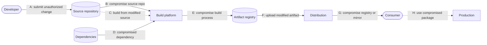
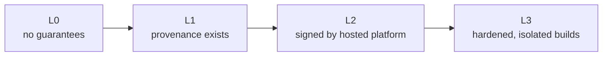
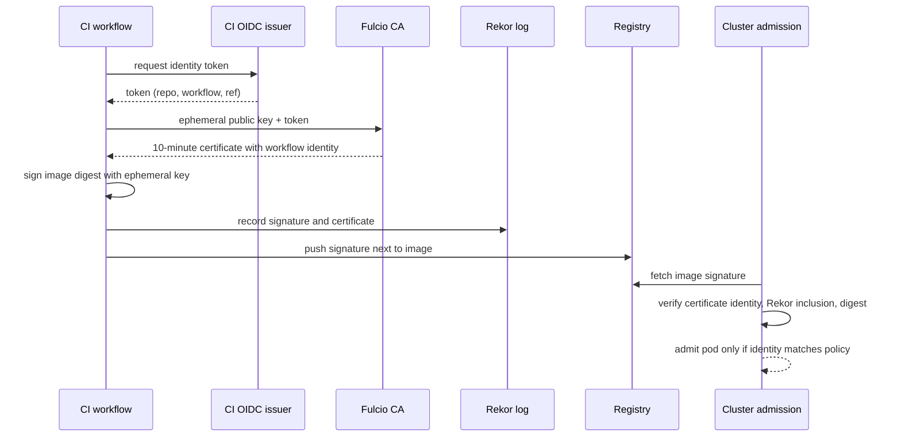

# Software supply chain security

## Summary

The software supply chain is everything that goes into producing and delivering a piece of software: source code and its contributors, third-party dependencies, build tools and systems, the CI/CD pipeline, artifact registries and the deployment path. Supply chain attacks compromise one of these links to reach every user downstream, as in SolarWinds (2020), Codecov (2021), the xz utils backdoor (2024) and the tj-actions GitHub Action compromise (2025). Defenses fall into three groups: **know what you ship** (software bills of materials, SBOMs, in SPDX or CycloneDX format), **prove how it was built** (provenance attestations and the SLSA framework's build levels), and **verify before you trust** (artifact signing with Sigstore, verification at deployment, dependency hygiene and policies). Together they turn "we hope this artifact is what we built" into a verifiable chain of evidence from commit to production.

## Prerequisites

- [DevSecOps overview](devsecops-overview.md) and [Application security testing in pipelines](application-security-testing.md).
- [CI/CD overview](../ci-cd/ci-cd-overview.md).

## Core concepts

### Why the supply chain became a target

Attackers aim for the highest leverage. Compromising one popular library, build system or CI action gives access to thousands of organizations at once, and the malicious code arrives signed, through trusted update channels. Modern applications magnify the risk: a typical application has hundreds of transitive dependencies, maintained by volunteers, pulled from public registries at build time.

The incidents below are described for defensive understanding; each changed industry practice.

| Year | Incident | Link compromised | Lesson |
| --- | --- | --- | --- |
| 2018 | event-stream (npm) | A new maintainer added a dependency that stole cryptocurrency wallets | Maintainer handover and transitive dependencies are attack paths |
| 2020 | SolarWinds Orion (SUNBURST) | Build system: malware injected during compilation of signed releases | Signing alone does not prove the build was clean; build integrity matters |
| 2021 | Codecov Bash Uploader | A modified script downloaded in CI pipelines exfiltrated environment variables | Unpinned scripts fetched at build time execute with pipeline secrets |
| 2021 | Dependency confusion (research by Alex Birsan) | Public packages with the names of internal packages were installed by build tools | Registry resolution order must be controlled |
| 2021 | Log4Shell (CVE-2021-44228) | Not an attack on the chain but a critical flaw in a ubiquitous dependency | You must know where every component is used (SBOM) |
| 2024 | xz utils backdoor (CVE-2024-3094) | A long-term social engineering campaign gained maintainer rights and hid a backdoor in release tarballs | Release artifacts can differ from the source repository; reproducible builds help |
| 2025 | tj-actions/changed-files (CVE-2025-30066) | A widely used GitHub Action was modified to print CI secrets to logs | Pin actions to commit SHAs; limit token permissions |

The corresponding MITRE ATT&CK technique is T1195 (Supply Chain Compromise), with sub-techniques for dependencies and development tools (T1195.001) and software supply chain (T1195.002).

*Analogy.* Food traceability. A supermarket that can show, for every package, which farm grew the ingredients, which factory processed them and which truck delivered them, with tamper-evident seals at each step, can recall exactly the affected products when a problem appears, and refuses packages with broken seals. Without traceability, every product is suspect. The analogy breaks on intent: food contamination is mostly accidental, while software supply chain attacks are deliberate and designed to pass inspections, so the evidence must be cryptographically verifiable, not just labels.

### Threats along the chain



The flowchart follows the threat model of the SLSA specification, which labels threats A to H along the path from developer to consumer (wording simplified here). Each defense in this note covers some of these letters: source controls (A, B), build integrity and provenance (C, E), dependency management (D), signing and verification (F, G, H).

### Know what you ship: SBOMs

A software bill of materials (SBOM) is a machine-readable inventory of the components in a piece of software: names, versions, suppliers, identifiers (Package URL, CPE), hashes, licenses and dependency relationships.

| Format | Maintainer | Notes |
| --- | --- | --- |
| SPDX | Linux Foundation; ISO/IEC 5962:2021 | Version 3.0 (2024) adds profiles for security, build and AI |
| CycloneDX | OWASP; Ecma International ECMA-424 | Strong security focus: vulnerabilities, VEX, services, cryptography inventory |

The US National Telecommunications and Information Administration (NTIA) published *minimum elements* for an SBOM in 2021 (supplier, component name, version, unique identifiers, dependency relationship, author of the SBOM data, timestamp), following US Executive Order 14028 (May 2021) on improving the nation's cybersecurity; CISA has since proposed an updated list (TODO: verify the status of CISA's updated minimum elements). The EU Cyber Resilience Act also requires manufacturers to document components, with obligations phasing in from 2026 to 2027 (TODO: verify dates).

Uses of an SBOM:

- answer "are we affected by CVE X?" in minutes across all products;
- feed continuous vulnerability monitoring after release (new CVEs in old builds);
- license compliance;
- give customers transparency.

**VEX** (Vulnerability Exploitability eXchange) complements SBOMs: a statement that a product is *not affected*, *affected*, *fixed* or *under investigation* for a given vulnerability, with a justification (for example "vulnerable code not present" or "vulnerable code not in execute path"). It cuts the noise of scanners that report every CVE in every component. Formats: CSAF VEX, CycloneDX VEX, OpenVEX.

SBOMs should be generated during the build from the actual artifacts (Syft, Trivy, cdxgen, language plugins), not written by hand, and stored and signed with the artifact.

### Prove how it was built: provenance and SLSA

*Provenance* is verifiable information about how an artifact was produced: which source repository and commit, which build platform, which build instructions, which inputs, when. It is published as an *attestation*: a signed statement about a subject (the artifact, identified by its digest). The in-toto attestation framework defines the envelope and statement format; SLSA defines the provenance content.

**SLSA** (Supply-chain Levels for Software Artifacts, pronounced "salsa"), an OpenSSF project started by Google, specifies incremental levels. Version 1.0 (2023) defined the Build track; version 1.2 added a Source track (checked 2026-11).

| Build level | Requirements (summary) | Protects against |
| --- | --- | --- |
| Build L0 | None | Nothing |
| Build L1 | Provenance exists, showing how the artifact was built | Mistakes, lack of inventory; enables debugging |
| Build L2 | Hosted build platform generates and signs the provenance | Tampering after the build; forged provenance without the platform's key |
| Build L3 | Hardened build platform: builds isolated from each other, signing keys inaccessible to build steps | Tampering during the build by other builds or by user-defined build steps |



The levels are cumulative. GitHub Actions with artifact attestations or the SLSA GitHub generator, Google Cloud Build and GitLab can produce provenance at Build L2 or L3 depending on configuration (TODO: verify current SLSA level claims of each platform).

**Reproducible builds** go further: independent parties build the same source and get bit-for-bit identical artifacts, which proves that the binary corresponds to the source. Debian, Arch Linux and NixOS invest heavily in reproducibility; it would have exposed the xz backdoor, which existed only in release tarballs and not in the Git repository.

### Verify before you trust: signing

Signing binds an artifact to an identity, and verification checks that binding before use.

**Sigstore** (an OpenSSF project) makes signing practical without managing long-lived keys:

- **cosign** signs and verifies container images and other artifacts, and attaches attestations (SBOMs, provenance).
- **Fulcio** is a certificate authority that issues short-lived (10-minute) signing certificates bound to an OIDC identity, for example a GitHub Actions workflow identity or a developer's email ("keyless signing").
- **Rekor** is a public, append-only transparency log of signatures, so signing events are auditable and a signature can be verified after the short-lived certificate expires.



The sequence shows keyless signing in CI and verification at deployment: no private key is stored anywhere, and the policy at the cluster states *which workflow* must have signed the image.

Other signing systems: Notation (Notary Project, CNCF) with X.509 certificates, GPG signatures for packages (Debian, RPM), npm provenance and PyPI attestations (PEP 740) for language packages.

### Dependency hygiene

| Control | Purpose |
| --- | --- |
| Lock files with integrity hashes (`package-lock.json`, `poetry.lock`, `go.sum`) | Reproducible dependency resolution; tampered packages fail hash checks |
| Pin versions and digests (container images by `@sha256:`, CI actions by commit SHA) | Tags can be moved to malicious content |
| Internal proxy or mirror registry (Artifactory, Nexus, cloud artifact registries) | One controlled source, caching, blocking of known-bad packages |
| Scoped registries and namespace reservation | Prevent dependency confusion |
| Automated updates (Dependabot, Renovate) with tests | Keep up with fixes without manual effort |
| Minimum package age or cooldown before adopting new versions | Many malicious versions are detected within days of publication |
| OpenSSF Scorecard | Evaluate an open source project's security practices before adopting it |
| Malicious package detection (OSV malicious package data, registry scanners) | Block known-malicious packages |

## Worked example

Build, sign, attest and verify a container image with keyless Sigstore signing in GitHub Actions, then enforce verification in Kubernetes. Untested; cosign 2.x, Syft 1.x, Kyverno 1.x, checked 2026-11. The organization, repository and registry are placeholders.

```yaml
# .github/workflows/release.yml (excerpt)
permissions:
  contents: read
  packages: write
  id-token: write                     # OIDC token for keyless signing
jobs:
  release:
    runs-on: ubuntu-24.04
    steps:
      - uses: actions/checkout@<SHA>
      - id: build
        run: |
          docker build -t ghcr.io/example-org/shop:${GITHUB_SHA} .
          docker push ghcr.io/example-org/shop:${GITHUB_SHA}
          echo "digest=$(docker inspect --format='{{index .RepoDigests 0}}' ghcr.io/example-org/shop:${GITHUB_SHA})" >> "$GITHUB_OUTPUT"
      - run: syft "${{ steps.build.outputs.digest }}" -o cyclonedx-json > sbom.cdx.json
      - run: |
          cosign sign --yes "${{ steps.build.outputs.digest }}"
          cosign attest --yes --type cyclonedx --predicate sbom.cdx.json "${{ steps.build.outputs.digest }}"
```

Verification by hand:

```bash
cosign verify ghcr.io/example-org/shop@sha256:<DIGEST> \
  --certificate-identity-regexp '^https://github.com/example-org/shop/.github/workflows/release.yml@refs/heads/main$' \
  --certificate-oidc-issuer https://token.actions.githubusercontent.com
```

Enforcement at admission with a Kyverno policy (excerpt):

```yaml
apiVersion: kyverno.io/v1
kind: ClusterPolicy
metadata:
  name: require-signed-shop-images
spec:
  validationFailureAction: Enforce
  rules:
    - name: verify-signature
      match:
        any:
          - resources: { kinds: [Pod] }
      verifyImages:
        - imageReferences: ["ghcr.io/example-org/*"]
          attestors:
            - entries:
                - keyless:
                    subject: "https://github.com/example-org/*/.github/workflows/release.yml@refs/heads/main"
                    issuer: "https://token.actions.githubusercontent.com"
                    rekor: { url: https://rekor.sigstore.dev }
```

| Attack attempted (in a test cluster) | Result |
| --- | --- |
| Image pushed directly to the registry with a stolen registry token | Rejected: no signature from the release workflow |
| Image signed by a workflow on a feature branch | Rejected: identity does not match `refs/heads/main` |
| Tag `latest` moved to a different image | Rejected or unaffected: signatures are bound to digests, and the policy resolves tags to digests |

This covers SLSA threats F to H (modified artifacts and registries). Build-time threats (C to E) need hardened builders and provenance; source threats (A, B) need branch protection and reviews ([CI/CD security](cicd-security.md)).

## Trade offs and when to use it

- **SBOMs** are cheap to generate and essential for incident response; their value depends on keeping them with the artifacts and querying them.
- **Signing and verification** stop artifact tampering but require policies on *who* must have signed; a signature by anyone proves nothing.
- **SLSA Build L3** gives strong build integrity but requires a hardened build platform; most teams should reach L2 quickly and L3 for critical artifacts.
- **Strict dependency controls** (proxies, cooldowns, allowlists) reduce risk but slow adoption of fixes; balance with automated updates.
- **Reproducible builds** are the strongest evidence but costly for many ecosystems.

## Common mistakes

- **Generating SBOMs and never using them.** Fix: store them with artifacts, index them, use them in vulnerability response.
- **Verifying "a signature exists"** instead of the signer's identity. Fix: policies with exact identities and issuers.
- **Pinning by tag** (`v3`, `latest`). Tags move. Fix: pin images by digest and CI actions by commit SHA, updated by bots.
- **Fetching scripts at build time** (`curl | bash`). Fix: vendor or pin and verify checksums.
- **Trusting the release tarball because the repository looks clean.** Fix: build from source, compare, prefer reproducible builds.
- **Mixing public and private registries without scopes.** Fix: scoped registries and a single proxy to prevent dependency confusion.

## Practice

1. What are the three groups of defenses in this note?
2. What is the difference between an SBOM and a VEX document?
3. What does SLSA Build L2 add over L1, and what does L3 add over L2?
4. In keyless signing, what replaces the long-lived private key, and why is Rekor needed?
5. Why did the xz backdoor evade review of the Git repository, and which practice would expose it?
6. Why should GitHub Actions be pinned to commit SHAs?

Answers:

1. Know what you ship (SBOMs), prove how it was built (provenance, SLSA), verify before you trust (signing and verification, dependency hygiene).
2. An SBOM lists the components; a VEX states whether a product is actually affected by specific vulnerabilities in those components.
3. L2: provenance is generated and signed by a hosted build platform, so it cannot be forged by the developer; L3: the build platform is hardened so builds are isolated and cannot access signing material or tamper with each other.
4. An ephemeral key with a short-lived certificate from Fulcio, bound to an OIDC identity; Rekor records the signature in a transparency log so it can be verified and audited after the certificate expires.
5. The malicious code was only in the release tarballs, not in the repository; reproducible builds from the repository (and comparing tarballs with the repository) would have exposed the difference.
6. Tags and branches can be moved to malicious commits, as in the tj-actions compromise; a commit SHA is immutable.

## Further reading

- [SLSA specification](https://slsa.dev/spec/) (OpenSSF): levels, threats and provenance format.
- [Sigstore documentation](https://docs.sigstore.dev/) (OpenSSF): cosign, Fulcio, Rekor.
- [in-toto attestation framework](https://github.com/in-toto/attestation) (in-toto project, CNCF).
- [The Minimum Elements For a Software Bill of Materials](https://www.ntia.gov/report/2021/minimum-elements-software-bill-materials-sbom) (NTIA, 2021).
- [SPDX](https://spdx.dev/) (Linux Foundation) and [CycloneDX](https://cyclonedx.org/) (OWASP).
- [NIST SP 800-204D](https://csrc.nist.gov/pubs/sp/800/204/d/final) (NIST, 2024): supply chain security in DevSecOps pipelines.
- [OpenSSF Scorecard](https://scorecard.dev/) (OpenSSF).
- [CVE-2024-3094](https://nvd.nist.gov/vuln/detail/CVE-2024-3094) (NVD): the xz utils backdoor.
- [Dependency Confusion](https://medium.com/@alex.birsan/dependency-confusion-4a5d60fec610) (Alex Birsan, 2021).
