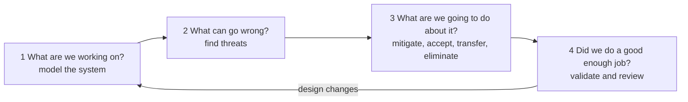
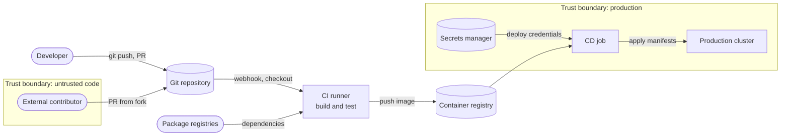
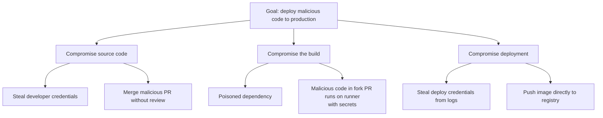
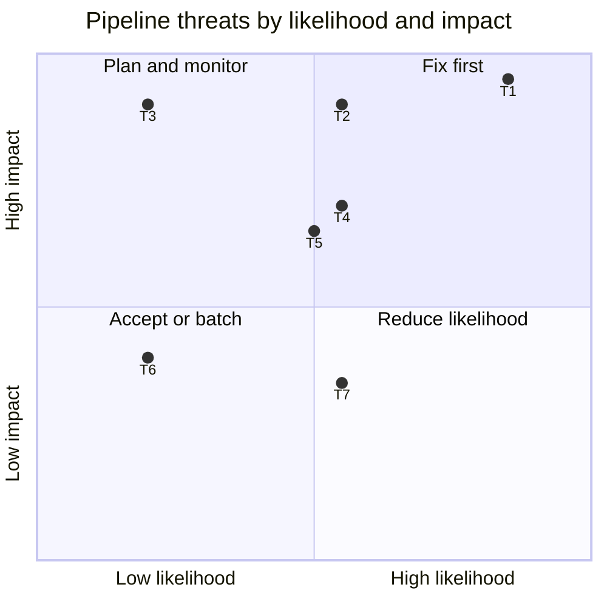

# Threat modeling

## Summary

Threat modeling is a structured way to find out, before attackers do, what can go wrong with a system and what to do about it. It is organized around four questions from the Threat Modeling Manifesto: What are we working on? What can go wrong? What are we going to do about it? Did we do a good enough job? Teams draw the system (usually as a data flow diagram with trust boundaries), enumerate threats systematically (most commonly with STRIDE: spoofing, tampering, repudiation, information disclosure, denial of service and elevation of privilege), decide on mitigations, and validate them. Done early and repeated when the design changes, it finds design flaws that no scanner detects. In DevOps, threat modeling applies not only to the product but to the delivery system itself: the source repository, the CI/CD pipeline, its runners, credentials and dependencies are a high-value target, as supply chain attacks have shown.

## Prerequisites

- [DevSecOps overview](devsecops-overview.md).
- Basic security vocabulary: authentication, authorization, confidentiality, integrity, availability.

## Core concepts

### Why model threats

Automated testing finds known bug patterns in code. It does not find a design in which an internal service trusts any request that reaches it, a pipeline in which any pull request can read deployment credentials, or a feature that lets one tenant see another tenant's data by changing an ID. These are design decisions, and fixing them after implementation is expensive. Threat modeling moves this thinking to the moment when changes are cheap, and it creates shared understanding of the system's security assumptions among developers, operators and security engineers.

*Analogy.* Planning the security of a building with its floor plan. You trace how people and goods move through the building (data flows), mark where the inside meets the outside and where secure areas begin (trust boundaries), and ask at each door and window how someone could get in, take something out or block the exit. Then you decide where to put locks, cameras and guards. The analogy breaks on change: buildings change rarely, while a software system changes every week, so a threat model must be updated continuously, preferably in small increments with each significant design change.

### The four questions

The Threat Modeling Manifesto (2020, written by a group of practitioners including Adam Shostack) frames every method around four questions:

The loop shows that threat modeling is iterative; the fourth question includes checking that mitigations were implemented and that the model still matches the system.

### Step 1: model the system with a data flow diagram

A data flow diagram (DFD) uses four element types plus trust boundaries:

| Element | Meaning | Example |
| --- | --- | --- |
| External entity | Something outside your control that interacts with the system | User, partner API, attacker |
| Process | Code that handles data | API service, CI runner |
| Data store | Where data rests | Database, artifact registry, state file |
| Data flow | Data moving between elements | HTTPS request, Git push, deployment |
| Trust boundary | Where the level of trust changes | Internet to DMZ, tenant A to tenant B, pull request code to the runner |

Threats concentrate where data flows cross trust boundaries.

Example: a deployment pipeline for a web service.

The DFD shows the pipeline's elements and two trust boundaries: code from external contributors is untrusted, and the production boundary holds the credentials and the cluster. The flows that cross boundaries (fork pull requests into the runner, dependencies into the build, credentials into the CD job) are where to look first.

### Step 2: find threats with STRIDE

STRIDE, created at Microsoft by Loren Kohnfelder and Praerit Garg in 1999, names six threat categories, each the violation of a security property:

| Threat | Violated property | Question | Pipeline example |
| --- | --- | --- | --- |
| **S**poofing | Authentication | Can someone pretend to be another user or system? | A forged webhook triggers a deployment |
| **T**ampering | Integrity | Can someone modify data or code? | A compromised dependency or a modified build script injects a backdoor |
| **R**epudiation | Non-repudiation | Can someone deny having done something? | Deployments without audit logs; shared admin accounts |
| **I**nformation disclosure | Confidentiality | Can someone read data they should not? | Secrets printed in build logs; a fork PR reads deployment credentials |
| **D**enial of service | Availability | Can someone make the system unavailable? | Crypto-mining jobs exhaust runners; a registry outage blocks all deploys |
| **E**levation of privilege | Authorization | Can someone gain rights they should not have? | Build job with cluster-admin rights; escape from a container on a shared runner |

*STRIDE per element* applies only the relevant categories to each element type: external entities are subject to spoofing and repudiation, data flows to tampering, information disclosure and denial of service, data stores to tampering, repudiation (for logs), information disclosure and denial of service, and processes to all six.

### Other methods

| Method | Focus | When to use |
| --- | --- | --- |
| STRIDE | Systematic threat categories per element | Default for software and infrastructure designs |
| Attack trees (Bruce Schneier, 1999) | Goal at the root, ways to reach it as branches with AND or OR | Deep analysis of one high-value goal ("steal production credentials") |
| PASTA (Process for Attack Simulation and Threat Analysis, 2015) | Seven-stage, risk-centric process tied to business impact | Large, risk-driven programs |
| LINDDUN | Privacy threats (linkability, identifiability, non-repudiation, detectability, disclosure, unawareness, non-compliance) | Systems processing personal data |
| MITRE ATT&CK | Catalog of real adversary tactics and techniques | Mapping detections and validating assumptions against real attacks |
| Kill chain and threat intelligence | How attacks unfold over time | Detection and response planning |

DREAD, an old Microsoft scoring scheme, was abandoned by Microsoft because its ratings were too subjective; use a simple likelihood and impact matrix or your organization's risk scale instead.

An attack tree for one goal in the pipeline above:

The tree breaks the attacker goal into alternative paths (all OR branches here); each leaf becomes a threat to mitigate, such as branch protection and required reviews (a2), dependency pinning and scanning (b1), isolating fork builds from secrets (b2), log masking and OIDC credentials (c1), and signed images with admission control (c2).

### Step 3: decide what to do

For each threat, choose one response and record it:

- **Mitigate**: add a control (authentication, signing, input validation, isolation, rate limiting).
- **Eliminate**: remove the feature or flow that creates the threat.
- **Transfer**: move the risk to another party (a managed service, insurance), consciously.
- **Accept**: document the decision, the owner and a review date.

Mitigations become backlog items with owners, and some become automated checks (for example a policy that blocks images without a signature, see [Policy as code](policy-as-code.md)).

### Step 4: validate

- Check that mitigations were implemented (code review, tests, policy checks).
- Test the riskiest threats (security tests, penetration tests, red team exercises, only with written authorization).
- Update the model when the architecture changes; keep it in the repository next to the code ("threat model as code" tools such as pytm or Threagile generate diagrams and threat lists from code).

### Threat modeling in agile and DevOps teams

- **Small and frequent.** A 30 to 60 minute session per significant design change (a new service, a new trust boundary, a new data type) beats a two-week workshop once a year.
- **Whole team.** Developers, an operator and a security champion; a security engineer facilitates when the risk is high.
- **Lightweight artifacts.** A DFD and a threat table in the repository; architecture decision records for accepted risks.
- **Triggers.** Use a checklist in the definition of ready: new external interface, authentication change, new data store, handling of personal or payment data, new third-party integration, pipeline or permission changes.

Tools: OWASP Threat Dragon (open source diagramming with STRIDE), Microsoft Threat Modeling Tool, pytm and Threagile (models as code), and whiteboards. The method matters more than the tool.

## Worked example

Threat model the pipeline DFD above in a one-hour session (abbreviated). Context: the analysis is defensive design work by the team that owns the pipeline.

| ID | Element or flow | STRIDE | Threat | Likelihood | Impact | Response |
| --- | --- | --- | --- | --- | --- | --- |
| T1 | Fork PR to CI runner | E, I | Malicious code in a fork PR runs on the runner and reads secrets (poisoned pipeline execution) | High | Critical | Mitigate: fork PRs run without secrets on ephemeral runners; approval before running for first-time contributors |
| T2 | Dependencies into build | T | Typosquatted or compromised package | Medium | Critical | Mitigate: lock files with hashes, private proxy registry, SCA, pinned versions |
| T3 | CI runner to registry | T, S | Attacker pushes an image directly to the registry | Low | Critical | Mitigate: only CI identity may push; images signed; admission control verifies signatures |
| T4 | Secrets manager to CD job | I | Long-lived deploy key leaked in logs | Medium | High | Mitigate: OIDC federation with short-lived tokens, log masking |
| T5 | CD job to cluster | E | Deploy identity has cluster-admin | Medium | High | Mitigate: namespace-scoped role |
| T6 | Repository | R | Force-push rewrites history without trace | Low | Medium | Mitigate: branch protection, signed commits, audit log export |
| T7 | CI runner | D | Runner pool exhausted by abuse | Medium | Medium | Mitigate: job limits, timeouts; accept residual risk |

The quadrant chart places the threats from the table by their qualitative ratings (positions are illustrative). T1, the fork pull request path, is fixed first; the related real-world risk categories are CICD-SEC-4 (poisoned pipeline execution) and CICD-SEC-6 (insufficient credential hygiene) of the OWASP Top 10 CI/CD Security Risks ([CI/CD security](cicd-security.md)), and the technique corresponds to MITRE ATT&CK T1195 (supply chain compromise).

## Trade offs and when to use it

- **Benefits.** Finds design flaws early and cheaply, builds shared security understanding, prioritizes controls by risk, documents assumptions for auditors and future maintainers.
- **Costs.** Time of the team and a facilitator; models that are not maintained become misleading.
- **Limits.** Quality depends on the participants' knowledge and imagination; it is complementary to testing, not a replacement. Heavy methods (full PASTA) are too slow for most product teams.
- **When to use it.** New systems and major features, changes to trust boundaries or authentication, handling of sensitive data, and the delivery pipeline itself.

## Common mistakes

- **Boiling the ocean.** Modeling the whole company in one workshop produces a poster, not decisions. Fix: scope to one feature, service or pipeline.
- **Listing threats without decisions.** Fix: every threat gets a response, an owner and, if accepted, a review date.
- **Ignoring the delivery system.** Fix: model repositories, pipelines, registries and credentials like any production system.
- **Done once, never updated.** Fix: triggers in the definition of ready; keep the model in the repository.
- **Security team models alone.** Fix: the team that builds the system participates; security facilitates.

## Practice

1. What are the four questions of threat modeling?
2. Which security property does each STRIDE category violate?
3. Where in a data flow diagram should you look for threats first, and why?
4. What are the four possible responses to a threat?
5. Why is a pull request from a fork a trust boundary for a CI system?
6. When would you choose an attack tree over STRIDE?

Answers:

1. What are we working on? What can go wrong? What are we going to do about it? Did we do a good enough job?
2. Spoofing: authentication; tampering: integrity; repudiation: non-repudiation; information disclosure: confidentiality; denial of service: availability; elevation of privilege: authorization.
3. At data flows that cross trust boundaries, because that is where data or control passes from less trusted to more trusted parts of the system.
4. Mitigate, eliminate, transfer or accept (with documentation).
5. The code comes from someone outside the organization, yet it is executed on the organization's runners, potentially with access to secrets and networks.
6. When analyzing one high-value attacker goal in depth and enumerating the alternative paths to it.

## Further reading

- [Threat Modeling Manifesto](https://www.threatmodelingmanifesto.org/) (2020): values, principles and the four questions.
- *Threat Modeling: Designing for Security* (Adam Shostack, Wiley, 2014).
- [OWASP Threat Modeling Cheat Sheet](https://cheatsheetseries.owasp.org/cheatsheets/Threat_Modeling_Cheat_Sheet.html) (OWASP).
- [OWASP Threat Dragon](https://owasp.org/www-project-threat-dragon/) (OWASP).
- [Attack Trees](https://www.schneier.com/academic/archives/1999/12/attack_trees.html) (Bruce Schneier, Dr. Dobb's Journal, 1999).
- [LINDDUN privacy threat modeling](https://linddun.org/) (KU Leuven).
- [MITRE ATT&CK](https://attack.mitre.org/) (MITRE), technique T1195 Supply Chain Compromise.
