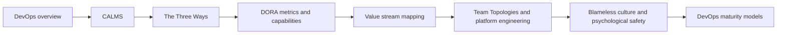

# Foundations

What DevOps is: the culture, principles, lifecycle and delivery metrics that every other area of this repository applies.

## Map of the area

The diagram shows the notes in reading order; subareas are marked with (subarea).

## Notes in reading order

1. [DevOps overview](devops-overview.md): definition, history, benefits, the lifecycle, core practices, tool categories and the DORA metrics in brief.
2. [CALMS](calms.md): culture, automation, lean, measurement and sharing, and how to use them as an assessment lens.
3. [The Three Ways](three-ways.md): flow, feedback and continual learning, with the practices derived from each.
4. [DORA metrics and capabilities](dora-metrics.md): the five delivery metrics, how to measure them, clusters, archetypes and capabilities.
5. [Value stream mapping](value-stream-mapping.md): process time, lead time, percent complete and accurate, and finding the constraint.
6. [Team Topologies and platform engineering](team-topologies.md): team types, interaction modes, cognitive load and internal developer platforms.
7. [Blameless culture and psychological safety](blameless-culture.md): Westrum, just culture and blameless postmortems.
8. [DevOps maturity models](devops-maturity-models.md): CMMI, DSOMM, SAMM, platform maturity, and capability models as the alternative.

## Planned topics

- Agile and Lean foundations of DevOps
- Flow metrics and the Flow Framework
- Developer experience and productivity (SPACE, DevEx)
- DevOps and AI-assisted software development
- Leading a DevOps transformation
