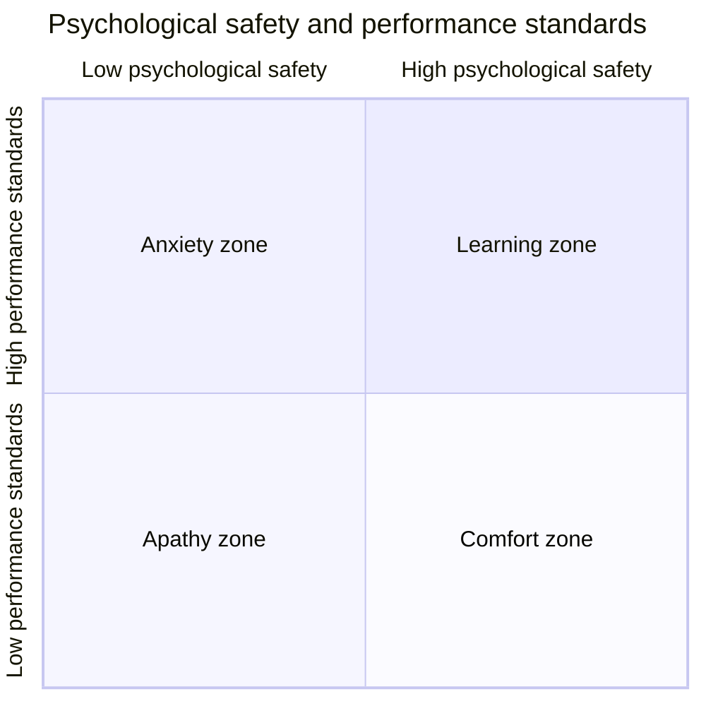
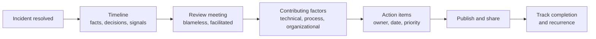

# Blameless culture and psychological safety

## Summary

A blameless culture treats failures as information about the system rather than as evidence of individual guilt. It rests on two research-backed ideas. *Psychological safety*, defined by Amy Edmondson (1999), is a shared belief that the team is safe for interpersonal risk taking: people can admit mistakes, ask questions and report problems without fear of punishment or humiliation. A *generative culture*, from Ron Westrum's typology (2004), is one in which information flows freely, messengers are trained rather than shot, and failure leads to inquiry rather than scapegoating; DORA's research found it predicts software delivery and organizational performance. Blameless postmortems, just culture and learning reviews are the practices that make these ideas real. Blameless does not mean accountability-free: people remain accountable for learning, for telling the full story and for improving the system.

## Prerequisites

- [CALMS](calms.md) (the Culture pillar) and [The Three Ways](three-ways.md) (the Third Way).

## Core concepts

### Why blame makes systems less safe

In complex systems, incidents rarely have a single cause; they arise from interactions between technology, processes, time pressure and decisions that seemed reasonable when they were made. Blaming the last person to touch the system has predictable effects:

- people stop reporting near misses and small problems, so weak signals are lost;
- people hide or soften the facts in incident reviews, so the organization learns the wrong lessons;
- people stop taking any initiative, adding approvals and waiting for permission, which slows delivery;
- the system's real weaknesses (missing safeguards, confusing interfaces, alert fatigue) stay unfixed, so the same incident happens to the next person.

Research in aviation, medicine and resilience engineering (Sidney Dekker, Richard Cook, Erik Hollnagel) reached the same conclusion long before software: safety comes from learning, and learning requires that people can speak openly.

*Analogy.* Aviation's incident reporting. Pilots report their own errors and near misses to confidential systems (such as NASA's Aviation Safety Reporting System), with protection from punishment for honest reports, and the industry fixes procedures, cockpit design and training based on them. Commercial aviation became extremely safe largely because errors became data. The analogy breaks on scale and regulation: aviation has legal protections and independent investigators, while a software organization has to create equivalent protection through its own leadership behavior.

### Psychological safety

Amy Edmondson defined team psychological safety as "a shared belief held by members of a team that the team is safe for interpersonal risk taking". Her research on hospital teams found that better teams *reported more* errors, not because they made more, but because they felt safe to report them. Google's Project Aristotle (2015) found psychological safety to be the most important of five factors distinguishing its effective teams.

Psychological safety is not comfort or niceness. Edmondson combines it with performance standards in a two-by-two model:

The quadrant chart shows Edmondson's model: high standards without safety create anxiety (people fear failing and hide problems); safety without standards creates comfort; neither creates apathy; both together create the learning zone where high-performing teams work.

Behaviors that build psychological safety:

- leaders frame work as a learning problem ("we have never done this, we will need everyone's input") rather than an execution problem;
- leaders acknowledge their own fallibility ("I may have missed something");
- people respond productively to bad news ("thank you for raising it, what do you need?");
- questions and dissent are invited explicitly, especially from the most junior people.

### Westrum's typology of organizational cultures

Ron Westrum, a sociologist who studied safety in aviation and health care, classified organizational cultures by how they process information (2004):

| Aspect | Pathological (power-oriented) | Bureaucratic (rule-oriented) | Generative (performance-oriented) |
| --- | --- | --- | --- |
| Cooperation | Low | Modest | High |
| Messengers | Shot | Neglected | Trained |
| Responsibilities | Shirked | Narrow | Shared risks |
| Bridging between groups | Discouraged | Tolerated | Encouraged |
| Failure | Leads to scapegoating | Leads to justice | Leads to inquiry |
| Novelty | Crushed | Leads to problems | Implemented |

DORA measures culture with survey items based on this table and has repeatedly found that a generative culture predicts better software delivery performance, organizational performance and well-being ([DORA metrics](dora-metrics.md)). It also found the relationship works in both directions: technical practices such as continuous delivery improve culture, because they make work less stressful and failures smaller.

### Just culture

A just culture (James Reason; Sidney Dekker, *Just Culture*, 2007) distinguishes between kinds of behavior instead of either punishing everyone or no one:

| Behavior | Example | Response |
| --- | --- | --- |
| Human error | A typo in a command during a routine change | Console the person; improve the system (validation, automation) |
| At-risk behavior | Skipping a review because "everyone does it under deadline" | Coach; remove the incentive and the pressure that made the shortcut normal |
| Reckless behavior | Knowingly disabling safety controls against explicit policy with obvious risk | Accountability measures |

Most incidents involve the first two, which is why the default response is learning. Dekker's later work emphasizes *restorative* just culture: asking who was hurt, what they need and whose obligation it is to meet those needs, rather than which rule was broken.

### Blameless postmortems

A postmortem (also *incident review*, *post-incident review* or *learning review*) is a written analysis of an incident with the goal of learning and preventing recurrence. John Allspaw's "Blameless PostMortems and a Just Culture" (Etsy, 2012) made the practice widely known in software; the Google SRE book describes it in its postmortem chapter.

Principles:

- **Focus on the system, not the person.** Ask *how* it made sense for people to do what they did, given what they knew at the time ("local rationality"), not *who* made the mistake.
- **Avoid hindsight bias and counterfactuals.** "They should have checked the dashboard" ignores that the dashboard did not show the problem clearly at the time. Describe what people saw, not what they should have seen.
- **Look beyond a single root cause.** Complex incidents have multiple contributing factors; "root cause: human error" ends inquiry exactly where it should start.
- **Write action items that change the system**: automation, safeguards, better alerts, clearer documentation, training; each with an owner and a date.
- **Share widely.** Publish postmortems internally so other teams learn (local discoveries become global improvements).

The flowchart shows the stages of a postmortem from the incident to tracked improvements. Details of incident management and postmortem templates belong to [Site reliability engineering](../site-reliability-engineering/README.md).

Language makes a difference:

| Blaming phrasing | Blameless phrasing |
| --- | --- |
| "Alex deleted the production database." | "A cleanup script ran against the production database because the target was selected from an environment variable that defaulted to production." |
| "The on-call engineer ignored the alert." | "The alert fired together with 40 low-priority alerts; nothing distinguished it as urgent." |
| "Root cause: human error." | "Contributing factors: no confirmation step for destructive commands, production and staging credentials stored in the same profile, time pressure during the release window." |

### Blameless is not accountability-free

A common objection is that blameless culture means nobody is responsible. The opposite is true: *forward-looking accountability* asks people to give a full and honest account of what happened, to take part in fixing the system and to share what they learned. What disappears is *backward-looking blame*: punishment meant to satisfy the need for a culprit. Reckless behavior is still handled through just culture, and repeated patterns are addressed through coaching and system changes.

### Measuring and improving culture

- **Surveys**: DORA's Westrum items (for example "On my team, failures are learning opportunities, and messengers of them are not punished"), Edmondson's seven-item psychological safety scale, rated on a Likert scale.
- **Behavioral signals**: number of near misses reported, number of postmortems written for small incidents, share of action items completed, how quickly bad news reaches leadership.
- **Leading by example**: leaders write postmortems about their own mistakes, thank people for raising problems, and fund the action items.

## Worked example

An engineer runs a database migration that locks a large table during peak traffic; checkout fails for 25 minutes. Two possible reviews (synthetic):

**Blaming review.** Finding: "Engineer did not follow the migration guideline." Action: "Engineer to be more careful; migrations need manager approval." Six months later a different engineer causes the same outage, because the guideline was still a wiki page nobody read, and the approval step added two days to every migration.

**Blameless review.** Timeline and questions reveal:

1. The migration tool ran the change in a single transaction by default; online migration required an extra flag that was not documented in the service template.
2. Staging had a hundred times less data, so the migration took 2 seconds there and gave no warning.
3. The deployment pipeline allowed migrations at any time of day.
4. The checkout service had no alert on database lock waits; the incident was detected by customer support after 12 minutes.

Action items: make online migrations the default in the service template (owner: platform team); add a pipeline check that estimates table size and blocks large blocking migrations (owner: platform team); add lock-wait metrics and an alert ([USE method](../observability/use-method.md)); publish the postmortem in the engineering newsletter.

| Measure (next 6 months) | Blaming review | Blameless review |
| --- | --- | --- |
| Repeat incidents of the same kind | 1 | 0 |
| Added lead time per migration | 2 days | none |
| Near misses reported by engineers | 2 | 9 |

The numbers are illustrative, but the pattern matches what the safety literature describes: the blameless review changed the system, and more near misses were reported because people saw that reporting led to improvements rather than punishment.

## Trade offs and when to use it

- **Benefits.** More and earlier reporting of problems, better incident analyses, systemic fixes, faster delivery because fewer approval gates are added after incidents, lower burnout.
- **Costs.** Writing and facilitating good postmortems takes time and skill; leaders must resist the pressure (from customers, executives or regulators) to name a culprit.
- **Limits.** Blamelessness cannot coexist with performance management that punishes incident involvement; HR processes and leadership incentives must be aligned. Legal or regulatory investigations may follow different rules, which should be explained honestly to teams.

## Common mistakes

- **"Blameless" in name only.** The postmortem avoids names, but the person is quietly sidelined afterwards. Fix: leadership behavior must match the policy; people notice.
- **Stopping at "human error".** Fix: ask why the action made sense at the time and which safeguards were missing.
- **Action items that ask people to try harder** ("be more careful"). Fix: change the system: automation, defaults, guardrails, alerts.
- **Postmortems only for big incidents.** Fix: review near misses and small incidents too; they are cheaper lessons.
- **No follow-through.** Fix: track action items like any other work and review completion.
- **Confusing safety with comfort.** Fix: keep high standards; safety is what lets people meet them honestly.

## Practice

1. Define psychological safety and explain why it is compatible with high standards.
2. Name the three cultures in Westrum's typology and how each treats messengers and failure.
3. What is hindsight bias, and how does it distort incident reviews?
4. Rewrite "the developer forgot to update the configuration" in blameless form.
5. How does a just culture handle human error, at-risk behavior and reckless behavior differently?
6. Why might a team with high psychological safety report *more* errors than a team with low safety?

Answers:

1. A shared belief that the team is safe for interpersonal risk taking; it lets people raise problems and admit mistakes, which is what allows a team to meet high standards instead of hiding gaps.
2. Pathological (messengers shot, failure leads to scapegoating), bureaucratic (messengers neglected, failure leads to justice), generative (messengers trained, failure leads to inquiry).
3. The tendency to see past events as more predictable than they were; reviews then judge decisions by their outcome and by information people did not have.
4. For example: "The configuration change was required in a separate repository, and nothing in the deployment process checked that both changes were released together."
5. Human error is consoled and the system improved; at-risk behavior is coached and the incentives behind it removed; reckless behavior leads to accountability measures.
6. Because people feel safe to report errors and near misses that would otherwise stay hidden, as Edmondson found in hospital teams.

## Further reading

- [Psychological Safety and Learning Behavior in Work Teams](https://doi.org/10.2307/2666999) (Amy C. Edmondson, Administrative Science Quarterly, 1999).
- *The Fearless Organization* (Amy C. Edmondson, Wiley, 2018).
- [A typology of organisational cultures](https://doi.org/10.1136/qshc.2003.009522) (Ron Westrum, Quality and Safety in Health Care, 2004).
- [Generative organizational culture](https://dora.dev/capabilities/generative-organizational-culture/) (DORA capability guide).
- [Blameless PostMortems and a Just Culture](https://www.etsy.com/codeascraft/blameless-postmortems) (John Allspaw, Etsy Code as Craft, 2012).
- [Postmortem Culture: Learning from Failure](https://sre.google/sre-book/postmortem-culture/) (Google SRE book, chapter 15, 2016).
- *Just Culture: Balancing Safety and Accountability* (Sidney Dekker, Ashgate, 2007) and *The Field Guide to Understanding Human Error* (Sidney Dekker, 3rd edition, CRC Press, 2014).
- [How Complex Systems Fail](https://how.complexsystems.fail/) (Richard I. Cook, 1998).
