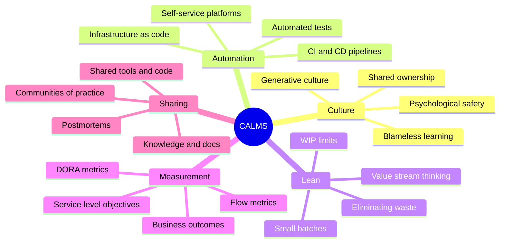
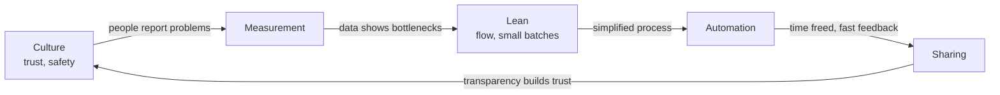
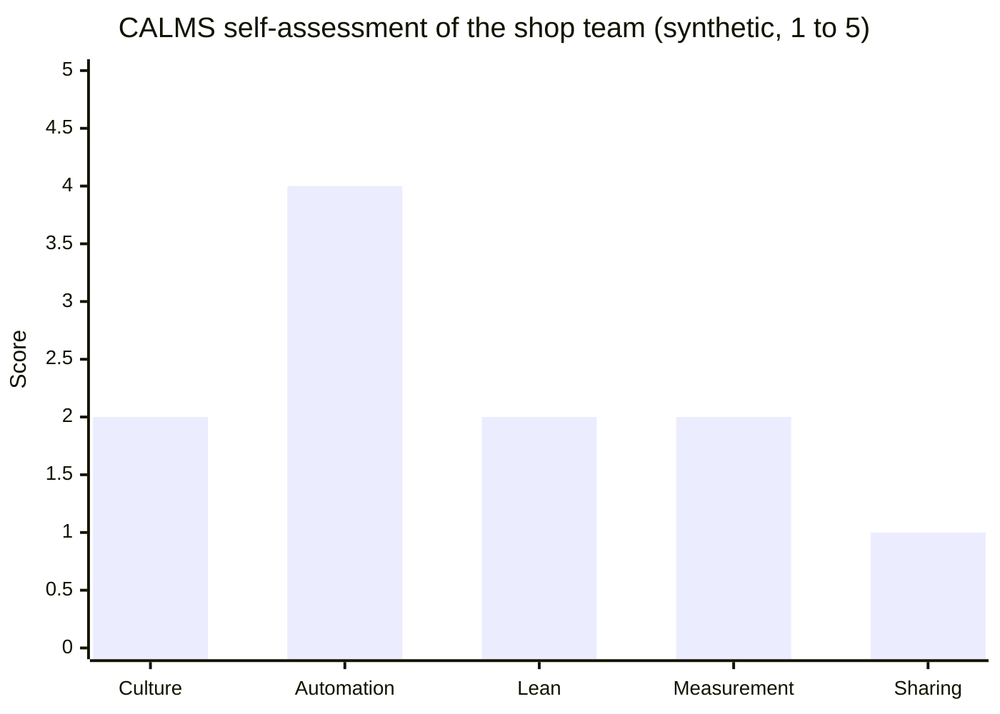

# CALMS

## Summary

CALMS is a five-part framework for describing and assessing DevOps: **C**ulture, **A**utomation, **L**ean, **M**easurement and **S**haring. John Willis and Damon Edwards introduced it as CAMS in 2010, and Jez Humble added Lean shortly after. Its value is that it refuses to reduce DevOps to tools: automation is one pillar out of five, and the other four describe how people collaborate, how work flows, how decisions are informed by data and how knowledge spreads. Used as a lens, CALMS helps a team find the pillar that holds it back (often culture or lean flow, not automation) and helps leaders see that buying a CI server is not a DevOps transformation. It is a descriptive model, not a maturity scale, so it is best used for structured conversations and targeted experiments rather than scoring.

## Prerequisites

- [DevOps overview](devops-overview.md).

## Core concepts

### Origin and purpose

At the first DevOpsDays in the United States (Mountain View, 2010), John Willis and Damon Edwards summarized what the early DevOps practitioners had in common as **CAMS**: Culture, Automation, Measurement and Sharing. Jez Humble, co-author of *Continuous Delivery*, proposed adding **Lean**, giving CALMS. The acronym spread because it answered a recurring question: "What do we have to change to do DevOps?" The answer it gives is: five things at once, of which tooling is only one.

*Analogy.* The five pillars of a building's foundation. You can build a very solid pillar (automation), but if the others are missing, the building still leans and eventually cracks. The pillars also carry load together: measurement without sharing produces dashboards nobody acts on; automation without lean flow speeds up a process full of waiting. The analogy breaks on independence: physical pillars are separate, while the CALMS elements constantly feed each other, for example sharing builds the trust that culture needs.

The mind map shows the five pillars with the practices that typically make each one concrete.

### Culture

Culture is how people behave when nobody tells them what to do: whether developers and operators share goals and responsibility, whether failures lead to learning or to blame, and whether people can raise problems safely. The DORA research uses Ron Westrum's typology of organizational cultures (pathological, bureaucratic, generative) and finds that generative, high-trust cultures predict better software delivery and organizational performance.

Signals of a DevOps culture:

- product teams own their services in production, including on-call ("you build it, you run it", Werner Vogels, Amazon, 2006);
- incidents end in blameless postmortems with action items, not in punishment;
- information flows freely across team boundaries; bad news travels fast;
- people from different functions collaborate on the same goals and metrics.

Culture cannot be changed directly; it changes when practices, incentives and leadership behavior change ([Blameless culture](blameless-culture.md)).

### Automation

Automation removes manual, repetitive, error-prone work so that people can spend time on judgment: builds, tests, deployments, infrastructure provisioning, configuration, security checks, environment creation. The DORA capability catalog lists continuous integration, deployment automation, test automation and infrastructure as code among the technical capabilities that predict performance.

The guiding rule is: **simplify first, then automate**. Automating a release process with ten hand-offs and four approval meetings produces a faster version of a bad process. Good automation is also self-service: teams can create an environment or a pipeline without filing a ticket ([Team Topologies and platform engineering](team-topologies.md)).

### Lean

Lean thinking, from the Toyota Production System and Lean manufacturing, focuses on delivering value to the customer with minimal waste and fast flow. In software delivery it means:

- **small batches**: small changes are easier to review, test, deploy and roll back;
- **limiting work in progress (WIP)**: fewer things in flight means each finishes sooner (Little's law: average lead time = WIP / throughput);
- **making work visible**: boards that show all work, including unplanned work;
- **eliminating waste**: waiting, hand-offs, partially done work, rework, unnecessary features, task switching;
- **value stream thinking**: optimizing the whole path from idea to customer, not individual steps ([Value stream mapping](value-stream-mapping.md)).

Mary and Tom Poppendieck adapted the seven wastes of manufacturing to software in *Lean Software Development* (2003):

| Manufacturing waste | Software equivalent |
| --- | --- |
| Inventory | Partially done work: unmerged branches, undeployed code |
| Overproduction | Extra features nobody uses |
| Extra processing | Relearning, unnecessary documentation and approvals |
| Transportation | Hand-offs between teams |
| Waiting | Delays for reviews, environments, approvals |
| Motion | Task switching |
| Defects | Defects and rework |

### Measurement

Measurement makes improvement possible and keeps it honest: without data, teams cannot tell whether a change helped. Useful measurement in DevOps has three layers:

1. **Delivery performance**: the DORA metrics (change lead time, deployment frequency, failed deployment recovery time, change fail rate, deployment rework rate) ([DORA metrics](dora-metrics.md)).
2. **Operational performance**: service level indicators and objectives, error budgets ([RED method](../observability/red-method.md), [Site reliability engineering](../site-reliability-engineering/README.md)).
3. **Outcomes**: customer and business results (adoption, retention, revenue, satisfaction), and team health (burnout, satisfaction).

Measurement goes wrong when metrics become targets for individuals (Goodhart's law: "When a measure becomes a target, it ceases to be a good measure"). Measure teams and systems, compare a team with its own past, and pair every speed metric with a stability metric.

### Sharing

Sharing spreads knowledge, tools and responsibility across team boundaries:

- shared goals and metrics between development, operations and security;
- shared code and tools: internal open source (inner source), shared libraries, a common platform;
- shared knowledge: documentation, runbooks, architecture decision records, postmortems published for everyone, demos, communities of practice;
- shared responsibility: developers on call for their services, operators involved early in design.

Sharing is what turns one team's improvement into an organization's capability, and what prevents knowledge from living only in one person's head (the "bus factor").

### How the pillars reinforce each other

The cycle shows one common pattern of reinforcement: trust makes honest measurement possible, data points to flow problems, a simplified flow is worth automating, automation frees time and makes results visible, and visible, shared results build more trust. A break anywhere weakens the whole loop, which is why fixing only automation rarely transforms delivery.

### Using CALMS as an assessment lens

CALMS works well as a structured conversation. For each pillar, ask a few concrete questions and collect evidence rather than opinions:

| Pillar | Example questions | Evidence |
| --- | --- | --- |
| Culture | Who is paged when the service breaks at night? What happened after the last major incident? | On-call rota, postmortem documents |
| Automation | How many manual steps does a production deployment need? Can a developer create a test environment without a ticket? | Pipeline definitions, runbooks |
| Lean | How long does a change wait for review, test, approval? How many items are in progress per person? | Lead time breakdown, board WIP |
| Measurement | Which delivery and reliability metrics do you know today, and who looks at them? | Dashboards, SLO documents |
| Sharing | Where is the documentation? Can another team deploy a fix to your service? | Wiki, inner source contributions |

A radar chart of self-assessed scores per pillar is a popular visualization, but treat the scores as conversation starters: their value lies in the disagreement between team members and in the evidence behind them, not in the number.

### CALMS compared with other frameworks

| Framework | Focus | Relation to CALMS |
| --- | --- | --- |
| [The Three Ways](three-ways.md) | Principles: flow, feedback, continual learning | Explains *why*; CALMS lists *what* to change |
| [DORA capabilities](dora-metrics.md) | Research-backed capabilities and outcome metrics | Empirical evidence for each CALMS pillar, with measurable metrics |
| [Team Topologies](team-topologies.md) | Team structures and interactions | Makes the culture and sharing pillars concrete in organizational design |
| [Maturity models](devops-maturity-models.md) | Staged levels | CALMS is not staged; it has no levels |

## Worked example

A product team of eight runs an online shop. A one-hour CALMS workshop collects this evidence (synthetic):

| Pillar | Evidence found | Score (1 to 5) |
| --- | --- | --- |
| Culture | Operations team is paged for application errors; last outage ended with "who deployed this?" | 2 |
| Automation | CI builds and unit tests run on every commit; deployment is scripted but started by an operator | 4 |
| Lean | Changes wait on average 3 days for a weekly change advisory board; 14 items in progress for 8 people | 2 |
| Measurement | Uptime is reported monthly; nobody knows the lead time | 2 |
| Sharing | Runbooks exist only in the operations wiki; developers cannot read production logs | 1 |

The chart shows the scores from the table. The team's instinct was to buy a better deployment tool, but automation is already its strongest pillar. The evidence points elsewhere, and the team picks three experiments for the next quarter:

1. **Sharing and culture**: give developers read access to production logs and dashboards, and put developers on the on-call rota for their service, with operations as second line.
2. **Lean**: replace the weekly change board for low-risk changes with peer review plus automated checks; limit WIP to one item per person plus one.
3. **Measurement**: measure change lead time and deployment frequency from the pipeline, and review them every two weeks.

After the quarter, lead time dropped from about five days to under one day, mainly because the change board wait disappeared. This is a typical CALMS result: the largest gain came from lean flow and sharing, not from more automation.

## Trade offs and when to use it

- **Strengths.** Memorable, balanced, tool-agnostic; good for explaining DevOps to leadership and for team retrospectives.
- **Limits.** It is not empirically derived, has no levels and no prescribed metrics, and its pillars are broad enough to mean different things to different people. For measurable improvement, pair it with DORA metrics and capabilities.
- **Alternatives.** The Three Ways for principles, the DORA capability catalog for evidence-based priorities, value stream mapping for finding the bottleneck.

## Common mistakes

- **Equating DevOps with the A.** Buying tools while leaving silos, approvals and blame unchanged. Fix: assess all five pillars and start with the weakest.
- **Turning CALMS into a scored maturity model** that teams game. Fix: use it for conversation and experiments, measure outcomes with DORA metrics.
- **Measuring individuals.** It destroys culture and sharing. Fix: measure teams and systems, never rank people by deployments or tickets.
- **Treating culture as a slogan.** Posters do not change behavior. Fix: change concrete practices (on-call, postmortems, access) and leadership responses to failure.

## Practice

1. What do the five letters of CALMS stand for, and who coined the acronym?
2. Why does "simplify first, then automate" follow from the Lean pillar?
3. A team has excellent pipelines but deployments still wait a week for approval. Which pillars are weak?
4. Name two ways measurement can damage culture.
5. Use Little's law: a team has 12 items in progress and finishes 4 per week. What is the average lead time?

Answers:

1. Culture, Automation, Lean, Measurement, Sharing. John Willis and Damon Edwards coined CAMS in 2010; Jez Humble added Lean.
2. Lean aims to remove waste from the value stream; automating a wasteful process preserves the waste and makes it harder to change.
3. Lean (waiting, large batches) and probably culture (lack of trust behind heavy approvals).
4. Using metrics as targets for individuals, which invites gaming (Goodhart's law), and using metrics to assign blame after incidents.
5. 12 / 4 = 3 weeks.

## Further reading

- *The DevOps Handbook*, 2nd edition (Gene Kim, Jez Humble, Patrick Debois, John Willis, Nicole Forsgren, IT Revolution, 2021): the practices behind each pillar.
- [DevOps Culture: Westrum organizational culture](https://dora.dev/capabilities/generative-organizational-culture/) (DORA): the research behind the culture pillar.
- *Lean Software Development: An Agile Toolkit* (Mary and Tom Poppendieck, Addison-Wesley, 2003): the seven wastes of software.
- [CALMS framework](https://www.atlassian.com/devops/frameworks/calms-framework) (Atlassian): a practitioner overview with examples.
- *Continuous Delivery* (Jez Humble, David Farley, Addison-Wesley, 2010): automation and lean flow in delivery pipelines.
