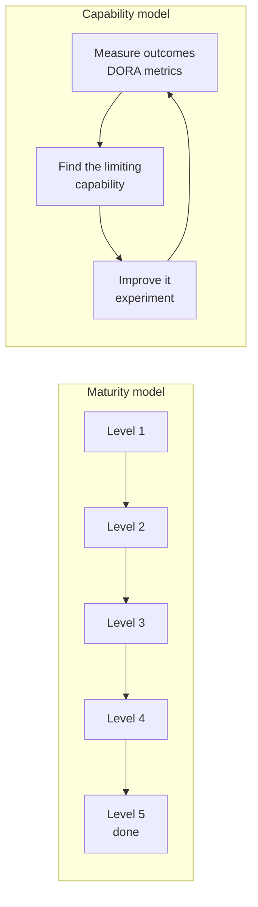
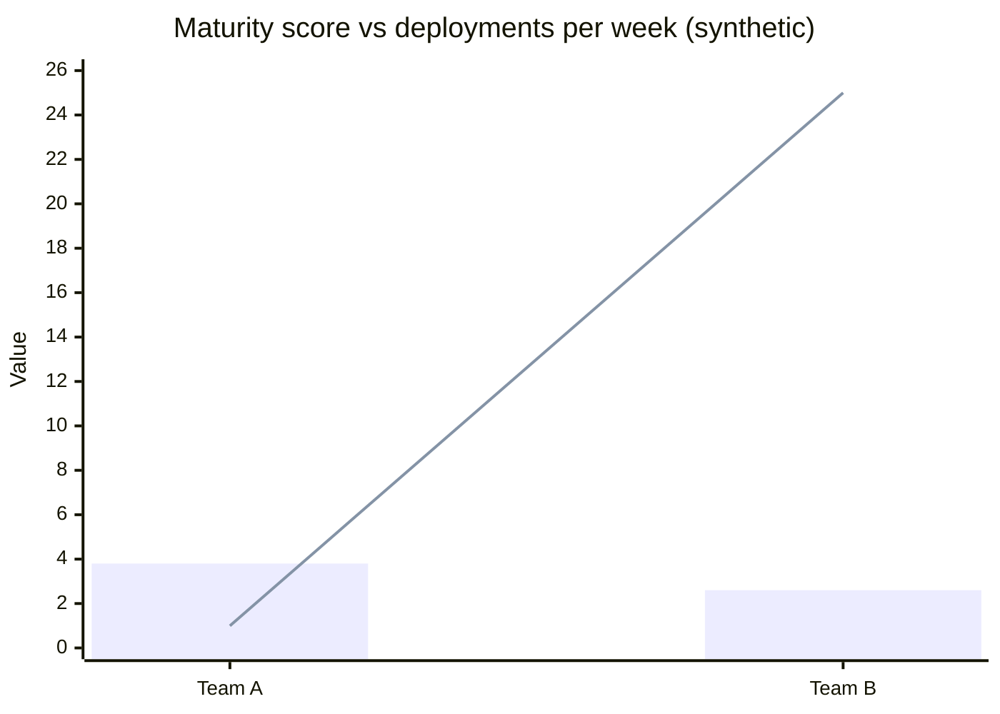

# DevOps maturity models

## Summary

A maturity model describes the evolution of an organization's practices as a sequence of levels, from ad hoc to optimized, so that it can assess where it is and decide what to improve next. Many DevOps maturity models exist, from the Capability Maturity Model Integration (CMMI) tradition, from vendors and from open communities: OWASP's DevSecOps Maturity Model (DSOMM), OWASP SAMM for software security, and the CNCF Platform Engineering Maturity Model. They are useful as checklists and as a shared vocabulary, but the DORA research argues against treating maturity as a destination: high performers keep improving, technology and context change, and level-based models encourage box ticking. The research-backed alternative is a *capability model*: measure outcomes (DORA metrics), identify the capabilities that limit you, and improve them continuously. This note explains how maturity models are built, which ones are worth knowing, and how to use them without falling into their traps.

## Prerequisites

- [CALMS](calms.md) and [DORA metrics and capabilities](dora-metrics.md).

## Core concepts

### What a maturity model is

A maturity model has three parts:

1. **Dimensions** (also domains or practice areas): what is assessed, for example culture, automation, testing, deployment, monitoring.
2. **Levels**: ordered stages, each with criteria per dimension; usually four or five.
3. **An assessment method**: questionnaires, interviews or evidence reviews that place the organization on the levels.

The idea comes from the Capability Maturity Model (CMM) developed at the Software Engineering Institute of Carnegie Mellon University for the US Department of Defense in the late 1980s, later CMMI. Its five levels are still the template for most models:

| CMMI maturity level | Characteristic |
| --- | --- |
| 1 Initial | Processes unpredictable, poorly controlled, reactive; success depends on heroes |
| 2 Managed | Processes planned and executed per project; still reactive |
| 3 Defined | Processes standardized across the organization; proactive |
| 4 Quantitatively managed | Processes measured and controlled with data |
| 5 Optimizing | Focus on continuous process improvement |

*Analogy.* Belt grades in martial arts. Each belt has defined skills, you are examined against them, and the next belt tells you what to learn. That works because the art is stable and the path is known. The analogy breaks for DevOps: the "art" changes every few years (containers, cloud, platform engineering, AI), the best path depends on the organization's context, and the black belt is not an end state, because high performers keep improving.

### A generic DevOps maturity model

Most vendor and consultancy models look similar. A typical five-level version, used here only to illustrate the structure:

| Dimension | 1 Initial | 2 Managed | 3 Defined | 4 Measured | 5 Optimizing |
| --- | --- | --- | --- | --- | --- |
| Culture and organization | Silos, blame | Some cross-team work | Shared ownership, blameless postmortems | Culture measured, generative | Continuous learning institutionalized |
| Build and integration | Manual builds | Automated builds | CI on every commit, trunk-based | Build metrics, fast feedback | Optimized, self-service pipelines |
| Testing | Manual testing | Some unit tests | Automated tests in the pipeline | Coverage and flakiness tracked | Testing in production, chaos experiments |
| Deployment and release | Manual, rare releases | Scripted deployments | Continuous delivery | Progressive delivery, metrics-driven | Continuous deployment on demand |
| Infrastructure | Manual servers | Some scripts | Infrastructure as code | Self-service platform | Platform as a product, policy as code |
| Monitoring | Reactive, user-reported | Basic host monitoring | Application metrics and logs | SLOs, tracing | Observability-driven development |
| Security | Late, manual audits | Periodic scans | Security checks in the pipeline | Supply chain controls, metrics | Continuous compliance |

### Maturity models worth knowing

| Model | Owner | Scope | Structure |
| --- | --- | --- | --- |
| CMMI | CMMI Institute (ISACA) | Process improvement in general | Five maturity levels, practice areas |
| [DSOMM](../devsecops/devsecops-overview.md) (DevSecOps Maturity Model) | OWASP | Security activities in DevOps | Dimensions (build and deployment, culture and organization, implementation, information gathering, test and verification); four levels |
| SAMM (Software Assurance Maturity Model) | OWASP | Software security program | Five business functions (governance, design, implementation, verification, operations), maturity 0 to 3 per practice |
| BSIMM (Building Security In Maturity Model) | Black Duck (formerly Synopsys) | Observed software security activities | Descriptive: what participating firms actually do, published yearly |
| Platform Engineering Maturity Model | CNCF TAG App Delivery (2023) | Internal platforms | Aspects (investment, adoption, interfaces, operations, measurement) at four levels: provisional, operational, scalable, optimizing |
| Cloud Native Maturity Model | CNCF | Adoption of cloud native technology | Levels from build to adapt across people, process, policy, technology and business outcomes |
| Continuous Delivery Maturity Model | Various (for example the 2013 InfoQ model by Rehn, Palmborg and Boström) | Continuous delivery practices | Five levels across culture, design, build, test, deploy, information |

### The critique: maturity models versus capability models

In *Accelerate* (2018), Forsgren, Humble and Kim argue that maturity models are the wrong tool for technology transformation, for four reasons:

1. **Maturity models focus on reaching a level and declaring done**; capability models focus on continuous improvement, because the best performers keep improving and the landscape keeps changing.
2. **Maturity models are lock-step and one-size-fits-all**: every team must pass the same levels in the same order. Capability models recognize that the right next capability depends on the team's context and current constraint.
3. **Maturity models measure technical proficiency or tool adoption**, not outcomes. Capability models link capabilities to outcomes (delivery performance, organizational performance) with evidence.
4. **Maturity models are static**: the definition of "level 5" is written once, while what high performance means changes.

The diagram contrasts the two shapes: a ladder with an end, and a loop without one.

### Using maturity models well

Maturity models still have legitimate uses when treated as maps rather than scorecards:

- **Checklists and vocabulary**: a model's criteria list practices a team may not have considered, and give teams and leaders shared terms.
- **Security and compliance programs**: SAMM, DSOMM and BSIMM are widely used to plan security investment and report progress to auditors.
- **Platform strategy**: the CNCF platform model helps a platform team decide whether to invest in interfaces, adoption or measurement next.
- **Self-assessment for conversation**: the disagreement between team members about a level is often more informative than the level itself.

Rules that avoid the traps:

1. **Pair every assessment with outcome metrics** (DORA metrics, SLOs, developer satisfaction), and judge improvement by outcomes, not levels.
2. **Assess per team or value stream**, not one number for the company.
3. **Pick the next step from the current constraint** ([Value stream mapping](value-stream-mapping.md)), not from the next level of every dimension.
4. **Never tie levels to bonuses or rankings**, which turns assessments into theater (Goodhart's law).
5. **Revisit the model itself** every year or two; criteria age quickly.

## Worked example

Two teams use the generic model above and also measure DORA metrics (synthetic data).

| Team | Average maturity level | Change lead time | Deployments per week | Change fail rate |
| --- | --- | --- | --- | --- |
| Team A | 3.8 | 9 days | 1 | 22 % |
| Team B | 2.6 | 6 hours | 25 | 6 % |

The chart shows maturity level as bars and deployments per week as a line for the two teams in the table. Team A scored high because it had adopted many tools (a service mesh, a security scanner, a tracing system) and documented processes, but its deployments still go through a weekly release train and a change board. Team B scored lower on the checklist (no tracing, little documentation) but deploys small changes continuously with good tests. By outcomes, team B is clearly ahead.

The capability-model response for team A: its constraint is the release process, so the next step is lightweight change approval and continuous delivery, not more tools. For team B: its next capability might be documentation and observability, because they will matter as the service grows. The maturity score would have pointed both teams at the dimensions where they were lowest, which for team A would have meant even more tooling.

## Trade offs and when to use it

- **Benefits of maturity models.** Structure, completeness, comparability, a clear story for leadership and auditors.
- **Costs.** Assessment effort, the risk of box ticking and gaming, and criteria that age.
- **Capability models** demand more judgment (finding the constraint, interpreting metrics) but stay aligned with outcomes.
- **When to use a maturity model.** Security and compliance programs, platform roadmaps, onboarding checklists, and as one input into a capability-based improvement process.

## Common mistakes

- **Treating level 5 as the goal.** Fix: set goals on outcomes; use levels only as a description.
- **Company-wide maturity scores.** They hide the variation that matters. Fix: assess per team or value stream.
- **Improving the lowest dimension by default.** Fix: improve the current constraint.
- **Equating tool adoption with maturity.** Fix: ask what the tool changed in lead time, failure rate or recovery.
- **Using assessments for performance reviews.** Fix: keep them as team learning tools.

## Practice

1. What are the three parts of a maturity model?
2. Name the five CMMI maturity levels.
3. Give the four arguments of *Accelerate* against maturity models.
4. Which OWASP models assess security practices, and how do they differ in structure?
5. A team is at level 2 for monitoring and level 4 for testing, but its main delay is a manual approval board. What should it improve first, and why?

Answers:

1. Dimensions, levels with criteria, and an assessment method.
2. Initial, managed, defined, quantitatively managed, optimizing.
3. Maturity models aim at an end state instead of continuous improvement; they are lock-step and one-size-fits-all; they measure tools and proficiency instead of outcomes; they are static while the field changes.
4. SAMM (five business functions, maturity 0 to 3 per practice) and DSOMM (DevSecOps dimensions with four levels); BSIMM, maintained outside OWASP, is descriptive rather than prescriptive.
5. The approval process (for example lightweight change approval with peer review and automated checks), because it is the constraint on flow; improving monitoring would not shorten lead time.

## Further reading

- *Accelerate* (Nicole Forsgren, Jez Humble, Gene Kim, IT Revolution, 2018): the chapter on capability models versus maturity models.
- [CMMI](https://cmmiinstitute.com/cmmi) (CMMI Institute, ISACA).
- [OWASP DevSecOps Maturity Model](https://dsomm.owasp.org/) (OWASP).
- [OWASP SAMM](https://owaspsamm.org/) (OWASP).
- [BSIMM](https://www.blackduck.com/resources/analyst-reports/bsimm.html) (Black Duck): the yearly report of observed security activities.
- [Platform Engineering Maturity Model](https://tag-app-delivery.cncf.io/whitepapers/platform-eng-maturity-model/) (CNCF TAG App Delivery, 2023).
- [Continuous Delivery Maturity Model](https://www.infoq.com/articles/Continuous-Delivery-Maturity-Model/) (Andreas Rehn, Tobias Palmborg, Patrik Boström, InfoQ, 2013).
