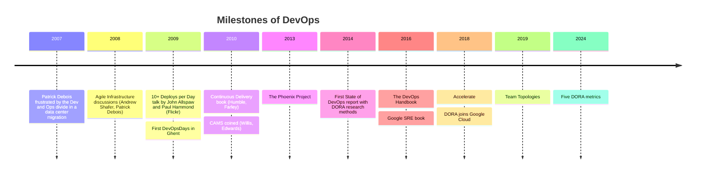
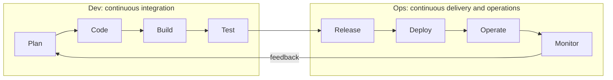
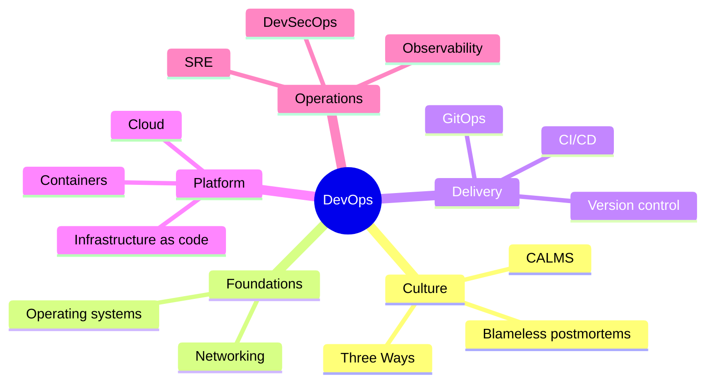
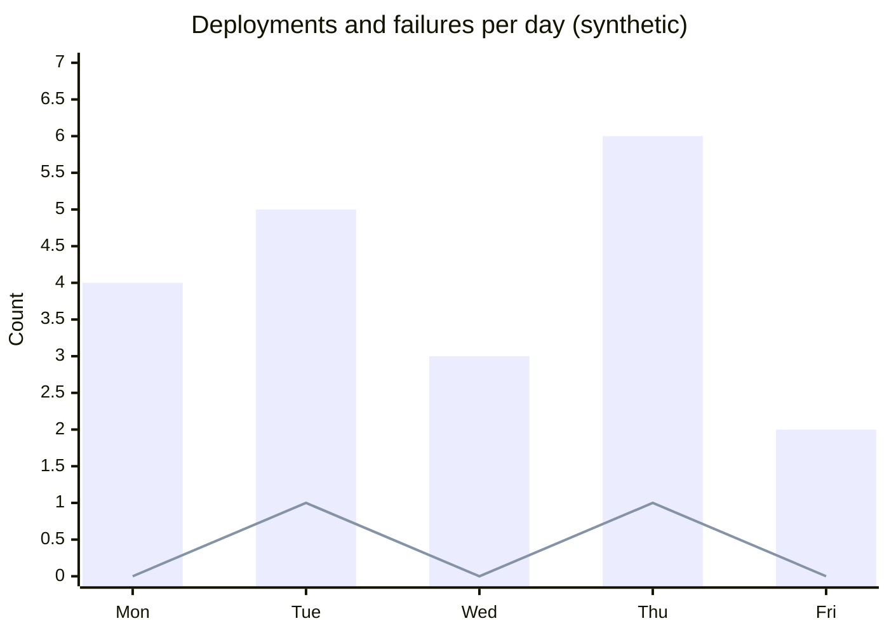

# DevOps overview

## Summary

DevOps is a combination of cultural philosophies, practices and tools that unifies software development (Dev) and IT operations (Ops) into one flow of work with shared goals. Its primary goal is to shorten the software development lifecycle and to deliver high-quality software continuously, without trading speed for stability. In practice that means small changes, automation of everything repeatable (build, test, deploy, infrastructure), fast feedback from production, and teams that own their services from commit to customer. DevOps is not a job title or a tool: the tools only make the practices cheap enough to do every day.

## Prerequisites

- General experience with how software is written, built and run on servers.
- No other note is required. This note is the entry point of the repository.

## Core concepts

### The problem DevOps solves

Before DevOps, development and operations were separate teams with opposing incentives. Developers were measured on how much change they shipped, operations on how stable production stayed. Releases were large and rare (quarterly or yearly), hand-offs went through tickets, environments were configured by hand and differed from each other, and failures turned into blame between the two groups. Large releases contain many changes at once, so when something breaks it is hard to tell which change caused it, which makes releases even scarier and even rarer. DevOps breaks this loop by making change small, frequent, automated and observable, and by making one team responsible for both shipping and running a service.

*Analogy.* A traditional release is like a ferry that leaves twice a year: everything must be on board, the crossing is risky and missing it means waiting six months. DevOps replaces the ferry with a conveyor belt: each item travels alone, a broken item is easy to spot and remove, and nobody has to wait. The analogy breaks at the team level: a conveyor belt needs no collaboration, while DevOps depends on people sharing goals and information.

### A short history

The timeline shows how the movement grew from practitioner frustration and conference talks into a research-backed discipline. The name comes from DevOpsDays, the conference Patrick Debois organized in Ghent in October 2009.

### Benefits

- **Faster time to market.** Changes reach users in hours or days instead of months.
- **Improved collaboration and communication.** Development and operations share goals, tools and on-call responsibility.
- **Increased efficiency through automation.** Repetitive work (builds, tests, deployments, provisioning) is done by machines, consistently.
- **Better quality software with fewer defects.** Automated tests run on every change, so defects are caught close to their cause.
- **Enhanced scalability and reliability.** Infrastructure defined as code can be reproduced and scaled on demand.
- **Faster recovery from incidents.** Small changes are easy to identify and roll back, and monitoring shortens the time to detect a problem.

### Key components

1. **Culture.** Collaboration between development and operations teams is essential for shared accountability and mutual understanding. Blameless postmortems and shared metrics are the visible signs of it.
2. **Automation.** Streamlining processes with tools for continuous integration, testing and deployment.
3. **Continuous integration and continuous delivery (CI/CD).** Automating the building, testing and deploying of applications to ensure rapid and reliable delivery. See [CI/CD overview](../ci-cd/ci-cd-overview.md).
4. **Infrastructure as code (IaC).** Managing infrastructure with configuration files rather than manual processes, ensuring consistency and scalability. See [Infrastructure as code](../infrastructure-as-code/infrastructure-as-code-overview.md).
5. **Monitoring and logging.** Tracking application and infrastructure performance to identify and resolve issues quickly. See [Monitoring](../observability/monitoring.md).
6. **Collaboration and communication.** Encouraging cross-functional teams to work together with shared tools and visible work.

The most quoted summary of these components is *CALMS*: Culture, Automation, Lean (small batches, limiting work in progress), Measurement and Sharing. It was coined by John Willis and Damon Edwards and extended with "Lean" by Jez Humble. See [CALMS](calms.md) for each pillar in depth and how to use it as an assessment lens.

### The DevOps lifecycle

The DevOps lifecycle is usually drawn as an infinity loop: the left half belongs to development, the right half to operations, and the loop has no end because feedback from operating the system feeds the next plan. Read the diagram left to right: every stage hands its output to the next one automatically where it can.

### The Three Ways

Gene Kim, Jez Humble, Patrick Debois and John Willis describe the principles under DevOps as *the Three Ways* in *The DevOps Handbook*:

1. **Flow.** Make work move fast from development to operations to the customer: small batches, visible work, fewer hand-offs, automated pipelines.
2. **Feedback.** Make problems visible as early as possible: automated tests, telemetry, alerts, peer review.
3. **Continual learning and experimentation.** Treat failures as learning opportunities, run blameless postmortems and reserve time for improvement.

The principles, their sources and the practices derived from each are explained in [The Three Ways](three-ways.md); the cultural side of the Third Way is in [Blameless culture and psychological safety](blameless-culture.md).

### Core practices

1. **Continuous integration (CI).** Merging code changes frequently to avoid integration issues.
2. **Continuous delivery (CD).** Automating the release process so that code is deployable at any time.
3. **Version control.** Using systems like Git to track changes and enable collaboration. Everything, including infrastructure and pipeline definitions, lives in version control.
4. **Infrastructure as code (IaC).** Tools like Terraform and Ansible allow infrastructure to be managed programmatically.
5. **Monitoring and feedback.** Tools like Prometheus, Grafana and the Elastic Stack give real-time insight into running systems.
6. **Containerization and orchestration.** Docker and Kubernetes package applications and run them in a scalable, portable way.

### Tools by category

The tools are examples of categories; each category has a home note in this repository.

| Category | Examples | Home area |
| --- | --- | --- |
| CI/CD | Jenkins, GitLab CI/CD, Azure DevOps, CircleCI, GitHub Actions | [CI/CD](../ci-cd/README.md) |
| Version control | Git, Bitbucket (hosting) | [Version control](../version-control/README.md) |
| Containerization | Docker | [Containers and virtualization](../containers-and-virtualization/README.md) |
| Orchestration | Kubernetes | Kubernetes knowledge repository |
| Monitoring | Prometheus, Grafana, Datadog | [Observability](../observability/README.md) |
| IaC | Terraform, Ansible, Chef, Puppet | [Infrastructure as code](../infrastructure-as-code/README.md) |

The mindmap below shows how the areas of this repository map to DevOps.

### Measuring DevOps: the DORA metrics

The DevOps Research and Assessment (DORA) program, started by Nicole Forsgren, Jez Humble and Gene Kim and now part of Google Cloud, measures software delivery performance with a small set of metrics. For years these were the "four key metrics" below; in 2024 DORA added a fifth, deployment rework rate, and regrouped them into throughput and instability ([DORA metrics and capabilities](dora-metrics.md)). The four classic metrics:

| Metric | Measures | Question it answers |
| --- | --- | --- |
| Deployment frequency | Throughput | How often do we deploy to production? |
| Change lead time | Throughput | How long from commit to running in production? |
| Change failure rate | Stability | What share of deployments causes a failure that needs remediation? |
| Failed deployment recovery time | Stability | How long does it take to recover from a failed deployment? (called mean time to restore before 2023) |

The central finding of the research, published in *Accelerate* (2018), is that throughput and stability are not a trade off: the best performing teams are better on all four metrics at the same time.

The fifth metric, deployment rework rate, is the share of deployments that are unplanned fixes for production incidents (checked against dora.dev, 2026-11).

## Worked example

A team records its production deployments for one week (synthetic data). Each row is one deployment, with the time from first commit to production and whether it caused an incident.

| Day | Deployments | Median lead time (hours) | Failed deployments | Recovery time of failures (minutes) |
| --- | --- | --- | --- | --- |
| Mon | 4 | 6 | 0 | - |
| Tue | 5 | 5 | 1 | 25 |
| Wed | 3 | 8 | 0 | - |
| Thu | 6 | 4 | 1 | 15 |
| Fri | 2 | 7 | 0 | - |

Calculation:

- Deployment frequency: 4 + 5 + 3 + 6 + 2 = 20 deployments in 5 working days, so about 4 per day.
- Change lead time: the median of the daily medians is 6 hours (a rough approximation; compute it over individual changes in practice).
- Change failure rate: 2 failed out of 20, so 10 percent.
- Failed deployment recovery time: (25 + 15) / 2 = 20 minutes on average.

The chart shows deployments per day next to failures, which is the shape DORA looks for: frequent deployments with few failures.

## Trade offs and when to use it

- **Benefits.** Higher delivery speed and stability at the same time, less manual work, better morale through shared ownership.
- **Costs.** An upfront investment in test automation, pipelines and observability; a cultural change that needs management support; on-call duty for developers.
- **Where it fits less well.** Systems that are released rarely by contract (embedded firmware, regulated medical devices) can still use the practices (CI, IaC, automated tests) but cannot deploy continuously. Very small teams may not need a separate platform function.
- **Alternatives and relatives.** Site reliability engineering (SRE) is an implementation of DevOps principles with an engineering focus on reliability (see [Site reliability engineering](../site-reliability-engineering/README.md)). Platform engineering builds internal platforms so that product teams can practice DevOps without each building their own tool chain ([Team Topologies and platform engineering](team-topologies.md)). DevSecOps builds security into the same flow ([DevSecOps overview](../devsecops/devsecops-overview.md)).

## Common mistakes

- **Treating DevOps as a team or a job title.** A "DevOps team" that sits between Dev and Ops creates a third silo. Fix: make product teams own their services and let a platform team provide self-service tools ([Team Topologies](team-topologies.md)).
- **Buying tools instead of changing practices.** A CI server with a manual, monthly release process is not DevOps. Fix: measure the DORA metrics and improve the bottleneck they reveal.
- **Automating a broken process.** Automating a ten-step manual release with four approvals makes it faster but not better. Fix: simplify first (smaller batches, fewer hand-offs), then automate.
- **Ignoring the Ops half.** Fast delivery without monitoring and incident practice only ships failures faster. Fix: build observability and on-call into the definition of done.

## Practice

1. Why do large, infrequent releases tend to become even larger and less frequent over time?
2. Name the four DORA metrics and say which ones measure throughput and which measure stability.
3. What does the "L" in CALMS stand for, and which practice does it imply?
4. A team deploys 40 times in a month and 6 deployments cause incidents. What is its change failure rate?

Answers:

1. Each release bundles many changes, so failures are hard to diagnose and roll back. Failed releases make the organization add gates and wait longer, which bundles even more changes into the next release.
2. Deployment frequency and change lead time measure throughput; change failure rate and failed deployment recovery time measure stability.
3. Lean. It implies small batches and limited work in progress.
4. 6 / 40 = 15 percent.

## Further reading

- [DORA capabilities and metrics](https://dora.dev/) (DORA, Google Cloud, ongoing): the current definitions of the metrics and the capability catalog behind the research.
- *Accelerate: The Science of Lean Software and DevOps* (Nicole Forsgren, Jez Humble, Gene Kim, IT Revolution, 2018): the research that established the four key metrics.
- *The DevOps Handbook*, 2nd edition (Gene Kim, Jez Humble, Patrick Debois, John Willis, Nicole Forsgren, IT Revolution, 2021): the Three Ways with case studies.
- [DevOps roadmap](https://roadmap.sh/devops) (roadmap.sh, ongoing): the community curriculum whose skill groups shape this repository.
- [What is DevOps?](https://aws.amazon.com/devops/what-is-devops/) (Amazon Web Services): a concise vendor definition with the same practice list.
