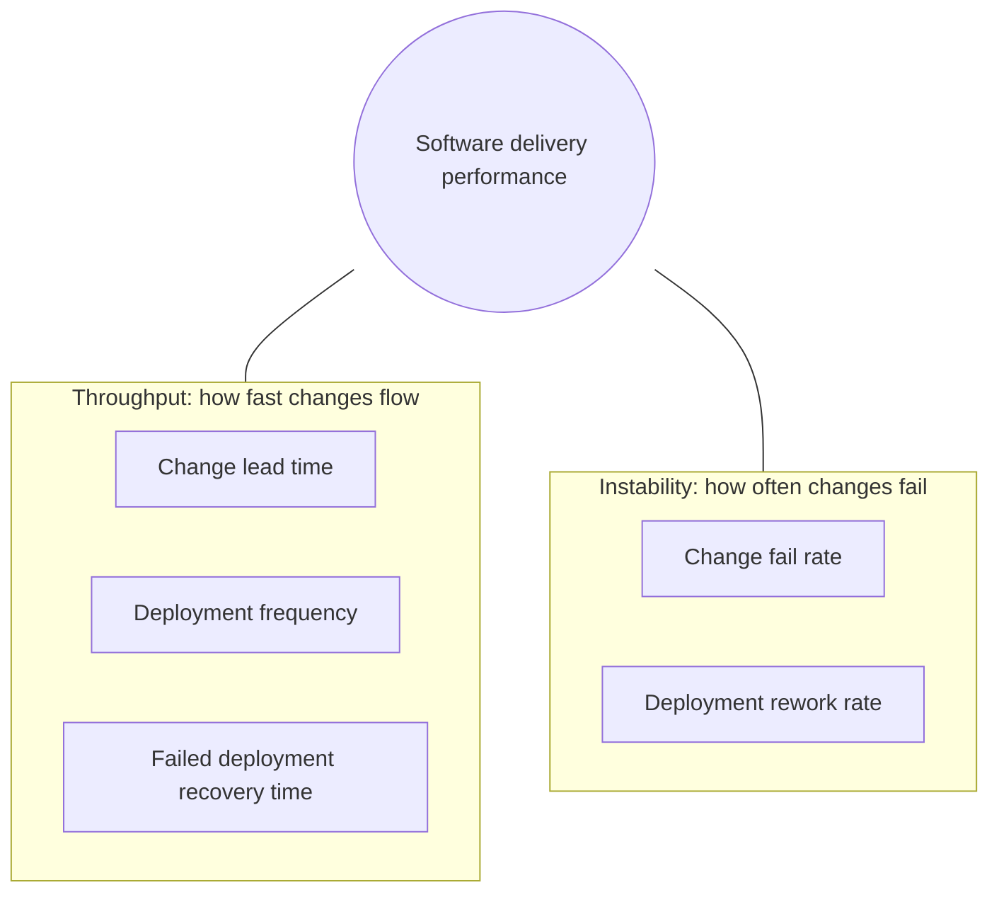
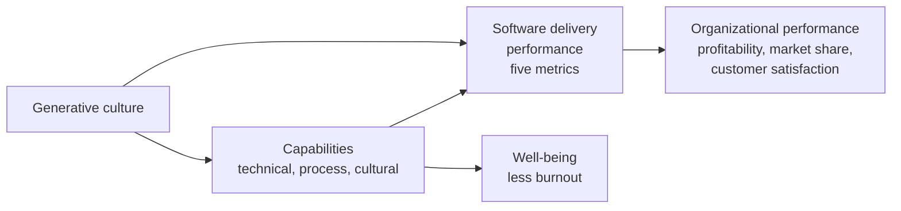
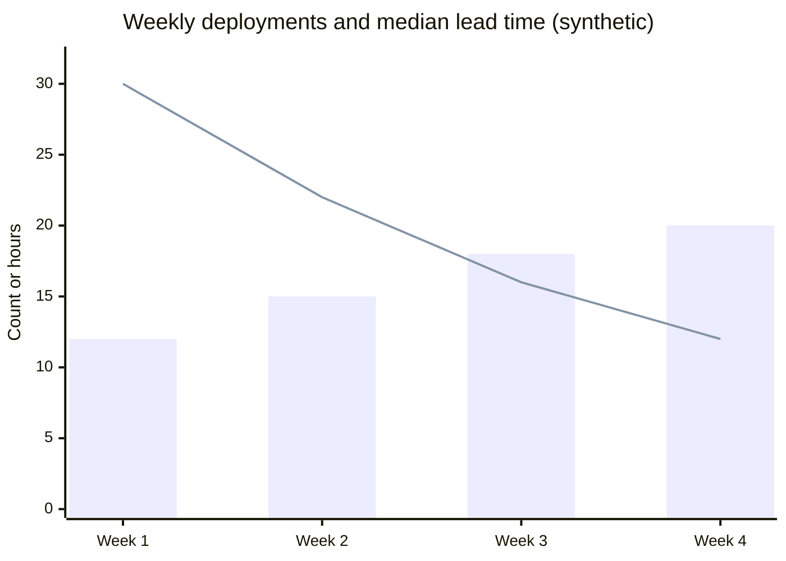

# DORA metrics and capabilities

## Summary

The DevOps Research and Assessment (DORA) program has studied software delivery since 2014 through yearly surveys of tens of thousands of professionals, and it measures delivery performance with a small set of outcome metrics. Since 2024 there are five: **change lead time**, **deployment frequency** and **failed deployment recovery time** (throughput), and **change fail rate** and **deployment rework rate** (instability). The central finding, published in *Accelerate* (2018), is that throughput and stability are not a trade off: teams that deploy more often also fail less and recover faster. DORA also identifies the *capabilities* (technical, process and cultural practices) that predict better performance, from continuous integration and loosely coupled architecture to a generative culture. Used properly, the metrics show a team where it stands and whether its improvements work; used as targets for individuals or for comparing teams, they are gamed and lose their meaning.

## Prerequisites

- [DevOps overview](devops-overview.md) and [CALMS](calms.md).
- [CI/CD overview](../ci-cd/ci-cd-overview.md) for deployments and pipelines.

## Core concepts

### The problem DORA solves

Before DORA, debates about DevOps were driven by anecdotes and vendor claims, and organizations measured IT with metrics that rewarded the wrong behavior: lines of code, story points, utilization, number of changes approved. Nicole Forsgren, Jez Humble and Gene Kim, working with Puppet on the State of DevOps reports from 2014, applied survey research methods (validated constructs, cluster analysis, structural equation modeling) to find out which outcomes describe delivery performance and which practices cause it. The program became DORA, was acquired by Google Cloud in 2018 and continues as an open research program at dora.dev.

*Analogy.* A car's dashboard with a few gauges: speed, fuel, engine temperature. They do not tell you how to drive, but together they tell you whether the journey is going well, and a driver who watches only the speedometer will eventually overheat the engine. The analogy breaks on control: a driver can push the accelerator to change speed directly, while a team cannot change its DORA numbers directly without changing the underlying practices, and trying to (for example splitting one deployment into ten) only corrupts the gauge.

### The five metrics

Definitions as given on dora.dev (checked 2026-11):

| Metric | Factor | Definition | Typical unit |
| --- | --- | --- | --- |
| **Change lead time** | Throughput | The time it takes for a code change to go from committed to version control to successfully deployed in production | Hours or days (median) |
| **Deployment frequency** | Throughput | How often application changes are deployed to production | Deployments per day or week |
| **Failed deployment recovery time** | Throughput | The time it takes to recover from a deployment that fails and requires immediate intervention | Hours (median) |
| **Change fail rate** | Instability | The ratio of deployments that require immediate intervention following a deployment (rollback, hotfix) | Percent of deployments |
| **Deployment rework rate** | Instability | The ratio of deployments that are unplanned and happen as a result of an incident in production | Percent of deployments |

The diagram shows the 2024 model: two factors, five metrics. Note that recovery time is grouped with throughput in this model, because statistically it moves together with lead time and deployment frequency.

### How the metric set evolved

| Year | Change |
| --- | --- |
| 2014 | IT performance measured by deployment frequency, lead time for changes and mean time to restore (MTTR); change fail rate did not fit the construct |
| 2015 | Two groups: throughput (deployment frequency, lead time) and stability (MTTR, change fail rate): the "four key metrics" |
| 2018 | *Accelerate* published; availability added as an operational metric ("software delivery and operational performance") |
| 2021 | Availability broadened to reliability, sometimes wrongly called "the fifth metric" |
| 2023 | MTTR renamed and redefined as failed deployment recovery time, limited to failures caused by deployments |
| 2024 | Deployment rework rate added; five metrics in the factors throughput and instability |
| 2025 | The report "State of AI-assisted Software Development" replaced the four performance clusters with seven team archetypes based on eight measures (including team well-being and friction) |

### Measuring the metrics

Survey answers are how DORA does research; a team improving itself should measure from its own systems.

| Metric | Data source | Calculation |
| --- | --- | --- |
| Change lead time | Version control commit times and deployment events | For each deployed change: deploy time minus commit time; report the median per period |
| Deployment frequency | Deployment events from the pipeline or deployment tool | Count of production deployments per day or week; also the share of days with at least one deployment |
| Change fail rate | Deployments linked to incidents, rollbacks or hotfixes | Failed deployments / all deployments |
| Failed deployment recovery time | Incident or deployment records | Time from the failed deployment (or its detection) to restoration; median |
| Deployment rework rate | Deployments labeled as unplanned fixes for production incidents | Unplanned fix deployments / all deployments |

Practical rules:

- **Use medians and distributions**, not means; a single week-long change distorts the mean.
- **Define "deployment" and "failure" once** and write the definitions down, per service.
- **Measure per service or team**, not as one number for a whole company.
- **Automate collection** from the pipeline (deployment events), version control (commit times) and the incident tool (links between incidents and deployments). The open source Four Keys project from Google showed one implementation (it is archived; TODO: verify current recommended tooling on dora.dev).

### Performance clusters and archetypes

From 2014 to 2024, DORA grouped respondents with cluster analysis into performance levels. The 2024 report described four clusters (values as published in the 2024 report; TODO: verify against the report):

| Cluster | Deployment frequency | Change lead time | Change fail rate | Failed deployment recovery time |
| --- | --- | --- | --- | --- |
| Elite | On demand, several times per day | Less than one day | About 5 % | Less than one hour |
| High | Between once per day and once per week | Between one day and one week | About 20 % | Less than one day |
| Medium | Between once per week and once per month | Between one week and one month | About 10 % | Less than one day |
| Low | Between once per month and once every six months | Between one month and six months | About 40 % | Between one week and one month |

The clusters are descriptive: they show what the survey population looked like that year and changed from year to year (in 2022 there was no elite cluster at all). The 2025 report replaced them with seven *team archetypes* derived from throughput, instability, team performance, product performance, individual effectiveness, time spent on valuable work, friction and burnout, with names such as "Legacy bottleneck" and "Harmonious high achievers". The shift reflects a long-standing DORA message: compare a team with its own past, not with a league table.

### Capabilities

DORA's research identifies capabilities that drive delivery performance, which in turn drives organizational performance and well-being. *Accelerate* (2018) listed 24 key capabilities in five categories; the dora.dev catalog has since grown and is regularly updated.

| Category (Accelerate) | Capabilities |
| --- | --- |
| Continuous delivery | Version control for all production artifacts, deployment automation, continuous integration, trunk-based development, test automation, test data management, shift left on security, continuous delivery |
| Architecture | Loosely coupled architecture, empowering teams to choose tools |
| Product and process | Customer feedback, visibility of work in the value stream, working in small batches, team experimentation |
| Lean management and monitoring | Lightweight change approval, monitoring, proactive notification, WIP limits, visual management |
| Cultural | Westrum generative culture, supporting learning, collaboration among teams, job satisfaction, transformational leadership |

Later additions in the dora.dev catalog include, for example, cloud infrastructure, code maintainability, database change management, documentation quality, monitoring and observability, well-being, and capabilities related to AI adoption and platform engineering (TODO: verify the current list on dora.dev).

The diagram is a simplified version of DORA's research model: capabilities and culture predict delivery performance and well-being, and delivery performance predicts organizational performance. These are statistical predictions across many organizations, not guarantees for a single team.

### The J-curve and other findings worth knowing

- **Throughput and stability move together.** Speed comes from small batches and automation, which also reduce risk.
- **The J-curve of transformation** (2018 report): early improvement efforts often make performance temporarily worse (new automation, learning costs) before it improves; teams that stop at the bottom of the curve conclude wrongly that the change failed.
- **Heavyweight change approval** by an external board is associated with lower performance and no better stability than peer review ([Value stream mapping](value-stream-mapping.md)).
- **Culture matters.** A generative culture predicts delivery and organizational performance ([Blameless culture](blameless-culture.md)).
- **Documentation quality** amplifies the effect of technical capabilities (2021 and 2022 reports).
- **AI amplifies** an organization's existing strengths and weaknesses (2025 report).

### Complementary frameworks

DORA metrics measure the delivery system. They do not measure developer productivity or product value. Complementary frameworks:

- **SPACE** (Forsgren, Storey, Maddila, Zimmermann, Houck, Butler, 2021): Satisfaction and well-being, Performance, Activity, Communication and collaboration, Efficiency and flow; a reminder to measure productivity in several dimensions at once.
- **DevEx** (Noda, Storey, Forsgren, Greiler, 2023): feedback loops, cognitive load and flow state as the three dimensions of developer experience.
- **Flow metrics** (Mik Kersten, *Project to Product*, 2018): flow velocity, flow time, flow efficiency, flow load and flow distribution across features, defects, risks and debt.
- **SLOs** for reliability as experienced by users ([RED method](../observability/red-method.md)).

## Worked example

Compute the five metrics for one service from four weeks of synthetic pipeline and incident data.

| Week | Deployments | Median lead time (hours) | Failed deployments | Unplanned fix deployments | Median recovery (minutes) |
| --- | --- | --- | --- | --- | --- |
| 1 | 12 | 30 | 2 | 2 | 95 |
| 2 | 15 | 22 | 2 | 1 | 60 |
| 3 | 18 | 16 | 1 | 1 | 40 |
| 4 | 20 | 12 | 1 | 1 | 35 |

Calculation for the four weeks:

- Deployment frequency: 12 + 15 + 18 + 20 = 65 deployments in 20 working days, about 3.3 per day.
- Change lead time: medians fell from 30 to 12 hours (compute the true median over all 65 changes in practice).
- Change fail rate: (2 + 2 + 1 + 1) / 65 = 6 / 65, about 9.2 percent.
- Deployment rework rate: (2 + 1 + 1 + 1) / 65 = 5 / 65, about 7.7 percent.
- Failed deployment recovery time: median of the weekly medians is about 50 minutes.

The bars are deployments per week and the line is the median lead time in hours, both from the table. As deployments became more frequent, lead time fell and the share of failed deployments dropped from 2 in 12 (17 percent) to 1 in 20 (5 percent): the throughput and stability pattern DORA describes. The team should still read the trend with care: four weeks are a small sample, and one large incident could reverse the picture.

## Trade offs and when to use it

- **Strengths.** Outcome-oriented, research-backed, balanced between speed and stability, cheap to measure from existing systems, independent of technology.
- **Limits.** They measure the delivery system, not whether the right product is built, not developer well-being, and not reliability as users experience it. They are hard to apply to systems with rare, contractual releases (firmware, regulated software), where lead time and failure rate remain useful but deployment frequency does not.
- **Risks.** Goodhart's law: once the numbers become targets, teams game them (splitting deployments, not counting failures). Comparing teams with different contexts produces unfair conclusions.
- **When to use them.** As a team's own trend, reviewed regularly with the team, to choose and evaluate improvements; together with SLOs and a developer experience measure.

## Common mistakes

- **Using the metrics to rank teams or individuals.** Fix: compare each team with its own past; discuss context.
- **Optimizing one metric.** More deployments with a rising failure rate is not progress. Fix: always look at throughput and instability together.
- **Ambiguous definitions** (is a configuration change a deployment? is a failed canary a failure?). Fix: write definitions per service and keep them stable.
- **Means instead of medians.** Fix: medians and percentiles.
- **Measuring only what is easy** (deployments) and skipping failures and recovery. Fix: link incidents to deployments in the incident process.
- **Treating the clusters as targets** ("we must be elite by Q3"). Fix: set improvement goals from your own baseline and from the capabilities that limit you.

## Practice

1. Name the five DORA metrics and the factor each belongs to.
2. What was the main finding of *Accelerate* about speed and stability?
3. Why was mean time to restore replaced by failed deployment recovery time in 2023?
4. A service had 80 deployments in a month; 6 needed a rollback or hotfix and 4 were unplanned fixes for incidents. What are its change fail rate and deployment rework rate?
5. What is the J-curve of transformation?
6. Why did the 2025 report stop using elite, high, medium and low clusters?

Answers:

1. Change lead time, deployment frequency and failed deployment recovery time (throughput); change fail rate and deployment rework rate (instability).
2. They are not a trade off: high performers are better at both at the same time.
3. MTTR mixed all kinds of incidents (hardware, external outages) with deployment failures; the new metric focuses on failures caused by changes, which is what software delivery controls.
4. 6 / 80 = 7.5 percent change fail rate; 4 / 80 = 5 percent rework rate.
5. The observation that transformations often make performance worse at first, before improvements pay off.
6. To describe teams with more dimensions (including well-being and friction) through archetypes, and to discourage league-table comparisons.

## Further reading

- [DORA metrics and history](https://dora.dev/guides/dora-metrics/history/) (DORA, 2026): the evolution of the metric set.
- [DORA capabilities](https://dora.dev/capabilities/) (DORA): the current capability catalog with implementation guides.
- *Accelerate: The Science of Lean Software and DevOps* (Nicole Forsgren, Jez Humble, Gene Kim, IT Revolution, 2018): the research method, the four key metrics and 24 capabilities.
- [Accelerate State of DevOps Report 2024](https://dora.dev/research/2024/dora-report/) (DORA, Google Cloud, 2024): the five-metric model and performance clusters.
- [2025 State of AI-assisted Software Development](https://dora.dev/research/2025/dora-report/) (DORA, Google Cloud, 2025): team archetypes.
- [The SPACE of Developer Productivity](https://queue.acm.org/detail.cfm?id=3454124) (Forsgren et al., ACM Queue, 2021).
- [DevEx: What Actually Drives Productivity](https://queue.acm.org/detail.cfm?id=3595878) (Noda, Storey, Forsgren, Greiler, ACM Queue, 2023).
