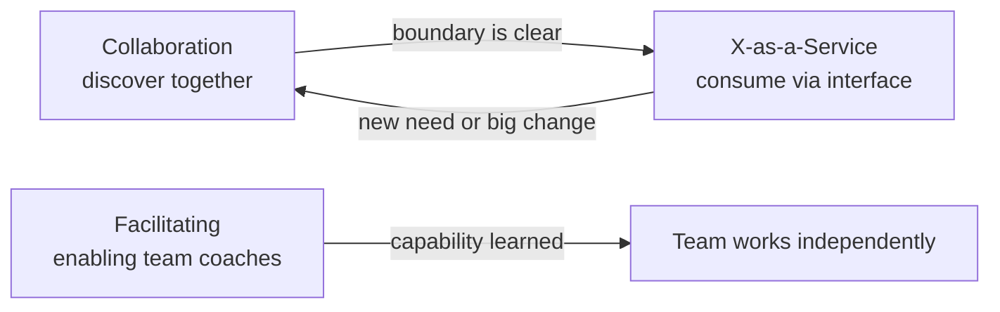
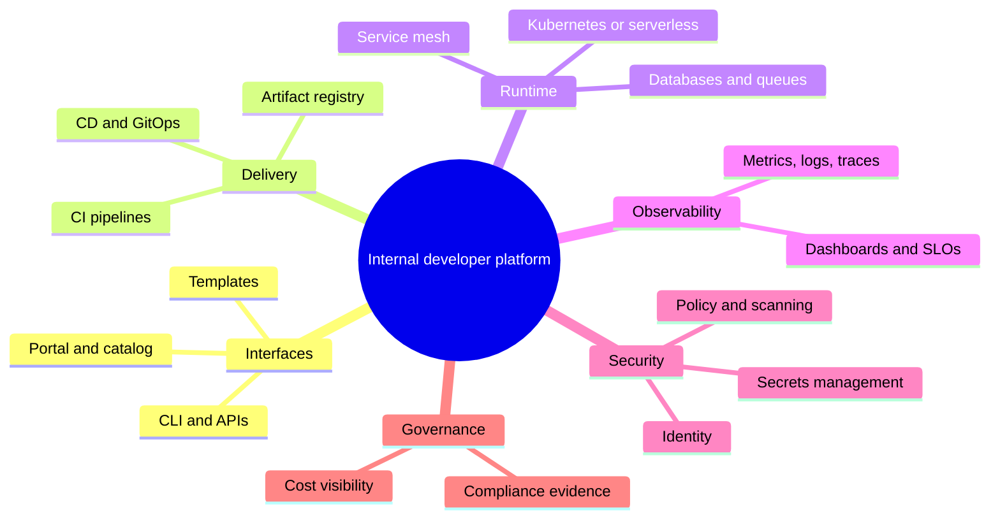
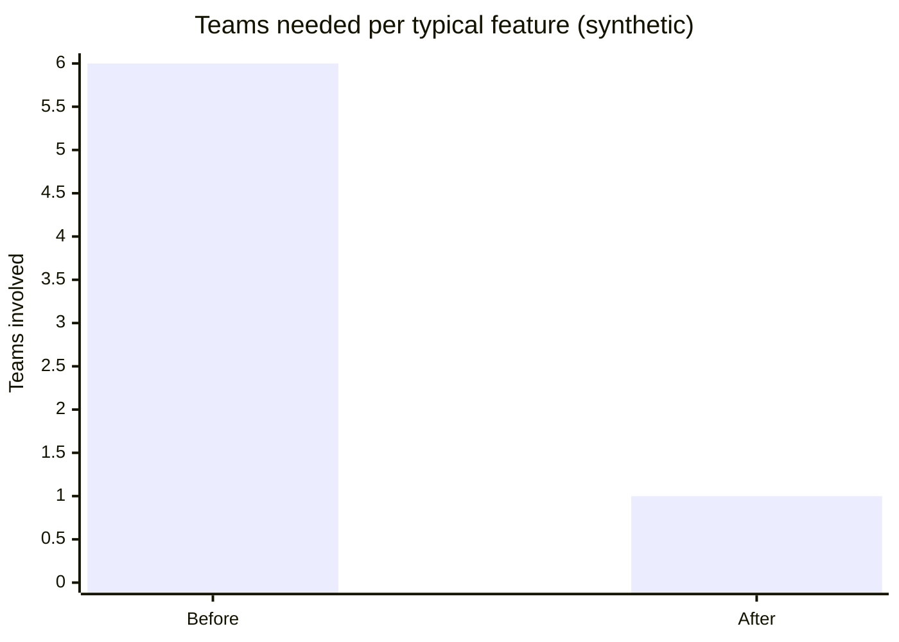

# Team Topologies and platform engineering

## Summary

Team Topologies, by Matthew Skelton and Manuel Pais (2019), is a model for organizing technology teams for fast flow. It starts from two observations: software architecture mirrors the communication structure of the organization that builds it (Conway's law), and a team can only own as much software as its cognitive load allows. From these it defines four fundamental team types (**stream-aligned**, **enabling**, **complicated-subsystem** and **platform**) and three interaction modes (**collaboration**, **X-as-a-Service** and **facilitating**). Most teams should be stream-aligned, owning a flow of change end to end; the other types exist to reduce their cognitive load. Platform engineering is the discipline of building the platform team's product, an internal developer platform with self-service *golden paths*, treated as a product for internal customers. Together they answer the question DevOps leaves open: how should teams be structured so that "you build it, you run it" is possible without every team becoming an expert in everything.

## Prerequisites

- [DevOps overview](devops-overview.md), [CALMS](calms.md) and [The Three Ways](three-ways.md).

## Core concepts

### The problems the model solves

Two failure patterns are common in DevOps transformations:

- **The DevOps team as a new silo.** A central "DevOps team" receives tickets from developers and runs the pipelines and infrastructure: the old Dev and Ops hand-off with a new name.
- **"You build it, you run it" without support.** Every product team must master Kubernetes, networking, observability, security scanning and cloud cost management in addition to its product. Cognitive load explodes, delivery slows down and on-call becomes exhausting.

Team Topologies addresses both by designing team boundaries and interactions deliberately, with the goal of fast flow and sustainable cognitive load.

*Analogy.* A city's services. Neighborhood shops (stream-aligned teams) serve customers directly and decide how to run their business. The city provides roads, water and electricity as reliable utilities (the platform) that shops use without negotiating each time; specialist services such as a power plant (complicated subsystem) are run by experts; and business advisors (enabling teams) coach shops for a while and then move on. The analogy breaks on choice: shops cannot choose another electricity grid, while a good internal platform must earn adoption, because teams can usually build around it.

### Conway's law and the inverse Conway maneuver

Melvin Conway wrote in 1968: "Organizations which design systems are constrained to produce designs which are copies of the communication structures of these organizations." Three teams working on one compiler produce a three-pass compiler. In practice, a front-end team, a back-end team and a database team produce a three-layer architecture in which every feature needs all three teams to coordinate.

The *inverse Conway maneuver* turns this around: design the team structure that matches the architecture you want, and the architecture will follow. If you want independently deployable services aligned to business domains, create teams aligned to those domains, each owning its services end to end.

### Cognitive load

Cognitive load, from John Sweller's educational psychology research, is the amount of working memory used. Team Topologies applies three kinds to teams:

| Type | Meaning | Goal |
| --- | --- | --- |
| Intrinsic | Inherent to the task (the business domain, the programming language) | Manage through training and good design |
| Extraneous | Caused by the environment (how to deploy, how to configure the cluster, how to request a firewall rule) | **Minimize**: this is what platforms remove |
| Germane | Effort for the valuable learning of the domain | **Maximize** the room for it |

The book recommends limiting the size and number of domains a team owns, and sizing teams at about five to nine people (influenced by Dunbar's number research on group sizes). If a team cannot explain or safely change all of what it owns, its load is too high.

### The four fundamental team types

The figure shows how the four types and three interaction modes fit together around the flow of change to customers.

| Team type | Purpose | Typical examples | Share of teams |
| --- | --- | --- | --- |
| **Stream-aligned** | Owns a flow of work for a business domain, product, user journey or persona, end to end: build, test, deploy, run | Checkout team, search team, mobile app team | The large majority |
| **Enabling** | Specialists who help stream-aligned teams acquire missing capabilities, then step away | Observability coaching, test automation, security champions program | Few, temporary engagements |
| **Complicated-subsystem** | Owns a part that requires deep specialist knowledge most teams lack | Video codec, fraud scoring model, pricing engine, real-time trading engine | Only where truly needed |
| **Platform** | Provides internal services that reduce stream-aligned teams' cognitive load, consumed as self-service products | CI/CD, runtime platform, observability stack, data platform | A few, possibly nested ("platform of platforms") |

### The three interaction modes

| Mode | What happens | When to use | Cost |
| --- | --- | --- | --- |
| **Collaboration** | Two teams work closely together on a shared goal for a defined period | Discovery, new technology, unclear boundaries | High communication cost; blurred ownership; must be time-boxed |
| **X-as-a-Service** | One team consumes something another provides, with minimal collaboration, through a clear interface | Stable, well-understood capabilities (the platform, a subsystem) | Requires a good product and interface; slower to change the boundary |
| **Facilitating** | One team (usually enabling) helps another learn or remove obstacles | Capability gaps, adoption of new practices | Needs clear exit criteria |

Interaction modes are expected to *change over time*: a stream-aligned team and the platform team may collaborate for three months while building a new deployment capability, then switch to X-as-a-Service when it is stable. Team Topologies calls sensing when to change modes *organizational sensing*.

The diagram shows the typical evolution of interactions: discovery through collaboration, then a stable service, and enabling engagements that end when the team has learned the capability.

### Platform engineering

Platform engineering is the discipline of designing and building the *internal developer platform* (IDP) that a platform team offers: the set of self-service tools, services and paved workflows that let stream-aligned teams build, deploy, run and observe software without filing tickets.

Key ideas:

- **Platform as a product.** The platform has users (developers), a roadmap, product management, documentation, support and adoption metrics. It is not a collection of tools imposed by mandate.
- **Thinnest viable platform (TVP)**, from Team Topologies: the smallest platform that accelerates teams. It can start as a wiki page of conventions and grow only when needed.
- **Golden paths** (also *paved roads*): opinionated, supported, well-documented ways to do common tasks (create a service, add a database, deploy, add alerts), which are easy to follow but not mandatory. The term was popularized by Spotify.
- **Self-service with guardrails**: teams act on their own, and policy, security and cost controls are built into the paths ([Policy as code](../devsecops/policy-as-code.md)).
- **Developer portals** such as Backstage (created by Spotify, a CNCF project) give a single interface: a software catalog, templates for new services, documentation and plugins for the tools behind them.

Typical capabilities of an internal developer platform, following the CNCF Platforms white paper (2023):

The mind map groups the capabilities a platform typically offers; a thinnest viable platform implements only those its users need first.

**Measuring a platform.** Adoption (share of services on the golden path), developer satisfaction and perceived cognitive load (surveys), time to first deployment for a new service, the DORA metrics of the teams using the platform, and the number of support tickets. DORA's 2024 research on platform engineering reported both gains in productivity and a temporary drop in throughput and stability after introducing a platform, a reminder that platforms must be introduced and measured carefully (TODO: verify the exact 2024 findings).

### Anti-patterns

| Anti-pattern | Why it fails | Better |
| --- | --- | --- |
| Separate front-end, back-end and database teams | Every feature needs three teams; Conway's law produces a layered monolith | Stream-aligned teams per domain |
| Central "DevOps team" doing deployments on request | Hand-off silo, queue for every change | Platform team with self-service, product teams deploy |
| Platform built without users | Low adoption, shadow tooling | Platform as a product, user research, TVP |
| Permanent collaboration everywhere | Blurred ownership, meetings instead of work | Time-boxed collaboration, then X-as-a-Service |
| Enabling team that never leaves | Dependency instead of capability | Exit criteria for each engagement |
| Shared services with no ownership | Nobody fixes or improves them | Every service has one owning team |

### Relation to other models

- **DevOps team topologies** (Matthew Skelton's earlier catalog at devopstopologies.com) describes patterns and anti-patterns for how Dev and Ops relate, such as "Dev and Ops collaboration" or the anti-pattern "DevOps team silo"; Team Topologies generalized it.
- **SRE** teams can act as a platform team (providing reliability tooling), an enabling team (coaching teams on SLOs) or, in Google's model, a team that shares operational ownership with product teams.
- **Domain-driven design** provides the bounded contexts that make good stream boundaries.

## Worked example

A company with 70 engineers has these teams (synthetic): Front-end (10), Back-end (14), Database (5), QA (8), Operations (10), "DevOps" (6), Data science (7), Mobile (10). A typical feature touches front-end, back-end, database and QA, and is deployed by operations after the DevOps team has prepared the pipeline. Median lead time is 25 days.

Redesign with Team Topologies, keeping all 70 engineers (the stream-aligned teams have 9 or 10 people, at or slightly above the recommended size, and may be split later):

| New team | Type | Size | Formed from |
| --- | --- | --- | --- |
| Checkout | Stream-aligned | 10 | Front-end, back-end, QA, operations |
| Catalog and search | Stream-aligned | 10 | Front-end, back-end, QA, operations |
| Customer accounts | Stream-aligned | 9 | Front-end, back-end, QA |
| Mobile app | Stream-aligned | 10 | Mobile, QA |
| Recommendations | Complicated-subsystem | 7 | Data science |
| Delivery platform | Platform | 12 | DevOps, operations, database |
| Data platform | Platform | 7 | Database, operations |
| Engineering enablement | Enabling | 5 | QA, operations (test automation, observability coaching) |

Interactions for the first quarter:

1. The delivery platform team **collaborates** with the checkout team to build the first golden path (service template, pipeline, dashboards), then offers it **as a service** to the other stream-aligned teams.
2. Engineering enablement **facilitates** test automation in the customer accounts and mobile teams for six weeks each.
3. Recommendations is consumed **as a service** through an API with a documented contract.

The chart shows the main effect: a typical feature needed six teams (front-end, back-end, database, QA, DevOps, operations) before and one stream-aligned team afterwards, which removes the hand-offs that caused most of the 25-day lead time. Whether lead time actually drops should be measured with the DORA metrics over the following quarters.

## Trade offs and when to use it

- **Strengths.** Gives a shared vocabulary for team design, links organization to architecture and flow, makes platform teams' purpose explicit, and treats team structure as something that evolves.
- **Costs.** Reorganizations are disruptive; stream-aligned teams need broader skills; platform teams need product management skills that infrastructure teams often lack.
- **Limits.** The four types are a simplification; real teams may mix responsibilities. The model says little about career paths, line management or budgeting.
- **When to use it.** When lead times are dominated by cross-team coordination, when a DevOps team has become a ticket queue, when product teams are overloaded with infrastructure work, or when designing a platform.

## Common mistakes

- **Renaming teams without changing ownership or interactions.** Fix: change what each team owns and how it interacts, and measure flow.
- **Building a platform as a mandatory toolset.** Fix: product management, user research, golden paths that are easier than the alternatives.
- **Ignoring cognitive load** when assigning services. Fix: ask teams, limit domains per team, move complex parts to a subsystem team or the platform.
- **Making every interaction a collaboration.** Fix: time-box collaboration and aim for X-as-a-Service.
- **Splitting teams by technology layer** in the name of efficiency. Fix: split by business domain or value stream.

## Practice

1. State Conway's law and the inverse Conway maneuver.
2. Name the four team types and the three interaction modes.
3. Which kind of cognitive load does a good platform reduce, and why?
4. What is a golden path?
5. A stream-aligned team and the platform team have collaborated closely for a year. What does Team Topologies suggest?
6. Why is a central DevOps team that runs deployments for others considered an anti-pattern?

Answers:

1. Organizations produce system designs that copy their communication structures; the inverse maneuver designs the team structure to produce the desired architecture.
2. Stream-aligned, enabling, complicated-subsystem and platform; collaboration, X-as-a-Service and facilitating.
3. Extraneous load (deployment mechanics, infrastructure details), because it consumes working memory without adding value to the product.
4. An opinionated, supported and documented way to do a common task on the platform, easy to follow but not mandatory.
5. Collaboration should be time-boxed; after a year the boundary should be clear enough to switch to X-as-a-Service, or the team boundaries need rethinking.
6. It recreates the Dev and Ops hand-off: every change waits in its queue, and knowledge stays in one team instead of enabling the others.

## Further reading

- *Team Topologies: Organizing Business and Technology Teams for Fast Flow* (Matthew Skelton, Manuel Pais, IT Revolution, 2019; a second edition was published in 2025, TODO: verify).
- [Team Topologies key concepts](https://teamtopologies.com/key-concepts) (Team Topologies).
- [How Do Committees Invent?](https://www.melconway.com/Home/Committees_Paper.html) (Melvin E. Conway, Datamation, 1968): the origin of Conway's law.
- [CNCF Platforms White Paper](https://tag-app-delivery.cncf.io/whitepapers/platforms/) (CNCF TAG App Delivery, 2023) and the [Platform Engineering Maturity Model](https://tag-app-delivery.cncf.io/whitepapers/platform-eng-maturity-model/) (CNCF, 2023).
- [Backstage documentation](https://backstage.io/docs/) (Backstage project, CNCF).
- [DevOps team topologies](https://web.devopstopologies.com/) (Matthew Skelton): patterns and anti-patterns of Dev and Ops team relationships.
