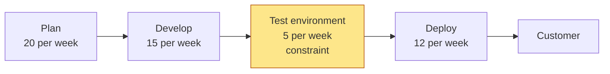
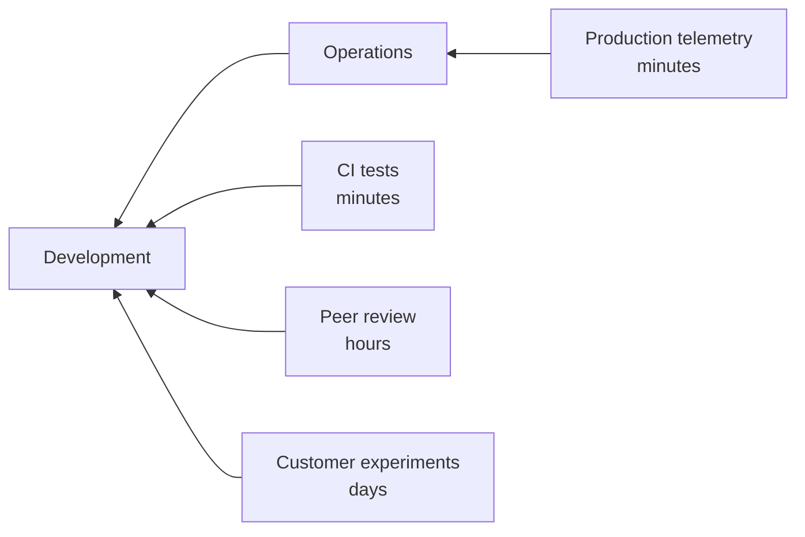
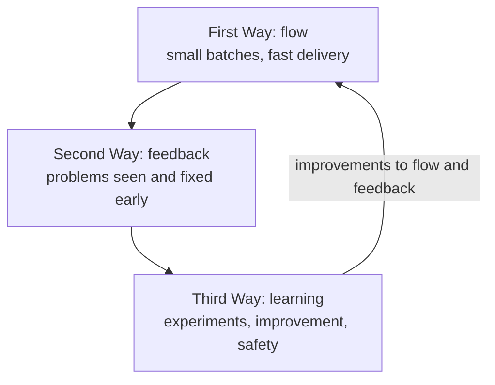

# The Three Ways

## Summary

The Three Ways are the principles from which DevOps practices are derived, as described by Gene Kim in 2012 and developed in *The Phoenix Project* (2013) and *The DevOps Handbook* (2016, second edition 2021). The **First Way** is fast flow of work from development to operations to the customer: small batches, visible work, no hand-off queues, the system optimized as a whole. The **Second Way** is fast feedback from right to left: telemetry, automated tests and peer review that detect problems where they occur, so they are fixed at the source. The **Third Way** is a culture of continual learning and experimentation: taking measured risks, learning from failures without blame, and turning local discoveries into global improvements. Every concrete practice (CI, trunk-based development, monitoring, postmortems) is an application of one or more Ways, which makes them a useful tool for judging whether a practice is done for the right reason.

## Prerequisites

- [DevOps overview](devops-overview.md) and [CALMS](calms.md).

## Core concepts

### Where the Three Ways come from

The Three Ways translate decades of manufacturing and safety research into software delivery: the Toyota Production System and Lean (flow, stopping the line, kaizen), the Theory of Constraints (Eliyahu Goldratt, *The Goal*, 1984), W. Edwards Deming's systems thinking, and research on safety culture and resilience engineering. Gene Kim published them in the blog post "The Three Ways: The Principles Underpinning DevOps" (2012), used them as the structure of the novel *The Phoenix Project* (with Kevin Behr and George Spafford, 2013), and the authors of *The DevOps Handbook* organized all its practices under them.

The figure shows the direction of each Way: work flowing from left to right, feedback flowing from right to left, and learning loops at every stage.

*Analogy.* A river with a navigation system. The First Way keeps the river flowing without dams and whirlpools; the Second Way is the network of gauges and alarms that tells upstream operators within minutes when something goes wrong downstream; the Third Way is the habit of the engineers to study every flood, share what they learned with every other river, and run small controlled experiments to improve flow. The analogy breaks on deliberate risk: river engineers avoid floods at all costs, while the Third Way intentionally injects failures (game days, chaos engineering) to learn before real incidents.

### The First Way: flow

The goal is to accelerate the flow of work from development to operations to the customer, while optimizing for the whole system rather than local efficiency.

Principles and practices:

| Principle | Practice |
| --- | --- |
| **Make work visible** | Boards that show all work, including operations and unplanned work; value stream maps |
| **Limit work in progress** | WIP limits per column and per person; stop starting, start finishing |
| **Reduce batch size** | Small commits, trunk-based development, continuous integration, frequent deployments |
| **Reduce the number of hand-offs** | Cross-functional teams, self-service platforms instead of tickets |
| **Continually identify and elevate constraints** | Theory of Constraints: find the bottleneck, exploit it, subordinate everything else, elevate it, repeat |
| **Eliminate hardships and waste** | Remove waiting, manual work, heroics, partially done work, unnecessary approvals |

The Theory of Constraints explains why optimizing anything other than the bottleneck does not help: a chain of stages moves only as fast as its slowest stage. The DevOps Handbook describes a typical order in which constraints appear and move: environment creation, then code deployment, then test setup and execution, then an overly tight architecture; after those, the constraint often moves to development or product management.

The flowchart shows capacities per stage in a synthetic pipeline: the system delivers 5 changes per week no matter how fast developers code, so the first investment should go into test environments (automation, on demand creation), not into development speed.

### The Second Way: feedback

The goal is fast and constant feedback from right to left at every stage, so problems are detected and fixed where and when they occur, before they cause catastrophic failures.

| Principle | Practice |
| --- | --- |
| **See problems as they occur** | Telemetry in every service and pipeline stage; deployment markers on dashboards |
| **Swarm and solve problems to build new knowledge** | "Stop the line" (the Andon cord): when a build breaks, the team fixes it before doing new work |
| **Keep pushing quality closer to the source** | Automated tests in CI, peer review, static analysis and security scanning in the pipeline instead of late gates |
| **Optimize for downstream work centers** | Design for operations: logging, health checks, runbooks and deployability are part of "done" |

Feedback must be fast to be useful: a test result after 10 minutes changes behavior; a defect report after three months does not. The DevOps Handbook calls for feedback loops on every scale, from seconds (unit tests) to days (A/B experiments with customers).

The diagram shows several feedback loops reaching development from different stages, each with its own delay; shortening these delays is the practical work of the Second Way.

### The Third Way: continual learning and experimentation

The goal is a generative, high-trust culture that supports experimentation, risk taking and organizational learning from both successes and failures.

| Principle | Practice |
| --- | --- |
| **Enable organizational learning and a safety culture** | Blameless postmortems, just culture, psychological safety ([Blameless culture](blameless-culture.md)) |
| **Institutionalize the improvement of daily work** | Reserved time for improvement and technical debt (for example 20 percent of capacity), improvement blitzes, kaizen |
| **Transform local discoveries into global improvements** | Published postmortems, shared libraries and platforms, internal conferences, communities of practice |
| **Inject resilience patterns into daily work** | Game days, chaos engineering, fault injection, rehearsed failovers |
| **Leaders reinforce a learning culture** | Leaders ask "what did we learn?" instead of "who did this?", and fund experiments |

The Third Way also changes how risk is viewed: in complex systems, failures cannot be eliminated, so the organization's ability to detect, respond and learn becomes the key safety property (an idea from resilience engineering).

### How the Ways build on each other

The diagram shows the dependency: fast feedback needs fast flow (feedback on a change shipped once a quarter is too late), learning needs feedback (you cannot learn from what you cannot see), and learning feeds back into better flow and feedback.

### Mapping common practices to the Ways

| Practice | First Way | Second Way | Third Way |
| --- | --- | --- | --- |
| Continuous integration | Small batches, no merge hell | Fast test feedback | |
| Trunk-based development | Small batches | Integration problems visible daily | |
| Deployment pipeline | Fewer hand-offs | Quality gates at the source | |
| Monitoring and alerting | | See problems as they occur | Data for learning |
| Blameless postmortems | | | Organizational learning |
| Chaos engineering | | Detect weaknesses | Inject resilience |
| Internal platform | Self-service, fewer hand-offs | | Local discoveries become global |
| WIP limits | Faster completion | Problems visible as blocked work | |

Using this table in reverse is a good test of a proposed practice: if a practice serves none of the Ways, it is probably ceremony.

## Worked example

A team suffers from long lead times and frequent production incidents. Applying the Three Ways in order (synthetic numbers):

1. **First Way.** A value stream map shows that a change waits on average 4 days for a shared staging environment and 2 days for a weekly release window, while development takes 1 day. The team automates environment creation (ephemeral environments per pull request) and moves to daily deployments.
2. **Second Way.** Incidents are detected by customers, on average 45 minutes after a deployment. The team adds RED dashboards with deployment markers and an alert on error ratio, and makes broken builds a "stop the line" event.
3. **Third Way.** The team holds blameless postmortems for every customer-visible incident, publishes them, and reserves 15 percent of each sprint for the action items.

| Metric | Before | After 3 months |
| --- | --- | --- |
| Change lead time (days) | 7 | 1.5 |
| Deployments per week | 1 | 8 |
| Time to detect incidents (minutes) | 45 | 6 |
| Change fail rate (%) | 25 | 12 |

```mermaid
xychart-beta
  title "Before and after applying the Three Ways (synthetic)"
  x-axis ["Lead time (days)", "Deploys per week", "Detect time (min / 10)", "Change fail rate (% / 10)"]
  y-axis "Value" 0 --> 8
  bar [7, 1, 4.5, 2.5]
  bar [1.5, 8, 0.6, 1.2]
```

The chart compares the before (first bar) and after (second bar) values from the table; detection time and change fail rate are divided by 10 to fit one scale. Flow improved first, which made feedback meaningful, and learning reduced the failure rate.

## Trade offs and when to use it

- **Strengths.** A small set of principles that explain *why* practices work; useful to evaluate new practices and tools; a shared language between engineering and leadership.
- **Limits.** The Ways are principles, not a method: they do not tell you which practice to adopt first or how to measure progress. Use value stream mapping to find the constraint and DORA metrics to measure the outcome.
- **Cost.** The Third Way requires reserved capacity and leadership behavior change, which competes with feature work in the short term.

## Common mistakes

- **Optimizing a non-constraint** (for example faster laptops for developers while tests wait days for an environment). Fix: find the constraint first.
- **Feedback that arrives too late or goes to the wrong people**, such as monthly incident reports to managers. Fix: real-time telemetry for the team that owns the service.
- **Blame after failure**, which shuts down the Third Way: people hide problems. Fix: blameless postmortems with system-focused action items.
- **No time for improvement.** Action items rot in the backlog. Fix: explicitly reserve capacity and track completion.

## Practice

1. Name the Three Ways and the direction each one points in the value stream.
2. Why does improving a non-bottleneck stage not shorten lead time?
3. Which Way does "stop the line when the build breaks" serve, and why?
4. Give two practices that turn local discoveries into global improvements.
5. A team wants to adopt a new approval step for production changes. Which Way does it hurt, and what would serve the same purpose better?

Answers:

1. The First Way (flow, left to right), the Second Way (feedback, right to left), the Third Way (continual learning and experimentation, loops at every stage).
2. Throughput of the whole system is limited by the slowest stage (the constraint), so work just piles up in front of the bottleneck.
3. The Second Way: it ensures problems are fixed at the source while the context is fresh, instead of piling up behind new work.
4. Published blameless postmortems, shared libraries or platform features, communities of practice and internal conferences.
5. The First Way, because it adds a hand-off and waiting time; automated tests, peer review and progressive delivery with fast rollback serve the purpose of reducing risk better.

## Further reading

- [The Three Ways: The Principles Underpinning DevOps](https://itrevolution.com/articles/the-three-ways-principles-underpinning-devops/) (Gene Kim, IT Revolution, 2012): the original article.
- *The DevOps Handbook*, 2nd edition (Gene Kim, Jez Humble, Patrick Debois, John Willis, Nicole Forsgren, IT Revolution, 2021): parts II to IV are structured by the Three Ways.
- *The Phoenix Project* (Gene Kim, Kevin Behr, George Spafford, IT Revolution, 2013): the novel that introduced the Ways to a wide audience.
- *The Goal: A Process of Ongoing Improvement* (Eliyahu M. Goldratt, Jeff Cox, North River Press, 1984): the Theory of Constraints.
- *The Unicorn Project* (Gene Kim, IT Revolution, 2019): the Five Ideals, a later restatement focused on developers.
