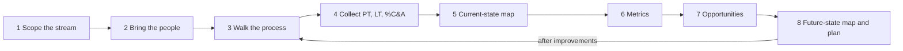

# Value stream mapping

## Summary

A value stream is the sequence of activities an organization performs to turn a customer request into delivered value; in software, typically from an idea or a commit to a change running in production. Value stream mapping (VSM) is a Lean technique, from the Toyota Production System, for drawing that sequence with real data: for each step, how long the work is actively processed (process time), how long it takes end to end including waiting (lead time), and how often the output is correct the first time (percent complete and accurate). The map makes visible what nobody sees from inside one team: most of the elapsed time is waiting between steps, not work. From the current-state map, the team designs a future-state map and an improvement plan focused on the largest delays, hand-offs and rework. VSM is the most direct practical tool for the First Way of DevOps.

## Prerequisites

- [The Three Ways](three-ways.md), in particular the First Way.
- [DORA metrics and capabilities](dora-metrics.md) for change lead time.

## Core concepts

### Origin and purpose

Toyota used "material and information flow diagrams" to see its production systems as a whole. Mike Rother and John Shook formalized the method as value stream mapping in *Learning to See* (1999), and Karen Martin and Mike Osterling adapted it to office and knowledge work in *Value Stream Mapping* (2013), introducing the metrics used for software today. In DevOps, VSM answers a question that local metrics cannot: where does the time go between a developer finishing a change and a customer using it?

*Analogy.* A parcel's tracking history. The parcel spends minutes being scanned, sorted and loaded, but days sitting in depots and trucks. Looking at only one depot's efficiency (how fast it sorts) misses that the parcel waited three days for the next truck. VSM is the tracking history for a unit of work. The analogy breaks on rework: parcels rarely travel back to the sender for corrections, while software changes often loop back from testing or review to development, and those loops are a major part of the map.

### Key terms and metrics

| Term | Definition |
| --- | --- |
| **Value stream** | All activities from a customer request to delivered value, including information flows |
| **Process time (PT)** | Time a work item is actively worked on in a step (touch time), if the person could work on it without interruption |
| **Lead time (LT)** | Elapsed time from when a step receives work until it hands it on, including waiting; total lead time is from request to delivery |
| **Wait time** | Lead time minus process time |
| **Percent complete and accurate (%C&A)** | Share of the time the next step can use the output as received, without correction, clarification or rework |
| **Activity ratio (flow efficiency)** | Total process time / total lead time |
| **Rolled %C&A** | Product of all %C&A values: the share of work that passes the whole stream without any rework |

Lead time in VSM is wider than DORA's change lead time: VSM often starts at the customer request or the start of design, while DORA starts at the commit. Both views are useful; the DORA metric measures the delivery part of the stream.

### How to run a value stream mapping

1. **Choose the value stream and its boundaries.** For example "a change to the checkout service, from a ticket being ready for development to running in production". One map per stream.
2. **Gather the people who do the work** from every step (product, development, review, test, security, operations, change management). Managers alone cannot map what they do not see.
3. **Walk the process** and list the steps, the hand-offs between them and the information flows (tickets, approvals, notifications).
4. **Collect data** for each step: process time, lead time and %C&A, from tools where possible (tickets, pull requests, pipelines, deployments) and from the participants otherwise. Use typical values, not best cases.
5. **Draw the current-state map** with a timeline: process time on one line, waiting on the other.
6. **Calculate** total lead time, total process time, activity ratio and rolled %C&A.
7. **Find the improvement opportunities**: largest waits, hand-offs, low %C&A, manual steps, batching.
8. **Design the future-state map** for a realistic horizon (3 to 12 months) and a transformation plan with owners and metrics.
9. **Revisit** the map regularly; the constraint moves when it is removed.



The diagram summarizes the steps as a loop: a value stream map is never finished, because improving one constraint reveals the next.

### Typical findings in software value streams

| Finding | Typical cause | Typical countermeasure |
| --- | --- | --- |
| Long wait for code review | Large pull requests, reviewers overloaded | Small changes, review as a team priority, pairing |
| Long wait for test environments | Shared, manually configured environments | Ephemeral environments created on demand with IaC |
| Batching before release | Fixed release trains, manual regression testing | Test automation, continuous delivery, feature flags |
| Change approval board | External approval for every change | Peer review plus automated controls, lightweight approval for high-risk changes only |
| Low %C&A from requirements | Unclear acceptance criteria | Shared refinement, examples, earlier involvement of testers |
| Rework after security review | Late security gate | Security checks in the pipeline and early threat modeling ([DevSecOps overview](../devsecops/devsecops-overview.md)) |
| Hand-off tickets to operations | Separate ops team deploys | Self-service deployment, team owns production |

### Related flow concepts

- **Little's law**: average lead time = average work in progress / average throughput. Halving WIP with the same throughput halves lead time, which is why WIP limits are one of the cheapest improvements.
- **Flow efficiency** in knowledge work is often low: values of 5 to 15 percent are commonly reported for software teams (a practitioner estimate, not a research result). Improving it usually means removing waiting, not working faster.
- **Value stream management** is the ongoing practice of measuring and improving value streams with tooling (flow metrics from Mik Kersten's Flow Framework: flow velocity, flow time, flow efficiency, flow load, flow distribution), as opposed to a one-off mapping workshop.

## Worked example

Map the delivery of one change to a web service, from "ready for development" to "running in production". Synthetic data collected in a workshop:

| Step | Process time (hours) | Lead time (hours) | %C&A |
| --- | --- | --- | --- |
| Development | 8 | 16 | 90 % |
| Code review | 1 | 24 | 80 % |
| Integration test in shared environment | 2 | 48 | 70 % |
| Security review | 1 | 40 | 85 % |
| Change advisory board | 0.5 | 72 | 95 % |
| Deployment by operations | 1 | 8 | 90 % |
| **Total** | **13.5** | **208** | rolled 37 % |

Calculations:

- Total lead time: 16 + 24 + 48 + 40 + 72 + 8 = 208 hours, about 8.7 days (calendar hours).
- Total process time: 8 + 1 + 2 + 1 + 0.5 + 1 = 13.5 hours.
- Activity ratio: 13.5 / 208 = 6.5 percent; the change is actively worked on only one sixteenth of the time.
- Rolled %C&A: 0.90 x 0.80 x 0.70 x 0.85 x 0.95 x 0.90 = about 0.37; only about one change in three passes the whole stream without rework.

```mermaid
xychart-beta
  title "Process time vs lead time per step (hours, synthetic)"
  x-axis [Dev, Review, "Int test", Security, CAB, Deploy]
  y-axis "Hours" 0 --> 80
  bar [16, 24, 48, 40, 72, 8]
  bar [8, 1, 2, 1, 0.5, 1]
```



The chart shows lead time (first bar of each pair) and process time (second bar) per step from the table. Waiting dominates every step after development, and the three largest waits are the change advisory board, the shared test environment and the security review.

The timeline view used on paper maps:

```text
           Dev     Review   Int test   Security   CAB      Deploy
wait:      8h      23h      46h        39h        71.5h    7h        = 194.5 h waiting
work:  |   8h   |   1h   |    2h    |    1h    |  0.5h  |   1h   |   = 13.5 h working
```

The future-state design the team agrees on:

1. Replace the shared integration environment with ephemeral environments per pull request (wait 46 hours to about 1 hour, %C&A up because environments are clean).
2. Move security checks into the pipeline (SAST, dependency scanning) and keep a manual review only for changes that touch authentication or payment (wait 39 hours to near zero for most changes).
3. Replace the change advisory board for standard changes with automated evidence (tests passed, review approved, deployment logged).
4. Let the team deploy itself through the pipeline.

Expected future lead time: about 16 + 8 + 1 + 0.5 + 0.5 = 26 hours, with an activity ratio of roughly 50 percent. The team will verify the forecast by measuring change lead time ([DORA metrics](dora-metrics.md)) for three months.

## Trade offs and when to use it

- **Strengths.** Makes the whole system and its waiting visible, builds shared understanding across silos, points to the constraint with data, and creates a baseline for measuring improvement.
- **Costs.** Needs time from people of every step (a one to two day workshop for a first map), honest data and management support for acting on findings.
- **Limits.** A map is a snapshot of typical flow; it hides variation (some changes take a month) unless distributions are also collected. It does not tell you how to fix a problem, only where it is.
- **When to use it.** At the start of a DevOps transformation, when lead times are long and nobody knows why, before buying tools, and periodically to find the next constraint.

## Common mistakes

- **Mapping the process as documented instead of as it really runs.** Fix: walk real work items and use tool data.
- **Mapping without the people who do the work.** Fix: invite every function in the stream.
- **Optimizing process time** (making developers code faster) when waiting is 90 percent of lead time. Fix: attack the largest waits and hand-offs first.
- **Using best-case numbers.** Fix: typical values or medians, plus notes on variation.
- **Creating a map and no plan.** Fix: future-state map, owners, dates and a metric to verify each change.

## Practice

1. Define process time, lead time and %C&A.
2. A stream has 20 hours of process time and 400 hours of lead time. What is its activity ratio?
3. Three steps have %C&A of 90, 80 and 50 percent. What is the rolled %C&A, and what does it mean?
4. With 30 items in progress and a throughput of 10 items per week, what is the average lead time? What if WIP is cut to 15?
5. Why is DORA's change lead time usually shorter than a VSM total lead time?

Answers:

1. Process time is the active work time in a step; lead time is the elapsed time from receiving work to handing it on, including waiting; %C&A is the share of output that the next step can use without correction.
2. 20 / 400 = 5 percent.
3. 0.9 x 0.8 x 0.5 = 0.36: only 36 percent of items pass all three steps without any rework.
4. 30 / 10 = 3 weeks; with 15 items, 1.5 weeks (Little's law, assuming the same throughput).
5. DORA starts at the commit, while VSM often starts earlier (request, design, ready for development).

## Further reading

- *Learning to See: Value Stream Mapping to Add Value and Eliminate MUDA* (Mike Rother, John Shook, Lean Enterprise Institute, 1999).
- *Value Stream Mapping: How to Visualize Work and Align Leadership for Organizational Transformation* (Karen Martin, Mike Osterling, McGraw-Hill, 2013): the PT, LT and %C&A metrics for knowledge work.
- [Value stream mapping capability](https://dora.dev/capabilities/visibility-of-work-in-the-value-stream/) (DORA): visibility of work in the value stream.
- *Project to Product* (Mik Kersten, IT Revolution, 2018): the Flow Framework and flow metrics.
- *The DevOps Handbook*, 2nd edition (Gene Kim et al., IT Revolution, 2021): chapter on selecting and mapping value streams.
