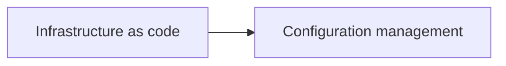

# Infrastructure as code

Provisioning and configuring infrastructure from versioned definition files.

Terraform is covered in depth in the separate Terraform knowledge repository (`terraform-knowledge`, a sibling of this repository), which follows the same standard.

## Map of the area

The diagram shows the notes in reading order; subareas are marked with (subarea).

## Notes in reading order

1. [Infrastructure as code](infrastructure-as-code-overview.md): concepts, workflow, tools and practices.
2. [Configuration management](configuration-management.md): configuration items, drift, tools and the comparison with IaC.

## Planned topics

- Ansible
- Pulumi
- AWS CloudFormation
- Packer and image building
- Immutable infrastructure
- Policy as code (OPA, Sentinel, Checkov)
- Testing infrastructure code
