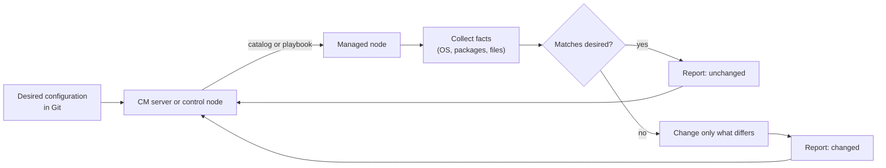

# Configuration management

## Summary

Configuration management (CM) is a systems engineering process that keeps the configuration of a system consistent throughout its lifecycle. In IT and software delivery it means tracking and controlling changes to software, infrastructure and environments: every component is a *configuration item* (CI) with a known, versioned desired configuration, every change is recorded and approved, and tools continuously detect and correct *drift* between the desired and the actual state. Tools such as Ansible, Puppet, Chef and Salt automate this for servers; Kubernetes ConfigMaps and key-value stores such as Consul do it for application settings.

## Prerequisites

- [Infrastructure as code](infrastructure-as-code-overview.md) for declarative definitions, idempotency and drift.
- Basic Linux administration ([Operating system overview](../operating-systems/operating-system-overview.md)).

## Core concepts

### The problem configuration management solves

A fleet of 200 servers configured by hand will hold 200 slightly different configurations within months: a package updated here, a config file edited there during an incident. Nobody can say what the correct configuration is, failures cannot be reproduced and audits cannot be passed. CM defines the correct configuration once, applies it everywhere and keeps checking that it stays applied.

*Analogy.* A franchise operations manual. Every restaurant of a chain follows the same manual for recipes, equipment and opening hours, and inspectors visit regularly and correct deviations. The manual is the desired state, the restaurants are the configuration items, the inspections are drift detection. The analogy breaks on speed: inspectors come monthly, CM agents check every few minutes.

### Origins and definition

CM began in the 1950s and 1960s as a discipline in defense and aerospace engineering (for example the US military standard MIL-STD-973, later EIA-649) to keep track of which parts and documents made up which version of a system. ITIL took it into IT service management as *service asset and configuration management* with a *configuration management database* (CMDB). DevOps narrowed it to automated, code-defined configuration of servers and applications.

### Kinds of configuration management in IT

1. **Software configuration management (SCM).** Tracks and controls changes to software and its configuration metadata. Works together with version control and CI/CD pipelines.
2. **Infrastructure configuration management.** Manages server configuration, network settings and infrastructure as code. Tools such as Ansible, Chef and Puppet automate the tasks.
3. **Application configuration management.** Manages environment-specific settings such as database connections and API endpoints, for example with Kubernetes ConfigMaps or HashiCorp Consul.

### Core aspects

1. **Tracking configuration items (CIs).** Every component (software, servers, databases and so on) is a CI that is tracked, versioned and managed to prevent misconfiguration.
2. **Change control and monitoring.** Every change to the system is recorded, reviewed and approved to keep the system stable.
3. **Automation and versioning.** CM integrates with version control (for example Git) and CI/CD pipelines so that deployments are consistent.
4. **Drift detection and correction.** The system state is monitored continuously, and *configuration drift* (the difference between desired and actual state) is corrected.

The convergence loop below is what agent-based tools (Puppet, Chef, Salt minions) run on every node, typically every 30 minutes; Ansible runs the same logic when a playbook is executed.



### Why it matters

- **System stability.** Prevents unwanted or unexpected changes that could break deployments.
- **Compliance.** Helps maintain security and regulatory standards with a recorded, enforced configuration (for example CIS benchmark settings).
- **DevOps efficiency.** Automates provisioning steps and application management.
- **Faster recovery.** After a failure, systems can be restored to a known good state.
- **Better CI/CD.** Keeps environments consistent, so what passed in staging behaves the same in production.

### Configuration management in CI/CD

1. **Version control for configuration.** Configuration is stored as code in repositories (for example Git on GitHub or Bitbucket); changes are tracked and can be rolled back.
2. **Automation in pipelines.** Infrastructure and application configuration stay consistent across environments; configuration changes are tested and deployed by pipelines.
3. **Monitoring and drift detection.** Continuous monitoring detects unauthorized changes and automatic reconciliation restores the desired configuration.

### Tools

| Tool | Model | Language | Architecture | Typical use |
| --- | --- | --- | --- | --- |
| Ansible | Procedural playbooks of declarative, idempotent modules | YAML | Agentless, push over SSH or WinRM | Automation and configuration, application deployment |
| Puppet | Declarative | Puppet DSL | Agent pulls a catalog from the server | System state management of large fleets |
| Chef | Imperative Ruby DSL (recipes, cookbooks) with declarative resources | Ruby | Agent pulls from the server | Infrastructure automation |
| SaltStack (Salt) | Hybrid (declarative states, imperative remote execution) | YAML and Jinja | Agents (minions) on an event bus, or agentless SSH | Large-scale cloud configuration, fast remote execution |
| Terraform | Declarative | HCL | Client calls provider APIs | Infrastructure provisioning (IaC), not in-server configuration |
| Kubernetes ConfigMaps | Declarative | YAML | Stored in the Kubernetes API | Application configuration in Kubernetes |
| HashiCorp Consul | Key-value store | HTTP API | Agents and servers | Service discovery and dynamic application configuration |

### Configuration management compared with infrastructure as code

The two overlap and are often combined: IaC creates the server, CM configures what runs on it.

| Aspect | Configuration management | Infrastructure as code (provisioning) |
| --- | --- | --- |
| Purpose | Keeps system configuration consistent | Automates infrastructure provisioning |
| Focus | Managing and maintaining configuration inside systems | Defining and creating the infrastructure |
| Lifecycle | Long-lived, mutable servers | Created, changed and destroyed resources |
| Tools | Ansible, Chef, Puppet, Salt | Terraform, AWS CloudFormation, Pulumi |

### Use cases

1. **Automating infrastructure deployments.** Ansible or Terraform set up infrastructure with predefined configuration.
2. **Multi-environment configuration.** Different configurations for development, staging and production are stored in Git (for example Ansible inventories and group variables per environment).
3. **Compliance and security audits.** A versioned record of configuration shows unauthorized changes.
4. **Disaster recovery.** Configuration definitions rebuild infrastructure after a failure.

### Challenges and solutions

1. **Configuration drift.** Manual changes cause deviations from the desired state. Solution: automated drift detection and regular enforcement runs.
2. **Complexity in large environments.** Thousands of servers and services are hard to manage. Solution: centralized configuration management tools, roles and inventories with clear structure.
3. **Integration with legacy systems.** Some legacy systems do not support modern CM tools. Solution: gradual migration with hybrid approaches (for example agentless Ansible over SSH where agents cannot be installed).

## Worked example

An Ansible playbook that keeps nginx installed, configured and running on all web servers. Untested; Ansible core 2.17, Debian or Ubuntu targets, checked 2026-11.

```yaml
# site.yml
- name: Web servers
  hosts: web
  become: true
  tasks:
    - name: Install nginx
      ansible.builtin.apt:
        name: nginx
        state: present          # declarative: install only if missing
        update_cache: true
        cache_valid_time: 3600  # do not refresh the package index on every run

    - name: Deploy site configuration
      ansible.builtin.template:
        src: templates/site.conf.j2
        dest: /etc/nginx/conf.d/site.conf
        mode: "0644"
        validate: nginx -t -c %s   # never write a config nginx cannot load
      notify: Reload nginx

    - name: Keep nginx running and enabled at boot
      ansible.builtin.service:
        name: nginx
        state: started
        enabled: true

  handlers:
    - name: Reload nginx
      ansible.builtin.service:
        name: nginx
        state: reloaded
```

Run it in check mode first to see drift without changing anything, then apply:

```bash
ansible-playbook -i inventory/production site.yml --check --diff
ansible-playbook -i inventory/production site.yml
```

Output of a second run on unchanged servers (shortened):

```text
PLAY RECAP
web1.example.com : ok=4  changed=0  unreachable=0  failed=0
web2.example.com : ok=4  changed=0  unreachable=0  failed=0
```

`changed=0` on the second run is the proof of idempotency. If someone edits `/etc/nginx/conf.d/site.conf` by hand, the next run reports `changed=1` for that host and the handler reloads nginx.

## Trade offs and when to use it

- **Agent-based tools** (Puppet, Chef, Salt) enforce configuration continuously and scale to large fleets, but need agents, servers and certificates.
- **Agentless tools** (Ansible) need only SSH and Python on the target and are simple to start, but only enforce configuration when someone or something runs them.
- **Immutable infrastructure** (images built with Packer or containers) removes most in-place configuration management. Use CM for long-lived servers, appliances and the image build itself.
- **Application configuration** belongs in environment variables, ConfigMaps or a configuration service, not baked into images, so the same artifact runs in every environment.

## Common mistakes

- **Using `shell` and `command` tasks for everything.** They are not idempotent and always report a change. Fix: use the dedicated modules, or add `creates`, `removes` or `changed_when` conditions.
- **Running CM once at provisioning and never again.** Drift accumulates. Fix: scheduled enforcement runs or agents.
- **Storing secrets in inventories and variable files.** Fix: Ansible Vault or an external secrets manager ([Secrets management](../devsecops/secrets-management.md)).
- **Mixing provisioning and configuration in one tool without need.** Fix: let the IaC tool create resources and the CM tool configure them, and hand over through inventory.

### Best practices

1. **Store configuration as code** in version control (for example Git).
2. **Prefer declarative configuration.** Define what the system should look like, not how to configure it.
3. **Automate enforcement** with tools such as Ansible or Puppet.
4. **Monitor continuously** and revert drifted configuration automatically.
5. **Secure the configuration.** Apply security policies to configuration files and use role-based access control (RBAC) for who may change them.

## Practice

1. What is a configuration item?
2. Why does a second Ansible run reporting `changed=0` matter?
3. What is the main operational difference between Puppet and Ansible?
4. A server was changed manually during an incident. How does CM handle this, and what should the team do afterwards?

Answers:

1. Any component whose configuration is tracked and controlled: a server, a package, a database, a configuration file or an application setting.
2. It shows the playbook is idempotent: on a system that is already in the desired state, it changes nothing.
3. Puppet runs an agent on every node that pulls and enforces the configuration on a schedule; Ansible pushes changes over SSH only when a playbook is run.
4. The next enforcement run reverts the manual change. If the change was needed, the team must put it into the configuration code so it is applied everywhere and kept.

## Further reading

- [Ansible documentation](https://docs.ansible.com/) (Red Hat): playbooks, modules, check mode and Vault.
- [Puppet documentation](https://www.puppet.com/docs) (Perforce Puppet): catalogs, agents and the declarative model.
- [Chef documentation](https://docs.chef.io/) (Progress Chef): recipes, cookbooks and resources.
- [Salt documentation](https://docs.saltproject.io/) (Salt Project): states, minions and the event bus.
- *Infrastructure as Code*, 2nd edition (Kief Morris, O'Reilly, 2020): chapters on server configuration and immutable servers.
