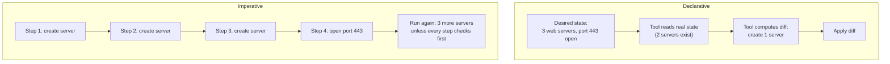
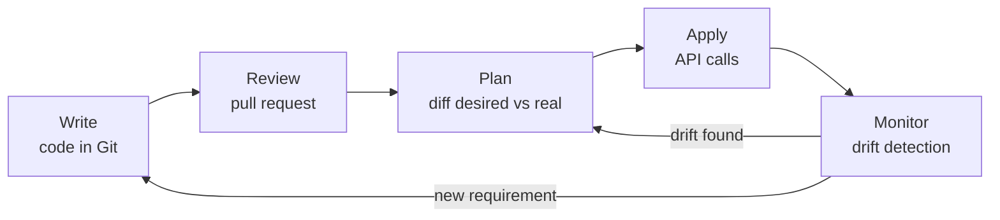

# Infrastructure as code

## Summary

Infrastructure as code (IaC) is the practice of managing and provisioning computing infrastructure through machine-readable definition files instead of physical configuration or interactive tools such as web consoles. Infrastructure is treated like application code: it lives in version control, is reviewed, tested and deployed by pipelines. A declarative IaC tool compares the desired state in the files with the real state and applies only the difference, so the same files can create a new environment or bring an existing one back in line. IaC is the basis for reproducible environments, disaster recovery and auditable change.

## Prerequisites

- [DevOps overview](../foundations/devops-overview.md).
- Basic familiarity with at least one cloud provider or virtualization platform ([Cloud providers](../cloud-computing/cloud-providers.md)).

## Core concepts

### The problem IaC solves

Hand-built servers become *snowflakes*: each one is slightly different, nobody remembers why, and rebuilding one after a failure takes days of guesswork. Manual changes are not reviewed, not recorded and not repeatable, so test environments drift away from production and "works in staging" stops meaning anything. IaC turns the environment into text that can be diffed, reviewed, reused and rebuilt.

*Analogy.* IaC is a building plan instead of oral instructions to builders. With a plan you can build the same house twice, see exactly what a renovation changes before you start, and rebuild after a fire. The analogy breaks at runtime: a house does not change itself, while real infrastructure is also changed by autoscalers, failures and people, which is why IaC tools have to detect drift.

### Key concepts

1. **Declarative compared with imperative approach.**
   - **Declarative.** You define *what* the infrastructure should look like, and the tool works out *how* to reach that state. Examples: Terraform, AWS CloudFormation, Kubernetes manifests.
   - **Imperative.** You define *how* to reach the desired state, step by step. Examples: shell scripts, the Chef Ruby DSL in its procedural use, cloud SDK scripts.
   - Ansible is often listed as imperative because a playbook is an ordered list of tasks; most of its modules are declarative and idempotent (`state: present`), so it is better described as procedural playbooks of declarative modules.
2. **Idempotency.** Applying the same definition many times gives the same result as applying it once. This makes runs safe to repeat and enables drift correction.
3. **Version control.** Definitions are stored in repositories, which enables change tracking, review, rollback and collaboration.
4. **Testing.** Infrastructure code can be tested for errors, misconfiguration and compliance violations, for example with Terratest, InSpec, `terraform test`, Checkov or OPA policies.
5. **State.** Declarative tools need to know which real resources belong to which definitions. Terraform keeps an explicit state file; CloudFormation keeps stacks on the AWS side; Kubernetes stores the state in its API server.
6. **Drift.** The difference between the declared state and the real state, caused by manual changes or external processes.

The diagram compares the two approaches on the same task.



### How it works

IaC tools call the APIs of cloud providers or on-premises platforms (vSphere, OpenStack, network devices) to create and configure resources. The typical workflow:

1. **Write.** Define the infrastructure in files (for example a Terraform `.tf` file).
2. **Plan.** Simulate the change and review the outcome before anything is touched.
3. **Apply.** Execute the change to provision or update the infrastructure.
4. **Monitor.** Continuously check for drift between the defined and the actual state.



### Provisioning compared with configuration management

IaC covers two jobs that are often done by different tools:

- **Provisioning** creates the infrastructure itself: networks, virtual machines, databases, load balancers (Terraform, CloudFormation, Pulumi).
- **Configuration management** configures what runs inside it: packages, files, services, users (Ansible, Chef, Puppet, Salt). See [Configuration management](configuration-management.md).

With *immutable infrastructure* the second job moves into image building (Packer, Dockerfiles): servers are never changed after creation, only replaced with a new image.

### Benefits

1. **Consistency.** Automation removes manual errors and gives identical environments for development, testing and production.
2. **Scalability.** Resources can be provisioned and scaled across regions from the same definitions.
3. **Speed.** Automated provisioning takes minutes instead of days.
4. **Cost efficiency.** Resource allocation is visible and reviewable, manual labor drops, and unused environments can be destroyed and recreated.
5. **Collaboration.** Teams work on infrastructure through version-controlled code and pull requests.
6. **Auditing and compliance.** Every change is documented and traceable to a commit and a reviewer.

### Challenges

1. **Complexity.** Large infrastructures need intricate configurations, module hierarchies and dependency management.
2. **Learning curve.** Teams need to learn the tools and their programming model.
3. **Drift management.** Changes made outside the IaC workflow cause configuration drift.
4. **Cost of errors.** A mistake in IaC is applied at scale; one wrong line can delete a database or open a firewall everywhere.
5. **State handling.** State files contain sensitive data and must be shared, locked and protected.

### Tools and ecosystems

| Tool | Approach | Features | Use cases | Challenges |
| --- | --- | --- | --- | --- |
| Terraform (and the OpenTofu fork) | Declarative (HCL) | Multi-cloud providers, state in `.tfstate` files, reusable modules | Provisioning across AWS, Azure, Google Cloud and many SaaS APIs; multi-cloud architectures | Managing large state files; license changed to BSL in 2023, OpenTofu is the open source fork |
| AWS CloudFormation | Declarative (YAML or JSON) | Native to AWS, stack-based resource management, state kept by AWS | Automating AWS deployments in line with AWS practices | Limited to the AWS ecosystem |
| Ansible | Procedural playbooks, declarative modules (YAML) | Agentless over SSH or WinRM, focus on configuration and automation | Application deployment, configuring systems and software | Slower at scale, no state, so it cannot see resources removed from code |
| Chef | Ruby DSL (recipes, cookbooks) | Configuration management with an agent and a server | Complex system configuration, continuous delivery pipelines | Requires an agent and Ruby knowledge |
| Puppet | Declarative DSL | Agent-based state enforcement | Large fleets of long-lived servers | Requires an agent and a server |
| Pulumi | Code-driven, declarative engine | General-purpose languages (Python, TypeScript, Go, C#), multi-cloud and Kubernetes support | Dynamic, application-specific infrastructure | Smaller ecosystem; real code invites complexity |
| Kubernetes manifests | Declarative (YAML) | Native to Kubernetes; pods, services, deployments | Containerized workloads and cluster configuration | Only manages objects inside Kubernetes |

Terraform is covered in depth in the separate Terraform knowledge repository (`terraform-knowledge`), and Ansible is a planned topic of this area.

### Use cases

1. **Multi-cloud deployments.** Terraform manages resources in AWS, Azure and Google Cloud from one workflow.
2. **Disaster recovery.** Infrastructure is rebuilt from code after a failure (data needs its own backups).
3. **Compliance enforcement.** Infrastructure is checked against security and regulatory rules, for example with InSpec or policy as code.
4. **CI/CD integration.** Provisioning and configuration run as pipeline stages.
5. **Hybrid cloud management.** On-premises and cloud infrastructure are managed with the same tools (for example Ansible).
6. **Ephemeral environments.** A full environment per pull request, destroyed after merge.

## Worked example

The same goal, "a storage bucket with versioning", in an imperative script and in declarative Terraform. Untested; Terraform 1.9 and AWS provider 5.x syntax, checked 2026-11.

Imperative (AWS CLI):

```bash
# Run twice and the first command fails with BucketAlreadyOwnedByYou;
# every step needs its own existence check to be idempotent.
aws s3api create-bucket --bucket example-logs-bucket --region eu-central-1 \
  --create-bucket-configuration LocationConstraint=eu-central-1
aws s3api put-bucket-versioning --bucket example-logs-bucket \
  --versioning-configuration Status=Enabled
```

Declarative (Terraform):

```hcl
resource "aws_s3_bucket" "logs" {
  bucket = "example-logs-bucket"
}

resource "aws_s3_bucket_versioning" "logs" {
  bucket = aws_s3_bucket.logs.id
  versioning_configuration {
    status = "Enabled"
  }
}
```

Running `terraform plan` on an empty account shows `Plan: 2 to add, 0 to change, 0 to destroy`. After `apply`, a second `plan` shows `No changes`. If someone suspends versioning in the console, the next `plan` shows `1 to change`: drift is detected and `apply` corrects it.

## Trade offs and when to use it

- **Use IaC** for anything that must exist in more than one copy, live longer than a day, or be audited. That is almost all production infrastructure.
- **Declarative tools** suit provisioning, because they detect drift and deletions. **Procedural tools** suit ordered operations (rolling upgrades, data migrations) where the sequence matters.
- **Cost.** IaC adds a layer to learn and maintain, and its state is a new critical asset. For a one-off experiment, the console is faster.
- **General-purpose languages** (Pulumi, CDK) give loops, types and tests but also allow overly clever code; a restricted DSL (HCL) keeps configurations reviewable.

## Common mistakes

- **Mixing manual and IaC changes.** The next apply reverts the manual change or fails. Fix: all changes through code; detect drift on a schedule.
- **Local or unprotected state.** Fix: remote state with locking and encryption, restricted access.
- **One giant configuration for everything.** A plan takes minutes and one mistake can touch everything. Fix: split by lifecycle and blast radius (network, data, applications) and reuse modules.
- **No review of the plan.** Fix: show the plan in the pull request and require approval before apply.
- **Hardcoded secrets in code.** Fix: read secrets from a secrets manager at apply time (see [Secrets management](../devsecops/secrets-management.md)).

### Best practices

1. **Organize code** in reusable modules (for example Terraform modules) to simplify reuse and maintenance.
2. **Use version control** for all IaC files to track changes and collaborate.
3. **Test infrastructure code** automatically (for example with Terratest).
4. **Protect state** with encryption and locking.
5. **Monitor drift** by regularly comparing actual and desired state (for example with a scheduled `terraform plan`).
6. **Document configurations** for handovers and audits.

## Practice

1. What does idempotency give you that a plain script does not?
2. Why is Ansible described both as imperative and as declarative?
3. Name two causes of drift and one way to detect it.
4. Which IaC job does immutable infrastructure move into image building?

Answers:

1. The same definition can be applied many times safely; repeated runs converge on the desired state instead of creating duplicates or failing.
2. Playbooks run tasks in a fixed order (procedural), but most modules describe a desired state and change only what differs (declarative).
3. Manual changes in a console and automated processes such as autoscalers or other tools; a scheduled plan or a GitOps agent detects it.
4. Configuration management: software and settings are baked into the image instead of being applied to running servers.

## Further reading

- *Infrastructure as Code*, 2nd edition (Kief Morris, O'Reilly, 2020): the standard book on IaC patterns and practices.
- [Terraform documentation](https://developer.hashicorp.com/terraform/docs) (HashiCorp): the declarative workflow, state and providers.
- [OpenTofu documentation](https://opentofu.org/docs/) (Linux Foundation): the open source fork of Terraform.
- [AWS CloudFormation User Guide](https://docs.aws.amazon.com/AWSCloudFormation/latest/UserGuide/Welcome.html) (Amazon Web Services): stacks and templates.
- [Ansible documentation](https://docs.ansible.com/) (Red Hat): playbooks, modules and idempotency.
