# Networking

Network models and protocols, organized by the layers of the Internet protocol suite (RFC 1122 and RFC 1123), plus network security, traffic management and network operations.

## Map of the area

The diagram shows the notes in reading order; subareas are marked with (subarea).

```mermaid
flowchart LR
  n0["Networking overview"]
  n1["Network types"]
  n0 --> n1
  n2["Network models<br/>(subarea)"]
  n1 --> n2
  n3["Link layer<br/>(subarea)"]
  n2 --> n3
  n4["Internet layer<br/>(subarea)"]
  n3 --> n4
  n5["Transport layer<br/>(subarea)"]
  n4 --> n5
  n6["Application layer<br/>(subarea)"]
  n5 --> n6
  n7["Network security<br/>(subarea)"]
  n6 --> n7
  n8["Traffic management<br/>(subarea)"]
  n7 --> n8
  n9["Network operations<br/>(subarea)"]
  n8 --> n9
```

## Notes in reading order

1. [Networking overview](networking-overview.md): components, key concepts, models, protocols and tools.
2. [Network types](network-types.md): PAN, LAN, WLAN, CAN, MAN, WAN and specialized networks.
3. [Network models](network-models/README.md): OSI, TCP/IP and what protocols are.
4. [Link layer](link-layer/README.md): switches, VLANs and ARP.
5. [Internet layer](internet-layer/README.md): IP, addressing, CIDR, NAT, routers and IPAM.
6. [Transport layer](transport-layer/README.md): ports, TCP and UDP.
7. [Application layer](application-layer/README.md): DNS, DHCP, NTP, HTTP, FTP, SSH and email.
8. [Network security](network-security/README.md): TLS, firewalls, DMZ, VPN and zero trust.
9. [Traffic management](traffic-management/README.md): proxies, load balancing, service discovery, CDN, service mesh and nginx.
10. [Network operations](network-operations/README.md): metrics and tools.

## Planned topics

- Wireless networking (802.11 in depth)
- IPv6 deployment and transition
- Software-defined networking
