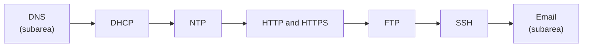

# Application layer

Protocols that applications use directly: name resolution, address configuration, time, web, file transfer, remote access and email.

## Map

The diagram shows the notes in reading order; subareas are marked with (subarea).

## Notes in reading order

1. [DNS](dns/README.md): resolution, records, domain names and DNS security.
2. [DHCP](dhcp.md): DORA, leases, relays, security and DHCPv6.
3. [NTP](ntp.md): strata, synchronization math, security and PTP.
4. [HTTP and HTTPS](http-and-https.md): requests, methods, status codes, versions and TLS.
5. [FTP](ftp.md): active and passive modes, FTPS, SFTP and TFTP.
6. [SSH](ssh.md): connection setup, authentication, tunneling and hardening.
7. [Email](email/README.md): SMTP, IMAP, POP3, filtering, SPF, DKIM and DMARC.

## Planned topics

- WebSocket
- gRPC
- LDAP
- SNMP
- Syslog protocol
