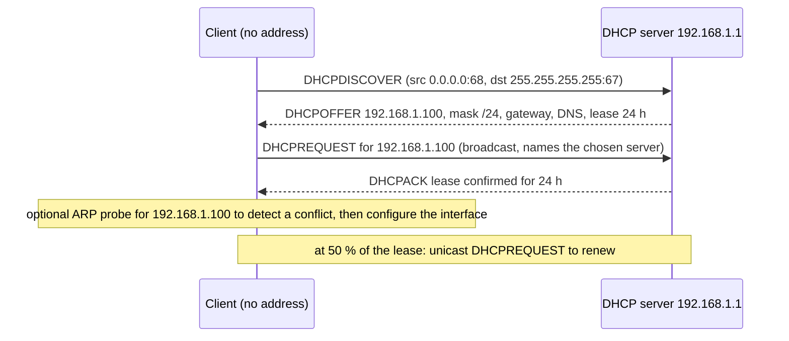
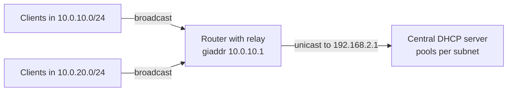

# DHCP

## Summary

The Dynamic Host Configuration Protocol (DHCP, RFC 2131) automatically gives devices their network configuration: an IP address with subnet mask, default gateway, DNS servers and other options, for a limited lease time. A new client finds a server by broadcast and completes a four-step exchange known as DORA (Discover, Offer, Request, Acknowledge) over UDP ports 67 and 68, then renews its lease periodically. Relay agents forward the broadcasts to central servers across subnets. DHCP has no authentication, so rogue servers and starvation attacks are real threats on LANs, countered with DHCP snooping. IPv6 uses SLAAC, DHCPv6 or both.

## Prerequisites

- [IP addressing](../internet-layer/ip-addressing.md) and [ARP](../link-layer/arp.md).

## Core concepts

### Definition and functions

DHCP is a network management protocol that automates the assignment of IP addresses and other configuration. Without it, every device would need manual configuration, which is slow and error-prone (duplicate addresses, typos in gateways).

It provides:

- IP address assignment,
- subnet mask,
- default gateway,
- DNS servers (and search domains),
- lease time management and renewal,
- other options such as NTP servers, domain name, PXE boot server and file (options 66 and 67), static routes (option 121).

DHCP is an application layer protocol (layer 7 in OSI terms) carried over UDP (server port 67, client port 68) that configures layer 3 addressing. It evolved from BOOTP (1985).

*Analogy.* A hotel reception desk. A new guest arrives and asks loudly in the lobby for a room (discover); the receptionist offers room 100 for one night (offer); the guest says "I'll take room 100" (request); the receptionist hands over the key card valid until tomorrow (acknowledge). Guests who stay longer extend at the desk before checkout (renewal). The analogy breaks on trust: anyone in the lobby can pretend to be the receptionist, which is the rogue DHCP server problem.

### How it works: DORA



1. **Discover.** The client broadcasts `DHCPDISCOVER` to `255.255.255.255` from source `0.0.0.0`, because it has no address yet: "Is there a DHCP server?"
2. **Offer.** A server replies with `DHCPOFFER`: an available address and configuration (mask, lease time, gateway, DNS): "You can use 192.168.1.100 for 24 hours."
3. **Request.** The client sends `DHCPREQUEST` (still broadcast, so other servers that made offers know they were not chosen): "I accept 192.168.1.100."
4. **Acknowledge.** The server confirms with `DHCPACK`: "192.168.1.100 is yours, the lease is valid for 24 hours." The client may verify that nobody else uses the address (ARP probe) and configures its interface.

### Lease time

Every assignment is temporary (a lease). The lease time sets how long the address stays assigned; after it expires the client must obtain a new one.

| Environment | Typical lease |
| --- | --- |
| Home networks | 24 hours |
| Enterprise LAN | 8 to 12 hours (often longer, up to days) |
| Public Wi-Fi | 30 minutes to a few hours |
| Data centers | Static addresses, reservations or long leases (weeks or months) |

Renewal timers (RFC 2131):

1. At **50 percent** of the lease (T1), the client sends a unicast `DHCPREQUEST` to its server to *renew*.
2. At **87.5 percent** (T2), if the server has not answered, the client *rebinds*: it broadcasts the request so any DHCP server can extend the lease.
3. At **100 percent**, the lease expires; the client stops using the address and restarts with Discover.

### Message types

| Message | Description |
| --- | --- |
| DHCPDISCOVER | Client looks for servers |
| DHCPOFFER | Server offers an address |
| DHCPREQUEST | Client requests the offered address, or renews or rebinds a lease |
| DHCPACK | Server confirms the lease and parameters |
| DHCPNAK | Server refuses the request (for example the client moved to another subnet or the lease is invalid) |
| DHCPDECLINE | Client reports the offered address is already in use (conflict) |
| DHCPRELEASE | Client gives up its address before the lease ends |
| DHCPINFORM | Client with a configured address asks only for other parameters (DNS, NTP) |

### Allocation methods

- **Dynamic allocation** (most common): addresses are leased for a limited time and return to the pool afterwards. Homes and corporate networks.
- **Automatic allocation**: the server assigns an address permanently on first contact, so the same device keeps it. Rare today; small networks.
- **Manual allocation (reservation)**: an administrator maps a client identifier (usually the MAC address) to a fixed address, so the device always receives it through DHCP. Servers, printers, critical infrastructure.

Cisco IOS reservation example:

```text
ip dhcp pool PRINTER
 host 192.168.1.50 255.255.255.0
 client-identifier 01aa.bbcc.ddee.ff
 default-router 192.168.1.1
```

### DHCP relay

DHCP Discover messages are broadcasts, and routers do not forward broadcasts, so by default a DHCP server serves only its own subnet. A **DHCP relay agent** (an "IP helper address" on Cisco) on each subnet's router receives client broadcasts and forwards them as unicast to a central server, adding the subnet's gateway address (`giaddr`) so the server picks the right pool.

```text
interface GigabitEthernet0/1
 ip helper-address 192.168.2.1
```

This forwards DHCP requests from clients on `Gi0/1`'s subnet to the server `192.168.2.1`.



### Security risks and mitigation

DHCP has no authentication, so any device can act as client or server. (Describe and test attacks only in labs or with authorization.)

- **DHCP starvation**: the attacker floods the server with requests using fake MAC addresses until the pool is exhausted, so legitimate clients get no address; often a prelude to a rogue server. Mitigation: DHCP snooping with rate limits, port security limiting MAC addresses per port.
- **Rogue DHCP server**: a fake server hands out a malicious gateway or DNS server and becomes a man in the middle. Mitigation: DHCP snooping (only trusted ports may send server messages) and port security. MITRE ATT&CK T1557.003.

  ```text
  ip dhcp snooping
  ip dhcp snooping vlan 10
  interface GigabitEthernet0/1
   ip dhcp snooping trust          ! the uplink toward the real DHCP server
  ```

- **ARP poisoning after DHCP**: an attacker who controls addressing or the network can redirect traffic. Mitigation: Dynamic ARP Inspection, which uses the DHCP snooping binding table:

  ```text
  ip arp inspection vlan 10
  interface GigabitEthernet0/2
   ip arp inspection trust
  ```

### DHCPv6 and SLAAC

IPv6 hosts can configure addresses in two ways, chosen by flags in router advertisements:

- **SLAAC** (stateless address autoconfiguration): hosts build their own addresses from the advertised `/64` prefix; DNS servers can come from the router advertisement (RDNSS) or from stateless DHCPv6.
- **Stateful DHCPv6**: a server assigns addresses and options, similar to DHCPv4 (Android does not support it, which matters for Wi-Fi design).

DHCPv6 uses UDP: clients listen on port 546 and servers and relays on port 547, so client messages go to port 547 and server replies to port 546. Messages are multicast to `ff02::1:2` instead of broadcast.

## Worked example

Run a small DHCP service with dnsmasq for a lab subnet and watch the exchange. Untested; dnsmasq 2.9x on Debian 12, checked 2026-11.

```ini
# /etc/dnsmasq.d/lab.conf
interface=lan0
dhcp-range=10.0.0.100,10.0.0.199,255.255.255.0,12h
dhcp-option=option:router,10.0.0.1
dhcp-option=option:dns-server,10.0.0.1
dhcp-host=52:54:00:aa:bb:50,printer,10.0.0.50     # reservation
```

```bash
sudo systemctl restart dnsmasq
sudo tcpdump -n -i lan0 port 67 or port 68          # on the server
# on a client:
sudo dhclient -v eth0       # or: sudo networkctl renew eth0
```

Expected capture (shortened):

```text
0.0.0.0.68 > 255.255.255.255.67: BOOTP/DHCP, Request ... DHCP-Message: Discover
10.0.0.1.67 > 10.0.0.142.68: BOOTP/DHCP, Reply ... DHCP-Message: Offer
0.0.0.0.68 > 255.255.255.255.67: BOOTP/DHCP, Request ... DHCP-Message: Request
10.0.0.1.67 > 10.0.0.142.68: BOOTP/DHCP, Reply ... DHCP-Message: ACK
```

Leases are visible in `/var/lib/misc/dnsmasq.leases`.

## Trade offs and when to use it

- **DHCP with reservations** gives central control and still fixed addresses for infrastructure; static configuration on devices is simpler but drifts and conflicts.
- **Short leases** recycle addresses fast in busy guest networks but increase traffic and dependence on the server; long leases do the opposite.
- **Redundancy**: DHCP failover pairs (ISC Kea high availability, Windows DHCP failover) or split scopes avoid a single point of failure.
- In clouds, the provider's DHCP assigns addresses from the subnet; you configure options through the platform, not your own server.

## Common mistakes

- **Two DHCP servers on one LAN** (for example a consumer router plugged in). Clients get random gateways. Fix: DHCP snooping, remove the rogue server.
- **Forgetting relay configuration** on new VLANs. Clients self-assign `169.254.x.x`. Fix: helper address on the gateway interface.
- **Static addresses inside the dynamic pool.** Conflicts. Fix: exclude ranges or use reservations.

## Practice

1. What does DORA stand for?
2. Why does the client use source address `0.0.0.0` in the Discover message?
3. What happens at 87.5 percent of the lease if the original server is down?
4. Why is a relay agent needed for central DHCP servers?

Answers:

1. Discover, Offer, Request, Acknowledge.
2. It has no IP address yet.
3. The client rebinds: it broadcasts a request so any DHCP server can extend the lease.
4. Discover messages are broadcasts that routers do not forward; the relay forwards them to the server as unicast.

## Further reading

- [RFC 2131: Dynamic Host Configuration Protocol](https://www.rfc-editor.org/rfc/rfc2131) (IETF, 1997) and [RFC 2132: DHCP Options](https://www.rfc-editor.org/rfc/rfc2132) (IETF, 1997).
- [RFC 8415: Dynamic Host Configuration Protocol for IPv6 (DHCPv6)](https://www.rfc-editor.org/rfc/rfc8415) (IETF, 2018).
- [RFC 4862: IPv6 Stateless Address Autoconfiguration](https://www.rfc-editor.org/rfc/rfc4862) (IETF, 2007).
- [ISC Kea DHCP documentation](https://kea.readthedocs.io/) (Internet Systems Consortium).
- [MITRE ATT&CK T1557.003: DHCP Spoofing](https://attack.mitre.org/techniques/T1557/003/) (MITRE).
