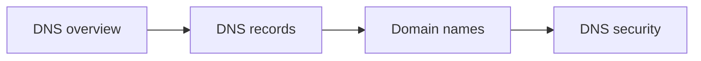

# DNS

The Domain Name System: how names are resolved, the records that zones contain, how domain names are registered, and how DNS is attacked and defended.

## Map

The diagram shows the notes in reading order; subareas are marked with (subarea).

## Notes in reading order

1. [DNS overview](dns-overview.md): resolution, delegation and glue, the message format, caching, negative answers and resilience.
2. [DNS records](dns-records.md): A, AAAA, CNAME, MX, TXT, NS, SOA, SRV, PTR, CAA, HTTPS, wildcards and TTL choices.
3. [Domain names](domain-names.md): structure, URLs, registrars and registries.
4. [DNS security](dns-security.md): attacks, DNSSEC, encrypted DNS and DNS firewalls.

## Planned topics

- Running authoritative DNS (BIND, PowerDNS, managed DNS)
- Internal DNS and split-horizon
- DNS in Kubernetes (CoreDNS)
