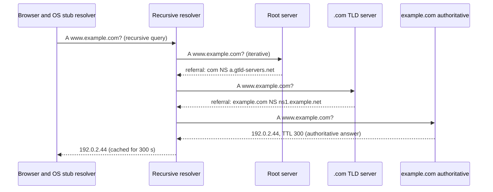
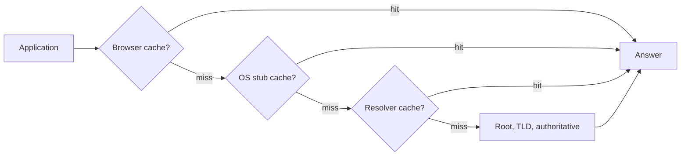

# DNS overview

## Summary

The Domain Name System (DNS) is the Internet's distributed, hierarchical directory that translates human-readable names such as `www.example.com` into IP addresses and other data. It works much like a phone book that nobody holds in full: the root servers know who is responsible for each top-level domain, the TLD servers know who is responsible for each domain, and the authoritative nameservers hold the actual records. Clients ask a recursive resolver, which walks this hierarchy on their behalf and caches answers for the time-to-live (TTL) of each record. DNS decides which server a user reaches, so it underpins load balancing, failover, email delivery, service discovery and many outages ("it's always DNS").

## Prerequisites

- [Networking overview](../../networking-overview.md) and [IP addressing](../../internet-layer/ip-addressing.md).

## Core concepts

### Definition

DNS manages the mapping between names and numbers. DNS servers translate requests for names (queries) into IP addresses, which controls which server an end user reaches when typing a domain name into a browser. Queries use UDP port 53 by default and fall back to TCP port 53 for large responses and zone transfers; encrypted variants are DNS over TLS (port 853) and DNS over HTTPS (port 443).

*Analogy.* A library with a librarian. You ask the librarian (recursive resolver) for a book. The librarian checks the shelf by the desk first (cache), then the library index (root servers), which points to the right section (TLD), where a catalog card (authoritative nameserver) gives the exact location (IP address). The librarian remembers the answer for a while. The analogy breaks on ownership: in DNS the index, the sections and the catalog cards are run by thousands of independent organizations.

### Types of DNS service

- **Authoritative DNS.** Holds the final answer for a domain: it provides an update mechanism for administrators to manage their public DNS names and answers queries for them, translating names into IP addresses. Authoritative servers answer recursive resolvers. Examples: Amazon Route 53, Cloudflare DNS, BIND or PowerDNS run by the domain owner.
- **Recursive DNS (resolver).** Clients normally do not query authoritative servers directly; they ask a recursive resolver. Like a hotel concierge, it owns no records but obtains them on your behalf: if the answer is cached, it replies from the cache; otherwise it queries authoritative servers. Examples: ISP resolvers, Google Public DNS (`8.8.8.8`), Cloudflare (`1.1.1.1`), Quad9 (`9.9.9.9`), Unbound in a data center.

The figure traces a complete resolution for `www.example.com` with Amazon Route 53 as the authoritative service: the user asks the resolver (1, 2), the resolver asks a root server (3), is referred to the `.com` TLD servers (4), is referred to the Route 53 name servers (5), receives `192.0.2.44` (6), returns it to the user (7), and the browser connects to the web server (8, 9).


### DNS servers involved in loading a web page

| Server | Role | Library analogy |
| --- | --- | --- |
| DNS recursor (recursive resolver) | Receives queries from clients such as browsers and makes the additional requests needed to answer them | The librarian asked to find a book |
| Root nameserver | First step of resolution: answers with referrals to the TLD servers. There are 13 root server identities (`a` to `m.root-servers.net`) run by 12 operators, served from more than 1,900 anycast instances worldwide (checked 2026-11) | The index that points to the right racks |
| TLD nameserver | Hosts the last label of a name (for `example.com`, the `com` servers run by Verisign) and refers to the domain's authoritative servers | A specific rack of books |
| Authoritative nameserver | The last stop: holds the records and returns the answer (or an authoritative "does not exist") | A dictionary on the rack that gives the definition |

The request sequence from a client through the four server types:




### Query types

A lookup combines three kinds of queries, which keeps the work short; ideally a cached answer is available and no further queries are needed.

1. **Recursive query.** The client requires the server (usually a recursive resolver) to answer with the requested record or an error; the server does all the work. Stub resolvers send recursive queries (the RD, recursion desired, flag).
2. **Iterative query.** The server returns the best answer it has: if it does not have the record, it returns a referral to a server authoritative for a lower level of the namespace, and the client queries that server next. This continues down the chain until an answer, an error or a timeout. Resolvers query root, TLD and authoritative servers iteratively.
3. **Non-recursive query.** The server answers immediately because it is authoritative for the record or has it in its cache; no further queries are needed.

### DNS caching

Caching stores data closer to the client so queries are answered earlier, avoiding queries further down the chain, improving load times and reducing bandwidth and CPU use. Every cache keeps a record only for its TTL (time to live), set by the zone owner. Negative answers (NXDOMAIN) are cached too, for the time given in the zone's SOA record.

**Browser cache.** Browsers cache DNS records for a set time; it is the first place checked. In Chrome the cache can be inspected and cleared at `chrome://net-internals/#dns`.

**Operating system cache.** The OS stub resolver (systemd-resolved, the Windows DNS Client service, mDNSResponder on macOS) is the second and last local stop. When an application asks it, it checks its cache; if the record is missing, it sends a recursive query to the configured recursive resolver (often the ISP's or a public one).

**Resolver cache.** The recursive resolver also checks its cache, and uses partial knowledge to shorten the walk:

1. Without the A record but with the NS records of the authoritative servers, it queries those servers directly, skipping the root and `.com` servers.
2. Without the NS records, it queries the TLD servers (for `.com`), skipping the root.
3. Only without TLD information (rare, for example after a cache flush) does it query the root servers.



### Local name resolution on Linux

Before DNS, `/etc/hosts` lists static names. The order of sources is set in `/etc/nsswitch.conf` (`hosts: files dns`), resolvers in `/etc/resolv.conf` (on systemd systems usually the local stub `127.0.0.53` managed by systemd-resolved). Kubernetes uses CoreDNS with search domains such as `svc.cluster.local`, which is why short service names resolve inside a cluster.

## Worked example

Trace a resolution yourself with `dig`. Untested; dig 9.18 from BIND, checked 2026-11. Output shortened.

```bash
dig +trace www.example.com        # performs the iterative walk from the root
```

```text
.                  518400 IN NS a.root-servers.net.        ;; from the local resolver: root servers
com.               172800 IN NS a.gtld-servers.net.        ;; referral from a root server
example.com.       172800 IN NS a.iana-servers.net.        ;; referral from the .com servers
www.example.com.   300    IN A  93.184.215.14              ;; answer from the authoritative server
```

```bash
dig www.example.com +noall +answer      # through the configured resolver
# www.example.com. 287 IN A 93.184.215.14   <- TTL counting down: served from the resolver cache
dig @1.1.1.1 www.example.com +short     # ask a specific resolver
resolvectl statistics                   # systemd-resolved cache hits and misses
```

A TTL that counts down between two queries shows that the answer came from a cache.

## Trade offs and when to use it

- **Long TTLs** reduce query load and latency but slow down changes; **short TTLs** allow fast failover at the cost of more queries. Lower TTLs a day before a planned migration.
- **Public resolvers** are fast and often filter malware, but see all your queries; **self-hosted resolvers** keep data private and allow internal zones.
- **DNS-based load balancing** is simple and global but coarse, because clients and resolvers cache answers.

## Common mistakes

- **Forgetting negative caching.** A record queried before it existed returns NXDOMAIN until the SOA minimum TTL expires. Fix: create records before announcing them.
- **Changing records with a high TTL and expecting instant effect.** Fix: lower TTLs in advance.
- **Debugging with a single resolver.** Fix: compare the authoritative answer (`dig @ns1.example.net`) with resolver answers.
- **Blocking TCP 53.** Large responses (DNSSEC, many records) fail. Fix: allow both UDP and TCP.

## Practice

1. What is the difference between a recursive resolver and an authoritative nameserver?
2. In which order are caches checked when a browser resolves a name?
3. Why does `dig +trace` start at the root servers?
4. A record's TTL is 3,600. You change its IP address. How long can clients still use the old address?

Answers:

1. A recursive resolver finds answers for clients and caches them but owns no records; an authoritative nameserver holds the records of a zone and gives the final answer.
2. Browser cache, OS stub resolver cache, recursive resolver cache, then the root, TLD and authoritative servers.
3. It performs the iterative resolution itself, ignoring caches, so it begins at the top of the hierarchy.
4. Up to about one hour (3,600 seconds) after the last cache refreshed it, plus any client that ignores TTLs.

## Further reading

- [RFC 1034: Domain Names, Concepts and Facilities](https://www.rfc-editor.org/rfc/rfc1034) and [RFC 1035: Domain Names, Implementation and Specification](https://www.rfc-editor.org/rfc/rfc1035) (IETF, 1987).
- [RFC 9499: DNS Terminology](https://www.rfc-editor.org/rfc/rfc9499) (IETF, 2024).
- [What is DNS?](https://www.cloudflare.com/learning/dns/what-is-dns/) (Cloudflare Learning Center).
- [Root Server Technical Operations](https://root-servers.org/) (root server operators): current root instances.
