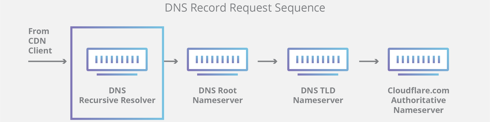
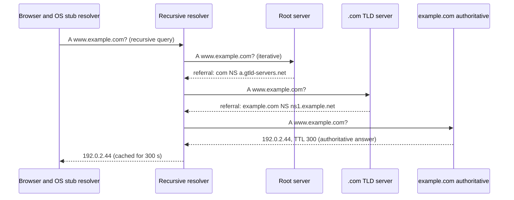
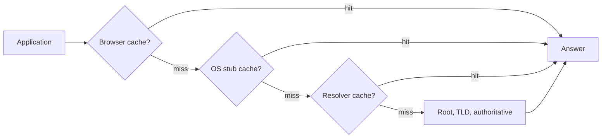
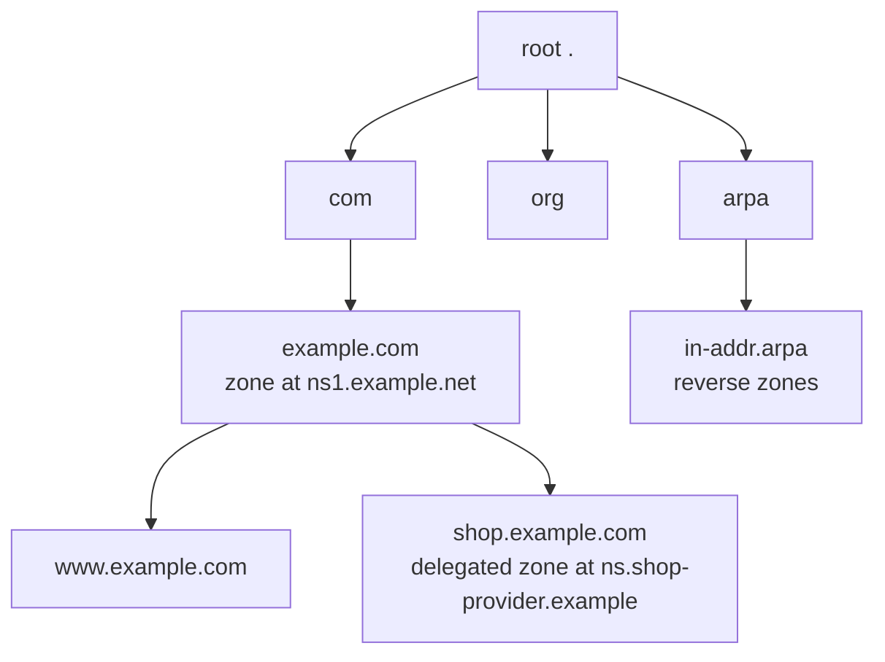
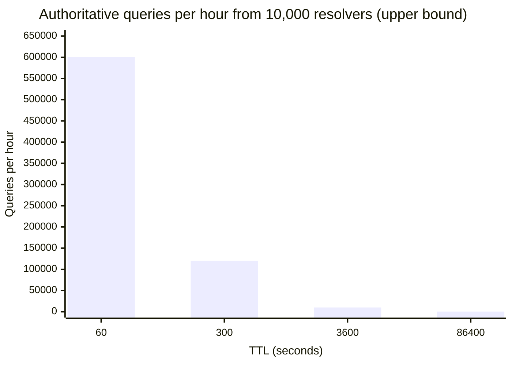

# DNS overview

## Summary

The Domain Name System (DNS) is the Internet's distributed, hierarchical directory that translates human-readable names such as `www.example.com` into IP addresses and other data. It works much like a phone book that nobody holds in full: the root servers know who is responsible for each top-level domain, the TLD servers know who is responsible for each domain, and the authoritative nameservers hold the actual records. Clients ask a recursive resolver, which walks this hierarchy on their behalf and caches answers for the time-to-live (TTL) of each record. DNS decides which server a user reaches, so it underpins load balancing, failover, email delivery, service discovery and many outages ("it's always DNS").

## Prerequisites

- [Networking overview](../../networking-overview.md) and [IP addressing](../../internet-layer/ip-addressing.md).

## Core concepts

### Definition

DNS manages the mapping between names and numbers. DNS servers translate requests for names (queries) into IP addresses, which controls which server an end user reaches when typing a domain name into a browser. Queries use UDP port 53 by default and fall back to TCP port 53 for large responses and zone transfers; encrypted variants are DNS over TLS (port 853) and DNS over HTTPS (port 443).

*Analogy.* A library with a librarian. You ask the librarian (recursive resolver) for a book. The librarian checks the shelf by the desk first (cache), then the library index (root servers), which points to the right section (TLD), where a catalog card (authoritative nameserver) gives the exact location (IP address). The librarian remembers the answer for a while. The analogy breaks on ownership: in DNS the index, the sections and the catalog cards are run by thousands of independent organizations.

### Types of DNS service

- **Authoritative DNS.** Holds the final answer for a domain: it provides an update mechanism for administrators to manage their public DNS names and answers queries for them, translating names into IP addresses. Authoritative servers answer recursive resolvers. Examples: Amazon Route 53, Cloudflare DNS, BIND or PowerDNS run by the domain owner.
- **Recursive DNS (resolver).** Clients normally do not query authoritative servers directly; they ask a recursive resolver. Like a hotel concierge, it owns no records but obtains them on your behalf: if the answer is cached, it replies from the cache; otherwise it queries authoritative servers. Examples: ISP resolvers, Google Public DNS (`8.8.8.8`), Cloudflare (`1.1.1.1`), Quad9 (`9.9.9.9`), Unbound in a data center.

The figure traces a complete resolution for `www.example.com` with Amazon Route 53 as the authoritative service: the user asks the resolver (1, 2), the resolver asks a root server (3), is referred to the `.com` TLD servers (4), is referred to the Route 53 name servers (5), receives `192.0.2.44` (6), returns it to the user (7), and the browser connects to the web server (8, 9).


### DNS servers involved in loading a web page

| Server | Role | Library analogy |
| --- | --- | --- |
| DNS recursor (recursive resolver) | Receives queries from clients such as browsers and makes the additional requests needed to answer them | The librarian asked to find a book |
| Root nameserver | First step of resolution: answers with referrals to the TLD servers. There are 13 root server identities (`a` to `m.root-servers.net`) run by 12 operators, served from more than 1,900 anycast instances worldwide (checked 2026-11) | The index that points to the right racks |
| TLD nameserver | Hosts the last label of a name (for `example.com`, the `com` servers run by Verisign) and refers to the domain's authoritative servers | A specific rack of books |
| Authoritative nameserver | The last stop: holds the records and returns the answer (or an authoritative "does not exist") | A dictionary on the rack that gives the definition |

The request sequence from a client through the four server types:





### Query types

A lookup combines three kinds of queries, which keeps the work short; ideally a cached answer is available and no further queries are needed.

1. **Recursive query.** The client requires the server (usually a recursive resolver) to answer with the requested record or an error; the server does all the work. Stub resolvers send recursive queries (the RD, recursion desired, flag).
2. **Iterative query.** The server returns the best answer it has: if it does not have the record, it returns a referral to a server authoritative for a lower level of the namespace, and the client queries that server next. This continues down the chain until an answer, an error or a timeout. Resolvers query root, TLD and authoritative servers iteratively.
3. **Non-recursive query.** The server answers immediately because it is authoritative for the record or has it in its cache; no further queries are needed.

### DNS caching

Caching stores data closer to the client so queries are answered earlier, avoiding queries further down the chain, improving load times and reducing bandwidth and CPU use. Every cache keeps a record only for its TTL (time to live), set by the zone owner. Negative answers (NXDOMAIN) are cached too, for the time given in the zone's SOA record.

**Browser cache.** Browsers cache DNS records for a set time; it is the first place checked. In Chrome the cache can be inspected and cleared at `chrome://net-internals/#dns`.

**Operating system cache.** The OS stub resolver (systemd-resolved, the Windows DNS Client service, mDNSResponder on macOS) is the second and last local stop. When an application asks it, it checks its cache; if the record is missing, it sends a recursive query to the configured recursive resolver (often the ISP's or a public one).

**Resolver cache.** The recursive resolver also checks its cache, and uses partial knowledge to shorten the walk:

1. Without the A record but with the NS records of the authoritative servers, it queries those servers directly, skipping the root and `.com` servers.
2. Without the NS records, it queries the TLD servers (for `.com`), skipping the root.
3. Only without TLD information (rare, for example after a cache flush) does it query the root servers.



### Local name resolution on Linux

Before DNS, `/etc/hosts` lists static names. The order of sources is set in `/etc/nsswitch.conf` (`hosts: files dns`), resolvers in `/etc/resolv.conf` (on systemd systems usually the local stub `127.0.0.53` managed by systemd-resolved). Kubernetes uses CoreDNS with search domains such as `svc.cluster.local`, which is why short service names resolve inside a cluster.

### The namespace, zones and delegation

The DNS namespace is a tree. Each node is a *label* (at most 63 bytes; a full name at most 255 bytes), the root is the empty label written as a trailing dot, and a *domain* is a node together with everything below it. A *zone* is the part of the tree that one set of authoritative servers answers for; a zone ends where its owner *delegates* a subtree to other servers with NS records.



The diagram shows one tree with several zones: the root zone delegates `com`, the `com` zone delegates `example.com`, and the `example.com` zone delegates `shop.example.com` to a different provider while keeping `www` itself.

**Delegation.** A delegation is a set of NS records in the parent zone that point to the child's nameservers. The parent's NS records are not authoritative (the child's own NS records are), and both copies should match; a mismatch, or NS records pointing to servers that do not answer for the zone (a *lame delegation*), causes slow or failing resolution.

**Glue records.** If a zone's nameserver is inside the zone itself (`example.com NS ns1.example.com`), a resolver could not find the address of `ns1.example.com` without already resolving `example.com`. The parent therefore also serves the address as a *glue* A or AAAA record in the additional section of its referral. Glue is set at the registrar together with the nameserver names.

```text
;; referral from a .com server for example.com
;; AUTHORITY SECTION:
example.com.      172800 IN NS ns1.example.com.
example.com.      172800 IN NS ns2.example.net.
;; ADDITIONAL SECTION:
ns1.example.com.  172800 IN A    192.0.2.53      ; glue: needed, ns1 is inside the zone
```

### The DNS message

All queries and responses share one binary format (RFC 1035 section 4): a 12-byte header and four sections.

| Part | Content |
| --- | --- |
| Header | 16-bit ID (matches responses to queries), flags, response code, counts of the four sections |
| Question | Name, type and class asked for |
| Answer | Records that answer the question |
| Authority | NS records of a referral, or the SOA record in a negative answer |
| Additional | Helpful extra records: glue addresses, the EDNS OPT pseudo-record |

Header flags that matter in troubleshooting:

| Flag | Meaning |
| --- | --- |
| `qr` | This is a response |
| `aa` | Authoritative answer: it comes from a server authoritative for the zone, not from a cache |
| `tc` | Truncated: the answer did not fit; retry over TCP |
| `rd` | Recursion desired (set by stub resolvers) |
| `ra` | Recursion available (the server is a recursive resolver) |
| `ad` | Authenticated data: the resolver validated the answer with DNSSEC |
| `cd` | Checking disabled: the client asks the resolver not to validate DNSSEC |

Response codes (RCODE): `NOERROR` (success, possibly with an empty answer), `NXDOMAIN` (the name does not exist), `SERVFAIL` (the server could not get an answer, often broken delegation or failed DNSSEC validation), `REFUSED` (policy refuses the query, for example an authoritative server asked for a zone it does not serve), `FORMERR`, `NOTIMP`.

**Size limits, EDNS and TCP.** The original protocol limited UDP responses to 512 bytes. EDNS(0) (RFC 6891) lets clients advertise a larger buffer in an OPT record; since DNS Flag Day 2020 the recommended UDP buffer size is 1232 bytes, to avoid IP fragmentation. Larger responses (DNSSEC signatures, many records) are truncated with the `tc` flag and retried over TCP, which every DNS server and resolver must support (RFC 7766). Firewalls that allow only UDP port 53 therefore cause intermittent failures for large answers.

### Negative answers and negative caching

Two kinds of "no" exist, and both are cached (RFC 2308):

- **NXDOMAIN**: the name does not exist at all.
- **NODATA**: the name exists but has no record of the requested type (RCODE `NOERROR` with an empty answer), for example a name with an A record but no AAAA record.

Both carry the zone's SOA record in the authority section, and caches keep the negative answer for the smaller of the SOA record's TTL and its MINIMUM field. A negative TTL of 3,600 seconds means a record created right after someone looked it up stays invisible to that resolver for up to an hour.

### Anycast, redundancy and outages

Root servers, TLD servers, large authoritative providers and public resolvers use *anycast*: the same IP address is announced through BGP from many sites, and routing delivers each query to a nearby instance. Anycast gives low latency and absorbs DDoS traffic, but ties DNS availability to routing.

Two outages show the failure modes:

- **Dyn, October 2016**: a DDoS attack by the Mirai botnet against the managed DNS provider Dyn made many large sites unreachable for hours in parts of the world. Domains with a second, independent DNS provider stayed reachable.
- **Facebook, October 2021**: a configuration change withdrew the BGP routes to Facebook's own anycast authoritative DNS servers; resolvers worldwide could not resolve Facebook's names for about six hours, and internal tools that depended on the same DNS also failed.

Resilience practices: at least two nameservers on different networks (RFC 2182 recommends geographically and topologically separate servers), a second DNS provider kept in sync for critical domains, sensible TTLs so caches bridge short outages, and resolvers that may serve stale answers when authoritative servers are unreachable (RFC 8767, "serve-stale").

### TTL and load

The TTL also decides how much traffic the authoritative servers receive. A resolver with steady demand for a name re-queries it at most once per TTL, so the upper bound of queries per hour from N busy resolvers is `N * 3600 / TTL`. For 10,000 resolvers:

| TTL (seconds) | 60 | 300 | 3,600 | 86,400 |
| --- | --- | --- | --- | --- |
| Queries per hour (upper bound) | 600,000 | 120,000 | 10,000 | about 417 |



The chart plots the table: lowering a TTL from one hour to one minute multiplies the authoritative load by up to 60. Short TTLs are the price of fast failover; use them only on names that actually fail over.

### Client behaviors that surprise operators

- **Applications cache too.** The Java runtime caches successful lookups according to `networkaddress.cache.ttl` (forever when a security manager is installed, otherwise 30 seconds by default), Go and Node.js do not cache by default, and connection pools keep old IP addresses until connections are recycled. A DNS change is only as fast as the slowest client cache.
- **Search domains and `ndots`.** With `options ndots:5` (the Kubernetes default in `/etc/resolv.conf` of pods), a name with fewer than five dots is first tried with every search domain appended, so `api.example.com` may cause several NXDOMAIN queries (`api.example.com.default.svc.cluster.local` and so on) before the real one. Writing fully qualified names with a trailing dot (`api.example.com.`) or lowering `ndots` avoids this.
- **Happy Eyeballs.** Clients query A and AAAA in parallel and prefer IPv6 if it answers quickly (RFC 8305), so a broken AAAA record causes slow connections rather than failures.
- **Resolver selection.** `/etc/resolv.conf` with several nameservers does not load-balance by default; the second is used only after the first times out (5 seconds by default in glibc), which turns a dead first resolver into 5-second delays.

### Transports

| Transport | Port | Standard | Note |
| --- | --- | --- | --- |
| DNS over UDP and TCP (Do53) | 53 | RFC 1035, RFC 7766 | Unencrypted; TCP for large answers and zone transfers |
| DNS over TLS (DoT) | 853 | RFC 7858 | Encrypted, easy to identify and block |
| DNS over HTTPS (DoH) | 443 | RFC 8484 | Encrypted, looks like web traffic; used by browsers |
| DNS over QUIC (DoQ) | 853 (UDP) | RFC 9250 | Encrypted, low latency |

Security aspects of these transports and DNSSEC are covered in [DNS security](dns-security.md).

## Worked example

Trace a resolution yourself with `dig`. Untested; dig 9.18 from BIND, checked 2026-11. Output shortened.

```bash
dig +trace www.example.com        # performs the iterative walk from the root
```

```text
.                  518400 IN NS a.root-servers.net.        ;; from the local resolver: root servers
com.               172800 IN NS a.gtld-servers.net.        ;; referral from a root server
example.com.       172800 IN NS a.iana-servers.net.        ;; referral from the .com servers
www.example.com.   300    IN A  93.184.215.14              ;; answer from the authoritative server
```

```bash
dig www.example.com +noall +answer      # through the configured resolver
# www.example.com. 287 IN A 93.184.215.14   <- TTL counting down: served from the resolver cache
dig @1.1.1.1 www.example.com +short     # ask a specific resolver
resolvectl statistics                   # systemd-resolved cache hits and misses
```

A TTL that counts down between two queries shows that the answer came from a cache.

Read the header of a full answer to see who answered and how:

```bash
dig www.example.com A
```

```text
;; ->>HEADER<<- opcode: QUERY, status: NOERROR, id: 41872
;; flags: qr rd ra ad; QUERY: 1, ANSWER: 1, AUTHORITY: 0, ADDITIONAL: 1
;; OPT PSEUDOSECTION:
; EDNS: version: 0, flags:; udp: 1232
;; ANSWER SECTION:
www.example.com.   287  IN  A  93.184.215.14
;; Query time: 1 msec
;; SERVER: 127.0.0.53#53(127.0.0.53) (UDP)
```

`ra` without `aa` means a recursive resolver answered from its cache (1 ms query time confirms it); `ad` means the resolver validated DNSSEC; the EDNS buffer is 1232 bytes. Asking the authoritative server directly (`dig @a.iana-servers.net www.example.com`) returns `aa` and the full TTL. A negative answer shows the SOA in the authority section, whose last field and TTL bound the negative caching time:

```bash
dig nonexistent.example.com A +noall +comments +authority | grep -E "status|SOA"
# ;; ->>HEADER<<- opcode: QUERY, status: NXDOMAIN, id: 5012
# example.com.  3600 IN SOA ns.icann.org. noc.dns.icann.org. 2026110601 7200 3600 1209600 3600
```

## Trade offs and when to use it

- **Long TTLs** reduce query load and latency but slow down changes; **short TTLs** allow fast failover at the cost of more queries. Lower TTLs a day before a planned migration.
- **Public resolvers** are fast and often filter malware, but see all your queries; **self-hosted resolvers** keep data private and allow internal zones.
- **DNS-based load balancing** is simple and global but coarse, because clients and resolvers cache answers.

## Common mistakes

- **Forgetting negative caching.** A record queried before it existed returns NXDOMAIN until the SOA minimum TTL expires. Fix: create records before announcing them.
- **Changing records with a high TTL and expecting instant effect.** Fix: lower TTLs in advance.
- **Debugging with a single resolver.** Fix: compare the authoritative answer (`dig @ns1.example.net`) with resolver answers.
- **Blocking TCP 53.** Large responses (DNSSEC, many records) fail. Fix: allow both UDP and TCP.

## Practice

1. What is the difference between a recursive resolver and an authoritative nameserver?
2. In which order are caches checked when a browser resolves a name?
3. Why does `dig +trace` start at the root servers?
4. A record's TTL is 3,600. You change its IP address. How long can clients still use the old address?
5. What is a glue record, and when is it required?
6. A response has the `tc` flag set. What does the resolver do next, and which firewall rule can break it?
7. What is the difference between NXDOMAIN and NODATA?
8. A pod in Kubernetes resolves `api.example.com` slowly. Which resolver option is the likely cause?

Answers:

1. A recursive resolver finds answers for clients and caches them but owns no records; an authoritative nameserver holds the records of a zone and gives the final answer.
2. Browser cache, OS stub resolver cache, recursive resolver cache, then the root, TLD and authoritative servers.
3. It performs the iterative resolution itself, ignoring caches, so it begins at the top of the hierarchy.
4. Up to about one hour (3,600 seconds) after the last cache refreshed it, plus any client that ignores TTLs.
5. An address record for a nameserver whose name lies inside the zone it serves, published by the parent zone in its referral; without it the resolver could not reach the nameserver.
6. It retries the query over TCP port 53; a firewall that allows only UDP port 53 breaks large answers.
7. NXDOMAIN means the name does not exist; NODATA means the name exists but has no record of the requested type. Both are cached for the negative TTL.
8. `ndots:5` with the cluster search domains: the name is first tried with each search domain appended, producing several NXDOMAIN lookups before the real query.

## Further reading

- [RFC 1034: Domain Names, Concepts and Facilities](https://www.rfc-editor.org/rfc/rfc1034) and [RFC 1035: Domain Names, Implementation and Specification](https://www.rfc-editor.org/rfc/rfc1035) (IETF, 1987).
- [RFC 9499: DNS Terminology](https://www.rfc-editor.org/rfc/rfc9499) (IETF, 2024).
- [What is DNS?](https://www.cloudflare.com/learning/dns/what-is-dns/) (Cloudflare Learning Center).
- [Root Server Technical Operations](https://root-servers.org/) (root server operators): current root instances.
- [RFC 2308: Negative Caching of DNS Queries](https://www.rfc-editor.org/rfc/rfc2308) (IETF, 1998).
- [RFC 6891: Extension Mechanisms for DNS (EDNS(0))](https://www.rfc-editor.org/rfc/rfc6891) (IETF, 2013) and [DNS Flag Day 2020](https://www.dnsflagday.net/2020/): the 1232-byte buffer recommendation.
- [RFC 7766: DNS Transport over TCP](https://www.rfc-editor.org/rfc/rfc7766) (IETF, 2016).
- [RFC 8767: Serving Stale Data to Improve DNS Resiliency](https://www.rfc-editor.org/rfc/rfc8767) (IETF, 2020).
- [More details about the October 4 outage](https://engineering.fb.com/2021/10/05/networking-traffic/outage-details/) (Meta Engineering, 2021).
