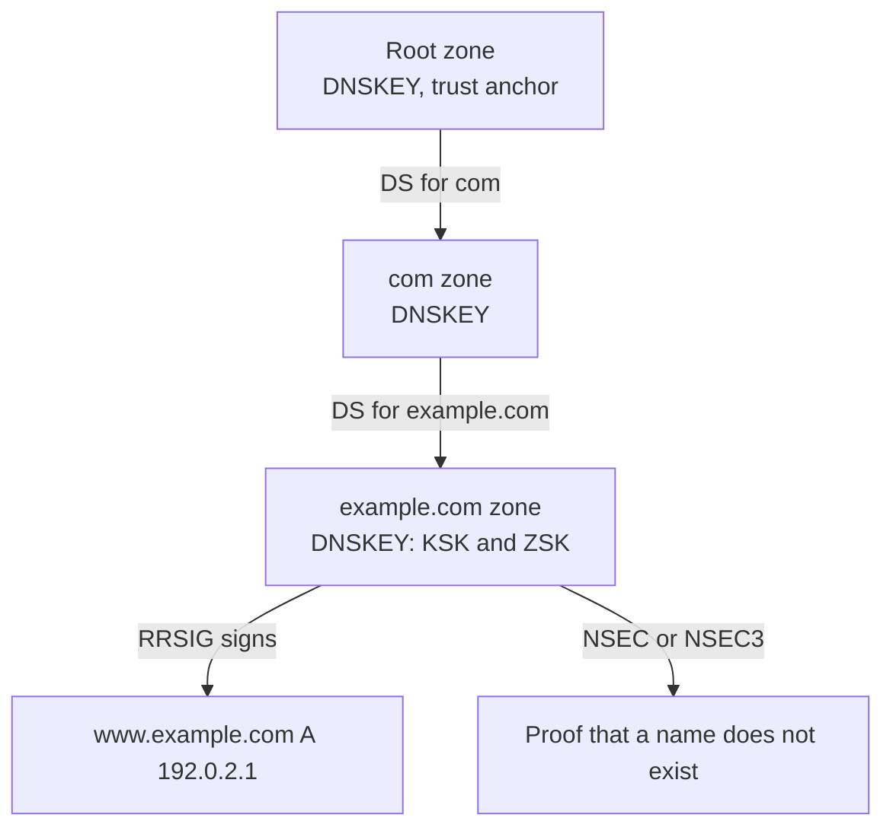
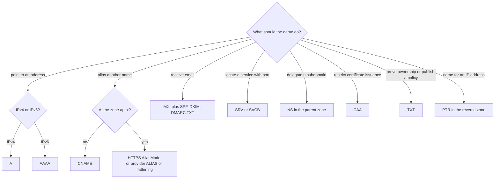

# DNS records

## Summary

DNS records (resource records, RRs) are the entries in a zone on an authoritative nameserver that say what a name means: its IPv4 address (A), IPv6 address (AAAA), an alias (CNAME), mail servers (MX), free text and policies (TXT), the zone's nameservers (NS) and administrative data (SOA), service locations with ports (SRV) and reverse mappings (PTR), plus many specialized types for security (DNSSEC, CAA, SSHFP) and other uses. Every record has a name, a type, a class (almost always `IN`), a TTL and data. Knowing the rules (no CNAME at the zone apex, MX and NS must not point to a CNAME, PTR lives under `in-addr.arpa`) prevents common outages and mail delivery problems.

## Prerequisites

- [DNS overview](dns-overview.md).

## Core concepts

### Zones and the record format

A zone file is the text representation of a zone's records in "DNS syntax" (RFC 1035 master file format). Each record has a TTL in seconds that tells caches how long to keep it.

```text
$ORIGIN example.com.
$TTL 3600
;name      TTL    class type  data
@          3600   IN    SOA   ns1.example.net. hostmaster.example.com. 2026110901 7200 3600 1209600 300
@                 IN    NS    ns1.example.net.
@                 IN    NS    ns2.example.org.
@                 IN    A     192.0.2.1
@                 IN    AAAA  2001:db8::1
www               IN    CNAME example.com.
@                 IN    MX    10 mailhost1.example.com.
mailhost1         IN    A     192.0.2.25
```

`@` means the zone apex (the domain itself). Names without a trailing dot are relative to `$ORIGIN`.

*Analogy.* A company's entry in a business directory, with separate lines for the street address (A), a second address for the new building (AAAA), "see also: our parent company" (CNAME), the mailroom (MX), notes such as opening hours (TXT) and who maintains the entry (SOA). The analogy breaks on scope: a CNAME replaces the whole entry for that name, not just one line, which is why it cannot coexist with other records.

### Record types

The figure summarizes the most used types.


Common types:

| Type | Purpose |
| --- | --- |
| A | IPv4 address of a name |
| AAAA | IPv6 address of a name |
| CNAME | Alias: forwards a name to another name; does not hold an IP address |
| MX | Mail servers for a domain |
| TXT | Text, used for email security (SPF, DKIM, DMARC) and domain verification |
| NS | The authoritative nameservers of a zone or delegated subdomain |
| SOA | Start of authority: administrative data of a zone |
| SRV | Host and port of a specific service |
| PTR | Name for an address, used in reverse lookups |

Specialized types:

| Type | Purpose |
| --- | --- |
| AFSDB | Locates database servers of Andrew File System (AFS) cells (AFS was developed at Carnegie Mellon University) |
| APL | Address prefix list, an experimental record listing address ranges |
| CAA | Certification Authority Authorization: lists the CAs allowed to issue certificates for the domain; without CAA any CA may issue; applies to subdomains unless they have their own |
| DNSKEY | Public key used to verify DNSSEC signatures |
| CDNSKEY | Child copy of a DNSKEY, for the child zone to tell the parent which key to reference |
| DS | Delegation signer: hash of the child's key, stored in the parent zone (the link in the DNSSEC chain) |
| CERT | Stores public key certificates |
| DHCID | DHCP identifier, links a name to the DHCP client that registered it |
| DNAME | Delegation name: aliases a whole subtree; if `website.net` has a DNAME to `example.com`, `blog.website.net` maps to `blog.example.com` |
| HIP | Host Identity Protocol data, separating identity from location (mobile and multihomed hosts) |
| IPSECKEY | Public key for IPsec |
| LOC | Geographic location (latitude, longitude, altitude) |
| NAPTR | Name authority pointer: rewrite rules (regular expressions) that, combined with SRV, produce URIs; used in VoIP (ENUM) |
| NSEC, NSEC3 | DNSSEC authenticated denial of existence: prove that a name or type does not exist |
| RRSIG | DNSSEC signature over a set of records |
| RP | Responsible person: email address of the person responsible for the domain |
| SSHFP | SSH host key fingerprints, letting SSH clients verify hosts through DNSSEC |
| HTTPS, SVCB | Service binding: connection parameters such as HTTP/3 support and alternative endpoints (RFC 9460) |

### A record

The A (address) record is the most fundamental type: it holds the IPv4 address of a name. A records hold only IPv4 addresses; IPv6 uses AAAA.

| Name | Type | Value | TTL |
| --- | --- | --- | --- |
| `@` (example.com) | A | `192.0.2.1` | 14400 |

`@` denotes the root of the domain, and 14400 is the TTL in seconds: after a change, caches can keep the old value for up to 14,400 seconds (four hours). Some DNS hosting providers use 14,400 as their default; there is no standard default, and many zones use 300 to 3,600 seconds.

Most names have one A record, but several are possible: *round-robin DNS* returns several addresses (rotated in order), which spreads traffic across servers with identical content. A records also power DNS-based blocklists (DNSBL), which mail servers query to reject mail from known spam sources. A records were defined in RFC 1035 (1987).

### AAAA record

AAAA records map a name to an IPv6 address, exactly like A records for IPv4. IPv6 offers far more addresses, which matters because IPv4 is exhausted and often shared through NAT. For example, Cloudflare's public resolver is reachable at `1.1.1.1` and `1.0.0.1` (IPv4) and `2606:4700:4700::1111` and `2606:4700:4700::1001` (IPv6).

| Name | Type | Value | TTL |
| --- | --- | --- | --- |
| `@` (example.com) | AAAA | `2001:db8:85a3::8a2e:370:7334` | 14400 |

AAAA records are used when a domain has an IPv6 address and the client has IPv6 connectivity; clients then prefer IPv6 and fall back to IPv4 (Happy Eyeballs, RFC 8305). Not every domain has AAAA records yet, but adoption keeps growing; Cloudflare enabled IPv6 for all its customers in 2016.

### CNAME record

A canonical name (CNAME) record makes one name an alias of another name, instead of an A record. A CNAME always points to a name, never to an IP address. Like a scavenger hunt, a clue can point to another clue (another CNAME) or to the treasure (a name with an A record).

If `blog.example.com` has a CNAME to `example.com`, a resolver looking up `blog.example.com` follows it, looks up `example.com` and returns its A record; `example.com` is the canonical (true) name of `blog.example.com`. Subdomains such as `blog` and `shop` often point to the root this way, so an address change needs only one A record update.

A frequent misconception is that a CNAME makes both names show the same website. It only gives the same IP address; the web server still sees the requested host name (`Host` header and TLS SNI) and can serve the blog for `blog.example.com` and the home page for `example.com`.

| Name | Type | Value | TTL |
| --- | --- | --- | --- |
| blog.example.com | CNAME | example.com | 32600 |

Chaining CNAMEs (`blog` to `www` to the apex) is possible but costs extra lookups; point every alias directly to the final name.

Rules:

- A CNAME cannot coexist with other records for the same name, so a CNAME cannot be placed at the zone apex (which must have SOA and NS). DNS providers offer non-standard "ALIAS", "ANAME" or "CNAME flattening" features for apex aliases (for example to a load balancer name).
- MX and NS records must not point to a name that is a CNAME; they must point to names with A or AAAA records.

### MX record

A mail exchange (MX) record directs email for a domain to mail servers, according to SMTP. Like a CNAME, it points to a name, which must have A or AAAA records (not a CNAME, as forbidden by RFC 2181 and RFC 5321).

| Name | Type | Priority | Value | TTL |
| --- | --- | --- | --- | --- |
| example.com | MX | 10 | mailhost1.example.com | 45000 |
| example.com | MX | 20 | mailhost2.example.com | 45000 |

The lower priority (preference) value is preferred: senders try `mailhost1` first and use `mailhost2` if delivery fails. `mailhost2` is a *backup MX*. With equal priorities, senders spread mail across both servers (load balancing).

Message transfer agents (MTAs) query MX records: when sending mail, the MTA looks up the MX records of the recipient domain and opens SMTP connections to the servers, starting with the most preferred. If a domain has no MX record, senders fall back to its A or AAAA record ("implicit MX"); a "null MX" (`MX 0 .`, RFC 7505) states that the domain accepts no mail.

### TXT record

A TXT record stores text in DNS. It was intended for human-readable notes but now carries machine-readable data; a domain can have many TXT records.

| Name | Type | Value | TTL |
| --- | --- | --- | --- |
| example.com | TXT | "This is an awesome domain! Definitely not spammy." | 32600 |

The original RFC only says the value is text strings. Each string is at most 255 bytes, and longer values are split into several strings in one record; providers limit total size. RFC 1464 (1993) proposed an experimental `"attribute=value"` format, for example `"printer=lpr5"` on `host.widgets.com` or `"favorite drink=orange juice"` on `sam.widgets.com`; it is rarely followed, but specific uses (SPF, DMARC) define strict formats.

Main uses today:

- **Email authentication against spoofing**:
  - SPF TXT records list the servers authorized to send mail for the domain ([SPF](../email/spf.md)),
  - DKIM TXT records publish the public key used to verify message signatures ([DKIM](../email/dkim.md)),
  - DMARC TXT records at `_dmarc.example.com` publish the policy that ties SPF and DKIM together ([DMARC](../email/dmarc.md)).
- **Domain ownership verification**: a service asks the administrator to publish a specific value (for example `google-site-verification=...`) and checks it, similar to confirming an email address by clicking a link.

### NS record

An NS (nameserver) record says which DNS servers are authoritative for a zone, that is, where the records are. Without correct NS records a domain cannot be resolved.

| Name | Type | Value | TTL |
| --- | --- | --- | --- |
| example.com | NS | ns1.exampleserver.com | 21600 |

NS records must never point to a CNAME. Domains use several nameservers for reliability, traditionally a primary that holds the editable zone and secondaries that copy it through zone transfers. The NS records exist twice: in the parent zone (the delegation at the TLD, set at the registrar) and in the zone itself; both should match.

Update NS records when moving DNS hosting (many cloud providers require pointing the domain to their nameservers), or to delegate a subdomain to other servers: adding `blog.example.com NS ns2.exampleserver.com` in the `example.com` zone makes `ns2` authoritative for `blog.example.com`. Because of long TTLs on delegations, NS changes can take hours or up to two days to take effect everywhere.

### SOA record

The start of authority (SOA) record stores administrative information about a zone. Every zone must have exactly one, and it drives zone transfers.

| Field | Example | Meaning |
| --- | --- | --- |
| Name | example.com | The zone |
| MNAME | ns.primaryserver.com | Primary nameserver of the zone |
| RNAME | admin.example.com | Administrator's email address with the `@` replaced by a dot: `admin@example.com` |
| SERIAL | 1111111111 | Zone version; often in the form `YYYYMMDDnn` |
| REFRESH | 86400 | Seconds a secondary waits before checking the primary for a newer serial |
| RETRY | 7200 | Seconds to wait before retrying an unresponsive primary |
| EXPIRE | 4000000 | Seconds after which a secondary that cannot reach the primary stops answering for the zone |
| MINIMUM (negative TTL) | 11200 | Since RFC 2308, the TTL for caching negative answers (NXDOMAIN) |

A *zone* is a portion of the namespace under one administration: one domain, a domain with subdomains, or several domains; it is often but not always the same as a domain. The *serial number* is the zone's version: when it increases, secondaries know they must update their copy through a *zone transfer* (AXFR for a full copy, IXFR for changes), which transfers the SOA first and runs over TCP. NOTIFY messages (RFC 1996) tell secondaries immediately instead of waiting for REFRESH.

### SRV record

An SRV (service) record specifies the host *and port* of a specific service, such as VoIP (SIP), instant messaging (XMPP), LDAP or Kerberos. Ports identify the process that receives traffic on a host, like apartment numbers in a building ([Ports](../../transport-layer/ports.md)); protocols such as IMAP, SIP and XMPP can use SRV to find both server and port.

| Field | Example |
| --- | --- |
| Service | `_xmpp` (XMPP) |
| Protocol | `_tcp` |
| Name | example.com |
| TTL | 86400 |
| Class | IN |
| Type | SRV |
| Priority | 10 |
| Weight | 5 |
| Port | 5223 |
| Target | server.example.com |

Format and example:

```text
_service._proto.name. TTL class SRV priority weight port target.
_xmpp._tcp.example.com. 86400 IN SRV 10 5 5223 server.example.com.
```

The target must have A or AAAA records, not a CNAME.

**Priority and weight.** Priority is evaluated first: the lowest priority value is used; higher values are fallbacks. With servers A, B and C at priorities 10, 20 and 30, clients always try A first and weights do not matter. Among servers with the same priority, weight distributes traffic proportionally: with weights 5, 3 and 2, A receives about half, B about 30 percent and C about 20 percent.

### PTR record

A PTR (pointer) record gives the name for an IP address: the reverse of an A record, used in reverse DNS lookups.

**Storage in IPv4.** PTR records live under the address with the octets reversed plus `.in-addr.arpa`: the PTR for `192.0.2.255` is stored at `255.2.0.192.in-addr.arpa`. `.arpa` is the infrastructure top-level domain, the first TLD defined, named after ARPA, the agency behind ARPANET. Reverse zones are delegated by whoever owns the address block (an ISP or cloud provider), not by the domain's registrar.

**Storage in IPv6.** The address is written out in full, reversed nibble by nibble (4-bit hexadecimal digits instead of 8-bit octets) and placed under `.ip6.arpa`.

Uses:

- **Anti-spam**: receiving mail servers check that the sending IP has a PTR record that matches the host name it claims (forward-confirmed reverse DNS).
- **Email delivery troubleshooting**: missing or wrong PTR records are a common reason for rejected mail.
- **Logging**: converting IP addresses in logs into names.

### CAA record

A Certification Authority Authorization (CAA, RFC 8659) record lists the certificate authorities that may issue certificates for a name. CAs must check it before issuing; without any CAA record, every CA may issue.

```text
example.com.  3600 IN CAA 0 issue "letsencrypt.org"
example.com.  3600 IN CAA 0 issuewild ";"
example.com.  3600 IN CAA 0 iodef "mailto:security@example.com"
```

The record has a flag (0, or 128 for critical), a tag (`issue`, `issuewild`, `iodef`) and a value. The lookup climbs the tree from the requested name toward the root and stops at the first name with CAA records, so a CAA record on a subdomain replaces the parent's policy. RFC 8657 adds `accounturi` and `validationmethods` parameters that bind issuance to one ACME account and chosen validation methods. The full rules and their role in certificate automation are in [Certificates for domains](../../network-security/domain-certificates.md).

### HTTPS and SVCB records

The service binding records SVCB and its HTTP-specific form HTTPS (RFC 9460, 2023) tell clients how to connect before the first packet: which protocols the endpoint supports (HTTP/3 over QUIC, HTTP/2), alternative endpoints and ports, IP address hints and Encrypted Client Hello (ECH) keys. Browsers query HTTPS records in parallel with A and AAAA.

```text
; ServiceMode: priority 1, the target "." means "this name"
example.com.      300 IN HTTPS 1 . alpn="h3,h2" ipv4hint=192.0.2.1 ipv6hint=2001:db8::1
; AliasMode: priority 0 aliases the apex to another name, which a CNAME cannot do
example.com.      300 IN HTTPS 0 lb.cdn.example.net.
```

| Mode | Priority | Purpose |
| --- | --- | --- |
| AliasMode | 0 | Points the name to another name for HTTPS connections, also at the zone apex |
| ServiceMode | 1 or higher | Connection parameters (`alpn`, `port`, `ipv4hint`, `ipv6hint`, `ech`); lower values are preferred |

HTTPS records let clients start with HTTP/3 directly instead of discovering it through an `Alt-Svc` header on a first HTTP/2 connection, and they deliver ECH keys. They do not replace A and AAAA records; clients still need addresses (the hints only speed things up).

### Wildcard records

A wildcard record (`*.example.com`, RFC 1034 and RFC 4592) answers for names that do not exist in the zone:

```text
*.example.com.     300 IN A     192.0.2.80
api.example.com.   300 IN A     192.0.2.10
```

`foo.example.com` and `bar.example.com` get `192.0.2.80`; `api.example.com` gets its own record; and `x.api.example.com` gets NXDOMAIN, because its closest existing ancestor (the *closest encloser*) is `api.example.com`, which has no wildcard below it; `*.example.com` applies only to names whose closest encloser is `example.com`. The wildcard does not match `example.com` itself, and it does not cover a name that exists with other record types: if `mail.example.com` has only an MX record, a query for its A record returns NODATA instead of the wildcard address. Wildcards hide typos (every misspelled name resolves) and can surprise certificate validation and mail delivery, so use them deliberately.

### Record sets and TTL rules

All records with the same name, class and type form a *resource record set* (RRset), which is the unit that is cached, transferred and signed with DNSSEC. Records in one RRset should have the same TTL (RFC 2181); a server that receives differing TTLs treats them as an error and uses the lowest. A response never contains half an RRset.

### DNSSEC records in context

DNSSEC adds records that let resolvers verify answers ([DNS security](dns-security.md)):



The diagram shows the chain of trust: each parent publishes a DS record (a hash of the child's key), each zone signs its RRsets with RRSIG records made with its DNSKEY, and NSEC or NSEC3 records prove non-existence. A DS record at the registrar that does not match the zone's keys breaks resolution for every validating resolver, which is the most common DNSSEC outage.

### Choosing TTLs

| Record | Typical TTL | Reason |
| --- | --- | --- |
| NS and glue at the parent | 1 to 2 days (set by the TLD) | Delegations change rarely; long TTLs protect against outages |
| SOA, MX, TXT for SPF, DKIM, DMARC, CAA | 1 to 24 hours | Rarely changed, read often |
| A, AAAA, CNAME of stable services | 1 hour | Balance between cache efficiency and change speed |
| A, AAAA, CNAME with DNS failover or blue-green switching | 30 to 300 seconds | Changes must take effect quickly |
| `_acme-challenge` TXT | 60 to 300 seconds | Short-lived, may be re-created during validation retries |
| Negative TTL (SOA minimum) | 5 minutes to 1 hour | How long a missing name stays missing in caches |

Before a planned change, lower the TTL at least one old TTL in advance, make the change, then raise it again. The effect of the TTL on authoritative query load is shown in [DNS overview](dns-overview.md#ttl-and-load).

### Choosing a record type



The decision tree covers the common cases from the sections above.

## Worked example

Inspect the records of a domain with `dig`. Untested; dig 9.18, checked 2026-11. Values are illustrative.

```bash
dig example.com SOA +short
# ns1.example.net. hostmaster.example.com. 2026110901 7200 3600 1209600 300
dig example.com NS +short
dig example.com MX +short           # 10 mailhost1.example.com.
dig www.example.com +noall +answer  # www.example.com. 300 IN CNAME example.com. / example.com. 300 IN A 192.0.2.1
dig _dmarc.example.com TXT +short   # "v=DMARC1; p=quarantine; rua=mailto:dmarc@example.com"
dig _xmpp._tcp.example.com SRV +short
dig -x 192.0.2.25 +short            # reverse lookup: mailhost1.example.com.
dig example.com CAA +short          # 0 issue "letsencrypt.org"
```

Moving the website to a new server with minimal disruption:

1. Two days before, lower the TTL of the A and AAAA records from 14,400 to 300 seconds.
2. After the old TTL has expired everywhere, change the records to the new address.
3. Keep the old server running for at least the new TTL, then raise the TTL again.

## Trade offs and when to use it

- **CNAME** simplifies changes for aliases but adds a lookup and cannot be used at the apex; provider ALIAS records fill the gap but are not portable between providers.
- **Many small TXT records** for verification accumulate; clean up stale ones.
- **Round-robin A records** spread load without health checks; for failover, use a DNS service with health checks or a load balancer.

## Common mistakes

- **CNAME at the zone apex** or next to other records. Fix: ALIAS or flattening, or A records.
- **MX pointing to a CNAME or to an IP address.** Fix: MX to a name with A or AAAA records.
- **Forgetting to increase the SOA serial** on manually managed zones, so secondaries never update. Fix: automation, date-based serials.
- **Missing PTR for mail servers.** Fix: set reverse DNS through the IP owner (ISP or cloud provider).
- **Multiple SPF records.** Only one SPF TXT record is allowed. Fix: merge them ([SPF](../email/spf.md)).

## Practice

1. Why can a CNAME not exist at `example.com` itself?
2. Two MX records have priorities 10 and 20. Which server receives mail normally?
3. Where is the PTR record for `198.51.100.42` stored?
4. SRV records with priority 10 have weights 6 and 2. What share of traffic does each receive?
5. A zone has `*.example.com A 192.0.2.80` and `api.example.com A 192.0.2.10`. What do `www.example.com` and `v2.api.example.com` resolve to?
6. How can a zone apex be aliased to a CDN name without a CNAME, in a standard way?
7. A CAA record exists only at `example.com` and allows Let's Encrypt. May Let's Encrypt issue for `shop.example.com`?

Answers:

1. A CNAME cannot coexist with other records, and the apex must have SOA and NS records.
2. The one with priority 10.
3. At `42.100.51.198.in-addr.arpa`.
4. 75 percent and 25 percent.
5. `www.example.com` gets 192.0.2.80 from the wildcard; `v2.api.example.com` gets NXDOMAIN, because its closest existing ancestor is `api.example.com`, which has no wildcard.
6. With an HTTPS record in AliasMode (priority 0) pointing to the CDN name, for clients that support HTTPS records; A and AAAA records or provider flattening are still needed for other clients.
7. Yes. With no CAA at `shop.example.com`, the lookup climbs to `example.com` and applies its policy.

## Further reading

- [RFC 1035: Domain Names, Implementation and Specification](https://www.rfc-editor.org/rfc/rfc1035) (IETF, 1987): A, CNAME, MX, NS, SOA, PTR, TXT.
- [RFC 2782: A DNS RR for specifying the location of services (DNS SRV)](https://www.rfc-editor.org/rfc/rfc2782) (IETF, 2000).
- [RFC 2181: Clarifications to the DNS Specification](https://www.rfc-editor.org/rfc/rfc2181) (IETF, 1997).
- [RFC 8659: DNS Certification Authority Authorization (CAA)](https://www.rfc-editor.org/rfc/rfc8659) (IETF, 2019).
- [RFC 9460: Service Binding and Parameter Specification via the DNS (SVCB and HTTPS)](https://www.rfc-editor.org/rfc/rfc9460) (IETF, 2023).
- [RFC 4592: The Role of Wildcards in the Domain Name System](https://www.rfc-editor.org/rfc/rfc4592) (IETF, 2006).
- [IANA DNS Parameters](https://www.iana.org/assignments/dns-parameters/) (IANA): the registry of all record types.
- [DNS records](https://www.cloudflare.com/learning/dns/dns-records/) (Cloudflare Learning Center).
