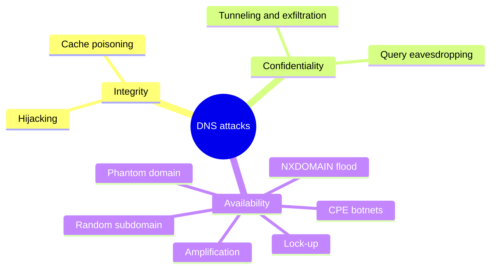
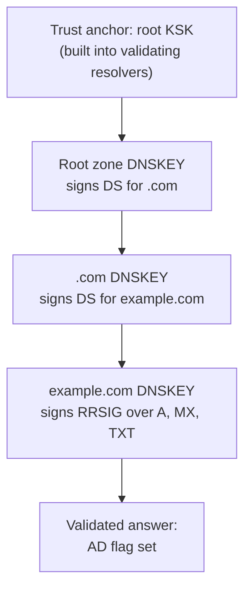

# DNS security

## Summary

DNS security is the practice of protecting DNS infrastructure and DNS data from attacks so that names resolve quickly, correctly and privately. DNS was designed without security: classic queries are unauthenticated and unencrypted UDP, which enables cache poisoning (spoofing), hijacking, tunneling of data through DNS, amplification attacks and a family of floods against resolvers and authoritative servers (NXDOMAIN, random subdomain, phantom domain, lock-up, botnet attacks from home routers). Defenses combine redundancy and over-provisioning, DNSSEC signatures that let resolvers verify answers, encrypted transport (DoT, DoH), DNS firewalls and rate limiting, logging, and protective resolvers that block malicious domains.

## Prerequisites

- [DNS overview](dns-overview.md) and [DNS records](dns-records.md).

## Core concepts

### Why DNS security matters

Like many early Internet protocols, DNS was not designed with security in mind. Its limitations, combined with modern attack tooling, expose DNS servers to spoofing, amplification, denial of service and interception of private information. Because almost every Internet request starts with DNS, it is a prime target, and DNS attacks are often launched together with other attacks to distract security teams from the real target. Organizations need to mitigate DNS attacks quickly. Strategies combine overlapping defenses: redundant DNS servers, security protocols such as DNSSEC and rigorous DNS logging.

*Analogy.* Phone directory assistance. If someone can whisper a wrong number to the operator, or replace the operator with an impostor, callers dial the wrong place while believing they reached their bank. DNSSEC is a tamper-evident seal on each directory entry; encryption is a private line to the operator. The analogy breaks at scale: one poisoned resolver can misdirect every user of an ISP at once.

### Types of attacks

These descriptions are for defense; test them only in a lab or with written authorization.

- **DNS spoofing and cache poisoning.** Forged data is inserted into a resolver's cache, so it returns a wrong IP address and sends users to a malicious server, often a replica of the real site used to spread malware or collect credentials. The 2008 Kaminsky attack (CVE-2008-1447) showed how practical this was; source port randomization and DNSSEC are the defenses. MITRE ATT&CK T1584.002 and T1565 are related techniques.
- **DNS tunneling.** Other protocols (SSH, TCP, HTTP) are encoded into DNS queries and responses to pass malware commands or exfiltrate data, unnoticed by firewalls that allow DNS (ATT&CK T1071.004).
- **DNS hijacking.** Queries are redirected to a different nameserver, through malware on the client, a compromised router, or unauthorized changes at the DNS provider or registrar. The result resembles spoofing, but the attack changes the records at the source (or the resolver in use) rather than a resolver's cache.

The figure contrasts normal resolution, in which the client asks a DNS server and then connects to the real site, with hijacking, in which a hijacked DNS server returns the address of a malicious server.


- **NXDOMAIN attack.** A flood of queries for records that do not exist, often with automatically generated unique names, to deny service to legitimate traffic; against a recursive resolver it also fills the cache with junk.
- **Phantom domain attack.** The attacker sets up "phantom" domains whose nameservers answer very slowly or not at all, then floods a resolver with queries for them, so the resolver's resources are tied up waiting.
- **Random subdomain attack (water torture).** Queries for many random, nonexistent subdomains of one legitimate domain overwhelm its authoritative nameservers; resolvers of the ISPs carrying the attack suffer too.
- **Domain lock-up attack.** Specially prepared domains and resolvers open TCP connections with legitimate resolvers and send slow streams of random packets, tying up the resolvers' resources.
- **Botnet-based CPE attack.** Compromised customer premises equipment (modems, routers, set-top boxes supplied by ISPs) form a botnet that performs random subdomain attacks against a target domain.
- **Amplification and reflection.** Small queries with a spoofed source address trigger large responses (for example `ANY` or DNSSEC-heavy answers) from open resolvers toward the victim.



### DNSSEC

DNS Security Extensions (DNSSEC) protect the integrity and authenticity of DNS data by signing it digitally. A resolver that validates can tell whether an answer really comes from the zone owner and was not modified, like a court expert verifying a handwritten signature that nobody else can produce.

How it works:

- Each zone signs its record sets with private keys; signatures are published as RRSIG records and public keys as DNSKEY records.
- The parent zone publishes a DS record (a hash of the child's key), so trust flows from parent to child: the root signs the key of `.com`, and `.com` signs (through DS) the key of `example.com`. This builds a chain of trust up to the root.
- NSEC or NSEC3 records prove that a name does not exist, so attackers cannot forge NXDOMAIN answers.
- The root zone key is anchored by humans: in the Root KSK Ceremony, trusted community representatives meet several times a year to sign the root DNSKEY set in a public, audited procedure.



DNSSEC is backwards compatible: non-validating resolvers still get answers, just without the protection. It is meant to complement TLS and other measures. Limits: it does not encrypt queries (privacy needs DoT or DoH), the chain must be intact at every level or validation fails, and key rollovers must be managed carefully (expired signatures make a domain unresolvable for validating resolvers).

### Encrypted DNS

- **DNS over TLS (DoT)**, RFC 7858, port 853.
- **DNS over HTTPS (DoH)**, RFC 8484, port 443, used by browsers.
- **DNS over QUIC (DoQ)**, RFC 9250.

They protect the client-to-resolver leg from eavesdropping and tampering; the resolver still sees all queries. Enterprises must decide whether to allow browsers' own DoH resolvers, since they bypass internal DNS controls.

### Attack prevention

Besides DNSSEC, zone operators protect their servers by:

- **over-provisioning** capacity, so volume attacks cannot overwhelm nameservers that handle several times the expected traffic,
- **redundant DNS servers** on separate networks and providers, often with anycast,
- **load balancing** queries to healthy servers when one degrades,
- **response rate limiting (RRL)** on authoritative servers and closing open resolvers to stop amplification,
- **registrar security** (MFA, registry lock) against hijacking of NS records,
- **logging and monitoring** of query volumes, NXDOMAIN rates and unusual query patterns (long random labels indicate tunneling).

### DNS firewall

A DNS firewall sits between users' recursive resolvers and the authoritative nameservers of a service (or in front of a resolver). It rate-limits attackers trying to overwhelm the server and, if the origin servers go down, keeps the service resolvable by answering from cache. It can also improve performance, with faster lookups and lower bandwidth costs for the DNS operator.

### DNS as a security tool

Resolvers can protect end users: content filtering blocks domains known to distribute malware and spam, and botnet protection blocks communication with known command and control domains. Response Policy Zones (RPZ) implement this in self-hosted resolvers (BIND, Unbound); public protective resolvers such as Quad9 (`9.9.9.9`) and Cloudflare for Families (`1.1.1.2`) do it as a service. Many are free and are enabled by changing one setting in the router or DHCP.

## Worked example

Check DNSSEC validation and spot tunneling patterns. Untested; dig 9.18 and delv, checked 2026-11.

```bash
dig +dnssec example.com A @1.1.1.1 | grep -E 'flags|RRSIG'
# ;; flags: qr rd ra ad; ...            <- "ad": the resolver validated the DNSSEC chain
# example.com. 300 IN RRSIG A 13 2 300 ...
delv example.com A                      # local validation: "; fully validated"
dig dnssec-failed.org A @1.1.1.1        # a test domain with broken signatures: SERVFAIL from validating resolvers
```

Tunneling detection idea from resolver logs (illustrative): normal query names are short, tunneled ones carry long encoded labels at high rates to one domain.

| Domain | Queries per hour | Average label length | Unique subdomains |
| --- | --- | --- | --- |
| cdn.example.net | 1,200 | 6 | 3 |
| api.example.com | 800 | 3 | 1 |
| x7.example.org | 9,500 | 52 | 9,480 |

The third row (many unique, long labels to one domain) is the classic tunneling signature worth investigating.

## Trade offs and when to use it

- **DNSSEC** prevents forgery but adds operational risk (key management, larger responses); signing through a managed DNS provider removes most of the burden.
- **Encrypted DNS** improves privacy but reduces enterprise visibility; managed DoH or DoT to the company's resolvers keeps both.
- **Protective resolvers** block much commodity malware cheaply but can produce false positives and see all queries.

## Common mistakes

- **Running open resolvers on the Internet.** They are used for amplification. Fix: restrict recursion to internal clients.
- **Forgetting DS records when changing DNS providers** with DNSSEC enabled. The domain fails validation. Fix: plan key rollovers and provider moves.
- **Allowing all outbound DNS to any server.** Tunneling and policy bypass. Fix: force DNS through internal resolvers and monitor.
- **Weak registrar account security.** Fix: MFA, locks, change alerts.

## Practice

1. What is the difference between DNS spoofing and DNS hijacking?
2. What does the `ad` flag in a `dig` response mean?
3. Which record types form the DNSSEC chain of trust between parent and child?
4. Why do random subdomain attacks bypass resolver caches?

Answers:

1. Spoofing (cache poisoning) inserts forged data into a resolver's cache; hijacking changes which nameserver answers or the records at the source, for example through a compromised registrar or router.
2. Authenticated data: the resolver validated the answer with DNSSEC.
3. DS records in the parent pointing to DNSKEY records in the child, with RRSIG signatures over record sets.
4. Each query asks for a different, nonexistent name, so nothing can be answered from cache and every query reaches the authoritative servers.

## Further reading

- [RFC 4033: DNS Security Introduction and Requirements](https://www.rfc-editor.org/rfc/rfc4033) (IETF, 2005), with RFC 4034 and RFC 4035.
- [RFC 8484: DNS Queries over HTTPS (DoH)](https://www.rfc-editor.org/rfc/rfc8484) (IETF, 2018) and [RFC 7858: DNS over TLS](https://www.rfc-editor.org/rfc/rfc7858) (IETF, 2016).
- [NIST SP 800-81-2: Secure Domain Name System (DNS) Deployment Guide](https://csrc.nist.gov/pubs/sp/800/81/2/final) (NIST, 2013).
- [MITRE ATT&CK T1071.004: Application Layer Protocol: DNS](https://attack.mitre.org/techniques/T1071/004/) (MITRE).
- [Root KSK Ceremonies](https://www.iana.org/dnssec/ceremonies) (IANA).
- [DNS security](https://www.cloudflare.com/learning/dns/dns-security/) (Cloudflare Learning Center).
