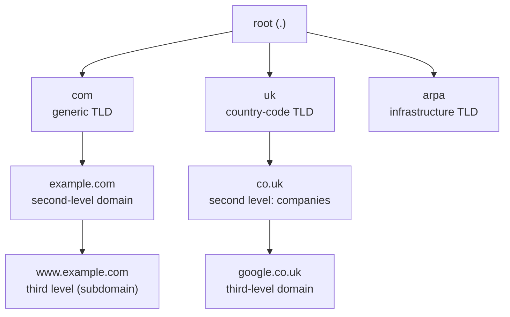

# Domain names

## Summary

A domain name is a human-readable name, such as `example.com`, that maps through DNS to IP addresses and other records. Names are hierarchical labels read from right to left: the top-level domain (TLD) such as `.com` or `.uk`, then the second-level domain, then any further subdomains. A URL contains a domain name plus a scheme, path and other parts. Domain names are allocated through a chain of organizations: ICANN and IANA coordinate the root, registries operate each TLD (Verisign for `.com`), registrars sell registrations to registrants, and the registrant controls the domain's nameservers. Managing domains well (renewals, registrar locks, MFA) is part of operations security.

## Prerequisites

- [DNS overview](dns-overview.md).

## Core concepts

### Definition

A domain name is a string that maps to numeric addresses and is used to reach a site or service from client software; in plain terms, the text a user types into a browser. Users type `example.com`, and DNS resolves it to an address such as `192.0.2.1` (a lookup), so they never need to remember numbers. Over 350 million domain names are registered across all TLDs (checked 2026-11; the source of the figure, Verisign's Domain Name Industry Brief, publishes it quarterly).

*Analogy.* A company name in the trade register compared with its street address. People remember the name; the register maps it to the current address, and the company can move without changing its name. The analogy breaks because domain names are rented, not owned: if the registration is not renewed, anyone can take the name.

### Domain name compared with URL

A uniform resource locator (URL), or web address, contains the domain name plus other information. In `https://www.example.com:443/learning/?q=dns#top`:

| Part | Value |
| --- | --- |
| Scheme (protocol) | `https` |
| Host (domain name) | `www.example.com` |
| Port | `443` (default for https, usually omitted) |
| Path | `/learning/` |
| Query | `q=dns` |
| Fragment | `top` (handled by the browser, not sent to the server) |

### Structure

Read from right to left, labels go from most general to most specific. The fully qualified domain name (FQDN) ends with an implicit root label, the trailing dot: `www.example.com.`.



- The label right of the last dot is the **top-level domain (TLD)**: generic TLDs (gTLDs) such as `.com`, `.net`, `.org` and newer ones such as `.dev`; country-code TLDs (ccTLDs) such as `.uk`, `.jp`, `.pl`.
- Left of the TLD is the **second-level domain (2LD)**; anything further left is a **third-level domain (3LD)** or deeper subdomain.

Examples:

- `google.com`: `.com` is the TLD (most general), `google` is the 2LD (most specific here).
- `google.co.uk`: `.uk` is the TLD, `.co` is the 2LD, `google` is the 3LD (most specific). The 2LD `.co` indicates the kind of registrant (companies) in the UK.

Each label is at most 63 bytes and the whole name at most 253 characters in text form. Internationalized domain names (IDN) are stored as ASCII "punycode" (`xn--...`).

### Registrars and registries

- A **registrar** is a company accredited to sell domain registrations to the public and to submit the registrant's data and nameservers to the registry. It does not assign IP addresses; addresses come from DNS records that the registrant (or their DNS provider) publishes.
- A **registry** operates a TLD: it maintains the authoritative database of which domains in that TLD exist, who registered them through which registrar, and which nameservers they delegate to. Verisign is the registry for `.com` and `.net`.
- **ICANN** (Internet Corporation for Assigned Names and Numbers) coordinates the system and accredits registrars for gTLDs; **IANA** (Internet Assigned Numbers Authority, operated by ICANN's affiliate PTI) manages the root zone and records which registry operates each TLD.
- The **registrant** is the person or organization that registers the domain.

Registries delegate commercial sales to registrars. When a registrar sells a `.com` registration, it registers the domain with Verisign and pays Verisign's fee (plus an ICANN fee), which is part of the price the registrant pays.


### Registration security

After registration, the registrar must remind the registrant before expiry and allow renewal. Some registrars have abused expiry by buying lapsed domains immediately and reselling them to the original owner at high prices, so choose a trustworthy registrar. Further practices:

- auto-renew and multi-year registration for critical domains,
- MFA on the registrar account and restricted access,
- registrar lock (`clientTransferProhibited`) and, for high-value domains, registry lock,
- monitoring of NS and DS changes and certificate transparency logs for unexpected certificates,
- WHOIS or RDAP privacy where appropriate, while keeping contact data valid.

## Worked example

Inspect a domain's registration and delegation. Untested; whois and dig, checked 2026-11.

```bash
whois example.com | grep -Ei 'registrar:|registry expiry|name server|status'
# Registrar: RESERVED-Internet Assigned Numbers Authority
# Registry Expiry Date: 2026-08-13T04:00:00Z
# Name Server: A.IANA-SERVERS.NET
# Domain Status: clientTransferProhibited
dig com NS +short                     # the registry's TLD servers
dig @a.gtld-servers.net example.com NS +norecurse   # the delegation stored at the registry
```

The NS records at the registry (set through the registrar) must match the NS records in the domain's own zone; a mismatch is a common cause of intermittent resolution failures after a DNS provider migration.

## Trade offs and when to use it

- **gTLD or ccTLD**: ccTLDs signal a market but follow national rules (residency, privacy); gTLDs are global.
- **Registrar and DNS provider together or separate**: separating them lets you change DNS hosting without a transfer and limits the impact of one compromised account.

## Common mistakes

- **Letting a domain expire.** Email, websites and certificates fail, and the name may be taken. Fix: auto-renew, alerts, ownership by a team account.
- **Confusing registrar and DNS host.** Changing records at the registrar has no effect if the domain delegates to another DNS provider. Fix: check `NS` first.
- **Using the wrong TLD in reasoning**, for example calling `.com` the TLD of `google.co.uk`. The TLD is the rightmost label.

## Practice

1. Which part of `https://shop.example.co.uk/cart` is the TLD, and which the domain name?
2. What is the difference between a registrar and a registry?
3. Why does registrar lock matter?

Answers:

1. The TLD is `uk`; the domain name (host) is `shop.example.co.uk`, with `example.co.uk` the registered domain.
2. A registry operates a whole TLD database; a registrar sells registrations in TLDs to customers and submits them to the registry.
3. It prevents unauthorized transfers of the domain to another registrar, a common step in domain hijacking.

## Further reading

- [RFC 1034: Domain Names, Concepts and Facilities](https://www.rfc-editor.org/rfc/rfc1034) (IETF, 1987).
- [RFC 3986: Uniform Resource Identifier (URI): Generic Syntax](https://www.rfc-editor.org/rfc/rfc3986) (IETF, 2005).
- [ICANN: Registrant educational materials](https://www.icann.org/resources/pages/educational-2012-02-25-en) (ICANN).
- [IANA Root Zone Database](https://www.iana.org/domains/root/db) (IANA): all TLDs and their registries.
