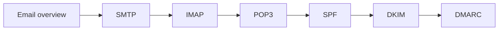

# Email

How email is sent, delivered and read, how spam is filtered, and how domains authenticate their mail.

## Map

The diagram shows the notes in reading order; subareas are marked with (subarea).

## Notes in reading order

1. [Email overview](email-overview.md): agents, protocols, filtering lists and the authentication trio.
2. [SMTP](smtp.md): sending and relaying, ports, commands, reply codes and security.
3. [IMAP](imap.md): server-side mailboxes, commands, authentication and security.
4. [POP3](pop3.md): downloading mail, commands and security.
5. [SPF](spf.md): authorized senders, mechanisms, qualifiers and limits.
6. [DKIM](dkim.md): message signatures, selectors, keys and rotation.
7. [DMARC](dmarc.md): alignment, policies, reports and rollout.

## Planned topics

- MTA-STS and DANE for SMTP
- BIMI
- Running Postfix and Dovecot
- Transactional email services
