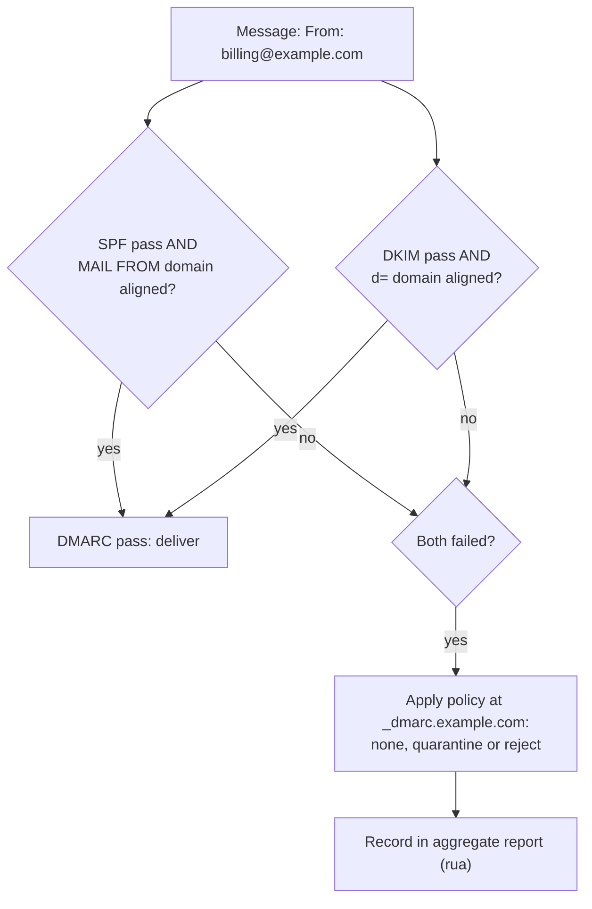
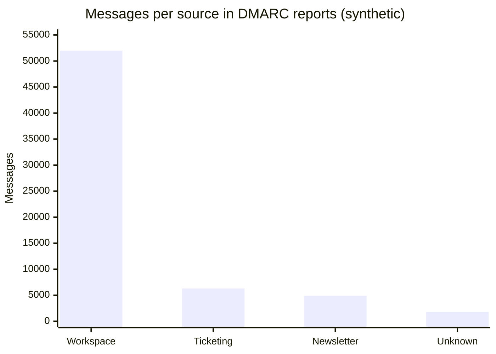

# DMARC

## Summary

Domain-based Message Authentication, Reporting and Conformance (DMARC, RFC 7489) lets a domain owner tell receivers how to handle mail that claims to come from the domain but fails authentication, and asks them to send reports. A message passes DMARC when SPF or DKIM passes *and* the authenticated domain aligns with the domain in the visible From header, which closes the gap that SPF and DKIM leave open on their own. The policy (`p=none`, `quarantine` or `reject`) is published as a TXT record at `_dmarc.example.com`, and aggregate reports show every source sending mail in the domain's name. Deploying DMARC is a staged process: monitor, fix legitimate senders, then enforce.

## Prerequisites

- [SPF](spf.md) and [DKIM](dkim.md), [Email overview](email-overview.md).

## Core concepts

### Definition

DMARC is an email security protocol that prevents spoofing, phishing and abuse of a domain. It builds on SPF and DKIM to verify senders and lets domain owners:

- specify policies for handling unauthenticated mail,
- prevent direct spoofing of their domain in the From header,
- receive reports on authentication results and abuse.

DMARC protects the domain from unauthorized use and improves deliverability of legitimate mail.

*Analogy.* A company's public notice to all post offices: "letters with our letterhead must carry our seal or come from our couriers; if not, throw them away, and send us a weekly summary of what you received". SPF and DKIM are the courier list and the seal; DMARC is the notice that ties them to the letterhead and states the consequence. The analogy breaks because receivers may choose not to follow the notice exactly (for example local overrides for mailing lists).

### Alignment

DMARC checks *identifier alignment*:

- **SPF alignment**: the envelope sender domain (MAIL FROM) that passed SPF matches the From header domain.
- **DKIM alignment**: the `d=` domain of a valid DKIM signature matches the From header domain.

Mode `r` (relaxed, default) accepts the same organizational domain (`mail.example.com` aligns with `example.com`); mode `s` (strict) requires an exact match. DMARC passes if at least one aligned mechanism passes.



### Record format

A DMARC record is a TXT record at `_dmarc.<domain>`:

```text
_dmarc.example.com.  TXT  "v=DMARC1; p=reject; rua=mailto:dmarc-reports@example.com; ruf=mailto:dmarc-failures@example.com; adkim=s; aspf=s; pct=100"
```

| Tag | Meaning |
| --- | --- |
| `v=DMARC1` | DMARC version, must be first |
| `p=reject` | Policy for failing mail: `none`, `quarantine` or `reject` |
| `sp=` | Optional policy for subdomains (defaults to `p`) |
| `rua=mailto:dmarc-reports@example.com` | Address for aggregate reports |
| `ruf=mailto:dmarc-failures@example.com` | Address for failure (forensic) reports |
| `adkim=s` | DKIM alignment mode: `s` strict, `r` relaxed (default) |
| `aspf=s` | SPF alignment mode: `s` strict, `r` relaxed (default) |
| `pct=100` | Percentage of failing mail to which the policy applies (0 to 100), used for gradual rollout |
| `fo=1` | When to generate failure reports (`1`: if any mechanism fails) |

Reports sent to addresses in another domain require that domain to authorize it with a record such as `example.com._report._dmarc.reports.example.net`.

TODO: Check the status of DMARCbis, the revision of DMARC in the IETF, which replaces `pct` with a testing flag and changes how the organizational domain is found.

### Policies

| Policy | Effect |
| --- | --- |
| `p=none` | No action; reports are sent (monitoring) |
| `p=quarantine` | Failing mail goes to spam or junk |
| `p=reject` | Failing mail is rejected during the SMTP transaction |

Move gradually from `none` to `reject` to avoid losing legitimate mail.

### Implementation

**Step 1: verify SPF and DKIM.**

```text
example.com.                     TXT  "v=spf1 include:_spf.google.com -all"
google._domainkey.example.com.   TXT  "v=DKIM1; k=rsa; p=MIIBIjANBgkqh..."
```

**Step 2: publish a monitoring record.**

```text
_dmarc.example.com.  TXT  "v=DMARC1; p=none; rua=mailto:dmarc-reports@example.com"
```

Collect reports for a few weeks and analyze them with a tool (for example dmarcian, Postmark's DMARC digests, Valimail) to find every legitimate sender and fix its SPF and DKIM.

**Step 3: enforce.** Once legitimate mail passes, move to quarantine (optionally with `pct=25`, then 100) and finally reject:

```text
_dmarc.example.com.  TXT  "v=DMARC1; p=reject; rua=mailto:dmarc-reports@example.com"
```

### Reports

**Aggregate reports (`rua`)**:

- sent by receivers, usually daily, as compressed XML,
- list sending IPs, message counts and SPF, DKIM and DMARC results per source,
- viewed with report analyzers (for example DMARC Analyzer, dmarcian).

**Failure reports (`ruf`, forensic)**:

- sent per failing message, with headers and sometimes content,
- give details for investigations, but many large mailbox providers do not send them for privacy reasons.

### DMARC, SPF and DKIM

| Feature | SPF | DKIM | DMARC |
| --- | --- | --- | --- |
| Purpose | Validates sending IPs for the envelope domain | Validates message integrity and signing domain | Policy and reporting for the visible From domain |
| DNS record | TXT at the domain | TXT at `selector._domainkey` | TXT at `_dmarc` |
| Protects against | Envelope spoofing | Tampering | Direct domain spoofing used in phishing |
| Action on failure | Defined by the receiver (or `-all` hint) | None defined | Quarantine or reject as published |

DMARC does not stop look-alike domains (`examp1e.com`) or display-name tricks; those need user awareness, brand monitoring and BIMI or VMC for visual verification.

## Worked example

Read an aggregate report and decide the next step. Untested; illustrative excerpt of a report XML, checked 2026-11.

```xml
<record>
  <row>
    <source_ip>198.51.100.77</source_ip>
    <count>1240</count>
    <policy_evaluated><disposition>none</disposition><dkim>fail</dkim><spf>fail</spf></policy_evaluated>
  </row>
  <identifiers><header_from>example.com</header_from></identifiers>
  <auth_results>
    <spf><domain>bounces.newsletter-tool.example.net</domain><result>pass</result></spf>
  </auth_results>
</record>
```

Interpretation: 1,240 messages from a newsletter tool used the From domain `example.com`; SPF passed only for the tool's own bounce domain (not aligned) and there was no DKIM signature for `example.com`. Under `p=reject` these legitimate newsletters would be lost. Fix: set up custom DKIM for `example.com` (or a custom return-path subdomain) in the tool, confirm alignment in the next reports, then enforce.

Summary of a month of reports for planning (synthetic):

| Source | Messages | Aligned pass |
| --- | --- | --- |
| Google Workspace | 52,000 | 99.8 percent |
| Ticketing system | 6,300 | 0 percent (needs DKIM) |
| Newsletter tool | 4,900 | 0 percent (needs DKIM) |
| Unknown IPs (spoofing) | 1,800 | 0 percent |



After fixing the two legitimate tools, only the unknown spoofing traffic fails, and `p=reject` blocks it.

## Trade offs and when to use it

- **Enforcement** protects the brand and users but requires an inventory of every sender; shadow IT tools are the usual obstacle.
- **Strict alignment** prevents abuse through subdomains but breaks senders that use subdomains for bounces; relaxed alignment is usually sufficient.
- **Third-party report processors** make reports readable but receive metadata about all your mail.

## Common mistakes

- **Staying at `p=none` forever.** It only monitors. Fix: plan the path to quarantine and reject.
- **Jumping to `p=reject` without reports.** Legitimate mail disappears. Fix: monitor first.
- **Forgetting subdomains and parked domains.** Attackers spoof them. Fix: `sp=reject` and `v=DMARC1; p=reject` on domains that never send.
- **Multiple DMARC records.** Receivers ignore them. Fix: exactly one TXT record at `_dmarc`.

## Practice

1. When does a message pass DMARC?
2. What is the difference between `adkim=r` and `adkim=s`?
3. What do aggregate reports contain?
4. A message is DKIM-signed with `d=mailer.example.net` and has `From: alerts@example.com`. Does it pass DMARC for `example.com` through DKIM?

Answers:

1. When SPF or DKIM passes and the passing domain aligns with the From header domain.
2. Relaxed allows the same organizational domain (subdomains); strict requires an exact match.
3. Per source IP, the number of messages and their SPF, DKIM and DMARC results and the applied disposition.
4. No, because `mailer.example.net` does not align with `example.com`.

## Further reading

- [RFC 7489: Domain-based Message Authentication, Reporting, and Conformance (DMARC)](https://www.rfc-editor.org/rfc/rfc7489) (IETF, 2015).
- [dmarc.org resources](https://dmarc.org/resources/) (DMARC.org).
- [Google: Set up DMARC](https://support.google.com/a/answer/2466580) (Google Workspace Admin Help).
- [M3AAWG Email Authentication Recommended Best Practices](https://www.m3aawg.org/) (M3AAWG).
