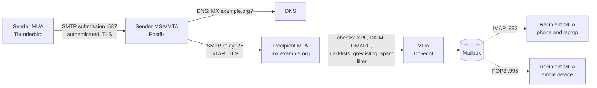

# Email overview

## Summary

Email is delivered by a chain of standardized protocols and agents. A mail user agent (MUA, the client) submits a message with SMTP to a mail transfer agent (MTA), which looks up the recipient domain's MX records and relays the message with SMTP to the recipient's MTA; a mail delivery agent (MDA) stores it in the mailbox, and the recipient reads it with IMAP (synchronized on the server) or POP3 (downloaded). Because SMTP was designed without sender authentication, mail systems add filtering (whitelisting, greylisting, blacklists) and domain authentication (SPF, DKIM, DMARC) to fight spam and spoofing. For DevOps engineers, email matters for application notifications, alerting, DNS configuration and deliverability troubleshooting.

## Prerequisites

- [DNS records](../dns/dns-records.md) (MX, TXT, PTR) and [SSL and TLS](../../network-security/ssl-and-tls.md).

## Core concepts

### The three main protocols

Email protocols are standardized methods to send, receive and manage email:

1. **SMTP** (Simple Mail Transfer Protocol): sending and relaying email ([SMTP](smtp.md)).
2. **POP3** (Post Office Protocol version 3): receiving email by downloading it, usually deleting it from the server ([POP3](pop3.md)).
3. **IMAP** (Internet Message Access Protocol): receiving and managing email that stays on the server and syncs across devices ([IMAP](imap.md)).

| Protocol | Purpose | Storage | Sync across devices | Ports |
| --- | --- | --- | --- | --- |
| SMTP | Sending and relaying | None (queues only) | Not applicable | 25 (server to server), 587 (submission with STARTTLS), 465 (submission with implicit TLS) |
| POP3 | Receiving | Local, on the client | No (download and usually delete) | 110 (plain or STARTTLS), 995 (implicit TLS) |
| IMAP | Receiving and managing | On the server | Yes | 143 (plain or STARTTLS), 993 (implicit TLS) |

*Analogy.* The postal system. You drop a letter at the local post office (submission to your MTA), post offices forward it between cities using the address (MX lookup and relay), the destination post office puts it in the recipient's mailbox (MDA), and the recipient either takes the letters home (POP3) or reads them at a shared mailbox that everyone in the family sees (IMAP). The analogy breaks on trust: anyone can write any sender address on an envelope, which is why email needs SPF, DKIM and DMARC.

### Mail agents

- **MUA (mail user agent)**: the email client, for example Outlook, Thunderbird or the Gmail web interface.
- **MSA (mail submission agent)**: accepts mail from MUAs on port 587 or 465 after authentication (often part of the MTA).
- **MTA (mail transfer agent)**: sends and receives mail between servers, for example Postfix, Sendmail, Exim, Microsoft Exchange.
- **MDA (mail delivery agent)**: delivers mail into the recipient's mailbox, for example Dovecot (LDA or LMTP) or Procmail.
- **MX records**: DNS records that tell senders which servers accept mail for a domain ([DNS records](../dns/dns-records.md#mx-record)).



### Whitelisting and greylisting

Whitelisting and greylisting are filtering techniques for incoming mail that control spam and improve security. (Current guidance often uses "allowlist" and "blocklist" for these terms.)

**Whitelisting (allowlisting)** keeps a list of approved senders (IP addresses, email addresses or domains) that are explicitly allowed. In its strict form, only mail from listed sources is accepted and everything else is blocked by default; in the common soft form, listed senders bypass spam filtering.

- Pros: very secure in strict form; blocks phishing, spam and malicious mail from unknown senders.
- Cons: inflexible, constant updates needed for new legitimate senders; important mail from unlisted senders is lost.

**Greylisting** temporarily rejects mail from unknown sender combinations (typically the triplet of client IP, sender address and recipient address) with a "try again later" response (SMTP code 451). Legitimate mail servers queue the message and retry after a few minutes; many spam bots do not retry, so their mail never arrives.

- Pros: reduces spam without manual list maintenance; new legitimate senders pass after the retry.
- Cons: delays first-time mail (minutes, sometimes longer with large sender farms that retry from different IPs); some poorly built automated senders (for example verification emails from simple scripts) do not retry and are lost.

| Feature | Whitelisting | Greylisting |
| --- | --- | --- |
| Purpose | Allow only trusted senders | Block spam by forcing retries |
| How it works | Accepts mail only from predefined sources | Temporarily rejects unknown senders and requires a retry |
| Security level | High (blocks everything not allowed) | Moderate (relies on retry behavior) |
| Spam prevention | Very effective, high maintenance | Effective against bots |
| Flexibility | Low (manual updates) | Higher (new legitimate senders pass) |
| Delivery speed | Immediate for approved senders | Delayed for first-time senders |

Use whitelisting in high-security environments (sensitive corporate communication) and where only known senders should be allowed; use greylisting on general mail servers that receive mail from many unknown senders and need spam reduction without manual work.

### Blacklisting

Blacklisting (blocklisting) blocks known malicious or unwanted sources: a list of IP addresses, email addresses or domains that are explicitly denied.

How it works: the receiving server checks the sender's IP or domain against blacklists; listed senders are rejected automatically, others are processed normally.

| Type | Description |
| --- | --- |
| IP blacklist | Blocks specific IP addresses known for spam or malicious activity |
| Domain blacklist | Blocks domains associated with phishing or scams (for example domain blocklists such as Spamhaus DBL) |
| RBL (real-time blackhole list) | Publicly available lists of spam sources maintained by third parties |
| DNSBL (DNS-based blackhole list) | An RBL queried through DNS: the server looks up the reversed IP under the list's zone (for example `4.113.0.203.zen.spamhaus.org`); an A record answer means "listed" |

Uses: spam prevention, phishing and malware protection, and reputation management (for example detecting that your own servers were listed after abuse).

Challenges:

- **False positives**: legitimate senders end up listed because of spam reports or misconfiguration.
- **Dynamic IP issues**: ISPs reassign dynamic addresses that were previously listed (and many lists block dynamic ranges entirely).
- **Evasion**: spammers rotate IPs and domains.

Checking whether a server is listed:

1. Public checkers: MXToolbox, Spamhaus, MultiRBL.
2. Bounce messages and SMTP errors, for example `550 5.7.1 Service unavailable; client host blocked using zen.spamhaus.org`.
3. Mail server logs, which record rejection reasons.

### Authentication: SPF, DKIM and DMARC

SPF, DKIM and DMARC authenticate the sending domain to prevent spoofing, reduce phishing and improve deliverability. Each has its own note; this is the overview.

**SPF (Sender Policy Framework)** lists in DNS which servers may send mail for a domain.

1. The domain owner publishes an SPF record.
2. The receiving server checks whether the connecting server's IP is authorized.
3. Allowed: accepted; not allowed: rejected or marked as spam.

```text
v=spf1 ip4:192.0.2.1 include:_spf.google.com -all
```

`v=spf1` is the version, `ip4:192.0.2.1` authorizes that address, `include:_spf.google.com` authorizes Google's mail servers, `-all` rejects all others. Pros: prevents envelope domain spoofing; helps verify trusted senders. Cons: does not detect tampering after sending; breaks when mail is forwarded (the forwarder's IP is not authorized). See [SPF](spf.md).

**DKIM (DomainKeys Identified Mail)** signs messages cryptographically so that receivers can verify they were not altered.

1. The sending server adds a `DKIM-Signature` header.
2. The receiving server fetches the public key from the sender's DNS.
3. It verifies the signature with the public key.
4. If valid, the message is authentic for that signing domain.

```text
v=DKIM1; k=rsa; p=MIGfMA0GCSqGSI...
```

`v=DKIM1` is the version, `k=rsa` the key type (signature algorithm), `p=` the public key. Pros: integrity (detects modification), helps prevent forgery. Cons: does not tell receivers what to do on failure; requires DNS setup and key management. See [DKIM](dkim.md).

**DMARC (Domain-based Message Authentication, Reporting and Conformance)** is a policy framework that tells receivers what to do when authentication fails and sends reports.

1. The domain owner publishes a DMARC policy in DNS.
2. The receiver checks SPF and DKIM and whether they align with the visible From domain.
3. According to the policy, the message is delivered, quarantined or rejected.
4. The receiver sends reports to the domain owner.

```text
v=DMARC1; p=reject; rua=mailto:reports@example.com
```

| Policy | Effect |
| --- | --- |
| `p=none` | Monitor only, no action |
| `p=quarantine` | Failing mail goes to spam or junk |
| `p=reject` | Failing mail is rejected |

Pros: clear instructions for handling spoofed mail; prevents direct domain impersonation; reporting. Cons: needs SPF and DKIM first; needs monitoring to avoid blocking legitimate mail. See [DMARC](dmarc.md).

| Feature | SPF | DKIM | DMARC |
| --- | --- | --- | --- |
| Purpose | Authorize sending servers | Verify message integrity and signing domain | Policy and reporting based on SPF and DKIM |
| How it works | Checks the sending IP | Cryptographic signature | Requires an aligned SPF or DKIM pass |
| Stored in | DNS TXT | DNS TXT (at `selector._domainkey`) | DNS TXT (at `_dmarc`) |
| Stops visible From spoofing alone | No | No (a different domain can sign) | Yes, with `p=reject` or `quarantine` |
| Detects tampering | No | Yes | Through DKIM |
| Best practice | With DKIM and DMARC | With SPF and DMARC | Requires SPF and DKIM |

Best practices:

1. **SPF**: authorize only legitimate senders; end with `-all` (or `~all` while testing).
2. **DKIM**: generate keys, publish the public key, enable signing at every sending service.
3. **DMARC**: start with `p=none` and reports (`rua=mailto:...`), then move gradually to `quarantine` and `reject`.
4. **Monitor reports** with tools such as dmarcian or Google Postmaster Tools, and adjust SPF and DKIM to avoid false positives.

Since 2024, Google and Yahoo require SPF, DKIM and DMARC (at least `p=none`) for bulk senders (checked 2026-11).

## Worked example

Check a domain's mail configuration from the command line. Untested; dig 9.18 and OpenSSL 3, checked 2026-11.

```bash
dig example.com MX +short                          # where mail is delivered
dig example.com TXT +short | grep spf1             # SPF policy
dig selector1._domainkey.example.com TXT +short    # DKIM public key (selector from a received message)
dig _dmarc.example.com TXT +short                  # DMARC policy
dig -x 203.0.113.25 +short                         # PTR of the sending server
openssl s_client -starttls smtp -connect mx.example.com:25 -brief   # TLS on the MX
```

In a received message, the `Authentication-Results` header shows the receiver's verdicts:

```text
Authentication-Results: mx.example.org;
  spf=pass smtp.mailfrom=example.com;
  dkim=pass header.d=example.com;
  dmarc=pass (p=REJECT) header.from=example.com
```

## Trade offs and when to use it

- **Running your own mail servers** gives control but requires constant work on deliverability, reputation, spam filtering and security; most organizations use hosted mail (Microsoft 365, Google Workspace) and transactional services (Amazon SES, SendGrid, Postmark) for application mail.
- **Strict DMARC** stops spoofing of your domain but breaks forgotten senders (marketing tools, ticketing systems) until they are configured.
- **Greylisting** reduces spam cheaply at the cost of delays for first contacts.

## Common mistakes

- **Applications sending mail from servers without SPF, DKIM and PTR.** Mail lands in spam. Fix: send through an authenticated relay or provider.
- **Open relays** that forward anyone's mail. They get blacklisted within hours. Fix: require authentication for relaying.
- **Jumping straight to `p=reject`.** Legitimate mail is lost. Fix: monitor with `p=none` first.

## Practice

1. Which protocol does a phone and a laptop need to see the same mailbox state?
2. What is the role of an MTA compared with an MDA?
3. Why does greylisting stop many spam bots?
4. Which of SPF, DKIM and DMARC detects modification of the message body?

Answers:

1. IMAP.
2. The MTA transfers mail between servers; the MDA stores delivered mail in the recipient's mailbox.
3. It temporarily rejects first attempts, and many bots never retry, while real mail servers do.
4. DKIM.

## Further reading

- [RFC 5598: Internet Mail Architecture](https://www.rfc-editor.org/rfc/rfc5598) (IETF, 2009): the roles of MUA, MSA, MTA and MDA.
- [RFC 5321: Simple Mail Transfer Protocol](https://www.rfc-editor.org/rfc/rfc5321) (IETF, 2008).
- [Google email sender guidelines](https://support.google.com/a/answer/81126) (Google).
- [Spamhaus blocklist information](https://www.spamhaus.org/blocklists/) (Spamhaus Project).
