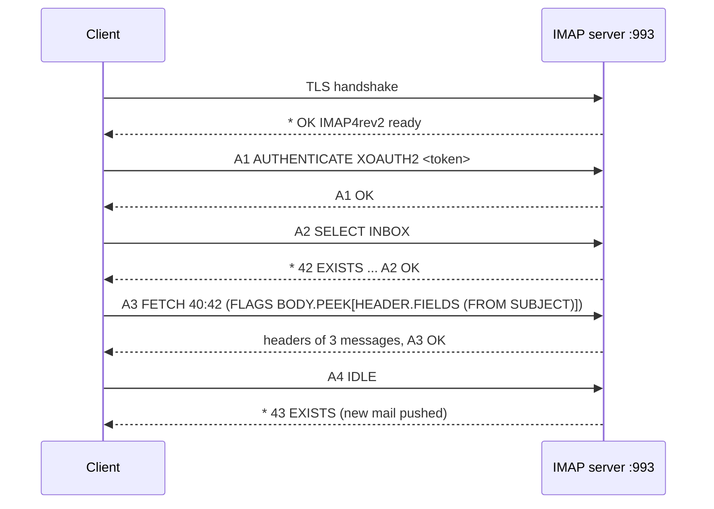

# IMAP

## Summary

The Internet Message Access Protocol (IMAP, current version IMAP4rev2, RFC 9051) lets mail clients access and manage mailboxes that stay on the server. Messages, folders and flags (read, answered, deleted) live on the server, so every device sees the same state. IMAPS is IMAP over implicit TLS on port 993; plain IMAP on port 143 must be upgraded with STARTTLS before authentication. Clients fetch headers first and bodies on demand, search on the server and keep connections open for push notifications (IDLE). Compared with POP3, IMAP is the protocol for multi-device and webmail use, and it is also a convenient interface for automating mailbox processing.

## Prerequisites

- [Email overview](email-overview.md) and [SSL and TLS](../../network-security/ssl-and-tls.md).

## Core concepts

### Definition

IMAPS (IMAP Secure) retrieves email from a mail server securely: it is IMAP with TLS. IMAP lets users access and manage messages stored on a remote server and keeps them synchronized across devices.

- **IMAP**: port 143, unencrypted unless upgraded with STARTTLS.
- **IMAPS**: port 993 with implicit TLS from the first byte.

*Analogy.* A shared filing cabinet in the office that everyone reaches through a window. You can look at folder labels, pull a letter, put a sticky note "read" on it, or move it to another drawer, and every colleague with access sees the change immediately. POP3 is taking the letters home in a bag. The analogy breaks because the "window" can stay open and the cabinet notifies you of new letters (IDLE).

### How it works

1. The user opens a mail client, which connects to the IMAPS server on port 993.
2. **Authentication** with username and password (inside TLS) or OAuth 2.0.
3. **Mailbox synchronization**: messages stay on the server; changes (read, deleted, moved) synchronize across devices.
4. **Retrieval on demand**: the client fetches metadata (headers, flags, sizes) first and full messages when opened.
5. **Reading**: unlike POP3, messages are not deleted after retrieval.
6. **Session end**: the connection stays open for synchronization (IDLE) or closes after inactivity.



### Commands and responses

IMAP is text-based: each command has a client-chosen tag (`A1`, `A2`) so responses can be matched, and the server answers with untagged data lines (`*`) and a tagged completion (`OK`, `NO`, `BAD`).

| Command | Description |
| --- | --- |
| `LOGIN user pass` | Authenticate with a password (only inside TLS) |
| `AUTHENTICATE XOAUTH2 ...` | Authenticate with an OAuth 2.0 token |
| `LIST "" "*"` | List all mailboxes (folders) |
| `SELECT INBOX` | Open a mailbox |
| `FETCH 1 BODY[]` | Retrieve the full first message (marks it as read; `BODY.PEEK[]` does not) |
| `FETCH 1 (BODY[HEADER])` | Retrieve only headers |
| `STORE 1 +FLAGS (\Seen)` | Mark a message as read |
| `SEARCH FROM "sender@example.com"` | Search on the server |
| `MOVE`, `COPY` | Move or copy messages between folders |
| `EXPUNGE` | Permanently remove messages flagged `\Deleted` |
| `IDLE` | Wait for server push notifications |
| `LOGOUT` | Close the session |

Example session over IMAPS:

```text
A1 LOGIN user@example.com <PASSWORD>
A2 LIST "" "*"
A3 SELECT INBOX
A4 FETCH 1 (BODY[HEADER])
A5 FETCH 1 BODY[]
A6 STORE 1 +FLAGS (\Seen)
A7 STORE 1 +FLAGS (\Deleted)
A8 EXPUNGE
A9 LOGOUT
```

IMAP commands are also useful for automation: scripts can fetch, filter and file messages (for example processing bounce mailboxes or ticket inboxes), preferably with a library (Python `imaplib`) rather than raw commands.

### IMAP compared with POP3

| Feature | IMAPS (port 993) | POP3S (port 995) |
| --- | --- | --- |
| Storage | Messages stay on the server | Downloaded and, by default, deleted from the server |
| Multi-device sync | Yes | No |
| Folders | Yes (Inbox, Sent, Spam and custom folders) | No (inbox only) |
| Security | TLS | TLS |
| Offline access | Partial (client caches) | Full (messages stored locally) |
| Server storage | Grows with mailboxes | Small |
| Use case | Webmail, several devices, business and cloud mail | Single device, limited server storage |

IMAPS is preferred for modern business and cloud mail.

### Authentication

**Username and password (basic authentication).** The client sends credentials, for example `A1 LOGIN user@example.com <PASSWORD>`. Without TLS they are exposed to man-in-the-middle attackers; even with TLS, passwords can be phished or reused, and they bypass MFA.

**OAuth 2.0.** Access tokens replace passwords. The client sends a Base64-encoded string containing the user and bearer token with the SASL mechanism `XOAUTH2` (Google, Microsoft) or the standard `OAUTHBEARER` (RFC 7628):

```text
A1 AUTHENTICATE XOAUTH2 dXNlcj11c2VyQGV4YW1wbGUuY29tAWF1dGg9QmVhcmVyIDxUT0tFTj4BAQ==
```

Microsoft 365 and Google Workspace have retired basic authentication for IMAP for most accounts (checked 2026-11), so OAuth 2.0 is effectively required for them.

### Securing IMAP

| Port | Protocol | Encryption |
| --- | --- | --- |
| 143 | IMAP | STARTTLS upgrade (must be enforced before login) |
| 993 | IMAPS | Implicit TLS |

RFC 8314 recommends implicit TLS (993) over STARTTLS.

### Best practices

1. **Enforce TLS**: port 993; disable plaintext authentication on unencrypted connections (Dovecot: `ssl = required`, `auth_allow_cleartext = no`; older versions `disable_plaintext_auth = yes`).
2. **OAuth 2.0** instead of passwords where the server supports it; app-specific passwords otherwise.
3. **Restrict access** with firewall rules to trusted networks when possible.
4. **Log and monitor** failed logins.
5. **Rate limiting and brute-force protection**, for example Fail2Ban on repeated authentication failures.

## Worked example

Read unread subjects with Python over IMAPS. Untested; Python 3.12 `imaplib`, checked 2026-11. Server and credentials are placeholders.

```python
import imaplib, email
from email.header import decode_header

with imaplib.IMAP4_SSL("imap.example.com", 993) as imap:      # implicit TLS
    imap.login("user@example.com", "<APP_PASSWORD>")
    imap.select("INBOX", readonly=True)                        # readonly: do not set \Seen
    status, data = imap.search(None, "UNSEEN")
    for num in data[0].split()[-5:]:                           # last five unread messages
        status, msg_data = imap.fetch(num, "(BODY.PEEK[HEADER.FIELDS (FROM SUBJECT)])")
        msg = email.message_from_bytes(msg_data[0][1])
        subject, enc = decode_header(msg["Subject"])[0]
        print(msg["From"], "|", subject.decode(enc or "utf-8") if isinstance(subject, bytes) else subject)
```

Manual test of TLS and the greeting:

```bash
openssl s_client -connect imap.example.com:993 -quiet
# * OK [CAPABILITY IMAP4rev1 ... AUTH=PLAIN AUTH=XOAUTH2] Dovecot ready.
```

## Trade offs and when to use it

- **IMAP** for any user with more than one device or webmail; the server needs storage, backups and quotas.
- **POP3** only for single-device archiving or legacy clients.
- **Provider APIs** (Microsoft Graph, Gmail API) offer richer access than IMAP for automation in those ecosystems.

## Common mistakes

- **Allowing LOGIN on port 143 without STARTTLS.** Fix: require TLS before authentication.
- **Automation that marks messages as read accidentally** with `BODY[]`. Fix: `BODY.PEEK[]` or read-only `SELECT` (`EXAMINE`).
- **Relying on basic authentication** for Microsoft 365 or Gmail. Fix: OAuth 2.0.

## Practice

1. What is the purpose of the tag in IMAP commands?
2. What is the difference between `\Deleted` and `EXPUNGE`?
3. Why does IMAP need more server storage than POP3?

Answers:

1. It matches the server's completion responses to the command, which allows several commands in flight.
2. `\Deleted` only flags a message; `EXPUNGE` permanently removes all flagged messages.
3. Messages remain on the server indefinitely instead of being downloaded and deleted.

## Further reading

- [RFC 9051: Internet Message Access Protocol (IMAP) Version 4rev2](https://www.rfc-editor.org/rfc/rfc9051) (IETF, 2021).
- [RFC 7628: A Set of SASL Mechanisms for OAuth](https://www.rfc-editor.org/rfc/rfc7628) (IETF, 2015).
- [Dovecot documentation](https://doc.dovecot.org/) (Dovecot project).
- [Python imaplib](https://docs.python.org/3/library/imaplib.html) (Python Software Foundation).
