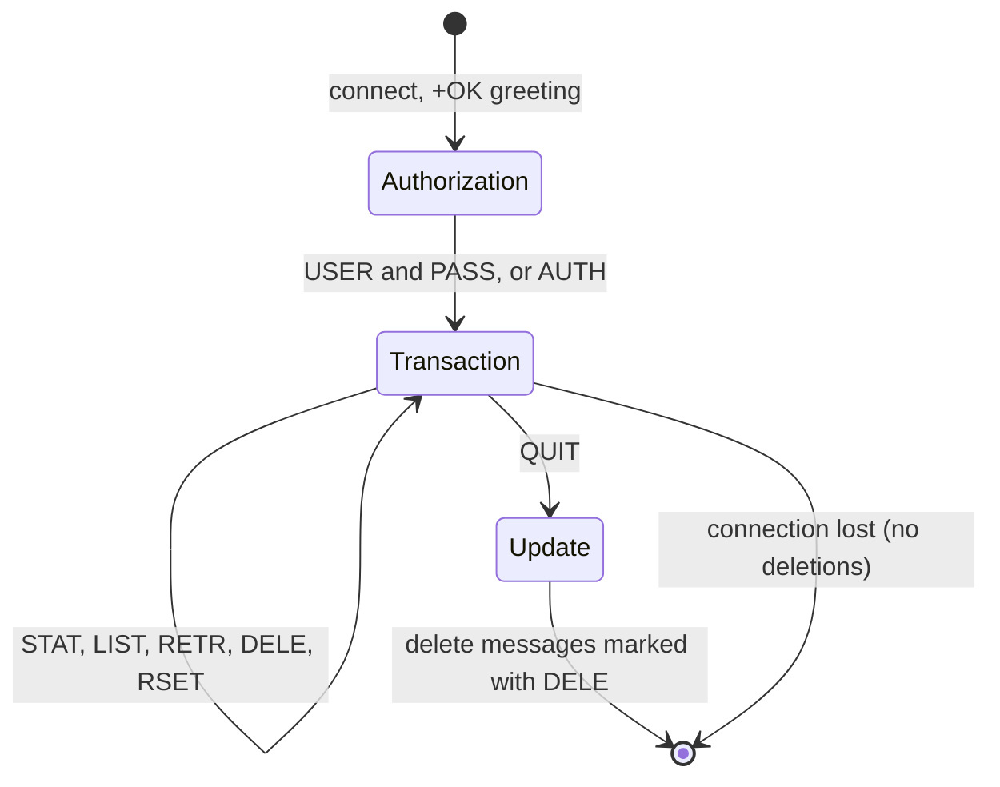

# POP3

## Summary

Post Office Protocol version 3 (POP3, RFC 1939, 1996) retrieves email from a server to a client: the client logs in, lists messages, downloads them and usually deletes them from the server. It has no folders and no synchronization, so it suits a single device that keeps mail locally, unlike IMAP, which keeps mail on the server. POP3 uses port 110, where STARTTLS (the `STLS` command) should be required, and POP3S on port 995 with implicit TLS. It remains common for automated mailbox processing and legacy clients.

## Prerequisites

- [Email overview](email-overview.md) and [IMAP](imap.md) for comparison.

## Core concepts

### Definition

POP3 retrieves messages from a mail server to a client. Unlike IMAP, it downloads messages and, by default, deletes them from the server, which makes it a fit for single-device use.

- **POP3**: port 110, unencrypted unless upgraded with STLS.
- **POP3S**: port 995 with implicit TLS.

*Analogy.* A post office box. You open it, take all the letters home and the box is empty; at home you sort them into your own drawers. Another family member checking the box later finds nothing. The analogy breaks in one detail: clients can choose "leave a copy on the server", but even then there is no shared read state or folders.

### How it works

1. The user opens a mail client, which connects to the POP3 server (port 110 with STLS or port 995).
2. **Authentication** with username and password or OAuth 2.0.
3. **Retrieval**: messages are downloaded; by default they are deleted from the server afterwards.
4. **Session end**: the connection closes, and deletions are committed.

POP3 sessions have three states: *authorization* (log in), *transaction* (list, retrieve, mark for deletion) and *update* (after `QUIT`, the server deletes marked messages). If the connection drops before `QUIT`, nothing is deleted.



POP3 suits single-device access; IMAP suits multi-device synchronization.

### Commands and responses

POP3 is text-based: the client sends commands, and the server answers `+OK` or `-ERR`.

| Command | Description |
| --- | --- |
| `USER user@example.com` | Provide the user name |
| `PASS <password>` | Provide the password |
| `STLS` | Upgrade to TLS on port 110 |
| `STAT` | Mailbox statistics: number of messages and total size |
| `LIST` | List messages with sizes |
| `UIDL` | Unique IDs, so clients can leave mail on the server without downloading twice |
| `RETR 1` | Retrieve message 1 |
| `TOP 1 10` | Headers and the first 10 lines of message 1 |
| `DELE 1` | Mark message 1 for deletion |
| `RSET` | Unmark all deletions |
| `QUIT` | End the session and commit deletions |

Example session:

```text
S: +OK POP3 server ready
C: USER user@example.com
S: +OK
C: PASS <PASSWORD>
S: +OK Logged in
C: LIST
S: +OK 2 messages
S: 1 1200
S: 2 2500
S: .
C: RETR 1
S: +OK 1200 octets
S: Subject: Test Email
S:
S: Hello, this is a test email.
S: .
C: DELE 1
S: +OK message 1 deleted
C: QUIT
S: +OK bye
```

POP3 has no folder structure; it only retrieves messages from the inbox.

### POP3 compared with IMAP

| Feature | POP3 (ports 110 and 995) | IMAP (ports 143 and 993) |
| --- | --- | --- |
| Storage | Downloaded and usually deleted from the server | Stays on the server |
| Multi-device sync | No | Yes |
| Folders | No (inbox only) | Yes |
| Offline access | Yes (messages stored locally) | Partial (client caching) |
| Security | Plain text on 110 unless STLS; encrypted on 995 | STARTTLS on 143; encrypted on 993 |
| Best for | Single-device users, downloading and removing mail | Users on several devices |

Use IMAP unless the requirement is specifically to download mail and remove it from the server.

### Authentication

**Username and password (basic authentication).** `USER` and `PASS` send credentials in plain text unless TLS is used; insecure without TLS.

**OAuth 2.0.** Access tokens replace passwords through the `AUTH` command with the SASL mechanism XOAUTH2 (or OAUTHBEARER); the argument is a Base64-encoded string with the user and the bearer token, not the raw token:

```text
AUTH XOAUTH2 dXNlcj11c2VyQGV4YW1wbGUuY29tAWF1dGg9QmVhcmVyIDxUT0tFTj4BAQ==
```

Microsoft 365 and Gmail require OAuth 2.0 for POP3 on most accounts.

### Securing POP3

POP3 without TLS sends passwords and mail in plain text, so it must be encrypted:

| Port | Protocol | Encryption |
| --- | --- | --- |
| 110 | POP3 | Plain text unless upgraded with STLS (enforce it) |
| 995 | POP3S | Implicit TLS (recommended) |

### Best practices

1. Use POP3S on port 995 instead of plain port 110.
2. Disable plaintext authentication on unencrypted connections.
3. Use OAuth 2.0 where supported.
4. Restrict access with firewall rules to trusted networks.
5. Monitor logs for failed logins and block brute force (Fail2Ban).

## Worked example

Check a mailbox over POP3S with Python without deleting anything. Untested; Python 3.12 `poplib`, checked 2026-11.

```python
import poplib
box = poplib.POP3_SSL("pop.example.com", 995)
box.user("user@example.com")
box.pass_("<APP_PASSWORD>")
count, size = box.stat()
print(f"{count} messages, {size} bytes")
for line in box.top(count, 0)[1]:          # headers of the newest message, no body lines
    if line.lower().startswith((b"from:", b"subject:")):
        print(line.decode(errors="replace"))
box.quit()                                  # no DELE was sent, so nothing is deleted
```

Manual check:

```bash
openssl s_client -connect pop.example.com:995 -quiet
# +OK Dovecot ready.
```

## Trade offs and when to use it

- **POP3** keeps server storage small and gives complete offline copies, but mail exists only on one device unless backed up.
- **IMAP** is the right default for people; POP3 remains handy for simple automated consumers (a ticket system that pulls and deletes mail).

## Common mistakes

- **Expecting deleted messages to vanish before `QUIT`.** Deletion happens in the update state. Fix: always end with `QUIT`.
- **Using POP3 on several devices.** Mail ends up split across them. Fix: IMAP, or "leave on server" with UIDL as a stopgap.
- **Plain port 110 without STLS.** Fix: port 995.

## Practice

1. When are messages marked with `DELE` actually deleted?
2. Which command lets a client avoid downloading the same message twice when leaving mail on the server?
3. Why does POP3 not support folders?

Answers:

1. After `QUIT`, in the update state; a broken connection deletes nothing.
2. `UIDL`, which lists unique, persistent message IDs.
3. It was designed only to download the inbox to a client; folders and server-side management are the purpose of IMAP.

## Further reading

- [RFC 1939: Post Office Protocol, Version 3](https://www.rfc-editor.org/rfc/rfc1939) (IETF, 1996).
- [RFC 2595: Using TLS with IMAP, POP3 and ACAP](https://www.rfc-editor.org/rfc/rfc2595) (IETF, 1999).
- [RFC 8314: Cleartext Considered Obsolete](https://www.rfc-editor.org/rfc/rfc8314) (IETF, 2018).
- [Python poplib](https://docs.python.org/3/library/poplib.html) (Python Software Foundation).
