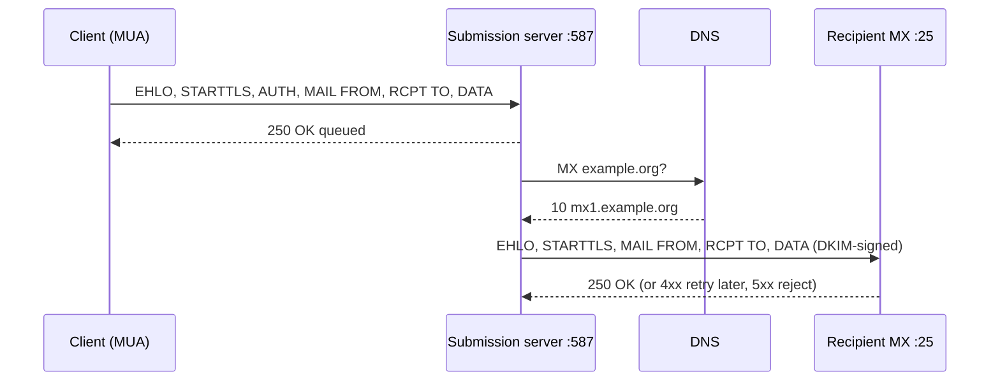

# SMTP

## Summary

The Simple Mail Transfer Protocol (SMTP, RFC 5321) sends and relays email: mail clients submit messages to a submission server, and mail servers pass them from server to server until they reach the recipient domain's mail exchanger, found through DNS MX records. SMTP is a text-based, command and reply protocol over TCP: the client greets with `EHLO`, optionally upgrades to TLS and authenticates, names the envelope sender (`MAIL FROM`) and recipients (`RCPT TO`), and transfers the message after `DATA`. Ports matter: 25 for server-to-server relay, 587 (STARTTLS) and 465 (implicit TLS) for authenticated submission. Reply codes in the 4xx and 5xx ranges explain most delivery problems.

## Prerequisites

- [Email overview](email-overview.md) and [DNS records](../dns/dns-records.md#mx-record).

## Core concepts

### Definition

SMTP is the application layer protocol for *sending* email between clients and servers and between servers, using ports 25, 465 or 587. It lets clients (Outlook, Thunderbird) and services send mail reliably, and understanding it is essential for running mail servers, troubleshooting delivery and securing mail. Retrieval by the recipient is a different job, done by IMAP or POP3.

*Analogy.* A registered-mail counter conversation. You greet the clerk (`EHLO`), show ID if you are a customer (`AUTH`), state who sends it (`MAIL FROM`) and who receives it (`RCPT TO`), hand over the letter (`DATA`), and get a receipt number (`250 queued`). The envelope details at the counter can differ from what is written inside the letter, which is exactly the difference between the SMTP envelope and the message headers.

### How it works

SMTP follows a client-server model: a client sends through an SMTP server, which relays to the recipient's server.

1. **The user composes an email**; the MUA connects to its submission server.
2. **Authentication**: the client authenticates (required on submission ports).
3. **Transmission**: the server queues the message and resolves the recipient domain's **MX records** in DNS.
4. **Delivery**: the sending MTA connects to the recipient's MX on port 25 and transfers the message; the recipient server stores it (through its MDA). Temporary failures (4xx) are retried for days; permanent failures (5xx) produce a bounce.
5. **Retrieval**: the recipient's MUA fetches the mail with IMAP or POP3.



### Ports

| Port | Usage | Security |
| --- | --- | --- |
| 25 | Server-to-server relay (MTA to MTA) | Opportunistic STARTTLS; usually blocked outbound by ISPs and clouds to stop spam from compromised machines |
| 587 | Message submission from clients, with STARTTLS (RFC 6409) | Authentication required, TLS upgrade |
| 465 | Message submission with implicit TLS (SMTPS) | Was deprecated in the past, but RFC 8314 (2018) re-standardized it and now recommends implicit TLS over STARTTLS for submission |

For applications and clients, use 465 with implicit TLS or 587 with STARTTLS, always authenticated; never relay through port 25 from application servers in the cloud.

### Commands and replies

| Command | Description |
| --- | --- |
| `HELO example.com` | Identifies the client host (original SMTP) |
| `EHLO example.com` | Extended hello: the server answers with supported extensions (STARTTLS, AUTH, SIZE, PIPELINING) |
| `STARTTLS` | Upgrades the connection to TLS |
| `AUTH PLAIN` or `AUTH LOGIN` | Authentication with username and password, Base64-encoded (not encrypted) |
| `MAIL FROM:<user@example.com>` | Envelope sender (return path for bounces) |
| `RCPT TO:<recipient@example.com>` | Envelope recipient (repeat for each) |
| `DATA` | Starts the message (headers and body), ended by a line with a single dot |
| `QUIT` | Closes the session |

Example conversation on port 587 (the Base64 values are illustrative; real sessions must use STARTTLS before AUTH):

```text
S: 220 smtp.example.com ESMTP Postfix
C: EHLO client.example.com
S: 250-smtp.example.com Hello client.example.com
S: 250-STARTTLS
S: 250 AUTH PLAIN LOGIN
C: STARTTLS
S: 220 Ready to start TLS
   ... TLS handshake, then EHLO again ...
C: AUTH LOGIN
S: 334 VXNlcm5hbWU6                   (Base64 for "Username:")
C: dXNlckBleGFtcGxlLmNvbQ==           (Base64 for "user@example.com")
S: 334 UGFzc3dvcmQ6                   (Base64 for "Password:")
C: cGFzc3dvcmQxMjM=                   (Base64 for "password123")
S: 235 Authentication successful
C: MAIL FROM:<user@example.com>
S: 250 OK
C: RCPT TO:<recipient@example.com>
S: 250 OK
C: DATA
S: 354 End data with <CRLF>.<CRLF>
C: From: User <user@example.com>
C: To: recipient@example.com
C: Subject: Test Email
C:
C: Hello, this is a test email.
C: .
S: 250 OK: queued as 4F2A1C0123
C: QUIT
S: 221 Bye
```

Base64 is an encoding, not encryption: anyone who captures the session without TLS can read the password.

### Reply codes

| Code | Meaning |
| --- | --- |
| 220 | Service ready |
| 221 | Closing connection |
| 235 | Authentication successful |
| 250 | Requested action completed |
| 334 | Waiting for authentication data |
| 354 | Start mail input |
| 421 | Service not available, closing (server overloaded or shutting down) |
| 450 | Mailbox unavailable, temporary (for example greylisting) |
| 451 | Local error, try again later |
| 535 | Authentication failed |
| 550 | Mailbox unavailable, permanent (no such user, or policy rejection such as a blacklist) |
| 554 | Transaction failed (often policy or spam rejection) |

The first digit decides behavior: 2 success, 3 continue, 4 temporary failure (the sender retries), 5 permanent failure (bounce). Enhanced status codes such as `5.7.1` (RFC 3463) add detail: class 5.7 means security or policy. Reading SMTP logs and codes is the first step in debugging delivery.

### Authentication methods

Submission servers require authentication so that they do not become *open relays* that anyone can use to send spam.

| Method | Description |
| --- | --- |
| PLAIN | Username and password in one Base64 string; safe only inside TLS |
| LOGIN | Username and password as separate Base64 strings; same security as PLAIN, non-standard |
| CRAM-MD5 | Hashed challenge-response, so the password is not sent; considered obsolete because the server must store reversible passwords and MD5 is weak |
| XOAUTH2 or OAUTHBEARER (OAuth 2.0) | Token-based, used by Gmail and Microsoft 365, supports MFA and revocation |

Recommended: TLS (implicit or STARTTLS) with PLAIN for service accounts that cannot use OAuth, OAuth 2.0 for user accounts; Microsoft and Google have disabled or restricted basic authentication for their services.

### Relays

An SMTP relay is a server that accepts mail and forwards it toward its destination on behalf of a domain or application.

How relays work:

- The sending system (an application or an internal MTA) hands mail to a relay, usually authenticated.
- The relay signs messages with DKIM for the sending domain and sends from IP addresses listed in the domain's SPF record, so that receivers' SPF, DKIM and DMARC checks pass.
- The relay delivers to the recipient's MX and handles retries, bounces and reputation.

Relay services: Amazon SES, SendGrid (Twilio), Postmark, Mailgun, Google Workspace SMTP relay, or a self-hosted Postfix relay. Using a reputable relay keeps application mail out of spam folders.

### Securing SMTP

- **TLS** for submission (465 or 587) and STARTTLS between servers; MTA-STS (RFC 8461) and DANE (RFC 7672) prevent downgrade attacks that strip STARTTLS on port 25.
- **Domain authentication** in DNS:
  - SPF lists authorized senders: `v=spf1 include:_spf.google.com ~all`, where `+all` allows everyone (never use), `-all` fails unauthorized senders and `~all` soft-fails them ([SPF](spf.md)).
  - DKIM signs messages: `v=DKIM1; k=rsa; p=MIGfMA0GCSqG...` publishes the public key ([DKIM](dkim.md)).
  - DMARC sets the policy: `v=DMARC1; p=quarantine; rua=mailto:dmarc-reports@example.com`, with `p=reject`, `p=quarantine` or `p=none` ([DMARC](dmarc.md)).
- **No open relay**: relay only for authenticated users and trusted networks.
- **Rate limits and outbound monitoring** to catch compromised accounts sending spam.

## Worked example

Test submission with TLS and authentication using `swaks`. Untested; swaks 20240103, checked 2026-11. Credentials are placeholders.

```bash
swaks --to recipient@example.org --from app@example.com \
      --server smtp.example.com --port 587 --tls \
      --auth LOGIN --auth-user app@example.com --auth-password '<PASSWORD>' \
      --header "Subject: swaks test" --body "Hello from swaks"
```

Expected final lines:

```text
<~  250 2.0.0 Ok: queued as 4F2A1C0123
 ~> QUIT
<~  221 2.0.0 Bye
```

Then follow the message in the server log (Postfix):

```bash
sudo grep 4F2A1C0123 /var/log/mail.log
# ... to=<recipient@example.org>, relay=mx1.example.org[198.51.100.25]:25, status=sent (250 2.0.0 OK)
```

A `status=deferred (... 451 4.7.1 Try again later)` line would indicate greylisting; `status=bounced (... 550 5.7.26 ... DMARC policy)` an authentication failure.

## Trade offs and when to use it

- **Self-hosted MTAs** (Postfix, Exim) give control and no per-message cost, but reputation, IP warm-up and blacklists are your problem.
- **Relay services** handle deliverability and scale at a per-message price and with data leaving your infrastructure.
- **Implicit TLS (465)** avoids STARTTLS stripping; **587** is still the most widely supported submission port.

## Common mistakes

- **Sending from cloud VMs on port 25.** Blocked or blacklisted. Fix: authenticated relay on 465 or 587.
- **AUTH without TLS.** Passwords are exposed. Fix: require TLS before AUTH (`smtpd_tls_auth_only = yes` in Postfix).
- **Envelope sender and From header in different domains without alignment.** DMARC fails. Fix: align domains or DKIM-sign with the From domain.
- **Ignoring 4xx deferrals.** Queues grow silently. Fix: monitor queue size (`mailq`) and deferral reasons.

## Practice

1. What is the difference between the SMTP envelope and the message headers?
2. Which port and mode does RFC 8314 recommend for client submission?
3. What does reply code `450` mean, and what does the sender do?
4. Why is `AUTH LOGIN` without TLS insecure?

Answers:

1. The envelope (`MAIL FROM`, `RCPT TO`) controls routing and bounces; the headers (`From`, `To`) are part of the message content displayed to users, and they can differ.
2. Port 465 with implicit TLS (587 with STARTTLS remains acceptable).
3. A temporary mailbox unavailability; the sender queues the message and retries later.
4. Base64 is a reversible encoding, so the credentials are effectively sent in plain text.

## Further reading

- [RFC 5321: Simple Mail Transfer Protocol](https://www.rfc-editor.org/rfc/rfc5321) (IETF, 2008).
- [RFC 6409: Message Submission for Mail](https://www.rfc-editor.org/rfc/rfc6409) (IETF, 2011) and [RFC 8314: Cleartext Considered Obsolete](https://www.rfc-editor.org/rfc/rfc8314) (IETF, 2018).
- [RFC 8461: SMTP MTA Strict Transport Security (MTA-STS)](https://www.rfc-editor.org/rfc/rfc8461) (IETF, 2018).
- [Postfix documentation](https://www.postfix.org/documentation.html) (Postfix project).
