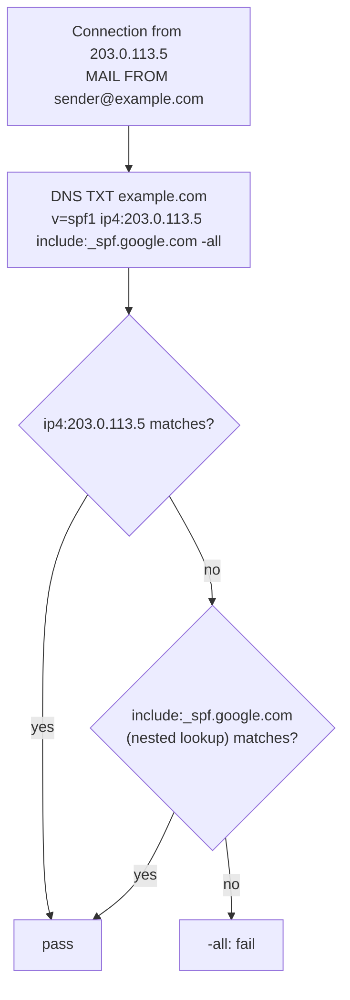

# SPF

## Summary

Sender Policy Framework (SPF, RFC 7208) lets a domain publish in DNS which servers may send mail using that domain in the SMTP envelope sender (`MAIL FROM`, the return path). A receiving server looks up the TXT record starting with `v=spf1` and evaluates its mechanisms (`ip4`, `ip6`, `a`, `mx`, `include`) against the connecting IP address, giving a result such as pass, fail, softfail or neutral. SPF reduces spoofing of envelope domains and improves deliverability, but it does not check the visible From header, does not survive forwarding, and is limited to 10 DNS lookups. It is one of three pillars with DKIM and DMARC.

## Prerequisites

- [Email overview](email-overview.md), [SMTP](smtp.md) and [DNS records](../dns/dns-records.md#txt-record).

## Core concepts

### Definition and importance

SPF is an email authentication protocol that prevents spoofing by specifying which mail servers are authorized to send for a domain. It is implemented as a DNS TXT record and works by checking the sending server's IP address against that list.

- It stops spammers from using your domain as the envelope sender in phishing and spam.
- It improves deliverability, because authenticated mail is less likely to be classified as spam.
- It works with DKIM and DMARC; SPF alone does not prevent phishing, because the visible From address is not checked.

*Analogy.* A company's list of authorized couriers posted at the reception of every building it delivers to. When a courier arrives claiming to come from the company, reception checks the list. The analogy breaks because the "company name" checked is the one on the delivery note (envelope), not the letterhead the recipient reads (From header), which is why DMARC is needed to connect the two.

### Verification process

1. A mail server (`mail.example.com`, IP `203.0.113.5`) sends mail with `MAIL FROM:<sender@example.com>`.
2. The receiving server queries DNS for the SPF record of `example.com`.
3. It evaluates the mechanisms left to right; the first match decides:
   - the IP matches an authorized mechanism: **pass**,
   - otherwise the `all` mechanism applies, typically **fail** (`-all`) or **softfail** (`~all`).
4. The receiver decides: accept on pass, mark as spam on softfail, reject on fail (or leave the decision to DMARC).



The result is recorded in a header:

```text
Received-SPF: Pass (mx.example.org: domain of sender@example.com designates 203.0.113.5 as permitted sender)
```

### Record syntax

```text
example.com.  TXT  "v=spf1 ip4:203.0.113.5 -all"
```

| Term | Description |
| --- | --- |
| `v=spf1` | SPF version; must be first |
| `ip4:203.0.113.5` | Authorizes an IPv4 address or range (`ip4:198.51.100.0/24`) |
| `ip6:2001:db8::25` | Authorizes an IPv6 address or range |
| `a` | Authorizes the domain's A and AAAA addresses |
| `mx` | Authorizes the domain's MX hosts |
| `include:_spf.google.com` | Evaluates another domain's SPF record (here Google Workspace); a pass there counts as a pass |
| `~all` | Softfail for everything else (mark, do not reject) |
| `-all` | Fail for everything else (reject unauthorized senders) |
| `redirect=_spf.example.net` | Use another domain's record instead (modifier) |

Use `~all` while testing to avoid losing mail, and `-all` once all senders are listed. Only one SPF record per domain is allowed; two records cause a permanent error.

### Mechanisms and qualifiers

| Mechanism | Description | Example |
| --- | --- | --- |
| `ip4:` | A specific IPv4 address or range | `ip4:203.0.113.5` |
| `ip6:` | A specific IPv6 address or range | `ip6:2001:db8::/48` |
| `mx` | The domain's MX hosts | `mx` |
| `a` | The domain's A and AAAA records | `a` |
| `include:` | Another domain's SPF policy | `include:_spf.google.com` |
| `exists:` | Pass if a constructed name resolves (advanced) | `exists:%{i}._spf.example.com` |
| `ptr` | Reverse DNS match; deprecated, do not use | |
| `all` | Matches everything; sets the default result | `-all`, `~all`, `?all` |

Each mechanism can carry a qualifier:

| Qualifier | Result | Typical action |
| --- | --- | --- |
| `+` (default) | Pass | Accept |
| `-` | Fail | Reject |
| `~` | Softfail | Accept but mark as suspicious |
| `?` | Neutral | No assertion; treated like no policy |

Example: `v=spf1 a mx include:_spf.google.com ~all` allows the domain's A and MX hosts and Google Workspace, and soft-fails everything else.

### Implementation

1. **Identify all senders**: your own mail servers (Postfix, Sendmail), providers (Google Workspace, Microsoft 365, SendGrid), marketing and transactional services (Mailchimp, Amazon SES), ticketing and CRM systems.
2. **Create the record**, for example for Google Workspace only:

   ```text
   v=spf1 include:_spf.google.com -all
   ```

   or for several senders:

   ```text
   v=spf1 ip4:203.0.113.5 ip4:198.51.100.10 include:_spf.google.com include:sendgrid.net -all
   ```

3. **Publish** the TXT record at the DNS provider (Cloudflare, Amazon Route 53, the registrar's DNS).
4. **Verify**:

   ```bash
   dig TXT example.com +short       # or: nslookup -type=TXT example.com
   # "v=spf1 ip4:203.0.113.5 include:_spf.google.com -all"
   ```

### Limitations and workarounds

**Ten-lookup limit.** Evaluating a record may cause at most 10 DNS lookups (each `include`, `a`, `mx`, `exists` and `redirect` counts, including nested ones); exceeding it is a permanent error (`permerror`), which fails SPF. Large providers' includes often contain several lookups each, so a record like this easily exceeds the limit:

```text
v=spf1 include:_spf.google.com include:sendgrid.net include:servers.mcsv.net include:amazonses.com include:spf.protection.outlook.com -all
```

Workarounds: remove unused senders, replace includes with `ip4` and `ip6` ranges ("flattening", manually or with a flattening service such as EasySPF, which must keep the ranges up to date), or send different streams from subdomains (`news.example.com`) with their own SPF records.

**Forwarding breaks SPF.** When mail is forwarded, the forwarder's IP connects to the final receiver but is not in the original sender's SPF record, so SPF fails. Remedies: DKIM signatures survive forwarding if the message is not modified, and DMARC passes if either SPF or DKIM passes in alignment; forwarders can use SRS (Sender Rewriting Scheme) to rewrite the envelope sender, and ARC preserves authentication results across intermediaries.

### SPF, DKIM and DMARC

| Feature | SPF | DKIM | DMARC |
| --- | --- | --- | --- |
| Purpose | Authorizes sending IPs for the envelope domain | Cryptographically signs messages | Policy and reporting tied to the visible From domain |
| Protects against | Envelope spoofing | Tampering, forged signing domain | Direct From-domain spoofing and phishing |
| Works with | SMTP envelope | Message headers and body | SPF and DKIM results |
| DNS location | TXT at the domain | TXT at `selector._domainkey.domain` | TXT at `_dmarc.domain` |

SPF should always be combined with DKIM and DMARC.

## Worked example

Count the DNS lookups of an SPF record before publishing it. Untested; Python 3.12 with dnspython 2.6, checked 2026-11.

```python
import dns.resolver   # pip install dnspython

def spf_lookups(domain, depth=0):
    txt = [r.to_text().strip('"') for r in dns.resolver.resolve(domain, "TXT")]
    spf = next(t for t in txt if t.startswith("v=spf1"))
    count = 0
    for term in spf.split()[1:]:
        name = term.lstrip("+-~?")
        if name.startswith(("include:", "redirect=")):
            count += 1 + spf_lookups(name.split(":", 1)[-1].split("=", 1)[-1], depth + 1)
        elif name.startswith(("a", "mx", "exists:")) and not name.startswith("all"):
            count += 1
    return count

n = spf_lookups("example.com")
print(n, "lookups", "OK" if n <= 10 else "PERMERROR risk")
```

## Trade offs and when to use it

- **`-all`** gives the strongest signal but rejects mail from any forgotten sender; **`~all`** is safer during rollout; with DMARC at `p=reject`, many receivers rely on DMARC and treat `~all` and `-all` similarly.
- **Flattening** solves the lookup limit but goes stale when providers change IP ranges.

## Common mistakes

- **Two SPF records** for one domain. Fix: merge into one.
- **`+all`** or `?all`, which authorize everyone. Fix: `-all` or `~all`.
- **Forgetting subdomains and non-sending domains.** Attackers use them. Fix: `v=spf1 -all` for domains that never send mail.
- **Exceeding 10 lookups.** Fix: count lookups after every change.

## Practice

1. Which address does SPF check, the envelope sender or the From header?
2. What does `~all` mean?
3. Why does forwarding break SPF, and what keeps authentication passing?
4. What happens when an SPF record needs 12 DNS lookups?

Answers:

1. The envelope sender (MAIL FROM, return path), or the HELO name when the envelope sender is empty.
2. Softfail: mail from unlisted servers should be accepted but treated as suspicious.
3. The forwarding server's IP is not in the original domain's SPF record; DKIM (if the message is unchanged) and DMARC alignment on DKIM keep it passing.
4. Evaluation stops with a permanent error, which counts as an SPF failure.

## Further reading

- [RFC 7208: Sender Policy Framework (SPF) for Authorizing Use of Domains in Email, Version 1](https://www.rfc-editor.org/rfc/rfc7208) (IETF, 2014).
- [RFC 8617: The Authenticated Received Chain (ARC) Protocol](https://www.rfc-editor.org/rfc/rfc8617) (IETF, 2019).
- [Google: Set up SPF](https://support.google.com/a/answer/33786) (Google Workspace Admin Help).
