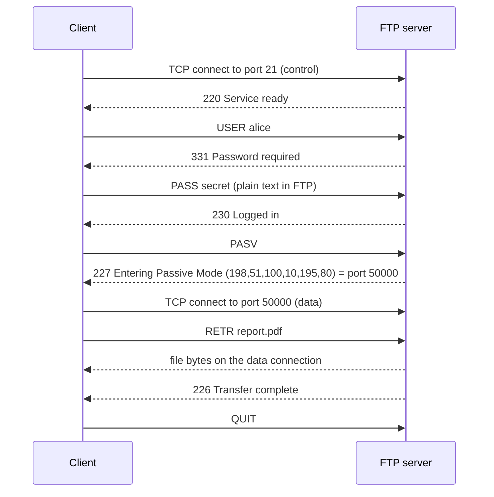

# FTP

## Summary

The File Transfer Protocol (FTP, RFC 959, 1985) transfers files between a client and a server over TCP using two connections: a control connection on port 21 for commands and replies, and separate data connections for listings and file contents, opened either by the server (active mode) or by the client (passive mode). Plain FTP sends usernames, passwords and data unencrypted and is awkward through firewalls and NAT, so its secure relatives are used instead: FTPS adds TLS to FTP, and SFTP is an entirely different protocol that runs inside SSH on port 22. TFTP is a minimal, unauthenticated UDP protocol used for network booting and device firmware.

## Prerequisites

- [TCP/IP model](../network-models/tcp-ip-model.md), [Ports](../transport-layer/ports.md), [NAT](../internet-layer/nat.md).

## Core concepts

### How FTP works

FTP follows a client-server model: a client connects to an FTP server to upload, download or manage files.

*Analogy.* Calling a warehouse to order goods. You talk to the clerk on the phone line (control connection), and the goods arrive in a separate truck (data connection). In active mode the warehouse sends the truck to your gate (and your guard may refuse it); in passive mode you drive to a loading dock number the clerk gives you. The analogy breaks because FTP opens a new "truck" connection for every file and every directory listing.

1. **Connection establishment**: the client connects to the server's control port 21 and authenticates with a username and password, or anonymously if the server allows it.
2. **Data transfer mode**:
   - **Active mode**: the client opens a random port X and tells the server with the `PORT` command; the server opens the data connection *from its port 20 to the client's port X*. Client firewalls and NAT usually block this inbound connection.
   - **Passive mode** (firewall-friendly): the client sends `PASV` (or `EPSV`), the server opens a random port Y and tells the client, and the client connects to port Y. The server's firewall must allow the passive port range.
3. **Commands and responses** on the control connection:

   ```text
   USER username      send the user name
   PASS password      send the password (in plain text)
   LIST               list the directory (over a data connection)
   RETR filename      download a file
   STOR filename      upload a file
   PASV / EPSV        request passive mode
   QUIT               end the session
   ```

   Reply codes: `200` command successful, `220` service ready, `226` transfer complete, `230` user logged in, `331` user name OK, need password, `425` can't open data connection, `530` not logged in.
4. **File transfer** in **ASCII** mode (text, line endings converted) or **binary** (image) mode, byte for byte; use binary for everything except plain text to avoid corruption.
5. **Session termination** with `QUIT`.



### Variants

**FTPS (FTP Secure, FTP over SSL/TLS).** FTP with TLS encryption for authentication and data.

- **Explicit FTPS (FTPES)**, recommended: the client connects to port 21 and upgrades with `AUTH TLS` (the FTP equivalent of STARTTLS).
- **Implicit FTPS**: TLS starts immediately on port 990 (legacy, not standardized).
- URL form: `ftps://ftp.example.com`.
- Encrypted control connections prevent firewalls from reading the dynamic data ports, so passive port ranges must be opened explicitly.

**SFTP (SSH File Transfer Protocol).** A completely different protocol from FTP and FTPS: a subsystem of SSH on port 22 over one encrypted connection. It provides encryption, authentication and integrity, and supports file transfers and remote file operations (rename, delete, change permissions).

```bash
sftp username@files.example.com
put myfile.txt   # upload
get myfile.txt   # download
```

**TFTP (Trivial File Transfer Protocol).** A lightweight protocol over UDP port 69, used for network device firmware updates, configuration backups and network booting (PXE). It has no authentication and no encryption and should run only on isolated management networks.

```bash
tftp 192.0.2.1
put firmware.bin
get config.txt
```

### Comparison

| Feature | FTP | FTPS | SFTP | TFTP |
| --- | --- | --- | --- | --- |
| Transport | TCP (control plus data connections) | TCP plus TLS | One SSH connection over TCP | UDP |
| Security | None | Encrypted (TLS) | Encrypted (SSH) | None |
| Authentication | Username and password in plain text | Username and password over TLS, optional client certificates | SSH passwords or keys (or certificates) | None |
| Port | 21 (control), 20 or dynamic (data) | 21 (explicit) or 990 (implicit), plus data ports | 22 | 69 |
| Firewall and NAT friendliness | Poor | Poor (encrypted control channel) | Good (single port) | Fine on a LAN |
| Use case | Legacy systems | Secure enterprise and partner transfers where FTP clients exist | Secure remote file management, automation | Network bootstrapping, firmware |

### Best practices for secure file transfer

1. **Use SFTP or FTPS instead of FTP**: plain FTP exposes credentials and data.
2. **Disable anonymous FTP** unless intentionally publishing public files read-only.
3. **Restrict file permissions** on uploaded files (`chmod`) and chroot users into their directories.
4. **Firewall rules**: allow only required ports (21 plus a fixed passive range for FTP/FTPS, 22 for SFTP, 990 if implicit FTPS); prefer passive mode for FTP.
5. **Log and monitor transfers** to detect suspicious activity.
6. **Consider alternatives**: HTTPS uploads, object storage with pre-signed URLs, or managed transfer services often replace FTP-style exchanges.

## Worked example

Offer SFTP-only access for a partner, chrooted to one directory, with OpenSSH. Untested; OpenSSH 9.x on Ubuntu 24.04, checked 2026-11.

```text
# /etc/ssh/sshd_config.d/sftp-partners.conf
Match Group sftp-partners
    ChrootDirectory /srv/sftp/%u          # directory must be owned by root and not writable by the user
    ForceCommand internal-sftp            # no shell, SFTP only
    AllowTcpForwarding no
    X11Forwarding no
    PasswordAuthentication no
```

```bash
sudo groupadd sftp-partners
sudo useradd -g sftp-partners -s /usr/sbin/nologin partner1
sudo install -d -o root -g root -m 755 /srv/sftp/partner1
sudo install -d -o partner1 -g sftp-partners -m 750 /srv/sftp/partner1/upload
sudo sshd -t && sudo systemctl reload ssh
sftp -i partner1_key partner1@files.example.com    # sees only /upload
```

## Trade offs and when to use it

- **SFTP** is the default choice: one port, strong authentication, available wherever SSH is.
- **FTPS** when partners require FTP-compatible clients or certificate-based policies.
- **FTP** only for legacy integrations on isolated networks; **TFTP** only for booting and device management on trusted segments.

## Common mistakes

- **Confusing SFTP and FTPS.** They are unrelated protocols with different ports and clients.
- **ASCII mode for binary files.** Corrupted archives and images. Fix: binary mode.
- **Not opening the passive range** on the server firewall. Logins succeed but listings hang (`425`). Fix: fixed passive range in the server and firewall.
- **TFTP reachable from untrusted networks.** Anyone can read or overwrite files. Fix: management network only.

## Practice

1. Why does active-mode FTP fail behind most client firewalls?
2. What is the difference between explicit and implicit FTPS?
3. Which port and protocol does SFTP use?
4. Why is TFTP used for network booting despite its lack of security?

Answers:

1. The server opens the data connection inbound to the client, which client firewalls and NAT block.
2. Explicit FTPS starts on port 21 and upgrades with `AUTH TLS`; implicit FTPS starts TLS immediately on port 990.
3. TCP port 22, as a subsystem of SSH.
4. It is tiny and simple enough to implement in network card firmware and boot ROMs.

## Further reading

- [RFC 959: File Transfer Protocol](https://www.rfc-editor.org/rfc/rfc959) (IETF, 1985).
- [RFC 4217: Securing FTP with TLS](https://www.rfc-editor.org/rfc/rfc4217) (IETF, 2005).
- [RFC 1350: The TFTP Protocol (Revision 2)](https://www.rfc-editor.org/rfc/rfc1350) (IETF, 1992).
- [sftp(1)](https://man.openbsd.org/sftp) and [sshd_config(5)](https://man.openbsd.org/sshd_config) (OpenBSD manual pages, OpenSSH).
