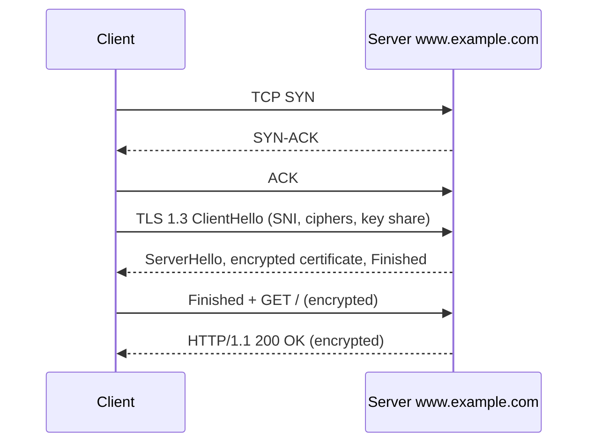

# HTTP and HTTPS

## Summary

HTTP (Hypertext Transfer Protocol) is the application protocol of the web: a client sends a request (method, target, headers, optional body) and a server answers with a status code, headers and a body. It is stateless, so state lives in cookies, tokens or the server's storage. HTTPS is HTTP inside TLS, which adds encryption, server authentication by certificate and integrity; it uses port 443 and is now the default for practically all traffic. The protocol evolved from HTTP/1.0 through persistent connections in HTTP/1.1 to binary, multiplexed HTTP/2 and HTTP/3 over QUIC (UDP). Almost everything in DevOps (APIs, health checks, load balancers, ingress, webhooks) speaks HTTP, so reading requests, responses and status codes fluently is essential.

## Prerequisites

- [TCP/IP model](../network-models/tcp-ip-model.md), [Ports](../transport-layer/ports.md), [DNS overview](dns/dns-overview.md).
- [SSL and TLS](../network-security/ssl-and-tls.md) for the details of the handshake.

## Core concepts

### HTTP characteristics

1. **Stateless**: each request is independent; the protocol keeps no session between requests (applications add cookies or tokens).
2. **Plain text** (HTTP without TLS): data travels unencrypted and can be read or modified in transit.
3. **Client-server model**: the client (browser, `curl`, service) sends requests; the server responds with resources or status codes.

*Analogy.* Ordering at a counter where the clerk has no memory: every order slip must contain everything needed (stateless), the slip has a fixed form (method, target, headers), and the clerk answers with a numbered result ("200, here it is", "404, we don't have it"). HTTPS is the same counter behind a sealed glass window with an ID badge you can verify. The analogy breaks with HTTP/2, where many order slips travel interleaved on one conveyor belt.

### Request and response structure

A request has a request line, headers, an empty line and an optional body:

```text
POST /api/orders HTTP/1.1
Host: www.example.com
User-Agent: curl/8.5.0
Content-Type: application/json
Content-Length: 27

{"item":"book","qty":2}
```

- **Request line**: method, target resource and protocol version (`GET /index.html HTTP/1.1`).
- **Headers**: metadata such as `Host` (required in HTTP/1.1, lets one IP serve many sites), `User-Agent`, `Accept`, `Authorization`, `Cookie`.
- **Body** (optional): data sent to the server, such as form fields or JSON.

A response has a status line, headers and a body:

```text
HTTP/1.1 201 Created
Content-Type: application/json
Content-Length: 18
Location: /api/orders/42

{"id":42,"ok":true}
```

### Methods

| Method | Purpose | Safe | Idempotent |
| --- | --- | --- | --- |
| GET | Retrieve a resource | Yes | Yes |
| HEAD | Like GET, headers only (metadata without the body) | Yes | Yes |
| POST | Submit data, create a subordinate resource or trigger processing | No | No |
| PUT | Create or replace a resource at a known URL | No | Yes |
| PATCH | Partially modify a resource | No | No (in general) |
| DELETE | Remove a resource | No | Yes |
| OPTIONS | Describe communication options (used in CORS preflight) | Yes | Yes |

*Safe* methods do not change server state; *idempotent* methods have the same effect when repeated, which matters for retries in proxies, load balancers and clients.

### Status codes

| Class | Meaning | Examples |
| --- | --- | --- |
| 1xx | Informational | `100 Continue`, `101 Switching Protocols` (WebSocket upgrade) |
| 2xx | Success | `200 OK`, `201 Created`, `204 No Content` |
| 3xx | Redirection | `301 Moved Permanently`, `302 Found`, `304 Not Modified` (cache), `308 Permanent Redirect` |
| 4xx | Client error | `400 Bad Request`, `401 Unauthorized` (not authenticated), `403 Forbidden` (not allowed), `404 Not Found`, `429 Too Many Requests` |
| 5xx | Server error | `500 Internal Server Error`, `502 Bad Gateway` (proxy got an invalid upstream response), `503 Service Unavailable`, `504 Gateway Timeout` |

For operations, 502 and 504 usually point at a reverse proxy or load balancer that cannot reach or wait for its backend ([Reverse proxy](../traffic-management/reverse-proxy.md)).

### Versions

| Version | Year | Main features |
| --- | --- | --- |
| HTTP/0.9 | 1991 | Only `GET`, no headers, HTML only |
| HTTP/1.0 | 1996 | Headers, status codes, content types; one request per connection |
| HTTP/1.1 | 1997 (RFC 9112 today) | Persistent connections (keep-alive), `Host` header, chunked transfer encoding, caching controls |
| HTTP/2 | 2015 (RFC 9113) | Binary framing, multiplexing many streams on one TCP connection, HPACK header compression |
| HTTP/3 | 2022 (RFC 9114) | Runs on QUIC over UDP: no TCP head-of-line blocking, faster setup, connection migration |

### HTTPS

HTTPS is HTTP over TLS (historically SSL). It ensures confidentiality, integrity and authenticity of web traffic.

1. **Encryption**: data in transit is encrypted with symmetric session keys.
2. **Authentication**: the server proves its identity with a TLS certificate.
3. **Integrity**: tampering in transit is detected.
4. **Port**: HTTPS uses 443; HTTP uses 80.

How it works, in short: a TLS handshake exchanges keys, the server sends its certificate, the client validates it against trusted certificate authorities (CAs), and then the HTTP exchange is encrypted with a session key.

Benefits:

1. **Security**: protects credentials, payment details and personal data.
2. **Trust**: browsers mark plain HTTP pages as "Not secure"; HTTPS is required for many browser features (service workers, geolocation, HTTP/2 in browsers).
3. **SEO**: search engines use HTTPS as a ranking signal.

Certificate validation levels:

1. **Domain Validation (DV)**: proves control of the domain (automated, for example by Let's Encrypt with ACME).
2. **Organization Validation (OV)**: also verifies the organization's identity.
3. **Extended Validation (EV)**: the strictest identity checks; browsers used to show the company name in the address bar, but Chrome and Firefox removed that indicator in 2019, so EV offers little visible benefit today.

### HTTP compared with HTTPS

| Feature | HTTP | HTTPS |
| --- | --- | --- |
| Encryption | None | Encrypted with TLS |
| Authentication | None | Server authenticated by certificate (client optionally, with mTLS) |
| Port | 80 | 443 |
| Security | Open to eavesdropping and tampering | Protected in transit |
| Use cases | Redirects to HTTPS, local development, some internal traffic | Everything else, especially sensitive transactions such as banking |

### In depth: an HTTP request

HTTP is a stateless application protocol on the TCP/IP stack.

1. **DNS resolution**: the client resolves the name (`www.example.com`) to an IP address.
2. **TCP connection** to port 80 with the three-way handshake: SYN (client asks to synchronize), SYN-ACK (server acknowledges and synchronizes), ACK (client confirms).
3. **Request and response**: the client sends `GET /index.html HTTP/1.1` with `Host: www.example.com`; the server responds with `HTTP/1.1 200 OK`, headers such as `Content-Type: text/html` and `Content-Length: 123`, and the HTML body.
4. **Connection handling**: HTTP/1.1 keeps connections open by default (persistent) for further requests unless `Connection: close` is sent; HTTP/1.0 closed them unless `Connection: keep-alive` was used.

### In depth: an HTTPS request

1. **DNS resolution**, as for HTTP.
2. **TCP connection** to port 443.
3. **TLS handshake** before any HTTP data:
   1. **ClientHello**: supported TLS versions and cipher suites, a random number, the server name (SNI) and, in TLS 1.3, key shares.
   2. **ServerHello**: the chosen version and cipher suite and the server's random value (and key share).
   3. **Certificate and verification**: the server sends its certificate chain (encrypted in TLS 1.3), and the client verifies it against trusted CAs, the host name and the validity period.
   4. **Key exchange**: ECDHE (ephemeral Diffie-Hellman) in TLS 1.3; TLS 1.2 also allowed static RSA key exchange, which lacks forward secrecy.
   5. **Session keys**: both sides derive symmetric keys from the exchanged secrets.
   6. **Finished**: each side sends a message protected with the new keys to confirm the handshake was not tampered with.
4. **Encrypted HTTP**: requests and responses travel encrypted and integrity-protected.
5. **Termination**: a TLS close notification, then the TCP connection closes.



TLS 1.3 needs one round trip for the handshake (TLS 1.2 needed two), and resumed sessions can send data immediately (0-RTT, with replay caveats).

### Technologies behind HTTP and HTTPS

1. **TCP/IP stack**: reliable delivery through segmentation, acknowledgments and retransmission; HTTPS adds TLS on top without changing TCP.
2. **SSL/TLS**: SSL is the obsolete predecessor (all SSL versions are insecure and disabled); TLS 1.2 and 1.3 are the current versions.
3. **Certificates**: issued by CAs, containing the public key, domain names (subject alternative names), validity period and issuer. Self-signed certificates are fine for internal testing but not trusted publicly.
4. **Cipher suites**: define the algorithms. In TLS 1.3, `TLS_AES_128_GCM_SHA256` means AES-128 encryption in GCM mode (authenticated encryption) with SHA-256 used for key derivation (HKDF); key exchange and signature algorithms are negotiated separately.
5. **Session resumption**: TLS 1.2 uses session IDs or session tickets; TLS 1.3 uses pre-shared keys from tickets and optionally 0-RTT data.

### Optimizations in HTTP/2 and HTTP/3

**HTTP/2**:

- **Multiplexing**: many requests and responses in parallel over one connection, removing HTTP/1.1's head-of-line blocking at the HTTP level.
- **Header compression** with HPACK.
- **Server push**: the server could send resources proactively; it was rarely beneficial and Chrome removed support in 2022, so treat it as deprecated (use `103 Early Hints` and preload instead).
- **Persistent connections**: one long-lived TCP connection per origin.

**HTTP/3**:

- Uses **QUIC** over UDP, which combines transport and TLS 1.3 handshakes, so connections start faster.
- **No TCP head-of-line blocking**: a lost packet delays only its own stream.
- **Connection migration**: connections survive changes of IP address or network (Wi-Fi to mobile) because they are identified by connection IDs.

## Worked example

Inspect a request with `curl`. Untested; curl 8.x with HTTP/2 and HTTP/3 support, checked 2026-11.

```bash
curl -sv https://www.example.com/ -o /dev/null 2>&1 | grep -E '^\*|^>|^<' | head -20
```

Typical output (shortened):

```text
* Connected to www.example.com (93.184.215.14) port 443
* SSL connection using TLSv1.3 / TLS_AES_256_GCM_SHA384
* Server certificate: subject: CN=www.example.org ... issuer: ... expire date: ...
* using HTTP/2
> GET / HTTP/2
> Host: www.example.com
< HTTP/2 200
< content-type: text/html; charset=UTF-8
< cache-control: max-age=604800
```

More checks:

```bash
curl -sI http://www.example.com/              # plain HTTP: expect 301 to https://
curl -s -o /dev/null -w '%{http_code} %{time_connect} %{time_appconnect} %{time_total}\n' https://www.example.com/
# 200 0.021 0.065 0.110   <- TCP connect, TLS done, total (seconds)
curl --http3 -sI https://www.cloudflare.com/ | head -1   # HTTP/3 if supported
```

The timing line separates network latency (TCP), TLS handshake cost and server time, which tells you where a slow request spends its time.

## Trade offs and when to use it

- **HTTPS everywhere**, including internal service traffic where feasible (or mTLS through a service mesh); certificate automation (ACME, cert-manager) removes most of the cost.
- **HTTP/2** helps browsers with many small resources; **HTTP/3** helps on lossy and mobile networks, but some corporate networks block UDP 443, so clients fall back to HTTP/2.
- **TLS termination at a load balancer** simplifies certificates but leaves traffic unencrypted behind it unless re-encrypted.

## Common mistakes

- **Mixed content**: HTTPS pages loading HTTP resources are blocked. Fix: HTTPS URLs for all resources.
- **Missing HSTS**: users can be downgraded to HTTP on first visit. Fix: `Strict-Transport-Security` header (and preload for important domains).
- **Expired certificates.** Fix: automated renewal and monitoring of expiry dates.
- **Retrying non-idempotent POSTs blindly** in proxies or clients, causing duplicate orders. Fix: idempotency keys or retry only idempotent methods.
- **Confusing 401 and 403.** 401 means "authenticate"; 403 means "authenticated but not allowed".

## Practice

1. Why does HTTP/1.1 require the `Host` header?
2. Which status code does a reverse proxy return when its backend times out?
3. What does HTTP/3 change at the transport layer, and what problem does it solve?
4. Which methods are idempotent?

Answers:

1. So that one IP address can host many sites (name-based virtual hosting); the server needs the requested host name.
2. `504 Gateway Timeout` (and `502 Bad Gateway` for invalid or refused upstream responses).
3. It runs over QUIC on UDP instead of TCP, which removes TCP head-of-line blocking and speeds up connection setup.
4. GET, HEAD, OPTIONS, PUT and DELETE.

## Further reading

- [RFC 9110: HTTP Semantics](https://www.rfc-editor.org/rfc/rfc9110) (IETF, 2022), with RFC 9111 (caching), RFC 9112 (HTTP/1.1), RFC 9113 (HTTP/2) and RFC 9114 (HTTP/3).
- [RFC 8446: The Transport Layer Security (TLS) Protocol Version 1.3](https://www.rfc-editor.org/rfc/rfc8446) (IETF, 2018).
- [MDN Web Docs: HTTP](https://developer.mozilla.org/en-US/docs/Web/HTTP) (Mozilla).
- *HTTP: The Definitive Guide* (David Gourley, Brian Totty, O'Reilly, 2002): the classic reference for HTTP/1.1 concepts.
